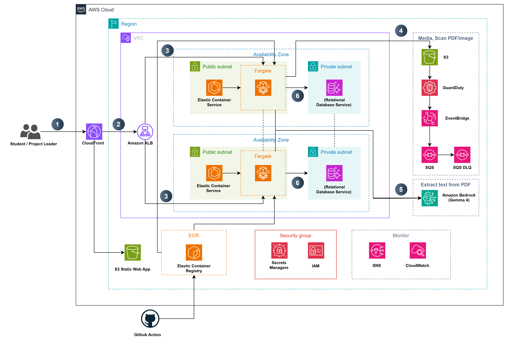

# Tindy — Nền tảng tìm dự án và đồng đội trên AWS

## 1. Tóm tắt đề xuất

Tindy là ứng dụng web giúp sinh viên và người mới đi làm tìm dự án phù hợp với kỹ năng và thời gian có thể tham gia. Trưởng nhóm đăng nhu cầu theo từng vị trí, theo dõi đơn ứng tuyển và chủ động mời ứng viên. Khi một ứng viên được chấp nhận, Tindy cập nhật danh sách thành viên và số chỗ của vị trí để cả hai bên thấy cùng một trạng thái.

Bản demo đề xuất tại **US East (N. Virginia), `us-east-1`**. CloudFront phân phối giao diện React từ S3 và chuyển yêu cầu động đến API ASP.NET Core chạy trên ECS Fargate. API sử dụng RDS PostgreSQL cho dữ liệu nghiệp vụ. S3 media lưu tài liệu riêng tư, còn GuardDuty và Amazon Bedrock lần lượt hỗ trợ quét PDF và tạo bản nháp hồ sơ.

## 2. Bài toán và phạm vi

### Bài toán

Thông tin tuyển thành viên thường nằm rải rác trong nhóm chat, bài đăng và biểu mẫu. Ứng viên khó biết vị trí nào còn tuyển, cần kỹ năng gì và phải dành bao nhiêu giờ mỗi tuần. Trưởng nhóm phải hỏi lại những thông tin này và theo dõi đơn, lời mời và số chỗ còn trống qua nhiều kênh. Tindy tập trung các thông tin đó theo từng dự án và vị trí.

### Phạm vi bản trình diễn

| Luồng | Người thực hiện | Kết quả trên Tindy |
| --- | --- | --- |
| Tạo hồ sơ | Thành viên hoàn thành onboarding và nhập kỹ năng, vai trò mong muốn, kinh nghiệm và số giờ có thể tham gia. Có thể dùng văn bản hoặc CV PDF đủ điều kiện để tạo bản nháp. | Hồ sơ được cập nhật sau khi chủ hồ sơ xem lại và lưu. |
| Ứng tuyển | Trưởng nhóm đăng vị trí đang mở. Thành viên tìm dự án, chọn vị trí rồi xác nhận gửi đơn. Trưởng nhóm xem đơn và quyết định. | Đơn ở trạng thái **Pending** sau khi gửi. Khi được chấp nhận, thành viên xuất hiện trong dự án và số chỗ đã dùng của vị trí tăng. |
| Mời đồng đội | Trưởng nhóm chọn dự án và vị trí, xem ứng viên đã bật nhận lời mời, rồi gửi lời mời. Ứng viên xem thông báo và phản hồi. | Lời mời đang chờ giữ trạng thái **Pending**. Khi ứng viên chấp nhận và API xác minh còn đủ điều kiện, hệ thống tạo membership và cập nhật số chỗ. |
| Trao đổi | Thành viên nhắn tin cá nhân hoặc tham gia phòng chat của dự án theo quyền. | Người có quyền xem tin nhắn mới trong đúng cuộc trò chuyện. |
| Vận hành | Người vận hành phát hành web và API, kiểm tra trạng thái dịch vụ, sao lưu dữ liệu và dựng lại môi trường khi cần. | Có thông tin phiên bản, kết quả kiểm tra và bản sao lưu để đối chiếu khi phục hồi. |

### Cách tính và diễn giải điểm phù hợp

API tính điểm theo từng vị trí dựa trên bốn tiêu chí với trọng số gốc: **kỹ năng bắt buộc 40%, vai trò mong muốn 30%, số giờ có thể tham gia 20% và kỹ năng bổ sung 10%**. Nếu vị trí không khai báo một nhóm kỹ năng hoặc không đủ dữ liệu để tính mức sẵn sàng, API chuẩn hóa lại trọng số các tiêu chí còn áp dụng. Khi ứng viên chưa chọn vai trò mong muốn, tiêu chí vai trò nhận điểm 0.

Ví dụ, một ứng viên có đủ kỹ năng bắt buộc và bổ sung, đúng vai trò nhưng chỉ có 5 giờ mỗi tuần so với 10 giờ dự án cần sẽ nhận **90/100**. Điểm này giúp người dùng hiểu mức độ phù hợp. Quyết định tuyển chọn vẫn do người dùng thực hiện. Khi xác nhận chấp nhận, API kiểm tra lại quyền, trạng thái dự án và số chỗ tại thời điểm xử lý.

### Lợi ích và cách đánh giá hiệu quả

Với **thành viên**, trang khám phá cho biết dự án cần tuyển vị trí nào, kỳ vọng bao nhiêu giờ mỗi tuần và kỹ năng nào còn thiếu. Một hồ sơ có thể dùng lại khi xem các vị trí khác nhau. Với **trưởng nhóm**, đơn ứng tuyển và lời mời được theo dõi theo dự án và vị trí. Khi tuyển được người, trạng thái ứng tuyển, danh sách thành viên và số chỗ đã dùng có thể được đối chiếu từ cùng một nguồn dữ liệu.

Tác động của đề xuất sẽ được đo trong phạm vi thử nghiệm. Với luồng tuyển người, ghi số thao tác và thời gian từ lúc chọn vị trí đến lúc cả hai bên xác nhận trạng thái. Với hồ sơ, dùng cùng bộ thông tin mẫu để đo thời gian nhập thủ công và thời gian tạo, duyệt, sửa bản nháp AI. Chi phí hạ tầng, thời gian chuẩn bị demo và công sức rà soát gợi ý là các đầu vào để đánh giá hiệu quả sau thử nghiệm.

## 3. Kiến trúc giải pháp

*Sơ đồ kiến trúc Tindy dùng cho đề xuất. Phần dưới diễn giải các điểm đánh số theo cấu hình và mã nguồn trong repository.*

| Bước | Thành phần | Luồng xử lý |
| --- | --- | --- |
| 1 | Amazon CloudFront và S3 frontend | Người dùng mở web qua HTTPS. CloudFront phân phối bản build React/Vite từ bucket S3 riêng tư. Origin Access Control (OAC) giới hạn đường đọc nội dung frontend qua distribution. |
| 2 | CloudFront VPC Origin và Application Load Balancer | Các đường dẫn động như `/api/*`, `/hubs/*` và callback đăng nhập được chuyển đến ALB nội bộ. Cùng một hostname phục vụ web và API, với cache tắt cho các đường dẫn động này. [CloudFront VPC origins](https://docs.aws.amazon.com/AmazonCloudFront/latest/DeveloperGuide/private-content-vpc-origins.html) |
| 3 | Amazon ECS, AWS Fargate và Amazon ECR | ECS chạy container API ASP.NET Core .NET 10 từ image trong ECR. API xử lý xác thực, hồ sơ, tìm dự án, tuyển thành viên và chat qua SignalR. ALB dùng health check để theo dõi tình trạng task. |
| 4 | S3 media, GuardDuty, EventBridge và SQS | S3 riêng tư lưu nội dung media. PDF chứng chỉ và PDF đầu vào AI đi qua luồng quét. EventBridge chuyển kết quả GuardDuty vào SQS để worker cập nhật trạng thái tài liệu. Dead-letter queue (DLQ) giữ thông điệp lỗi cần rà soát. |
| 5 | Amazon Bedrock | Với PDF đầu vào AI, backend xác nhận kết quả quét sạch cho đúng đối tượng trước khi cho phép trích xuất. Người dùng cũng có thể gửi văn bản. Backend kiểm tra đầu ra và trả bản nháp gồm các trường hồ sơ, kỹ năng, kinh nghiệm, chứng chỉ và cảnh báo để người dùng duyệt. |
| 6 | Amazon RDS for PostgreSQL | PostgreSQL 17 lưu dữ liệu có cấu trúc như tài khoản, hồ sơ, dự án, vị trí, đơn ứng tuyển, lời mời và tin nhắn. RDS đặt trong private subnet, yêu cầu TLS và giới hạn truy cập bằng security group. |

### Ba luồng qua sơ đồ

**Truy cập ứng dụng và cập nhật dữ liệu (1 → 2 → 3 → 6).** Trình duyệt tải giao diện từ S3 qua CloudFront. Khi người dùng mở danh sách dự án, gửi đơn hoặc kết nối chat, CloudFront chuyển yêu cầu động qua VPC origin đến ALB nội bộ. ALB chọn Fargate task khỏe. API kiểm tra JWT và quyền trên dự án hoặc cuộc trò chuyện trước khi đọc hoặc ghi vào PostgreSQL. Web, API và chat dùng cùng hostname.

**Tải chứng chỉ và kiểm tra PDF (3 → 4).** API tiếp nhận hồ sơ media và lưu PDF vào S3 riêng tư. GuardDuty quét tệp, EventBridge chuyển kết quả vào SQS, rồi worker đối chiếu kết quả với đúng đối tượng hoặc phiên bản S3 và cập nhật trạng thái. Khi kết quả còn chờ hoặc tệp chưa đủ điều kiện, API chặn thao tác đọc hoặc trích xuất tương ứng. Thông điệp xử lý thất bại sau số lượt thử cấu hình được đưa vào DLQ để kiểm tra.

**Trích xuất hồ sơ (4 → 5 → 3 → 6).** Tài liệu AI đã quét sạch có thể được đưa vào bước trích xuất. Với đầu vào văn bản, người dùng gửi nội dung trực tiếp. Backend gửi yêu cầu đến Bedrock, kiểm tra dữ liệu trả về và hiển thị bản nháp hồ sơ, kỹ năng, kinh nghiệm và chứng chỉ. Khi người dùng xem lại, sửa và xác nhận lưu, API mới ghi dữ liệu được chọn vào PostgreSQL.

**Mạng và tính sẵn sàng.** VPC có subnet ở hai Availability Zone. ALB là internal, còn Fargate task trong cấu hình hiện tại dùng public subnet và được cấp public IPv4. Security group giới hạn đường vào API từ ALB. Runbook demo sử dụng **một Fargate task** và template database đặt **RDS Single-AZ**. Hai vùng trong sơ đồ mô tả cách bố trí subnet. Để mở rộng sang nhiều task, cần kiểm thử lại SignalR giữa các task và luồng xử lý sự kiện nền trước khi tăng số lượng.

**Bảo mật và vận hành.** Hai S3 bucket phục vụ frontend và media có vai trò riêng. Backend xác thực JWT và kiểm tra quyền ở cấp tài nguyên. Secrets Manager giữ thông tin kết nối và các cấu hình nhạy cảm, còn GitHub Actions dùng OIDC để nhận quyền phát hành theo vai trò. CloudWatch thu log và theo dõi tình trạng target, lỗi HTTP 5xx và DLQ. SNS gửi cảnh báo khi tích hợp thông báo được cấu hình.

### Các thành phần và lý do lựa chọn

| Lớp | Trách nhiệm trong cấu hình demo | Lý do lựa chọn |
| --- | --- | --- |
| Web | React và Vite tạo bản build tĩnh. CloudFront đọc từ S3 qua Origin Access Control và phục vụ các đường dẫn ứng dụng. | Có thể phát hành giao diện độc lập. Các tài nguyên tĩnh có chính sách cache riêng với dữ liệu phiên và API. |
| API | ASP.NET Core chạy trong ECS Fargate. ECR giữ image của các bản phát hành. ALB kiểm tra readiness và định tuyến đến task. | Có thể đối chiếu một phiên bản đang chạy với image digest và triển khai bản mới có kiểm tra sức khỏe. |
| Dữ liệu nghiệp vụ | RDS PostgreSQL lưu hồ sơ, quan hệ thành viên, trạng thái tuyển dụng và lịch sử trò chuyện. | Quan hệ giữa dự án, vị trí và thành viên có thể được kiểm tra khi ghi dữ liệu. Migration quản lý thay đổi schema theo phiên bản ứng dụng. |
| Tệp và sự kiện | S3 media giữ tệp. GuardDuty tạo kết quả quét, EventBridge chuyển sự kiện vào SQS và worker cập nhật trạng thái. | Việc tiếp nhận tệp và nhận kết quả quét diễn ra ở các thời điểm khác nhau. Queue cho phép theo dõi thông điệp đang chờ và đưa lỗi cần xử lý vào DLQ. |
| AI | Khi tính năng được bật, backend gọi Bedrock để trả bản nháp có cấu trúc. | Người dùng có thể đối chiếu gợi ý với nguồn. Backend kiểm tra kỹ năng, vai trò và các trường trước khi đưa bản nháp cho người dùng duyệt. |

### Dữ liệu, quyền truy cập và quan sát hệ thống

**Phân tách dữ liệu.** PostgreSQL giữ danh tính, hồ sơ, quan hệ dự án và các trạng thái nghiệp vụ. S3 frontend giữ HTML và bundle tĩnh. S3 media giữ nội dung tệp. Khi sao lưu hoặc khôi phục, manifest cần ghi cả snapshot RDS và thông tin tham chiếu đối tượng S3 liên quan. Nhờ vậy, nhóm có thể kiểm tra lại liên kết giữa một bản ghi và tệp mà bản ghi đó đại diện.

**Quyền theo lớp.** Security group điều khiển đường kết nối giữa ALB, task API và cơ sở dữ liệu. Backend xác thực người dùng và kiểm tra quyền trên dự án, hồ sơ hoặc cuộc trò chuyện. ECS execution role phục vụ các việc khi khởi động container như lấy image, gửi log và đọc cấu hình được cấp cho task. ECS task role giới hạn các thao tác AWS mà mã ứng dụng cần, chẳng hạn truy cập media, nhận kết quả quét và gọi AI khi phần tích hợp được bật. Quyền phát hành qua OIDC của GitHub Actions được quản lý riêng với quyền của ứng dụng đang chạy.

**Quan sát theo dấu hiệu.** Trước hết, nhóm dùng trạng thái target và lỗi 5xx để xác định vấn đề ở lớp định tuyến hay lớp ứng dụng. ECS events và CloudWatch Logs giúp kiểm tra task không khởi động, task dừng hoặc API báo lỗi. Với PDF, cần đối chiếu trạng thái tài liệu trong ứng dụng, kết quả của GuardDuty và số thông điệp trong queue hoặc DLQ. Thông báo tuyển người được hiển thị trong ứng dụng qua API và polling. Chat dùng SignalR. SNS phục vụ cảnh báo vận hành khi được cấu hình.

### Đánh đổi của bản demo và hướng mở rộng

| Quyết định | Điều bản demo ưu tiên | Điều kiện để xem xét thay đổi |
| --- | --- | --- |
| Một Fargate task sau ALB | Giữ số tài nguyên chạy thường trực ở mức phù hợp với buổi demo và đơn giản hóa luồng chat. | Đo tải và độ trễ trước khi tăng task. Kiểm tra phân phối sự kiện SignalR giữa các task và tính nhất quán khi worker xử lý cùng một loại sự kiện. |
| RDS Single-AZ | Cấu hình ban đầu phù hợp với dữ liệu demo, có snapshot và hướng dẫn phục hồi. | Xác định thời gian gián đoạn và khoảng mất dữ liệu chấp nhận được. Ước tính chi phí Multi-AZ và diễn tập phục hồi trước khi cam kết mức sẵn sàng cao hơn. |
| API task ở public subnet, đường vào qua ALB nội bộ | Dùng đường ra hiện có cho các tích hợp cần thiết. Security group giới hạn nguồn truy cập vào API. | Nếu chuyển task sang private subnet, kiểm kê đích AWS và dịch vụ bên ngoài mà ứng dụng cần gọi. So sánh VPC endpoint và đường ra mạng theo kết nối, chi phí và công sức vận hành. |
| Trích xuất AI theo yêu cầu | Chỉ xử lý khi người dùng chủ động yêu cầu tạo bản nháp, dễ kiểm tra thời gian và chi phí từng lượt. | Đo tỷ lệ lỗi đầu ra, độ trễ và chi phí token trước khi cân nhắc thêm hàng đợi hoặc xử lý nền. |

## 4. Triển khai và kiểm thử

### Chuẩn bị hạ tầng và dữ liệu

AWS CloudFormation chia hạ tầng thành sáu stack: **foundation, network, database, integrations, runtime và edge**. Foundation và network cung cấp bucket, ECR, IAM và mạng. Database cung cấp PostgreSQL. Integrations cung cấp luồng nhận kết quả quét PDF. Runtime triển khai API, ALB và VPC origin. Edge dùng VPC origin để chuyển yêu cầu động đến API khi hệ thống đã sẵn sàng.

Khi dựng môi trường, chọn **Fresh** để tạo cơ sở dữ liệu mới, chạy migration và nạp dữ liệu demo, hoặc chọn **Restore** để phục hồi schema và dữ liệu từ snapshot. Nếu phát hành phiên bản có thay đổi schema, chụp snapshot trước và chạy EF Core migration bằng ECS task riêng. Kiểm tra API đang chạy vẫn tương thích với schema sau migration để có thể quay lại phiên bản API trước nếu rollout gặp lỗi.

### Phát hành ứng dụng

1. Sau khi CI đạt, chọn commit đã duyệt. Build backend và đưa image lên ECR. Ghi lại digest của image đưa vào ECS task definition.
2. Xác minh ECS service ổn định và target ALB khỏe. Khi edge ở chế độ `live`, kiểm tra `/api/health/ready` trả HTTP `200` với trạng thái `Healthy` qua CloudFront.
3. Build frontend với Vite, tải tài nguyên và trang vào S3, rồi làm mới cache CloudFront. Kiểm tra trang chủ, trang đăng nhập và bundle JavaScript qua cùng hostname.
4. Chạy kịch bản nghiệm thu với tài khoản mẫu và PDF mẫu. Ghi lại commit, image digest, revision ECS, kết quả kiểm thử và snapshot ID nếu có. Khi dựng lại môi trường demo, giữ edge ở chế độ bảo trì đến khi API, database và các tích hợp cần dùng đã sẵn sàng.

### Yêu cầu kỹ thuật và phi chức năng

- **Môi trường phát hành.** React/Vite, ASP.NET Core .NET 10, EF Core và PostgreSQL là các thành phần chính. Bản build giao diện cần dùng đường dẫn API cùng origin. Cấu hình môi trường và thông tin nhạy cảm được cấp qua cơ chế triển khai và AWS Secrets Manager.
- **Tính nhất quán.** Các thao tác nhận thành viên cần dựa vào trạng thái hiện tại của dự án và vị trí. Bài kiểm tra phải xem cả danh sách thành viên của dự án lẫn số chỗ của vị trí sau khi chấp nhận và tải lại trang.
- **Quyền riêng tư.** Sử dụng tài khoản và tài liệu mẫu cho demo. Kiểm tra quyền truy cập khi đọc tài liệu, trả bản nháp hoặc mở cuộc trò chuyện. Minh chứng vận hành chỉ cần tham chiếu cấu hình, mã định danh và trạng thái, tránh đưa giá trị secret hoặc nội dung CV vào biên bản.
- **Khả năng kiểm tra.** Chuẩn bị dữ liệu cho ca thành công và ca từ chối, ví dụ vị trí đã hết chỗ, ứng viên chưa bật nhận lời mời, PDF còn đang quét và người dùng ngoài cuộc trò chuyện.
- **Khả năng phục hồi.** Lưu snapshot và thông tin phiên bản ứng dụng trước thay đổi schema. Xác định cách đối soát một tập bản ghi và một tệp mẫu sau khi Restore.

### Vòng đời giữa các lần trình diễn

Khi kết thúc buổi demo, người vận hành kiểm tra xem còn yêu cầu ghi dữ liệu hoặc tác vụ quét đang xử lý hay không. Khi môi trường đã ổn định để sao lưu, ghi snapshot ID, thời điểm, trạng thái mã hóa, phiên bản API và migration hiện hành. Đối chiếu các tệp trên S3 và image trên ECR cần để dựng lại môi trường với dữ liệu đó.

Nếu cần dừng môi trường, đưa CloudFront về chế độ bảo trì trước và xác minh hostname vẫn giữ nguyên. Runbook của dự án dùng các bước kiểm tra trước khi gỡ runtime, database và tích hợp theo thứ tự phụ thuộc. Nền tảng giữ lại những thành phần đã xác định cho lần dựng tiếp theo, như snapshot, dữ liệu S3, image ECR và cấu hình cần cho phục hồi. Khi mở lại, chọn Restore hoặc Fresh theo mục tiêu buổi demo, kiểm tra endpoint cơ sở dữ liệu và chỉ mở edge sau khi dịch vụ đã sẵn sàng.

## 5. Kế hoạch sprint và mốc triển khai

Tindy bắt đầu phát triển vào **thứ Hai, 05/10/2026 (Tuần 4)**. Kế hoạch chia Tuần 4–9 thành ba sprint phát triển, mỗi sprint hai tuần. **Tuần 10 (16–22/11/2026)** dành cho deploy lên AWS, kiểm thử sau deploy và hoàn thành bản demo.

| Sprint | Thời gian | Công việc chính | Đầu ra cuối sprint |
| --- | --- | --- | --- |
| **Sprint 1 · Nền tảng ứng dụng** | **Tuần 4–5** · 05/10–18/10/2026 | Bắt đầu phát triển. Chốt luồng người dùng và mô hình dữ liệu. Thiết lập React/Vite, ASP.NET Core và PostgreSQL. Xây dựng đăng nhập, onboarding, hồ sơ và danh mục kỹ năng, vai trò. | Tài khoản mẫu đăng nhập, hoàn thành onboarding và lưu hồ sơ qua API. |
| **Sprint 2 · Dự án và tuyển đồng đội** | **Tuần 6–7** · 19/10–01/11/2026 | Phát triển quản lý dự án và vị trí, tìm dự án, điểm phù hợp, ứng tuyển, tìm đồng đội và gửi lời mời. Kiểm tra lại điều kiện tuyển và số chỗ khi chấp nhận. | Dữ liệu thử nghiệm chứng minh được cả hai luồng ứng tuyển và lời mời. Khi chấp nhận thành công, danh sách thành viên và số chỗ cập nhật đúng. |
| **Sprint 3 · Tích hợp và chuẩn bị phát hành** | **Tuần 8–9** · 02/11–15/11/2026 | Hoàn thiện chat SignalR và thông báo trong ứng dụng. Tích hợp lưu tệp, quét PDF và tạo bản nháp hồ sơ bằng Bedrock. Chuẩn bị template CloudFormation, cấu hình CI/CD và dữ liệu demo. | Có bản build ứng viên để phát hành, kịch bản kiểm thử cho các luồng chính và cấu hình AWS đã được rà soát. |
| **Sprint 4 · Deploy và hoàn thành** | **Tuần 10** · 16/11–22/11/2026 | Deploy frontend và API lên AWS. Kiểm tra CloudFront, ALB, ECS và RDS. Chạy lại các ca nghiệm thu qua hostname demo, xử lý lỗi còn ảnh hưởng đến luồng chính và ghi lại thông tin phát hành. | Bản demo triển khai trên AWS, API readiness trả HTTP `200` với trạng thái `Healthy`, kèm kết quả nghiệm thu và hướng dẫn dựng lại môi trường. |

Mốc hoàn thành dự án nằm ở **Tuần 10**. Từ Tuần 11 đến buổi tổng kết **14/12/2026**, công việc báo cáo gồm tổng hợp sơ đồ, kịch bản demo, kết quả nghiệm thu, thông tin phiên bản và giả định chi phí.

## 6. Ước tính ngân sách

Kịch bản tham chiếu chạy liên tục **730 giờ/tháng** tại `us-east-1`, gồm một task Linux/x86 với **0,5 vCPU và 2 GiB RAM**, một ALB nội bộ và một public IPv4 cho task. Số liệu sau là ước tính theo giá công bố, trước thuế, tín dụng và mức sử dụng thực tế.

| Khoản mục | Cơ sở tính | Chi phí tham chiếu |
| --- | --- | ---: |
| AWS Fargate | 730 giờ × cấu hình 0,5 vCPU và 2 GiB RAM. [Giá Fargate](https://aws.amazon.com/fargate/pricing/) | 21,27 USD/tháng |
| Application Load Balancer | 730 giờ × 0,0225 USD/giờ, chưa cộng LCU. [Giá Elastic Load Balancing](https://aws.amazon.com/elasticloadbalancing/pricing/) | 16,43 USD/tháng |
| Public IPv4 | 730 giờ × 0,005 USD/giờ. [Giá Amazon VPC](https://aws.amazon.com/vpc/pricing/) | 3,65 USD/tháng |
| RDS PostgreSQL | Một `db.t4g.micro` Single-AZ, 20 GiB gp3 khi tạo mới. Tính theo giờ, dung lượng, CPU credit và snapshot nếu phát sinh. [Giá RDS PostgreSQL](https://aws.amazon.com/rds/postgresql/pricing/) | Cần nhập cấu hình vào dự toán |
| Edge, media, bảo mật và AI | CloudFront, S3, ECR, Secrets Manager, GuardDuty, EventBridge, SQS, CloudWatch và Bedrock. Chi phí phụ thuộc lượng lưu trữ, request, log, tệp quét và token. | Theo mức sử dụng |

**Tạm tính ba khoản đã định lượng khoảng 41,3 USD/tháng.** Dự toán đầy đủ cần cộng RDS, LCU và các khoản theo mức sử dụng. Với môi trường chỉ dùng để demo, có thể so sánh kịch bản chạy liên tục với kịch bản chạy theo lịch rồi sao lưu và teardown có kiểm soát. Snapshot và các tài nguyên giữ lại vẫn cần đưa vào dự toán. [AWS Pricing Calculator](https://calculator.aws/)

### Hai kịch bản để đối chiếu

| Khoản cần đo | Chạy liên tục | Chạy theo lịch demo |
| --- | --- | --- |
| Fargate và public IPv4 | Tính số giờ của task theo mốc 730 giờ tham chiếu. | Dùng số giờ thực chạy, gồm thời gian chuẩn bị và kiểm thử trước buổi demo. |
| ALB và RDS | Tính số giờ ALB và DB tồn tại hoặc vận hành, cộng các khoản theo cấu hình. | Ghi riêng thời gian ALB được giữ, thời gian DB chạy và khối lượng snapshot giữ giữa các buổi. |
| Lưu trữ và cấu hình giữ lại | Đo dung lượng S3, ECR, backup và số mục cấu hình còn lại. | Tính cả các tài nguyên giữ để phục hồi, kể cả khi edge đang ở chế độ bảo trì. |
| Lưu lượng, quét và AI | Dùng cùng một mức tham chiếu về request, lượt tải, tệp quét và token. | Đo theo buổi và ghi lượng xử lý lại. Khi so sánh chi phí thời gian chạy, dùng cùng giả định tải giữa hai kịch bản. |

Sau đợt thử nghiệm, đối chiếu hóa đơn theo dịch vụ với thời gian tài nguyên thực sự được giữ. Nếu chi phí cao hơn dự toán, phân loại chênh lệch thành thời lượng chạy, dung lượng lưu, lưu lượng hoặc xử lý tài liệu. Có thể cấu hình AWS Budgets làm cảnh báo theo ngưỡng đã thống nhất và dùng Cost Explorer để xác định nhóm chi phí cần kiểm tra.

## 7. Đánh giá rủi ro

| Rủi ro | Ảnh hưởng | Cách xử lý |
| --- | --- | --- |
| API hoặc database gián đoạn trong cấu hình demo | Người dùng tạm thời mất quyền truy cập luồng nghiệp vụ. | Theo dõi readiness, ECS logs và ALB. Xác định phương án khôi phục database từ snapshot và thời gian gián đoạn chấp nhận được. |
| PDF bị từ chối, quét lỗi hoặc xử lý chậm | Chứng chỉ hoặc CV chưa thể sử dụng. | Hiển thị trạng thái quét, chặn đọc và trích xuất khi chưa đủ điều kiện, theo dõi DLQ và kiểm tra đúng đối tượng S3. |
| AI trích xuất thiếu hoặc sai thông tin | Hồ sơ có thể chứa dữ liệu sai nếu không được đối chiếu. | Kiểm tra cấu trúc đầu ra, đối chiếu danh mục kỹ năng và cho người dùng duyệt, sửa trước khi lưu. |
| Migration hoặc release lệch phiên bản | Web, API và schema có thể không tương thích. | Lưu snapshot trước thay đổi, triển khai theo thứ tự tương thích và ghi commit, digest, revision để phục hồi phiên bản đã xác minh. |
| Chi phí tồn dư sau demo | ALB, compute, database, log hoặc snapshot tiếp tục phát sinh phí. | Theo dõi ngân sách, xác định tài nguyên cần giữ và đối chiếu hóa đơn sau khi dọn môi trường. |

### Trình tự xử lý và phục hồi

1. **Xác định phạm vi.** Kiểm tra API readiness, target ALB và ECS trước. Nếu web còn truy cập được nhưng chỉ luồng PDF lỗi, kiểm tra trạng thái tệp, kết quả quét và hàng đợi riêng khỏi đường truy cập web.
2. **Bảo toàn dữ liệu và phiên bản.** Ghi thời điểm, revision, image digest và thay đổi gần nhất. Nếu nghi ngờ một release làm lỗi API, đối chiếu schema hiện tại với bản API trước khi quay lại revision.
3. **Khôi phục có đối soát.** Khi cần restore RDS, chọn đúng snapshot và xác minh kết nối TLS, quyền database, dữ liệu nghiệp vụ mẫu và liên kết tệp trên S3. So sánh thời điểm snapshot với lần cập nhật hợp lệ cuối cùng để biết phần dữ liệu nào cần xem xét.
4. **Mở lại theo dấu hiệu đạt.** Dùng readiness và các bài thử chính để quyết định khi nào chuyển CloudFront trở lại `live`. Ghi lại nguyên nhân, dấu hiệu phát hiện và bước nào cần bổ sung vào runbook.

## 8. Kết quả kỳ vọng và tiêu chí nghiệm thu

| Ca nghiệm thu | Cách thử | Dấu hiệu đạt |
| --- | --- | --- |
| Ứng tuyển từ phía thành viên | Dùng một vị trí đang tuyển và còn chỗ. Thành viên gửi đơn, sau đó trưởng nhóm chấp nhận đơn. | Đơn chuyển từ **Pending** sang **Accepted**. Thành viên xuất hiện trong dự án, số chỗ đã dùng tăng đúng một lần và dữ liệu vẫn khớp sau khi tải lại. |
| Lời mời từ phía trưởng nhóm | Dùng dữ liệu thử độc lập. Ứng viên bật nhận lời mời, trưởng nhóm gửi lời mời và ứng viên mở thông báo để chấp nhận. | Lời mời xuất hiện cho đúng dự án và vị trí. Số chỗ giữ nguyên khi lời mời đang chờ và được cập nhật khi ứng viên chấp nhận thành công. |
| Chat qua CloudFront | Mở hai phiên đăng nhập có quyền trong cùng cuộc trò chuyện và gửi tin nhắn từ một phiên. | Phiên còn lại nhận tin nhắn trong đúng cuộc trò chuyện. DevTools ghi nhận kết nối WebSocket được nâng cấp với mã `101`. |
| Quét PDF | Tải PDF mẫu cho chứng chỉ hoặc luồng AI. Theo dõi trạng thái từ lúc chờ quét đến khi có kết quả. | API giữ chặn hành động cần kết quả quét sạch trong lúc chờ. Khi có kết quả sạch cho đúng đối tượng hoặc phiên bản S3, tài liệu chuyển sang trạng thái đủ điều kiện tương ứng. |
| Bản nháp hồ sơ AI | Gửi văn bản hoặc PDF đã qua bước quét, kiểm tra các trường gợi ý, chỉnh sửa rồi xác nhận lưu. | Gợi ý có cấu trúc và hiển thị cảnh báo khi dữ liệu thiếu hoặc mâu thuẫn. Hồ sơ đã lưu chỉ phản ánh phần người dùng xác nhận. |
| Phát hành và phục hồi | Mở web qua CloudFront, kiểm tra readiness và demo nghiệp vụ. Dựng lại môi trường thử từ snapshot đã chọn theo hướng dẫn vận hành. | Web và API dùng cùng hostname, readiness trả `200` và `Healthy`, dữ liệu mẫu khớp điểm khôi phục. Có thông tin phiên bản, snapshot ID và biên bản đối soát dữ liệu. |

### Minh chứng bàn giao

Biên bản nghiệm thu nên ghi môi trường và phiên bản đã dùng, thao tác thử, kết quả mong đợi và kết quả quan sát. Với luồng tuyển người, dùng tài khoản mẫu và ghi trạng thái trước và sau. Với triển khai, ghi commit, image digest, kết quả readiness và mã nhận diện snapshot. Với quét PDF và AI, dùng tệp mẫu, ghi trạng thái quét và ví dụ bản nháp đã được duyệt. Bảng này giúp người đọc lần theo kết quả mà không cần truy cập tài khoản hoặc dữ liệu cá nhân của người thử.

**Cơ sở kỹ thuật.** Xem các template trong `tindy-infrastructure/cloudformation`, runbook phát hành và dựng lại môi trường, cùng tài liệu `DISCOVERY_PROJECT_FLOW.md`, `TEAMMATE_FLOW.md`, `AI_PROFILE_EXTRACTION.md` và hướng dẫn chat của backend.
