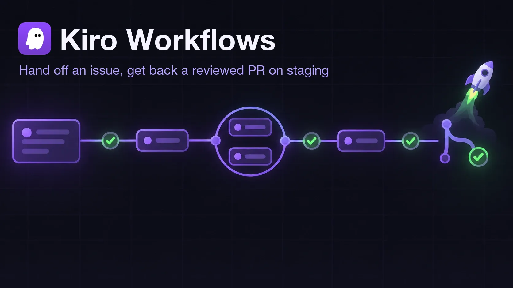
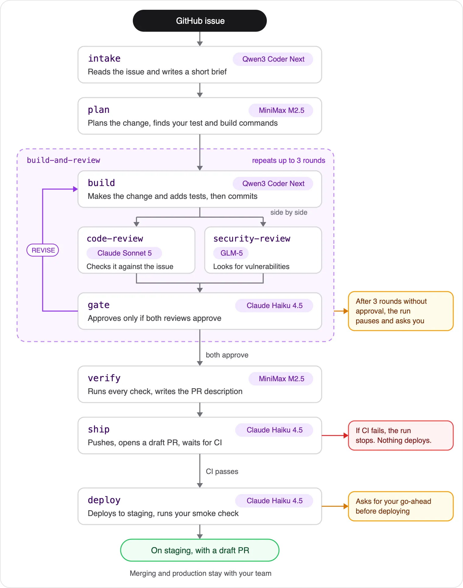
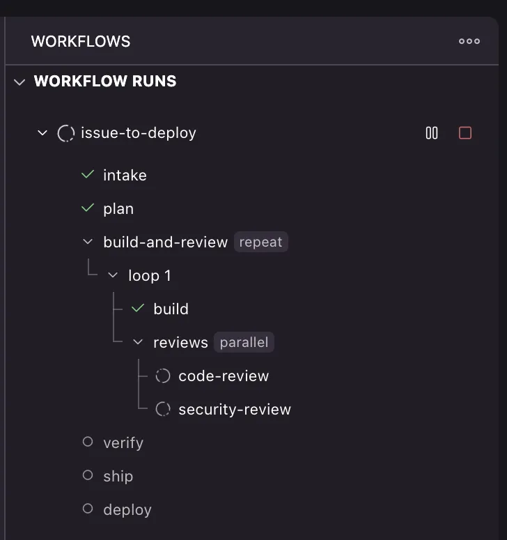

# Kiro Workflows: hand off an issue, get back a reviewed PR on staging

- **Original author** [Poobalan P](https://builder.aws.com/community/@poobalan1210)
- **Source** AWS Builder Center
- **Published** November 17, 2026

[Read the original article on AWS Builder Center](https://builder.aws.com/content/3MCoEpdAZs9KpBvcPp4ohQn6ZOE/kiro-workflows-hand-off-an-issue-get-back-a-reviewed-pr-on-staging)



## 1. The Task and the Result

Poobalan P describes a workflow that takes a GitHub issue, implements the change, runs two independent reviews, and deploys to staging after the operator approves. The author tested it on an issue to add pagination to a sample notes API. After **51 minutes**, the run had produced a draft pull request with tests and two review results. CI passed, and the change reached staging. Merging the PR and releasing to production remain decisions for the development team.

Every issue has different requirements. The path through planning, implementation, testing, review, and staging often stays the same. A recipe captures those steps so the next issue follows the same process. The operator supplies the task and the project's staging instructions for each run.

## 2. When to Use Chat or a Workflow

| Topic | Ordinary chat | Kiro Workflows |
| --- | --- | --- |
| Planning | Discuss and agree on a plan for the current task. | Define the steps and their order in a recipe for reuse. |
| Review | Ask for an additional review when needed. | Run the two reviews in separate sessions each time the recipe runs. |
| Model selection | Choose the model for the active conversation. | Set a model and effort level for individual steps. |
| Progress | Follow the work in the conversation. | Inspect running, paused, and completed steps in the Workflows panel. |

An ordinary chat suits a quick discussion or a typo fix. A workflow is useful when a recurring review and verification process justifies starting several steps, such as when a team routinely prepares similar changes for staging.

## 3. The YAML Recipe and Step Handoffs

The recipe takes two inputs. `issue` identifies the GitHub issue, and `deploy` describes how the project deploys to staging and checks the result. A step can declare an agent, model, prompt, and artifacts for other steps to read. The example below shows a shortened `intake` step. The author's repository contains the complete recipe.

```yaml
name: issue-to-deploy
inputs:
  issue: string
  deploy: prompt
steps:
  - type: step
    id: intake
    agent: wf-planner
    modelId: qwen3-coder-next
    artifacts:
      brief: .kiro/workflow-output/issue-to-deploy/issue.md
    prompt: >
      Read GitHub issue {{issue}} and save a short implementation brief.
```

Each step runs in its own session. The `plan` step needs the issue brief from `intake`. Reviewers need the diff and the criteria they should check. The `verify` step needs review results and test commands. Explicit artifact names and locations make those handoffs inspectable.



### The Nine Steps from Issue to Staging

| Step | Work | Output |
| --- | --- | --- |
| `intake` | Read the issue and identify its requirements. | A brief for the change. |
| `plan` | Plan the implementation and identify the project's build and test commands. | A change plan with verification steps. |
| `build` | Implement the change and add relevant tests. | A diff and commit ready for review. |
| `code-review` | Check the behavior, scope, and tests against the issue. | Implementation findings. |
| `security-review` | Review the change for security risks. | Findings to address before release. |
| `gate` | Combine the reviews and approve only when both reviewers agree. | A decision to continue or revise. |
| `verify` | Run checks and prepare the pull request description. | Test results, a change summary, and findings worth carrying forward. |
| `ship` | Push the branch, open a draft PR, and wait for CI. | A draft pull request and its GitHub checks. |
| `deploy` | Wait for approval, deploy to staging, and run a smoke check. | Staging results the operator can verify. |

### The Build–Review Loop and Its Stop Condition

The two reviewers run in parallel after `build`. When either requests a revision, the findings return to the builder for the next round. The workflow pauses for the operator after three rounds without approval. Once both reviewers approve, `gate` writes `APPROVED` and the run proceeds.

```yaml
- type: repeat
  id: build-and-review
  maxIterations: 3
  onMaxIterations: pause
  stopCondition:
    fileCheck:
      path: .kiro/workflow-output/issue-to-deploy/gate.json
      jsonPath: verdict
      value: APPROVED
  # Full recipe defines the build, parallel reviews, and gate here.
```

The gate file belongs to the active run. If a previous issue left an approval in `gate.json`, the stop condition could pick it up before the current reviews finish. The author's `plan` step resets the state.

| `send_message` severity | Outcome |
| --- | --- |
| `success` | Continue to the next step. |
| `warning` | Pause for a response. The deploy step uses this to request staging approval. |
| `error` | End the run. A CI failure during `ship` prevents it from reaching the deploy step. |

## 4. What the Sandbox Run Showed



*The screenshot shows `intake`, `plan`, and `build` complete. Both reviews are in progress in the first loop, with `verify`, `ship`, and `deploy` queued behind them.*

| Measure reported by the author | Sandbox result |
| --- | --- |
| Total run time | 51 minutes |
| Usage | About 37.6 credits |
| Code review alone | About 37 minutes and 80% of the run's credits |
| Command approval requests | 62 |
| Build–review rounds | Both reviewers approved in the first round |

These figures come from one sandbox run with a particular effort setting. Code review took most of the time. To compare runs, record the effort, wait time, and credit usage of each step. Approval requests also affect how much attention a run needs from the operator.

A reviewer found a missing test but rated it minor, so the workflow continued. The author updated `verify` to include minor findings in the PR description. The generated summaries also miscounted tests and acceptance criteria. Reviewing the diff, test list, and original issue together exposes gaps that a summary can miss. [Sandbox results and lessons from the original article](https://builder.aws.com/content/3MCoEpdAZs9KpBvcPp4ohQn6ZOE/kiro-workflows-hand-off-an-issue-get-back-a-reviewed-pr-on-staging)

## 5. Preparing a Sandbox Run

1. **Set up the environment.** Use a version of the Kiro IDE with Workflows, a GitHub remote, and an authenticated GitHub CLI. Enable Workflows in Workspace Configuration and open a new chat.
2. **Load the recipe.** Get `issue-to-deploy.workflow.yaml` from the author's repository. Read its prompts, model choices, iteration limit, and deploy step. If you adapt it for another project, check the edited recipe with `validate_workflow` before running it.
3. **Select the repository and issue.** For a sandbox, work from your own fork and enable Issues and Actions as needed. Confirm that GitHub CLI targets the fork. Choose an issue with clear acceptance criteria and start from a clean working tree. The issue description becomes part of the prompts, so review the request and intended scope before running it.
4. **Supply the inputs.** Give the workflow an issue number, the project's approved staging process, and a check to perform after deployment. The author's sandbox uses `npm run staging` as a demonstration step. For a real staging environment, use its deployment command and health endpoint, with access scoped to staging.
5. **Review approval requests.** Read the action under review. When the run asks to deploy, check the repository, branch, CI state, and review results before making that decision.

Example prompt for the sandbox fork:

> Run `issue-to-deploy` for issue 1 in my sandbox fork. Use `npm run staging` for the staging demonstration. Pause for my approval before that step and record the verification result in the PR description.

## 6. Verification and Cleanup

```bash
gh pr view --web
gh pr checks
cat .kiro/workflow-output/issue-to-deploy/gate.json
npm test
```

These checks cover the draft PR, GitHub CI, the gate verdict, and the local tests. After deployment, run a smoke check tied to the issue. For pagination, this could include requesting the first and next pages and checking an out-of-range parameter. Record a response or test log so someone else can verify the result.

When the sandbox run is finished, identify its draft PR, branch, and output files. Close the test PR and remove its branch if they are no longer needed. Save evidence required for review before clearing run artifacts. For a shared staging deployment, follow the team's runbook to hand over or restore the environment.

## References

- [Poobalan P's article on AWS Builder Center](https://builder.aws.com/content/3MCoEpdAZs9KpBvcPp4ohQn6ZOE/kiro-workflows-hand-off-an-issue-get-back-a-reviewed-pr-on-staging)
- [The issue-to-deploy recipe on GitHub](https://github.com/Poobalan1210/kiro-workflows)
- [Sandbox repository used for the example](https://github.com/Poobalan1210/kiro-workflows-sandbox)
- [Kiro Workflows documentation](https://kiro.dev/docs/workflows/)
