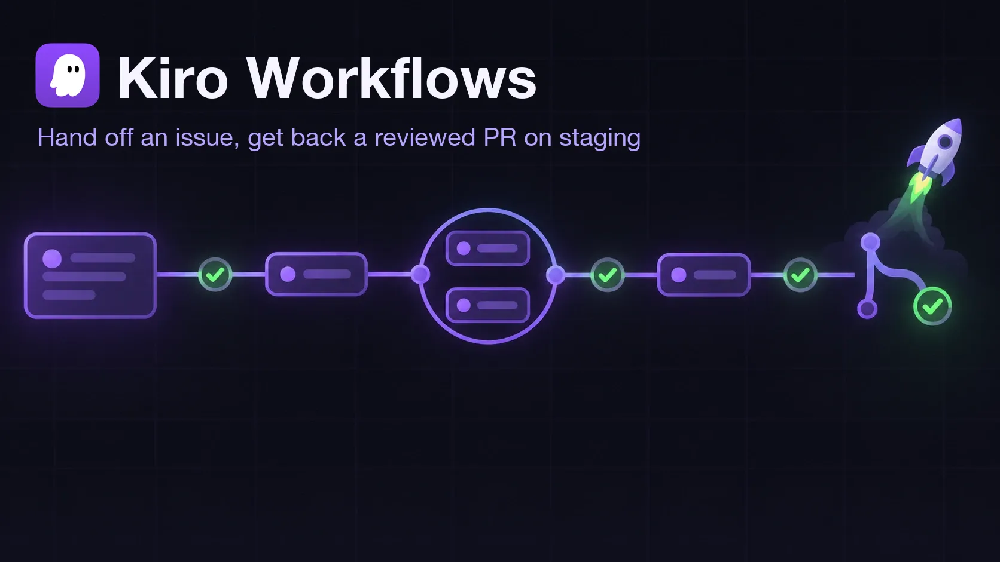
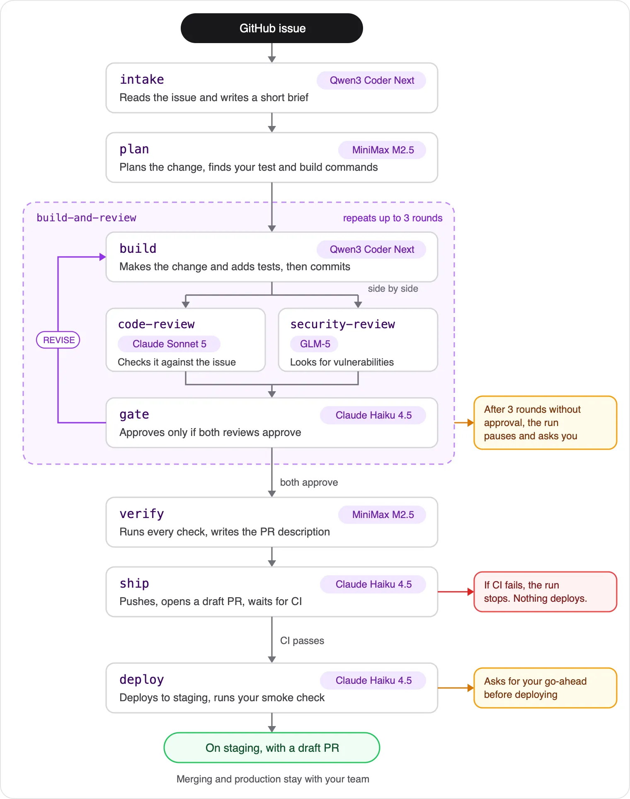
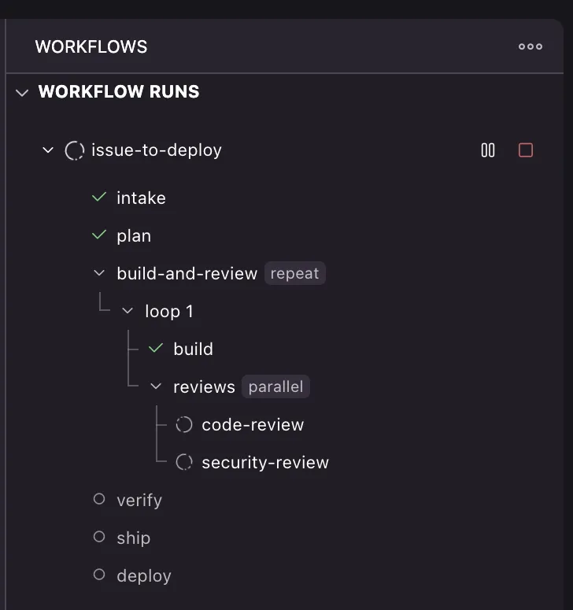

# Kiro Workflows — Từ GitHub issue đến pull request đã review trên staging

- **Tác giả bài gốc** [Poobalan P](https://builder.aws.com/community/@poobalan1210)
- **Nguồn** AWS Builder Center
- **Ngày đăng** 17/11/2026

[Đọc bài gốc trên AWS Builder Center](https://builder.aws.com/content/3MCoEpdAZs9KpBvcPp4ohQn6ZOE/kiro-workflows-hand-off-an-issue-get-back-a-reviewed-pr-on-staging)



## 1. Bài toán và kết quả

Bài viết mô tả một workflow nhận GitHub issue, triển khai thay đổi, tổ chức hai lượt review độc lập và đưa bản sửa lên staging sau khi người vận hành đồng ý. Tác giả thử quy trình bằng một issue bổ sung phân trang cho API ghi chú. Sau **51 phút**, lần chạy trả về một draft pull request có kiểm thử, hai kết quả review, CI đã qua và bản thay đổi trên staging. Merge và phát hành production vẫn thuộc quy trình của nhóm phát triển.

Một issue mới luôn có yêu cầu riêng, nhưng cách nhóm chuyển thay đổi qua các bước lập kế hoạch, kiểm thử, review và kiểm tra staging thường lặp lại. Recipe ghi những bước đó thành cấu hình để các issue khác nhau đi qua cùng quy trình. Người vận hành cung cấp mục tiêu và cách deploy của dự án cho từng lần chạy.

## 2. Khi nào dùng chat và khi nào dùng workflow?

| Tiêu chí | Chat thông thường | Kiro Workflows |
| --- | --- | --- |
| Kế hoạch | Trao đổi và thống nhất trong từng cuộc hội thoại. | Recipe định nghĩa các bước và thứ tự để chạy lại cho issue khác. |
| Review | Có thể giao thêm lượt review khi cần. | Hai bước review có phiên riêng và được thực hiện mỗi lần chạy recipe. |
| Model | Người dùng chọn model cho phiên đang làm. | Recipe có thể cấu hình model và mức effort theo từng bước. |
| Theo dõi | Tiến độ nằm trong cuộc hội thoại. | Bảng Workflows cho biết bước đang chạy, đang chờ hoặc đã kết thúc. |

Chat phù hợp với trao đổi nhanh hoặc chỉnh lỗi nhỏ. Workflow có ích khi chi phí khởi chạy nhiều bước được bù lại bằng quy trình review và xác minh lặp lại, chẳng hạn khi một nhóm liên tục đưa các issue tương tự lên staging.

## 3. Recipe YAML và cách các bước bàn giao

Recipe mẫu nhận hai đầu vào. `issue` chỉ ra GitHub issue cần thực hiện, còn `deploy` mô tả cách đưa bản sửa lên staging và cách kiểm tra sau deploy. Một bước có thể khai báo agent, model, prompt và các artifact để bước sau đọc lại. Đây là phần trích rút gọn của bước `intake`. Recipe đầy đủ nằm trong repository của tác giả.

```yaml
name: issue-to-deploy
inputs:
  issue: string
  deploy: prompt
steps:
  - type: step
    id: intake
    agent: wf-planner
    modelId: qwen3-coder-next
    artifacts:
      brief: .kiro/workflow-output/issue-to-deploy/issue.md
    prompt: >
      Read GitHub issue {{issue}} and save a short implementation brief.
```

Mỗi bước chạy trong phiên riêng. Bước `plan` cần đọc bản mô tả issue do `intake` ghi ra. Các reviewer cần thấy diff và tiêu chí cần kiểm tra. Bước `verify` cần biết kết quả review và lệnh kiểm thử. Việc chỉ định rõ tên, nơi lưu và mục đích của mỗi artifact giúp nhóm kiểm tra được công việc bàn giao giữa các bước.



### Chín bước từ issue đến staging

| Bước | Công việc | Kết quả bàn giao |
| --- | --- | --- |
| `intake` | Đọc issue và rút ra yêu cầu cần đáp ứng. | Bản mô tả ngắn về thay đổi. |
| `plan` | Lập kế hoạch và xác định lệnh build, test của dự án. | Kế hoạch sửa mã và cách xác minh. |
| `build` | Triển khai thay đổi và bổ sung kiểm thử cần thiết. | Diff và commit để review. |
| `code-review` | Kiểm tra hành vi, phạm vi và độ bao phủ của test theo issue. | Nhận xét về chất lượng triển khai. |
| `security-review` | Rà soát rủi ro bảo mật trong thay đổi. | Nhận xét bảo mật để xử lý trước khi phát hành. |
| `gate` | Tổng hợp hai lượt review. Chỉ duyệt khi cả hai chấp thuận. | Kết luận cho phép đi tiếp hoặc yêu cầu sửa. |
| `verify` | Chạy các kiểm tra và chuẩn bị mô tả PR. | Kết quả kiểm thử, mô tả thay đổi và các điểm còn cần chú ý. |
| `ship` | Push nhánh, mở draft PR và đợi CI. | Draft PR và trạng thái kiểm tra trên GitHub. |
| `deploy` | Chờ xác nhận, đưa thay đổi lên staging và chạy smoke check. | Kết quả kiểm tra staging để người vận hành đối chiếu. |

### Vòng build–review và điều kiện dừng

Hai reviewer chạy song song sau `build`. Nếu một lượt review yêu cầu sửa, `gate` đưa kết quả về bước `build` cho vòng kế tiếp. Workflow dừng chờ người vận hành khi hết ba vòng mà chưa được duyệt. Khi cả hai reviewer chấp thuận, `gate` ghi trạng thái `APPROVED` để workflow đi tiếp.

```yaml
- type: repeat
  id: build-and-review
  maxIterations: 3
  onMaxIterations: pause
  stopCondition:
    fileCheck:
      path: .kiro/workflow-output/issue-to-deploy/gate.json
      jsonPath: verdict
      value: APPROVED
  # Full recipe defines the build, parallel reviews, and gate here.
```

Tệp `gate.json` cần được khởi tạo lại theo lần chạy. Nếu tệp từ issue trước còn chứa `APPROVED`, điều kiện dừng có thể đọc nhầm kết quả cũ khi chưa có review mới. Trong recipe của tác giả, bước `plan` đặt lại trạng thái này.

| Trạng thái từ `send_message` | Workflow xử lý |
| --- | --- |
| `success` | Chuyển sang bước kế tiếp. |
| `warning` | Tạm dừng và chờ phản hồi. Bước deploy dùng trạng thái này để xin xác nhận staging. |
| `error` | Dừng lần chạy. Nếu CI lỗi tại `ship`, bước deploy chưa được thực hiện. |

## 4. Kết quả lần thử với API ghi chú



*Ảnh chụp lúc `intake`, `plan` và `build` đã xong. Hai lượt review đang chạy trong vòng đầu, còn `verify`, `ship` và `deploy` đang chờ.*

| Chỉ số tác giả báo cáo | Kết quả trong lần chạy |
| --- | --- |
| Tổng thời gian | 51 phút |
| Credits sử dụng | Khoảng 37,6 |
| Riêng bước code review | Khoảng 37 phút và 80% số credits của lần chạy |
| Số lần hỏi phê duyệt lệnh | 62 |
| Số vòng build–review | Hai lượt review chấp thuận trong vòng đầu tiên |

Những số liệu này thuộc lần thử trên sandbox với một cấu hình effort cụ thể. Phần code review chiếm phần lớn thời gian, nên khi so sánh các lần chạy có thể ghi riêng effort, thời gian chờ kiểm tra và lượng credits của từng bước. Số lần hỏi duyệt lệnh cũng ảnh hưởng đến thời gian người vận hành phải theo dõi workflow.

Một phát hiện đáng chú ý là reviewer thấy thiếu test nhưng xếp mức nhẹ, nên workflow vẫn tiếp tục. Tác giả bổ sung yêu cầu ghi các nhận xét nhẹ vào mô tả PR. Phần tóm tắt tự động cũng đếm sai số test và tiêu chí nghiệm thu. Vì vậy, khi đọc một PR do workflow tạo, cần đối chiếu các nhận xét với diff, danh sách test thực tế và yêu cầu ban đầu của issue. [Lần chạy và các phát hiện trong bài gốc](https://builder.aws.com/content/3MCoEpdAZs9KpBvcPp4ohQn6ZOE/kiro-workflows-hand-off-an-issue-get-back-a-reviewed-pr-on-staging)

## 5. Chuẩn bị và thử trên sandbox

1. **Chuẩn bị môi trường.** Dùng phiên bản Kiro IDE có Workflows, một repository có GitHub remote và GitHub CLI đã đăng nhập. Bật Workflows trong Workspace Configuration và mở phiên chat mới.
2. **Nạp recipe.** Lấy `issue-to-deploy.workflow.yaml` từ repository của tác giả. Đọc prompt, model, giới hạn lặp và bước deploy trước khi nạp. Nếu cần sửa recipe cho dự án, kiểm tra cấu hình bằng `validate_workflow` trước khi chạy.
3. **Chọn repository và issue.** Với sandbox, dùng fork của mình, bật Issues và Actions khi cần, rồi xác nhận GitHub CLI đang trỏ đến đúng repository. Chuẩn bị một issue có tiêu chí nghiệm thu cụ thể và bắt đầu với working tree sạch. Phần mô tả issue đi vào prompt, nên phạm vi thực hiện cần dựa trên yêu cầu đã được người vận hành xem qua.
4. **Giao yêu cầu cho workflow.** Cung cấp số issue, cách deploy mà dự án đã dùng và phép kiểm tra sau deploy. Ở sandbox của tác giả, `npm run staging` là bước minh họa. Với staging thật, dùng lệnh phát hành và endpoint kiểm tra của dự án, giới hạn quyền vào đúng môi trường đó.
5. **Theo dõi phê duyệt.** Đọc nội dung từng yêu cầu chạy lệnh. Khi workflow chờ xác nhận staging, đối chiếu repository, nhánh, trạng thái CI và các kết quả review trước khi quyết định.

Ví dụ yêu cầu chạy trên fork thử nghiệm:

> Chạy workflow `issue-to-deploy` cho issue số 1 trong fork sandbox của tôi. Dùng `npm run staging` cho bước thử staging. Hãy dừng để mình xác nhận trước bước đó và ghi kết quả kiểm tra vào mô tả PR.

## 6. Kiểm chứng kết quả và dọn thử nghiệm

```bash
gh pr view --web
gh pr checks
cat .kiro/workflow-output/issue-to-deploy/gate.json
npm test
```

Bốn lệnh minh họa cho bốn nguồn kiểm chứng: nội dung draft PR, trạng thái CI trên GitHub, kết luận của `gate` và kết quả kiểm thử local. Khi môi trường đã deploy, chạy smoke check theo yêu cầu của issue. Với phân trang, có thể đối chiếu trang đầu, trang kế tiếp và trường hợp tham số nằm ngoài phạm vi cho phép. Ghi phản hồi hoặc log kiểm tra vào biên bản để người khác xem lại được.

Sau khi hoàn tất thử nghiệm, kiểm tra draft PR, nhánh và thư mục artifact nào thuộc lần chạy này. Nếu không cần giữ PR sandbox, đóng PR và xóa nhánh thử sau khi xác nhận đúng đối tượng. Giữ lại log hoặc kết quả cần cho việc đánh giá trước khi dọn artifact. Nếu lần chạy đã thay đổi môi trường staging dùng chung, bàn giao hoặc khôi phục theo runbook của nhóm.

## Tài liệu tham khảo

- [Bài viết của Poobalan P trên AWS Builder Center](https://builder.aws.com/content/3MCoEpdAZs9KpBvcPp4ohQn6ZOE/kiro-workflows-hand-off-an-issue-get-back-a-reviewed-pr-on-staging)
- [Recipe issue-to-deploy trên GitHub](https://github.com/Poobalan1210/kiro-workflows)
- [Repository sandbox dùng cho thử nghiệm](https://github.com/Poobalan1210/kiro-workflows-sandbox)
- [Tài liệu Kiro Workflows](https://kiro.dev/docs/workflows/)
