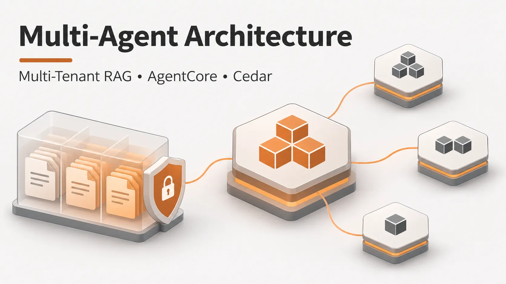
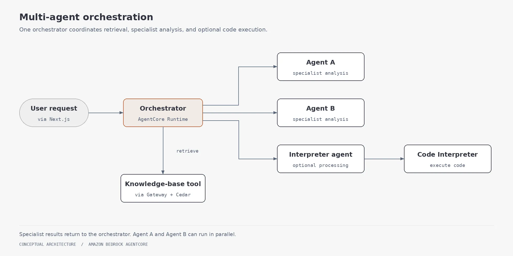
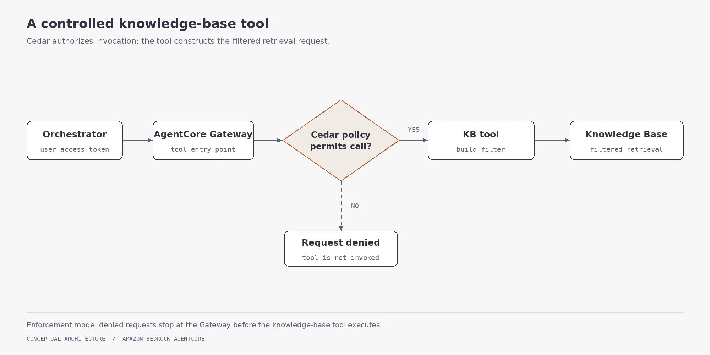
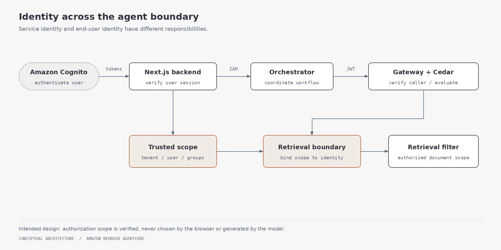
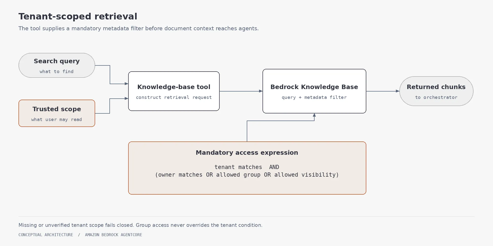

# Multi-Agent Orchestration and Multi-Tenant RAG with Amazon Bedrock AgentCore

- **Original author** [Leonid Gimelshtein](https://builder.aws.com/community/@cloudguru)
- **Source** [AWS Builder Center](https://builder.aws.com/content/3MCquj2lkgYhYNS1cpDrvT0P89Y/multi-agent-orchestration-and-multi-tenant-rag-with-amazon-bedrock-agentcore)

This architecture connects an orchestrator, specialist agents, and Code Interpreter to a retrieval tool behind AgentCore Gateway. Cedar evaluates who can invoke the tool. Metadata filters limit the documents that can be returned to the tenant and permissions of the user who initiated the request.



## 1. The Multi-Tenant RAG Problem

In a retrieval-augmented generation application, the system retrieves relevant document passages before it sends context to the model. When several organizations share the application and document collection, each organization has its own tenant. Two users from different tenants can ask the same question and receive answers grounded in different documents. Users within one tenant can also have different access based on ownership, group sharing, and visibility.

Multi-agent orchestration creates additional points where document content moves. A request may pass through retrieval, two analyses, a calculation, and report generation. At each boundary, the application needs to identify who coordinates the work, who can invoke the retrieval tool, and what context each agent can receive.

## 2. One Orchestrator Owns the Request



| Component | Responsibility |
| --- | --- |
| Next.js backend | Verify the user session and determine access scope from trusted application data. |
| Orchestrator | Retrieve context, delegate tasks, collect results, and assemble the final response. |
| Agent A and Agent B | Accept a focused task and relevant document passages, then return structured results. |
| Interpreter agent | Invoke AgentCore Code Interpreter when a calculation or data transformation is needed. |
| AgentCore Gateway and Cedar | Authenticate the caller and evaluate permission to invoke the knowledge-base tool under the deployed policy. |
| Knowledge-base tool | Construct the filtered retrieval request from verified scope. |
| Bedrock Knowledge Bases and OpenSearch Serverless | Run retrieval using the vector index in this architecture. |
| Amazon S3 | Store source documents and generated artifacts when the workflow persists them. |

Suppose a user asks for a summary of QA findings and the proportion in each severity category. The orchestrator retrieves context within the user's authorized scope. It can ask Agent A to summarize findings and Agent B to extract classification criteria. Both tasks can run in parallel. Once they return, the orchestrator can send selected structured data to the interpreter for the calculation and assemble the final response.

### Separate Runtimes and Focused Permissions

The example can host the orchestrator and specialists in separate AgentCore Runtimes, using the Strands SDK and Claude on Amazon Bedrock. Each runtime can have its own execution role and tool set. Agent A and Agent B receive the retrieved passages from the orchestrator. Direct access to the knowledge base or permission to write reports is granted only where a specialist task requires it.

The interpreter agent decides what calculation or transformation to perform. Code Interpreter executes it in the processing session. The orchestrator can skip this step for tasks that only need text analysis. Intermediate files and results remain within the scope of the original request.

## 3. The Tool Invocation and Retrieval Boundaries



**Retrieval path** Orchestrator → AgentCore Gateway → Cedar → knowledge-base tool → Bedrock Knowledge Bases.

| Control | Question | Result |
| --- | --- | --- |
| Gateway policy | May the authenticated caller invoke this tool for this request? | With enforcement enabled, a denied request stops before the tool runs. |
| Metadata filter built by the tool | Which documents may this user read in the current tenant? | The Knowledge Base receives a query with metadata conditions and returns matching passages. |

Permission to invoke the tool allows the request to proceed to the document access check. The tool still needs to obtain tenant, user, and document permissions from server-verified data or an authenticated context. Keeping retrieval behind this interface gives the team a defined place to enforce the filter. AgentCore's `ENFORCE` mode applies policy decisions, while `LOG_ONLY` records them for observation. [AgentCore policy enforcement modes](https://docs.aws.amazon.com/bedrock-agentcore/latest/devguide/policy-enforcement-modes.html)

## 4. Identity Follows the Request



1. **Cognito authenticates the user.** The Next.js backend validates the token used by its session, including signature, issuer, expiry, and applicable token type and client checks. It resolves tenant membership, user ID, and groups from a trusted source.
2. **Service identity authorizes runtime calls.** IAM can authorize the backend to invoke the runtime and grant each workload the AWS permissions it needs. Runtime permissions and the user's document access are evaluated at their respective boundaries.
3. **The Gateway receives end-user identity.** In this JWT-based design, the orchestrator passes the appropriate access token through the authentication channel. Prompts contain the task and authorized context. The server manages tokens and authorization values.
4. **The tool builds the filter from trusted scope.** Agent-generated query text describes what to find. Server logic verifies the tenant, user ID, and groups that determine what can be returned. Retrieval stops if the trusted scope is missing.

If the Gateway policy needs `tenantId`, inspect the access token actually issued to the Gateway. A tenant attribute in an ID token does not automatically appear in the access token. AWS documents access-token customization through a pre-token generation trigger for supported Cognito configurations. [Customizing Amazon Cognito access tokens](https://aws.amazon.com/blogs/security/how-to-customize-access-tokens-in-amazon-cognito-user-pools/)

## 5. An Illustrative Cedar Policy Binds the Tenant

This policy illustrates a Gateway with a JWT authorizer. It evaluates an OAuth principal, a specific tool action and Gateway, and the match between the input tenant and the verified claim.

```cedar
permit (
  principal is AgentCore::OAuthUser,
  action == AgentCore::Action::"kb-tool___queryKnowledgeBase",
  resource == AgentCore::Gateway::"<gateway-arn>"
)
when {
  principal.hasTag("tenantId") &&
  principal.getTag("tenantId") != "" &&
  context.input.tenantId == principal.getTag("tenantId")
};
```

`hasTag` checks for the claim before `getTag` reads it. The sample uses `context.input.tenantId` for the tenant field supplied to the tool. In a deployment, use the Gateway's action name and ARN, confirm the input schema, and check the claims issued by the application. [Principal-scoped policies](https://docs.aws.amazon.com/bedrock-agentcore/latest/devguide/example-policies-principal.html) · [Policy in AgentCore](https://docs.aws.amazon.com/bedrock-agentcore/latest/devguide/policy-getting-started.html)

This condition binds one tool call to the caller's tenant. Trusted application logic still determines ownership, groups, and administrative permissions. Where several policies apply, verify the combined authorization decision and keep the tenant condition mandatory in the retrieval tool.

## 6. Filter Metadata Before Context Reaches Agents



On ingestion, the application assigns `tenantId` and `ownerId` from trusted identity. `allowedGroups` lists the groups permitted to read the document in that tenant. `visibility` can represent sharing allowed by the application's policy. Metadata and document permissions need to stay in sync when access changes.

The example below uses `tenant-a`, `user-123`, and the `qa` group. The Knowledge Base can return passages from documents in `tenant-a` that the user owns or that are shared with the verified group.

```json
{
  "andAll": [
    {
      "equals": {
        "key": "tenantId",
        "value": "tenant-a"
      }
    },
    {
      "orAll": [
        {
          "equals": {
            "key": "ownerId",
            "value": "user-123"
          }
        },
        {
          "listContains": {
            "key": "allowedGroups",
            "value": "qa"
          }
        }
      ]
    }
  ]
}
```

The outer `andAll` requires a tenant match and a match in at least one branch of `orAll`. `listContains` checks whether the metadata list contains the specified value. A document in another tenant with the same `qa` group value fails the outer tenant condition. For multiple verified groups, the tool can add one branch per group. If only one access condition applies, include it directly in `andAll`, because `orAll` requires at least two entries. The ingestion and retrieval paths need to account for missing required metadata. [Bedrock RetrievalFilter](https://docs.aws.amazon.com/bedrock/latest/APIReference/API_RetrievalFilter.html) · [Configuring Knowledge Base queries](https://docs.aws.amazon.com/bedrock/latest/userguide/kb-test-config.html)

Once retrieval finishes, the orchestrator can distribute the returned passages by task. An analyst may need a subset on a particular topic, while the interpreter may only need an extracted table. Each step receives the material required for its part of the request.

## 7. Tenant Scope After Retrieval

| Derived data | How the application preserves scope |
| --- | --- |
| Conversation history | Resolve a saved or resumed session using the appropriate tenant and identity. |
| Retrieval and response caches | Partition by tenant and the relevant access scope. Account for permission changes when refreshing or invalidating entries. |
| Interpreter files | Bind sessions and storage locations to the request. Limit inputs to the files needed for the calculation. |
| Reports and exported files | Associate results with the tenant and access policy. Check current permission before returning a saved artifact. |
| Logs and traces | Record request identifiers and decision points for investigation. Keep access tokens and document contents out of operational logs. |

The supplied write-up reports two findings for the scenarios it covered. Unauthorized requests were rejected, and retrieval stayed within the user's permitted scope. The following example checks show which boundary to inspect for each expected result.

| Verification case | Expected evidence |
| --- | --- |
| An authorized caller owns a document in the tenant | The Gateway permits the tool call. The tool sends a filter and the returned context can include eligible passages. |
| A user belongs to a group with document access | The filter uses the verified group and can return matching documents within the tenant. |
| The shared index contains a document from another tenant | Its content is absent from retrieval results, specialist context, and reports for the active tenant. |
| The tenant scope is unverified | The request stops before retrieval. The application does not run an unfiltered search. |
| A user opens a saved report | The application checks the tenant and current read permission before returning the artifact. |

## 8. Putting the Architecture Together

Cognito and Next.js establish end-user identity. An orchestrator coordinates AgentCore Runtimes where the Strands SDK defines agent behavior and Claude on Bedrock performs analysis. Gateway and Cedar control access to the knowledge-base tool, which supplies mandatory tenant filtering for Bedrock Knowledge Bases and OpenSearch Serverless. Amazon S3 holds source documents and retained artifacts. Code Interpreter handles computation when needed. AWS CDK describes the infrastructure for repeatable deployments.

When adding a specialist or changing how a report is calculated, the team can trace the request back to its authenticated caller, the policy decision, and the filtered passages supplied to the agents. Those records give the team concrete places to verify access as the workflow evolves.
