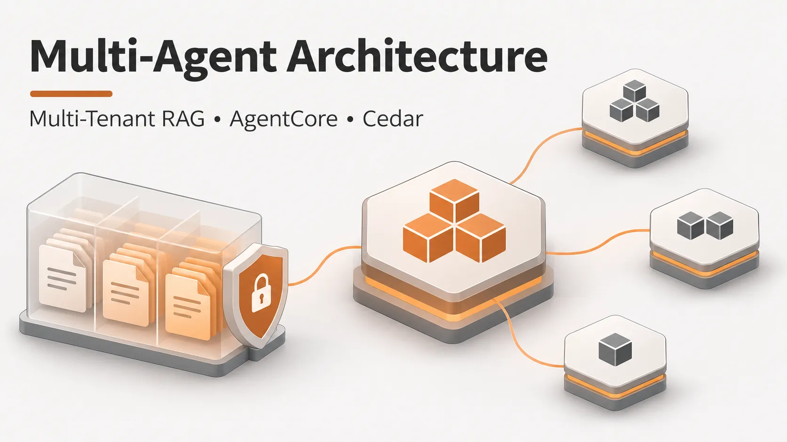
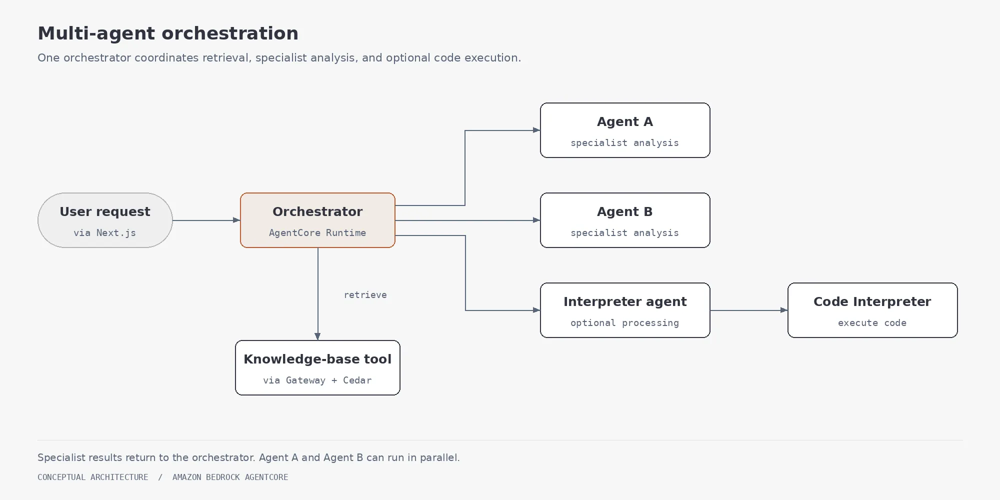
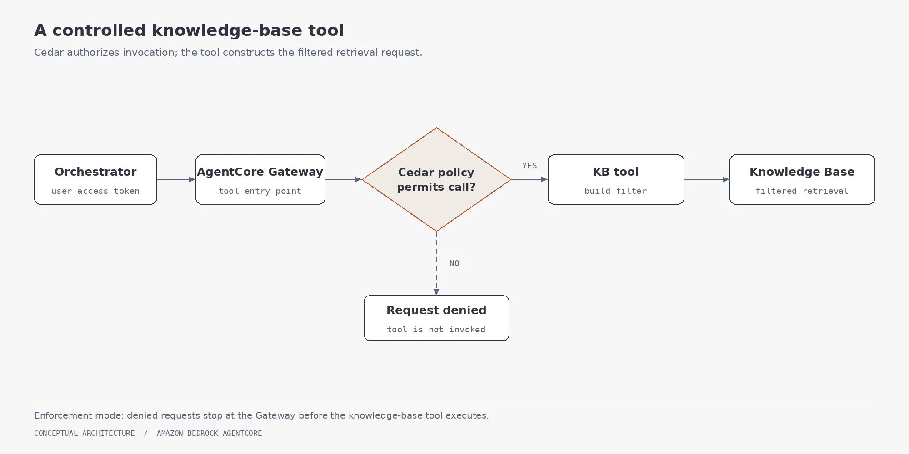
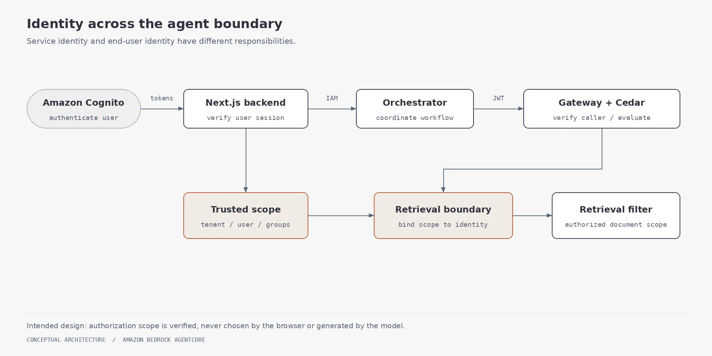
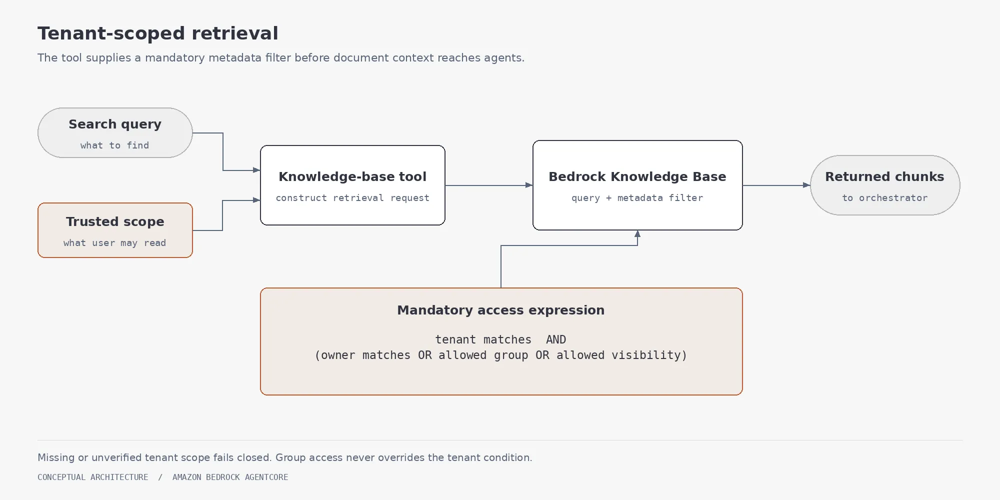

# Điều phối đa agent và RAG đa tenant với Amazon Bedrock AgentCore

- **Tác giả bài gốc** [Leonid Gimelshtein](https://builder.aws.com/community/@cloudguru)
- **Nguồn** [AWS Builder Center](https://builder.aws.com/content/3MCquj2lkgYhYNS1cpDrvT0P89Y/multi-agent-orchestration-and-multi-tenant-rag-with-amazon-bedrock-agentcore)

Kiến trúc này kết hợp một orchestrator, các agent chuyên trách và Code Interpreter với công cụ truy xuất tài liệu đi qua AgentCore Gateway. Cedar quyết định ai được gọi công cụ. Bộ lọc metadata giới hạn tài liệu có thể được trả về theo tenant và quyền của người dùng.



## 1. Bài toán của RAG đa tenant

Trong một ứng dụng RAG, hệ thống tìm các đoạn tài liệu liên quan trước khi chuyển chúng cho model làm ngữ cảnh. Khi nhiều tổ chức dùng chung ứng dụng và kho tài liệu, mỗi tổ chức là một tenant. Hai người ở hai tenant có thể hỏi cùng một câu và nhận kết quả từ hai tập tài liệu khác nhau. Ngay cả trong một tenant, quyền đọc còn phụ thuộc vào chủ sở hữu tài liệu, nhóm được chia sẻ hoặc mức hiển thị.

Điều phối nhiều agent bổ sung thêm các điểm chuyển giao dữ liệu. Một yêu cầu có thể đi qua bước truy xuất, hai bước phân tích, một bước tính toán và bước tạo báo cáo. Ở từng điểm đó, kiến trúc phải xác định thành phần điều phối, chủ thể được phép gọi công cụ truy xuất và ngữ cảnh được chuyển cho mỗi agent.

## 2. Orchestrator điều phối toàn bộ yêu cầu



| Thành phần | Trách nhiệm |
| --- | --- |
| Next.js backend | Xác minh phiên người dùng và xác định phạm vi truy cập từ dữ liệu tin cậy của ứng dụng. |
| Orchestrator | Truy xuất ngữ cảnh, phân công nhiệm vụ, nhận kết quả và tổng hợp phản hồi. |
| Agent A và Agent B | Nhận một nhiệm vụ hẹp cùng các đoạn tài liệu cần thiết, sau đó trả kết quả có cấu trúc. |
| Interpreter agent | Gọi AgentCore Code Interpreter để thực hiện phép tính hoặc biến đổi dữ liệu khi cần. |
| AgentCore Gateway và Cedar | Xác thực chủ thể gọi và đánh giá quyền gọi công cụ knowledge base theo cấu hình. |
| Knowledge-base tool | Tạo yêu cầu truy xuất có bộ lọc từ phạm vi quyền đã xác minh. |
| Bedrock Knowledge Bases và OpenSearch Serverless | Thực hiện truy xuất tài liệu qua chỉ mục vector theo cấu hình của kiến trúc. |
| Amazon S3 | Lưu tài liệu đầu vào và các tệp kết quả khi quy trình cần lưu. |

Ví dụ, người dùng muốn tổng hợp các phát hiện QA và tính tỷ lệ theo mức độ. Orchestrator truy xuất ngữ cảnh một lần trong phạm vi được phép. Nó có thể giao Agent A tóm tắt phát hiện và Agent B trích tiêu chí phân loại. Hai tác vụ độc lập có thể chạy song song. Khi có đủ kết quả, orchestrator chuyển dữ liệu đã chọn sang interpreter nếu cần phép tính rồi ghép kết quả thành phản hồi.

### Runtime và quyền theo nhiệm vụ

Mô hình minh họa có thể đặt orchestrator và các specialist trong những AgentCore Runtime riêng, dùng Strands SDK và Claude trên Amazon Bedrock. Mỗi runtime có execution role và danh sách công cụ phù hợp với nhiệm vụ. Agent A và Agent B nhận các đoạn đã truy xuất từ orchestrator. Quyền truy xuất trực tiếp từ kho tài liệu hoặc ghi báo cáo chỉ được cấp khi nhiệm vụ của agent thực sự cần.

Interpreter agent xác định phép tính hoặc cách biến đổi cần thực hiện. Code Interpreter chạy mã trong phiên của bước xử lý đó. Nếu tác vụ chỉ cần phân tích văn bản, orchestrator có thể bỏ qua bước interpreter. Dữ liệu và tệp trung gian của interpreter vẫn mang phạm vi của yêu cầu gốc.

## 3. Gateway kiểm soát quyền gọi, tool kiểm soát phạm vi truy xuất



**Luồng truy xuất** Orchestrator → AgentCore Gateway → Cedar → knowledge-base tool → Bedrock Knowledge Bases.

| Lớp kiểm soát | Câu hỏi cần trả lời | Kết quả |
| --- | --- | --- |
| Policy tại Gateway | Chủ thể đã xác thực có quyền gọi tool này với yêu cầu đang xét không? | Với policy được thực thi, yêu cầu bị từ chối dừng trước khi tool chạy. |
| Bộ lọc truy xuất trong tool | Trong tenant này, người dùng có quyền đọc tài liệu nào? | Knowledge Base nhận truy vấn kèm điều kiện metadata và trả các đoạn phù hợp. |

Quyền gọi tool mở đường đến bước kiểm tra tài liệu. Tool vẫn phải lấy tenant, danh tính và quyền tài liệu từ dữ liệu do server xác minh hoặc từ ngữ cảnh có thể xác thực. Giữ đường truy xuất sau tool này cũng giúp nhóm kiểm soát vị trí áp dụng bộ lọc. Trong AgentCore, `ENFORCE` thực thi quyết định. `LOG_ONLY` dùng để quan sát kết quả đánh giá policy. [Chế độ thực thi policy của AgentCore](https://docs.aws.amazon.com/bedrock-agentcore/latest/devguide/policy-enforcement-modes.html)

## 4. Danh tính đi cùng yêu cầu



1. **Cognito xác thực người dùng.** Next.js backend xác minh token dùng cho phiên, gồm chữ ký, issuer, thời hạn và các ràng buộc về loại token và ứng dụng theo cấu hình. Backend tra tenant, user ID và nhóm từ nguồn đáng tin cậy.
2. **Danh tính dịch vụ gọi runtime.** IAM có thể cấp quyền cho backend gọi runtime và cho các thành phần thực hiện thao tác AWS theo nhiệm vụ. Quyền của runtime và quyền đọc tài liệu của người dùng được kiểm tra ở các bước riêng.
3. **Gateway nhận danh tính người dùng.** Trong thiết kế dùng JWT, orchestrator gửi access token phù hợp đến Gateway qua đường xác thực. Nội dung prompt chỉ cần câu hỏi, nhiệm vụ và ngữ cảnh được phép. Token và các giá trị phân quyền do server quản lý.
4. **Tool dựng filter từ phạm vi tin cậy.** Query do agent đề xuất giúp xác định nội dung cần tìm. Tenant, user ID và nhóm dùng cho filter được xác minh ở phía server. Tool dừng truy xuất nếu thiếu phạm vi đáng tin cậy.

Nếu policy cần `tenantId` trong access token, kiểm tra token thực tế phát hành cho Gateway. Việc có thuộc tính tenant trong ID token chưa đủ để Gateway đọc thuộc tính đó từ access token. AWS mô tả cách dùng pre-token generation trigger để tùy chỉnh access token trong cấu hình Cognito phù hợp. [Tùy chỉnh access token trong Amazon Cognito](https://aws.amazon.com/blogs/security/how-to-customize-access-tokens-in-amazon-cognito-user-pools/)

## 5. Ví dụ Cedar ràng buộc tenant vào danh tính

Policy minh họa dưới đây áp dụng cho Gateway dùng JWT authorizer. Nó kiểm tra principal OAuth, tool action, Gateway cụ thể và sự trùng khớp giữa tenant trong đầu vào với claim đã xác minh.

```cedar
permit (
  principal is AgentCore::OAuthUser,
  action == AgentCore::Action::"kb-tool___queryKnowledgeBase",
  resource == AgentCore::Gateway::"<gateway-arn>"
)
when {
  principal.hasTag("tenantId") &&
  principal.getTag("tenantId") != "" &&
  context.input.tenantId == principal.getTag("tenantId")
};
```

`hasTag` kiểm tra claim có mặt trước khi `getTag` đọc giá trị. `context.input.tenantId` là trường đầu vào của yêu cầu gọi tool trong ví dụ. Khi cấu hình triển khai, cần dùng action và ARN từ Gateway thực tế, xác nhận kiểu dữ liệu theo schema và đối chiếu với token do ứng dụng phát hành. [Principal-scoped policies](https://docs.aws.amazon.com/bedrock-agentcore/latest/devguide/example-policies-principal.html) · [Policy in AgentCore](https://docs.aws.amazon.com/bedrock-agentcore/latest/devguide/policy-getting-started.html)

Điều kiện này ràng buộc một lần gọi tool theo tenant. Các kiểm tra quyền sở hữu, nhóm và vai trò quản trị vẫn nằm trong logic phân quyền đáng tin cậy. Khi Gateway có nhiều policy, cần kiểm tra quyết định cuối cùng của toàn bộ tập policy và giữ yêu cầu tenant bắt buộc trong tool truy xuất.

## 6. Lọc metadata trước khi tài liệu vào ngữ cảnh



Ở bước đưa tài liệu vào kho, ứng dụng gắn `tenantId` và `ownerId` từ danh tính đã xác minh. `allowedGroups` chứa các nhóm được phép đọc trong tenant đó. `visibility` có thể thể hiện mức chia sẻ đã được chính sách của ứng dụng cho phép. Metadata này phải được đồng bộ với quyền tài liệu khi quyền thay đổi.

Bộ lọc minh họa bên dưới dùng `tenant-a`, người dùng `user-123` và nhóm `qa`. Knowledge Base chỉ trả đoạn từ tài liệu ở `tenant-a` mà người dùng sở hữu hoặc được chia sẻ với nhóm đó.

```json
{
  "andAll": [
    {
      "equals": {
        "key": "tenantId",
        "value": "tenant-a"
      }
    },
    {
      "orAll": [
        {
          "equals": {
            "key": "ownerId",
            "value": "user-123"
          }
        },
        {
          "listContains": {
            "key": "allowedGroups",
            "value": "qa"
          }
        }
      ]
    }
  ]
}
```

`andAll` yêu cầu khớp tenant và ít nhất một nhánh quyền trong `orAll`. `listContains` kiểm tra một giá trị có trong trường metadata dạng danh sách. Ví dụ, tài liệu tenant khác mang cùng tên nhóm `qa` vẫn bị loại vì điều kiện tenant ở ngoài nhóm `orAll`. Với nhiều nhóm đã xác minh, tool có thể thêm nhánh cho từng nhóm. Nếu chỉ có một điều kiện quyền, đưa điều kiện đó trực tiếp vào `andAll`, vì `orAll` yêu cầu ít nhất hai phần tử. Các tài liệu thiếu metadata bắt buộc cần được xử lý trong luồng nhập liệu và truy xuất. [Bedrock RetrievalFilter](https://docs.aws.amazon.com/bedrock/latest/APIReference/API_RetrievalFilter.html) · [Cấu hình truy vấn Knowledge Base](https://docs.aws.amazon.com/bedrock/latest/userguide/kb-test-config.html)

Sau truy xuất, orchestrator phân phối các đoạn trả về cho đúng nhiệm vụ. Agent phân tích có thể nhận một tập con theo chủ đề, còn interpreter có thể chỉ nhận bảng đã trích xuất thay vì toàn bộ nội dung nguồn. Cách chuyển giao này giữ phạm vi dữ liệu sát với phần việc của từng agent.

## 7. Giữ phạm vi quyền ở các bước sau truy xuất

| Dữ liệu phát sinh | Cách giữ phạm vi quyền |
| --- | --- |
| Lịch sử hội thoại | Tra cứu phiên bằng tenant và danh tính phù hợp khi đọc lại hoặc nối tiếp một yêu cầu. |
| Cache truy xuất và cache phản hồi | Phân vùng theo tenant cùng phạm vi quyền cần thiết. Xem xét cập nhật hoặc vô hiệu cache khi quyền đọc tài liệu thay đổi. |
| Tệp trong interpreter | Dùng phiên và đường lưu trữ gắn với yêu cầu. Hạn chế tệp đầu vào theo nhiệm vụ tính toán. |
| Báo cáo và tệp kết quả | Gắn tenant và quyền xem khi lưu. Kiểm tra quyền hiện tại khi người dùng mở hoặc tải báo cáo. |
| Log và trace | Ghi mã yêu cầu, bước bị từ chối và thông tin đủ để điều tra, đồng thời giữ access token và nội dung tài liệu ra khỏi log vận hành. |

Bản mô tả gốc ghi nhận rằng yêu cầu trái quyền bị từ chối và dữ liệu truy xuất nằm trong phạm vi của người dùng ở các tình huống đã kiểm thử. Để giải thích cách đối chiếu hai kết quả đó, bảng dưới nêu các ca minh họa và vị trí cần quan sát.

| Tình huống kiểm chứng | Dấu hiệu mong đợi |
| --- | --- |
| Chủ thể được phép gọi tool và sở hữu tài liệu trong tenant | Gateway cho phép gọi, tool gửi filter và context có thể chứa đoạn từ tài liệu hợp lệ. |
| Người dùng thuộc nhóm được chia sẻ trong tenant | Filter nhận nhóm từ phạm vi đã xác minh và tài liệu phù hợp có thể được trả về. |
| Tài liệu ở tenant khác xuất hiện trong kho dùng chung | Tài liệu không có trong kết quả truy xuất, ngữ cảnh của specialist hoặc báo cáo của tenant hiện tại. |
| Phạm vi tenant chưa được xác minh | Yêu cầu dừng trước truy xuất và không chuyển sang tìm kiếm toàn kho. |
| Người dùng truy cập lại báo cáo đã lưu | Ứng dụng kiểm tra tenant và quyền đọc hiện tại trước khi trả tệp. |

## 8. Tổng kết kiến trúc

Next.js và Cognito xác lập danh tính người dùng. Orchestrator điều phối các AgentCore Runtime, trong đó Strands SDK mô tả hành vi của agent và Claude trên Bedrock thực hiện phần phân tích. Gateway cùng Cedar kiểm soát quyền gọi knowledge-base tool. Tool tạo filter có tenant bắt buộc cho Bedrock Knowledge Bases và OpenSearch Serverless. Amazon S3 lưu tài liệu và artifact cần giữ. Code Interpreter hỗ trợ khi tác vụ có phần tính toán. AWS CDK giúp mô tả và triển khai hạ tầng theo cấu hình có thể lặp lại.

Khi thêm specialist hoặc thay đổi cách tính báo cáo, nhóm vẫn có thể đối chiếu danh tính người gọi, quyết định phân quyền và các đoạn tài liệu đã đi qua bộ lọc của tenant. Đây là cơ sở để mở rộng quy trình phân tích và kiểm tra quyền truy cập ở từng bước.
