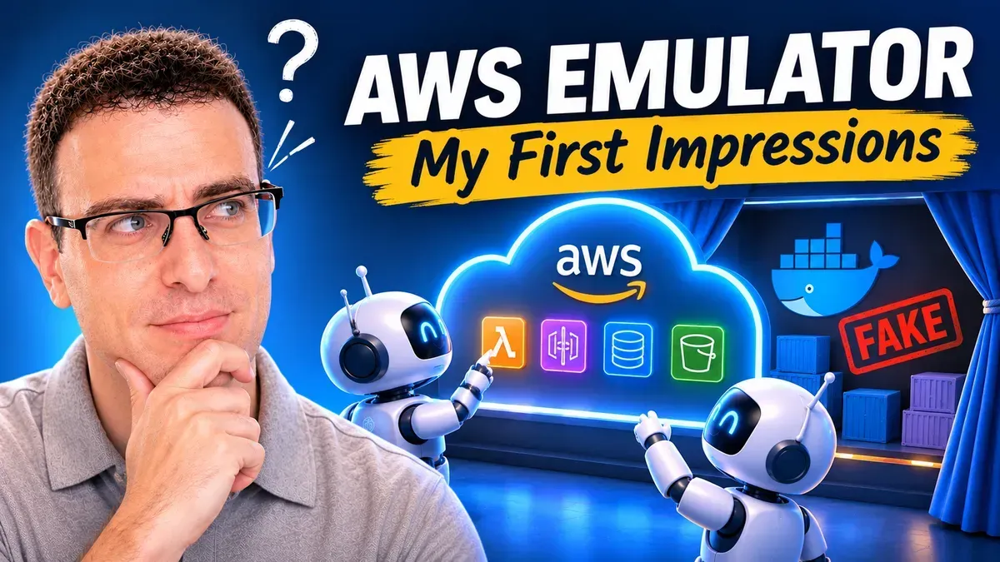
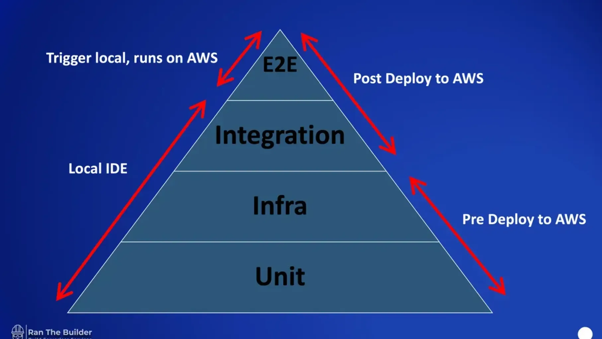
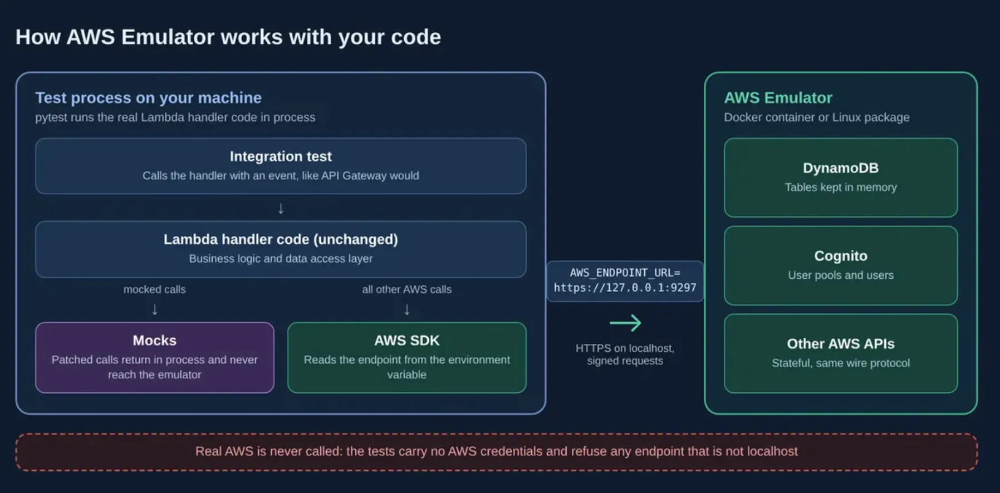
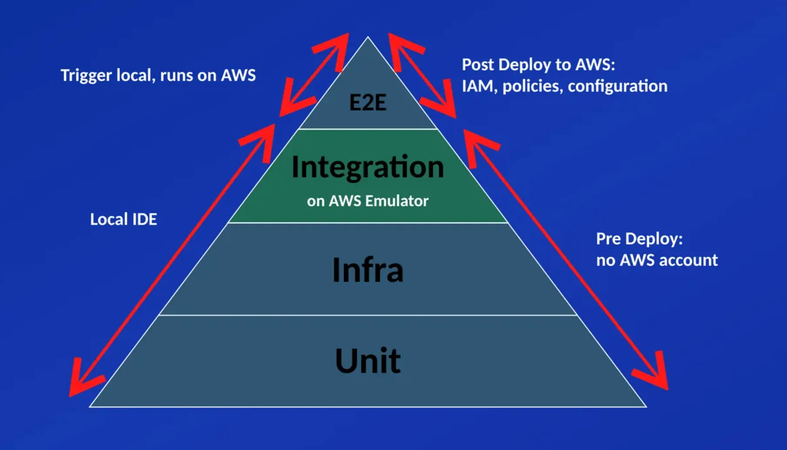
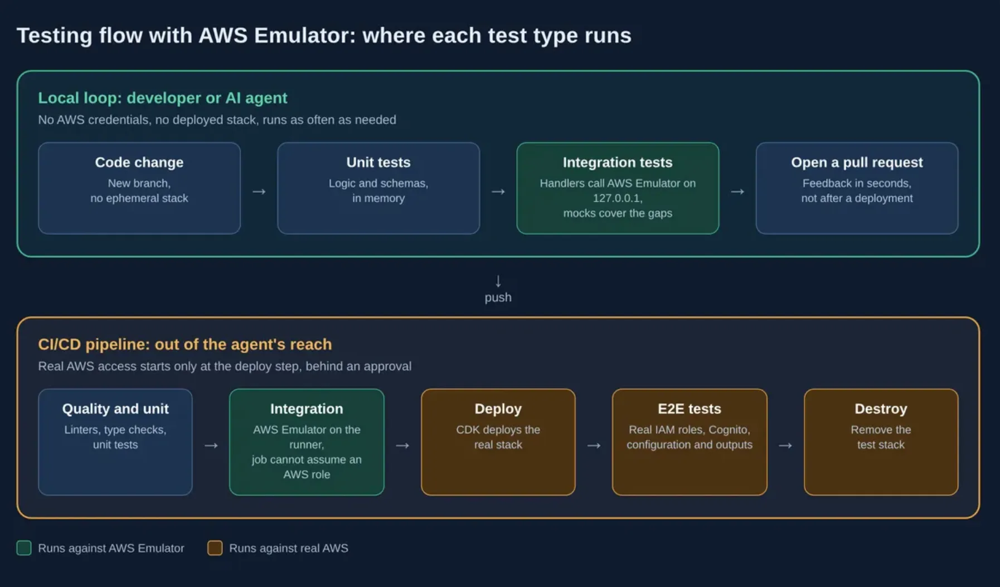
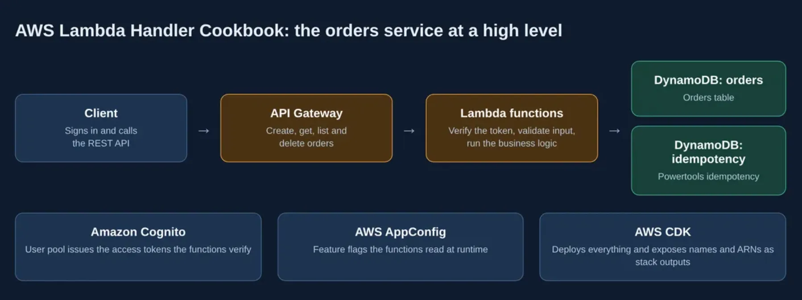

# AWS Emulator: First Impressions From a Real Serverless App

- **Original author** [Ran Isenberg](https://ranthebuilder.cloud/blog/aws-emulator-first-impressions-from-a-real-serverless-app/#author-bio)
- **Source** [Ran The Builder](https://ranthebuilder.cloud/blog/aws-emulator-first-impressions-from-a-real-serverless-app/)
- **Published** Nov 12, 2026
- **Last modified** Nov 13, 2026

Ran Isenberg experimented with moving integration tests for the **AWS Lambda Handler Cookbook** from deployed AWS resources to AWS Emulator. The first full run reported **34 passing integration tests in about seven seconds**. The Lambda application code and individual test bodies stayed the same. The main changes involved starting the test environment, setting the SDK endpoint, and adapting the test setup around behavior the tested emulator build handled differently. [Original article and experiment results](https://ranthebuilder.cloud/blog/aws-emulator-first-impressions-from-a-real-serverless-app/)

## 1. The Serverless Testing Pyramid Before the Change

The previous workflow used an *ephemeral stack*, a temporary deployment in an AWS test account that could be created for a branch. Unit tests and infrastructure definition checks ran locally. Developers could launch integration tests from their IDE, but those tests still called services from the deployed stack. End-to-end tests exercised the deployed application along the path a client would use.

This approach gives developers feedback from the AWS services themselves. It also adds a deployment or update before branch-level integration testing. Giving an AI coding agent the ability to run those tests raises a second question about where deployment credentials should live. The author's goal was to keep the edit-and-test loop local while leaving access to the AWS account in a controlled delivery pipeline.

Mocks already had a place in the old workflow. They helped make a particular dependency fail on demand so a test could check the application's response. Isenberg also describes using Moto for a case that needed a simulated organization with 10,000 accounts. Different tools are useful depending on what a particular test needs to prove. [The author's testing approach](https://ranthebuilder.cloud/blog/aws-emulator-first-impressions-from-a-real-serverless-app/)

## 2. Where AWS Emulator Sits in the Test Process

AWS Emulator exposes a local endpoint that implements AWS APIs for development and testing. AWS documents native Linux packages and a Docker path for Windows, macOS, and other supported setups. In this example, pytest still runs the handler in its own process. The SDK uses `AWS_ENDPOINT_URL` to route the relevant requests to the emulator, which maintains resource state for the run. [AWS Emulator User Guide](https://docs.aws.amazon.com/emulator/latest/userguide/what-is-service.html)

1. **Call the handler with a test event.** The handler executes the application logic and data-access layer used by the service.
2. **Return mocked results inside the test process.** A fixture can supply an AppConfig feature flag or another deliberately fixed dependency response.
3. **Send SDK requests to the local endpoint.** The diagram uses `https://127.0.0.1:9297`. A DynamoDB write and a later read can use the same emulated table.
4. **Check the response and the stored state.** An order creation case can inspect the handler's response and read back the order. A repeated-request case can check that the application handles the same request without creating an unexpected second order.

The local test job uses emulator credentials when request signing is required and configures its SDK to trust the emulator's CA. Real AWS credentials stay outside the job. The setup checks the effective endpoint before running tests and stops on a missing or unexpected configuration. This is especially useful when an SDK client has its own endpoint settings. [Pointing an AWS SDK at AWS Emulator](https://docs.aws.amazon.com/emulator/latest/userguide/point-sdk-to-emulator.html)

## 3. Moving Integration Tests Before Deployment

| Test layer | Where it runs in the revised setup | What it covers |
| --- | --- | --- |
| Unit | Local or CI | Business rules, input validation, and logic isolated from services. |
| Infrastructure | Local or CI before deployment | Expectations about declared resources and values in the infrastructure definition. |
| Integration | Local or CI with the emulator and selective mocks | The handler, SDK, and emulated resources working together within the test's scope. |
| End-to-end | A test stack on AWS | API Gateway reaching Lambda, real identity integration, IAM roles and policies, and deployed configuration. |

A developer or coding agent can update code, run unit and integration tests, and open a pull request from an environment without AWS account access. CI repeats linting, type checks, unit tests, and emulator integration tests. After approval, the deployment job uses scoped AWS permissions to create the test stack, run end-to-end checks, and remove temporary resources from that run.

The CI/CD permissions establish this separation. Pointing an SDK at loopback changes where its configured requests go. The integration job's identity still determines whether it could reach real AWS through another path. AWS also documents that IAM and resource policy evaluation in the emulator differs from AWS. IAM and deployed security checks therefore belong on a controlled AWS test stack. [AWS Emulator limitations](https://docs.aws.amazon.com/emulator/latest/userguide/what-is-service.html)

## 4. What the AWS Lambda Handler Cookbook Experiment Covered

The sample Python service lets a client sign in and call API Gateway to create, retrieve, list, or delete orders. Lambda validates requests and runs the business logic. One DynamoDB table stores orders. The other supports idempotency through Powertools. Cognito issues user tokens, AppConfig supplies runtime feature flags, and AWS CDK defines the deployed stack. [AWS Lambda Handler Cookbook](https://github.com/ran-isenberg/aws-lambda-handler-cookbook)

The migration added a Makefile path for starting the emulator locally and made the emulator a CI dependency. The integration job moved before deployment and checked its endpoint to avoid using a live AWS account. The first full run passed **34 integration tests in roughly seven seconds**. This is a measurement of the author's suite and environment. In a different project, measure emulator startup, test data preparation, and test execution separately when making a comparison. [Original article](https://ranthebuilder.cloud/blog/aws-emulator-first-impressions-from-a-real-serverless-app/) · [Migration pull request](https://github.com/ran-isenberg/aws-lambda-handler-cookbook/pull/1082)

| Component | Treatment in the reported experiment | What the result covers |
| --- | --- | --- |
| DynamoDB | The handler uses the SDK to call the emulated tables. | Order persistence and the Powertools idempotency store exercised by the suite. |
| Lambda and API Gateway | pytest builds sample events and invokes Python handlers directly. | Handler logic and its dependencies. The deployed API Gateway-to-Lambda path belongs to E2E. |
| AppConfig | The existing mock stays in the suite. | Application behavior for feature-flag values provided by the fixtures. |
| Cognito | The local suite uses test-only tokens suited to its application scenarios. | The local authentication path exercised by the fixtures. Live signing-key retrieval and user pool behavior remain checks for AWS E2E. |

The distinction matters when interpreting the reported result. The local suite exercised the handlers, order data, and idempotency together. It did not exercise the emulator's own Lambda or API Gateway implementation. The deployed suite verifies the wiring that sits outside the in-process test.

## 5. Four Approaches When an API Behaves Differently

| Approach | When it helps | What the team takes on |
| --- | --- | --- |
| Deploy a test stack to AWS | The test depends on live IAM, deployed configuration, or cross-service behavior. | Deployment time, resource cost, and management of test account access. |
| Mock calls in-process | The test needs a deliberate failure or needs to isolate application logic. | Mock responses need maintenance when service contracts or assumptions change. |
| Use the emulator with small workarounds | Most required APIs behave as expected and the remaining gaps can be isolated with fixtures. | Document the behavior each workaround leaves to E2E and recheck it after upgrades. |
| Combine the emulator with another container | An external dependency needs an engine's behavior, such as PostgreSQL for migrations or ORM queries. | Run another service on the test machine or runner. An engine container covers database behavior within its setup, while deployed RDS configuration still needs its own checks. |

In the build Isenberg tested, emulated Cognito issued ES256-signed tokens while the live Cognito flow used by the suite expected RS256. The reported user pool scenario also did not invoke Lambda triggers. A local token fixture kept the application scenarios runnable and left the live Cognito behavior to end-to-end tests. Isenberg discusses using a real PostgreSQL engine in a separate container as an option for relational workloads. The Cookbook uses DynamoDB, so the PostgreSQL approach was outside the reported experiment. [Trade-offs in the original article](https://ranthebuilder.cloud/blog/aws-emulator-first-impressions-from-a-real-serverless-app/)

When a difference appears, start with the purpose of the test. A failure fixture may be enough when the question is how the application reacts. When the question is whether an AWS service actually behaves that way, record which AWS check provides the evidence. That makes the cost of each workaround visible when the test suite changes.

## 6. Reading Compatibility Evidence by Release

The author recorded **6,908 reports in the known-gaps directory on November 12, 2026**. This number describes the repository at the time of the review. For a project decision, check whether the specific operations and failure cases your application uses are covered. A broad service label or score can hide differences between managing a resource and using its data plane. [The author's observations](https://ranthebuilder.cloud/blog/aws-emulator-first-impressions-from-a-real-serverless-app/)

Amazon describes three groups of agents behind the original project. One group develops reference tests using AWS. Another identifies differences in the emulator. The third fixes those differences and submits changes through automated checks. Isenberg raised a question about public visibility of the tests. AWS documentation now points to the public **AWS Emulator Evaluation Suite** and explains how fidelity scores relate to releases. Compare scores against the same version of the evaluation suite when judging changes. [How Amazon built AWS Emulator](https://www.aboutamazon.com/news/aws/how-autonomous-ai-agents-built-aws-emulator) · [AWS guidance on fidelity](https://docs.aws.amazon.com/emulator/latest/userguide/fidelity.html) · [Evaluation Suite repository](https://github.com/aws/aws-emulator-evaluation-suite)

## 7. Evaluating the Emulator for Another Repository

1. **Inventory the AWS calls.** Read the application code, CDK or Terraform configuration, and existing tests. Identify the data-plane calls and deployment behavior each test depends on.
2. **Try a small representative path.** Run one integration case from the handler through the SDK to an emulated resource. Record the emulator version, endpoint, fixtures, and observed behavior. Use sample data and emulator-only credentials.
3. **Record the coverage boundary.** For each mock or workaround, state what the local test covers and which AWS test verifies the remaining behavior. Keep a controlled E2E path from the client to deployed services.
4. **Revisit the result after updates.** Run the same tests against a new emulator version and compare against the expected AWS contract. Remove a workaround once the relevant project scenario passes with the standard path.

The author packaged this evaluation into an **AWS Emulator adoption skill**. It inventories application and infrastructure dependencies, checks relevant operations locally, and produces a report of compatibility and workarounds. The Cookbook's emulator configuration is a second reference for teams planning a similar trial. [AWS Emulator adoption skill](https://github.com/ran-isenberg/aws-emulator-adoption-skill) · [Cookbook emulator configuration](https://github.com/ran-isenberg/aws-lambda-handler-cookbook/tree/main/emulator)

For the Cookbook, the emulator made the integration loop faster because the core tests exercised application code against sufficiently compatible DynamoDB operations. A useful test record names the layers each result actually covered. Local checks surface application issues early, and the deployed suite verifies the configuration and access controls the application will use on AWS.
