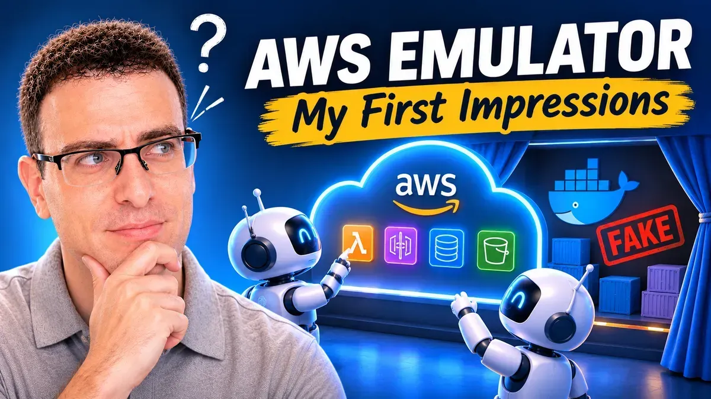
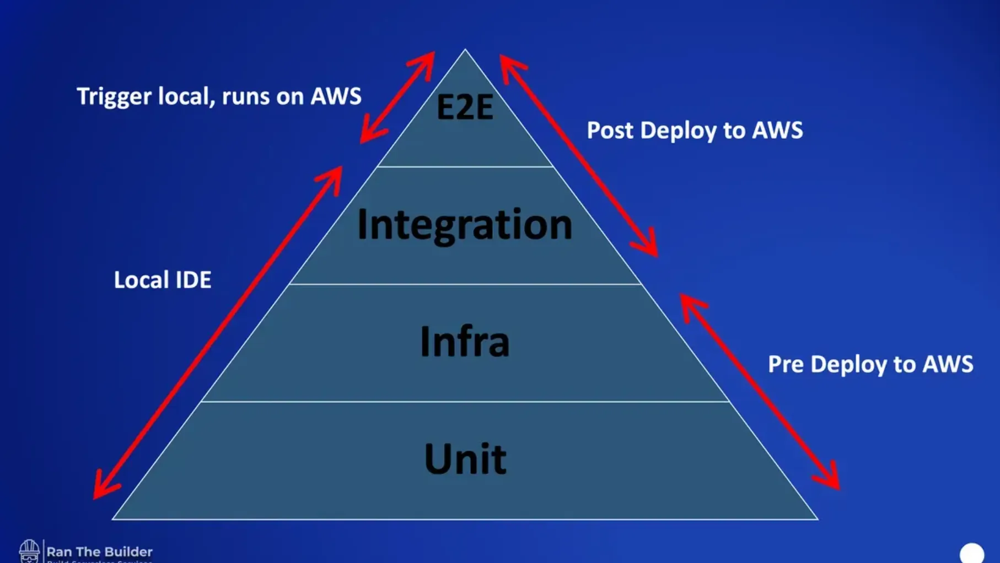
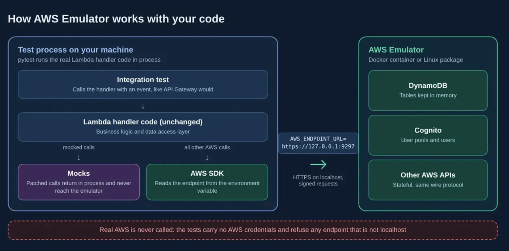
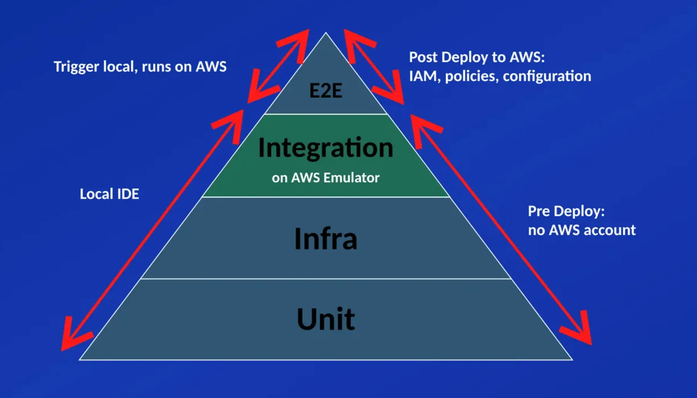
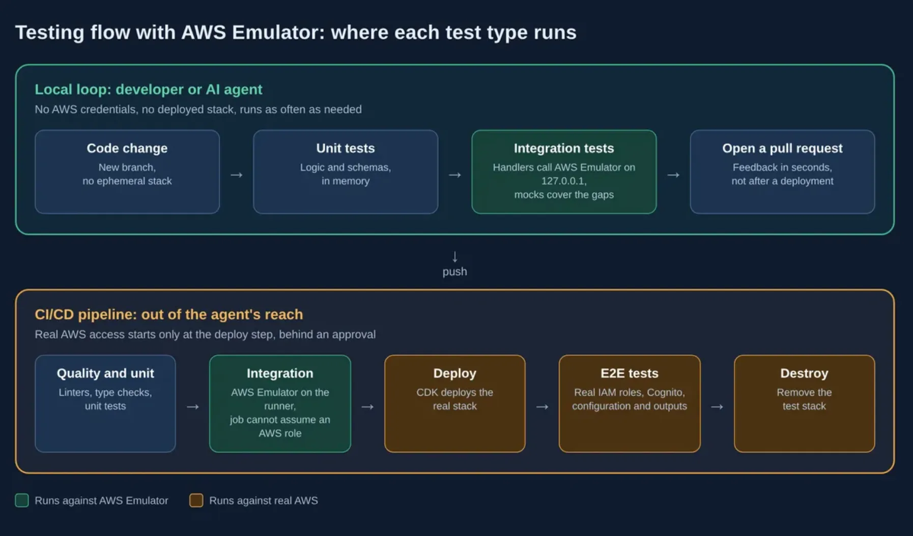
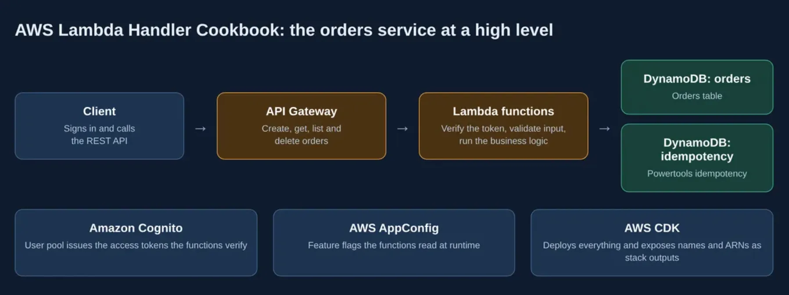

# Trải nghiệm AWS Emulator trên một ứng dụng serverless thực tế

- **Tác giả bài gốc** [Ran Isenberg](https://ranthebuilder.cloud/blog/aws-emulator-first-impressions-from-a-real-serverless-app/#author-bio)
- **Nguồn** [Ran The Builder](https://ranthebuilder.cloud/blog/aws-emulator-first-impressions-from-a-real-serverless-app/)
- **Ngày đăng** 12/11/2026
- **Cập nhật lần cuối** 13/11/2026

Tác giả thử chuyển integration test của **AWS Lambda Handler Cookbook** từ tài nguyên AWS đã triển khai sang AWS Emulator. Trong lần chạy được báo cáo, **34 integration test đều qua trong khoảng 7 giây**. Phần logic Lambda và nội dung từng test được giữ lại. Thay đổi chủ yếu nằm ở cách khởi động môi trường test, chọn endpoint cho AWS SDK và xử lý những hành vi mà bản emulator đang dùng chưa mô phỏng được. [Bài gốc và kết quả thử nghiệm](https://ranthebuilder.cloud/blog/aws-emulator-first-impressions-from-a-real-serverless-app/)

## 1. Quy trình kiểm thử trước khi có emulator

Ở quy trình cũ, mỗi nhánh có thể dùng một *ephemeral stack*, tức một bản triển khai tạm thời của dịch vụ trên tài khoản AWS thử nghiệm. Unit test và kiểm tra định nghĩa hạ tầng chạy trên máy phát triển. Integration test có thể khởi chạy từ IDE nhưng vẫn gọi tài nguyên AWS của stack đó. E2E đi qua dịch vụ đã triển khai để kiểm tra hành vi mà người dùng hoặc client thực sự nhìn thấy.

Cách làm này cho phản hồi từ dịch vụ AWS thật. Đổi lại, nhóm phải đợi stack được tạo hoặc cập nhật trước khi chạy những ca tích hợp cần tài nguyên. Khi muốn một AI coding agent có thể tự chạy các ca đó, quyền truy cập tài khoản thử nghiệm cũng trở thành một phần của bài toán. Mục tiêu của tác giả là giữ vòng sửa mã và kiểm thử trên máy phát triển, còn quyền deploy nằm ở pipeline có người kiểm soát.

Mock vẫn hữu ích trong mô hình cũ, chẳng hạn khi cần tạo một lỗi có chủ đích để kiểm tra ứng dụng xử lý ra sao. Tác giả cũng nêu trường hợp đội ngũ dùng Moto để thử việc duyệt một AWS Organization giả lập có 10.000 tài khoản. Giá trị của công cụ nằm ở mức độ phù hợp với hành vi cụ thể mà test muốn chứng minh. [Bài viết và tháp kiểm thử của tác giả](https://ranthebuilder.cloud/blog/aws-emulator-first-impressions-from-a-real-serverless-app/)

## 2. AWS Emulator nằm ở đâu trong luồng chạy test?

AWS Emulator cung cấp một endpoint mô phỏng các API AWS ở máy local hoặc CI runner. Theo tài liệu AWS, có thể chạy native trên Linux hoặc dùng Docker trên Windows, macOS và các môi trường phù hợp. Với cách thiết lập trong bài, handler vẫn chạy trong tiến trình pytest. Các lệnh AWS SDK được cấu hình đi đến emulator qua `AWS_ENDPOINT_URL`. Emulator giữ trạng thái cho các tài nguyên đã tạo trong phiên chạy. [AWS Emulator User Guide](https://docs.aws.amazon.com/emulator/latest/userguide/what-is-service.html)

1. **Test tạo event mẫu và gọi handler trực tiếp.** Handler vẫn dùng logic nghiệp vụ và lớp truy cập dữ liệu của ứng dụng.
2. **Lời gọi được mock trả kết quả trong tiến trình test.** Ví dụ, AppConfig có thể trả giá trị feature flag đã được fixture chuẩn bị.
3. **Lời gọi qua SDK đi đến endpoint local.** Trong cấu hình minh họa, endpoint là `https://127.0.0.1:9297`. Các thao tác như ghi và đọc DynamoDB có thể dùng cùng trạng thái của emulator.
4. **Test xác minh kết quả và dữ liệu.** Một ca tạo đơn có thể kiểm tra phản hồi của handler và đọc lại bản ghi đã lưu. Ca gọi lặp có thể kiểm tra ứng dụng xử lý cùng một yêu cầu mà không tạo thêm đơn ngoài dự kiến.

Job local dùng credential của emulator khi cần ký request và chứng chỉ CA theo cấu hình của SDK. Quyền truy cập tài khoản AWS thật được giữ ngoài môi trường đó. Test setup nên xác nhận endpoint hiệu lực là loopback và dừng sớm khi cấu hình thiếu hoặc sai. Bước này đặc biệt quan trọng nếu một client có thiết lập endpoint riêng. [Cách trỏ AWS SDK đến AWS Emulator](https://docs.aws.amazon.com/emulator/latest/userguide/point-sdk-to-emulator.html)

## 3. Chuyển integration test xuống trước bước deploy

| Lớp kiểm thử | Nơi chạy trong mô hình mới | Điều có thể kiểm tra |
| --- | --- | --- |
| Unit | Local hoặc CI | Quy tắc nghiệp vụ, schema đầu vào và các nhánh xử lý độc lập với dịch vụ. |
| Infrastructure | Local hoặc CI trước deploy | Các giá trị và tài nguyên được khai báo trong định nghĩa hạ tầng. |
| Integration | Local hoặc CI runner với emulator và mock có chọn lọc | Handler, SDK và tài nguyên giả lập hoạt động cùng nhau trong phạm vi ca kiểm thử. |
| End-to-end | Stack thử nghiệm trên AWS | API Gateway gọi Lambda, hệ thống nhận danh tính thật và các IAM role, policy cùng cấu hình deploy hoạt động theo dự kiến. |

Developer hoặc AI agent có thể sửa mã, chạy unit test và integration test, rồi mở pull request từ môi trường không có quyền truy cập AWS thật. CI chạy lại lint, type check, unit test và integration test trong job riêng. Sau bước phê duyệt, pipeline có quyền giới hạn mới deploy stack thử nghiệm, chạy E2E và dọn stack của lượt kiểm thử.

Ranh giới này phụ thuộc vào cách cấp quyền của hệ thống CI/CD. Nếu job integration có sẵn role deploy hoặc đọc được credential thật, việc trỏ SDK đến localhost chỉ thay đổi đích của một số lời gọi. Theo tài liệu AWS, ngữ nghĩa IAM và resource policy trong emulator cũng có thể khác dịch vụ thật, nên kiểm tra bảo mật và quyền triển khai vẫn cần môi trường AWS được kiểm soát. [Giới hạn của AWS Emulator](https://docs.aws.amazon.com/emulator/latest/userguide/what-is-service.html)

## 4. Kết quả trên AWS Lambda Handler Cookbook

Ứng dụng mẫu là dịch vụ quản lý đơn viết bằng Python. Client đăng nhập rồi gọi API Gateway để tạo, xem, liệt kê hoặc xóa đơn. Lambda kiểm tra đầu vào và thực hiện nghiệp vụ. Một bảng DynamoDB lưu đơn, bảng còn lại hỗ trợ tính idempotent bằng Powertools. Cognito phát hành token cho người dùng, AppConfig cung cấp feature flag và AWS CDK mô tả stack triển khai. [AWS Lambda Handler Cookbook](https://github.com/ran-isenberg/aws-lambda-handler-cookbook)

Tác giả bổ sung cách chạy emulator từ Makefile ở local và cài emulator như một dependency trong CI. Integration job chạy trước deploy, kiểm tra endpoint và tránh dùng tài khoản AWS thật. Lần chạy đầy đủ đầu tiên đạt **34 test trong khoảng 7 giây**. Đây là số liệu của bộ test và môi trường trong bài. Để đánh giá tốc độ ở dự án khác, nên tách thời gian khởi động emulator, chuẩn bị bảng và thời gian thực thi test. [Bài gốc](https://ranthebuilder.cloud/blog/aws-emulator-first-impressions-from-a-real-serverless-app/) · [Pull request chuyển đổi](https://github.com/ran-isenberg/aws-lambda-handler-cookbook/pull/1082)

| Thành phần | Cách bộ test thử nghiệm xử lý | Phạm vi của kết quả |
| --- | --- | --- |
| DynamoDB | Handler gọi các bảng giả lập qua SDK. | Thử luồng đọc, ghi đơn và lớp lưu trạng thái idempotency. |
| Lambda và API Gateway | Test tạo event mẫu và gọi hàm Python trực tiếp. | Kiểm tra logic handler. Luồng API Gateway gọi Lambda được kiểm tra ở E2E. |
| AppConfig | Giữ mock đã có. | Kiểm tra cách ứng dụng xử lý với feature flag từ fixture. |
| Cognito | Dùng token kiểm thử dành riêng cho môi trường local để phù hợp với luồng xác thực của bộ test. | Việc lấy khóa ký thật và hành vi của user pool được xác minh qua bộ E2E tương ứng. |

Bộ test duy trì hai loại bằng chứng khác nhau. Kết quả local cho thấy luồng ứng dụng hoạt động với DynamoDB giả lập và các dependency đã chọn. Kết quả E2E xác minh các điểm kết nối giữa tài nguyên sau deploy, gồm cấu hình, danh tính và quyền truy cập thực tế.

## 5. Chọn cách thay thế khi gặp API chưa tương thích

| Phương án | Dùng khi | Chi phí hoặc giới hạn |
| --- | --- | --- |
| Deploy stack thử nghiệm trên AWS | Hành vi cần kiểm tra phụ thuộc vào cấu hình dịch vụ, workflow liên dịch vụ hoặc IAM thật. | Có thời gian chờ deploy, chi phí tài nguyên và yêu cầu quản lý quyền. |
| Mock trong tiến trình | Cần mô phỏng một nhánh lỗi có chủ đích hoặc chỉ kiểm tra logic cô lập. | Mock phản ánh hợp đồng mà lập trình viên mô tả. Khi hợp đồng thay đổi, fixture và kỳ vọng phải được cập nhật. |
| Emulator với workaround nhỏ | Phần lớn các API của ứng dụng đã phù hợp, chỉ còn một số chỗ có thể tách bằng fixture. | Cần ghi rõ hành vi bị bỏ qua ở local và ca kiểm thử nào bao phủ nó trên AWS. |
| Emulator kết hợp container bên thứ ba | Một dependency đòi hỏi hành vi riêng của engine, ví dụ PostgreSQL cho migration hoặc truy vấn ORM. | Thêm dịch vụ cần vận hành trên runner. Bản dựng container vẫn có phạm vi riêng so với dịch vụ RDS đã deploy. |

Ở phiên bản tác giả thử, token Cognito giả lập được ký bằng ES256, trong khi luồng Cognito thật mà test dựa vào dùng RS256. Lambda trigger của user pool cũng chưa được gọi trong tình huống được báo cáo. Workaround cho phép giữ kiểm tra logic nghiệp vụ tại local, đồng thời để các hành vi Cognito thật ở E2E. Với PostgreSQL, tác giả nêu cách dùng engine thật trong container bên cạnh emulator như một phương án để đánh giá. Lần thử Cookbook sử dụng DynamoDB nên phương án PostgreSQL chưa được áp dụng trong kết quả 34 test. [Các đánh đổi được ghi lại trong bài gốc](https://ranthebuilder.cloud/blog/aws-emulator-first-impressions-from-a-real-serverless-app/)

Khi gặp một khác biệt, trước hết xác định test đang kiểm tra quy tắc của ứng dụng hay hợp đồng của AWS. Nếu fixture giữ được mục tiêu của test, ghi tên workaround và ca E2E bù cho phần bị che. Nếu hành vi đó là điều cần chứng minh, giữ ca kiểm thử ở môi trường phù hợp cho đến khi emulator đã được kiểm tra ở đúng phiên bản.

## 6. Đọc báo cáo tương thích theo phiên bản

Tác giả ghi nhận **6.908 báo cáo trong thư mục known gaps vào ngày 12/11/2026**. Con số này là ảnh chụp của kho ở thời điểm nghiên cứu. Khi chọn phiên bản cho một dự án, thông tin hữu ích hơn là các thao tác của chính ứng dụng có được kiểm chứng, đặc biệt là các thao tác data plane và hành vi lỗi mà ứng dụng dựa vào. [Bài gốc](https://ranthebuilder.cloud/blog/aws-emulator-first-impressions-from-a-real-serverless-app/)

Amazon mô tả quy trình ban đầu của dự án bằng ba nhóm agent. Một nhóm xây ca kiểm thử đối chiếu với AWS. Một nhóm phát hiện sai khác trong emulator. Nhóm còn lại sửa lỗi và đưa bản sửa qua các kiểm tra tự động. Bài gốc đặt câu hỏi về mức độ công khai của bộ kiểm thử. Tài liệu AWS hiện dẫn đến **AWS Emulator Evaluation Suite** và giải thích cách đọc fidelity score theo từng bản phát hành. Điểm fidelity gắn với phiên bản bộ test, nên cần đối chiếu cùng phiên bản khi so sánh. [Cách Amazon xây AWS Emulator](https://www.aboutamazon.com/news/aws/how-autonomous-ai-agents-built-aws-emulator) · [Fidelity trong AWS Emulator](https://docs.aws.amazon.com/emulator/latest/userguide/fidelity.html) · [Evaluation Suite](https://github.com/aws/aws-emulator-evaluation-suite)

## 7. Áp dụng cho một repository khác

1. **Kiểm kê các lời gọi AWS.** Xem mã ứng dụng, cấu hình CDK hoặc Terraform và test hiện có. Ghi rõ test cần kiểm tra thao tác data plane nào, ví dụ ghi và đọc dữ liệu, và điểm nào cần xác minh sau deploy.
2. **Chọn một luồng nhỏ để thử.** Chạy một ca đi từ handler đến SDK và tài nguyên giả lập. Ghi endpoint, phiên bản emulator, fixture và hành vi quan sát được. Dùng dữ liệu mẫu và credential chỉ dành cho emulator.
3. **Ghi lại phạm vi kiểm chứng.** Với mỗi mock hoặc workaround, nêu điều vẫn được kiểm tra local và ca AWS nào xác minh hành vi còn lại. Giữ E2E có kiểm soát cho đường đi từ client đến tài nguyên đã triển khai.
4. **So sánh lại sau khi nâng phiên bản.** Chạy cùng bộ test trên bản mới và đối chiếu với kỳ vọng từ dịch vụ AWS. Khi một API đã khớp với ca kiểm thử của dự án, có thể bỏ workaround tương ứng.

Tác giả đóng gói phần đánh giá thành **AWS Emulator adoption skill**. Skill tham chiếu hạ tầng và mã của repository, chạy kiểm tra local với những API liên quan rồi ghi lại mức độ phù hợp và các workaround. Cấu hình Docker của Cookbook cũng có thể dùng làm tài liệu tham khảo khi bắt đầu. [Adoption skill của tác giả](https://github.com/ran-isenberg/aws-emulator-adoption-skill) · [Cấu hình emulator trong Cookbook](https://github.com/ran-isenberg/aws-lambda-handler-cookbook/tree/main/emulator)

Kết quả Cookbook cho thấy integration test có thể phản hồi nhanh với AWS Emulator khi luồng chính dựa vào các API đủ tương thích. Mỗi bộ test cần nói rõ nó đã đi qua những lớp nào. Kết quả local giúp phát hiện lỗi sớm, còn kết quả trên stack AWS xác minh cấu hình và quyền trong môi trường sẽ chạy ứng dụng.
