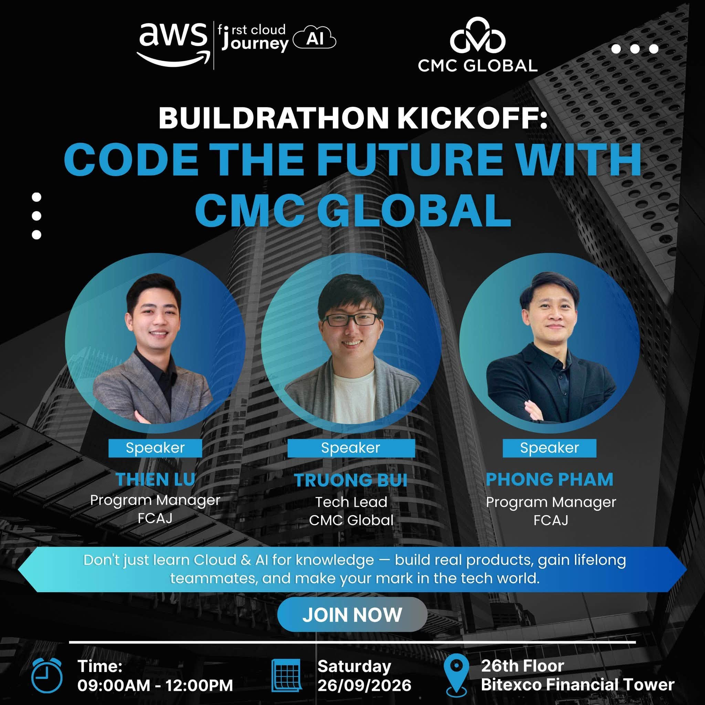
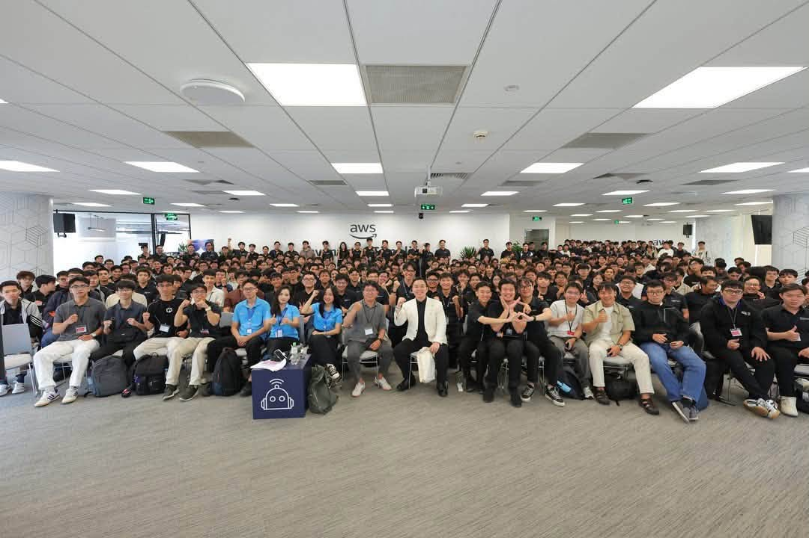
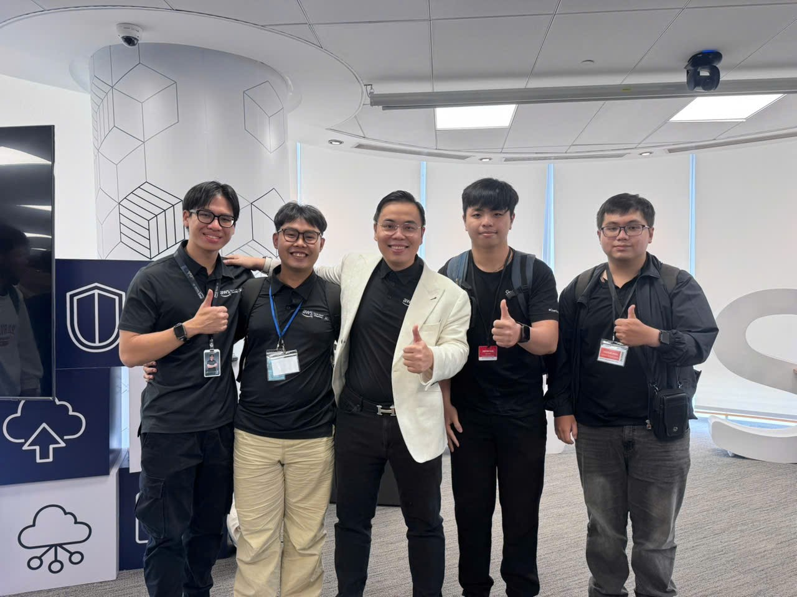

# Buildrathon Kickoff

- **Theme** · Code the Future with CMC Global
- **Date** · Saturday, September 26, 2026
- **Venue** · 26th floor, Bitexco Financial Tower, Ho Chi Minh City
- **Organizers** · AWS First Cloud AI Journey (FCAJ) and CMC Global
- **Role** · Attendee

### Event objectives

FCAJ and CMC Global brought participants together to introduce the Buildrathon challenge, its goals, and how entries would be judged. The program paired career discussions with a short AI agent exercise. The opening also introduced AWS Cloud, generative AI, and how AWS services can support agent development. [Event program](https://luma.com/8fe9vvps)

### Speakers

| Speaker | Title on the poster | Organization |
| --- | --- | --- |
| Thien Lu | Program Manager | FCAJ |
| Truong Bui | Tech Lead | CMC Global |
| Phong Pham | Program Manager | FCAJ |

### Key highlights

#### Morning schedule

| Time (UTC+7) | Activity |
| --- | --- |
| 08:00–09:00 | Arrival and check-in. |
| 09:00–09:30 | Opening, challenge overview, objectives, and judging criteria. |
| 09:30–09:45 | Introductions and networking with other attendees. |
| 09:45–10:30 | Career talk on cloud and AI. |
| 10:30–10:45 | Q&A about AWS, certifications, career paths, and the challenge. |
| 10:45–11:15 | Hands-on AI agent exercise. |
| 11:15–11:20 | Closing recap, learning resources, and upcoming community activities. |
| 11:20–12:00 | Mock interviews listed in the [republished program](https://allai.events/event/buildrathon-kickoff-code-the-future-with-cmc-global). |

[Program on the registration page](https://luma.com/8fe9vvps)

#### Opening and attendee introductions

The opening introduced the Buildrathon challenge and how teams would be evaluated. Attendees then had time to meet other participants, discuss their backgrounds and interests in AWS and AI, and prepare to collaborate on the challenge. [Event program](https://luma.com/8fe9vvps)

#### Careers in cloud and AI

The career discussion covered cloud and AI trends, examples from real projects, and potential career paths. The Q&A followed with topics including AWS, generative AI, certifications, and the Buildrathon challenge. [Event program](https://luma.com/8fe9vvps)

#### Hands-on AI agent challenge

The hands-on activity tasked participants with developing a small AWS-based AI solution with mentor support. It covered prompt design, knowledge bases, and retrieval-augmented generation (RAG) as a way to bring relevant information into an answer. The agent connects these steps within the example task. [Event program](https://luma.com/8fe9vvps)

#### Mock interviews

The republished program lists practice interviews for cloud engineering, DevOps, data engineering, and solutions architecture roles. Feedback topics included AWS fundamentals, technical skills, and how participants communicated their answers. [Republished program](https://allai.events/event/buildrathon-kickoff-code-the-future-with-cmc-global)

### Key takeaways

- **Start with the problem and how success will be judged.** Before choosing services, I can describe the user's need and the outcome the solution must produce.
- **Understand the role of source data in an AI application.** A prompt defines the task, while a knowledge base provides information the system can use to answer it. A question with a known answer gives me a concrete way to check what the system retrieves and how it uses that information.
- **Practice explaining technical decisions.** When introducing a project or answering an interview question, I can start with the requirement, explain my contribution, and give an example of how I checked the result.

### Applying the ideas to work

The agent challenge gave me a way to frame an AI feature by its input, output, and acceptance criteria. For the PDF-to-profile feature in the [Tindy proposal](/2-proposal/), I can choose a sample document, list the fields to extract, and check what happens when the document omits some of them. That gives me a small task I can demonstrate with a concrete result.

### Event experience

I attended the kickoff in person at Bitexco Financial Tower. The parts most relevant to my internship were the AI agent exercise and the career talk. The exercise gave me an example of an AI task with a concrete output, and the talk prompted me to think about how I would explain that output when presenting a project.

#### Photos from Buildrathon Kickoff

*Group photo in the Buildrathon Kickoff hall.*

*Photo taken at the kickoff venue.*
