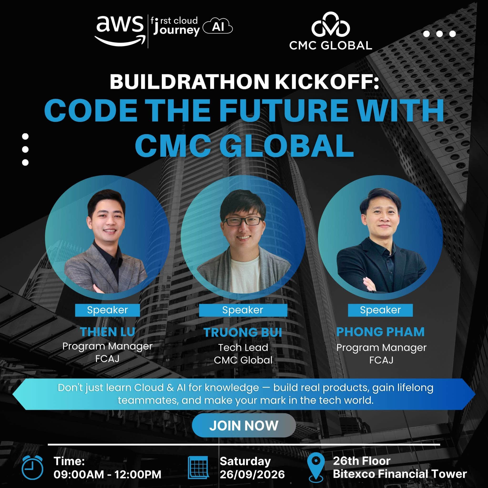
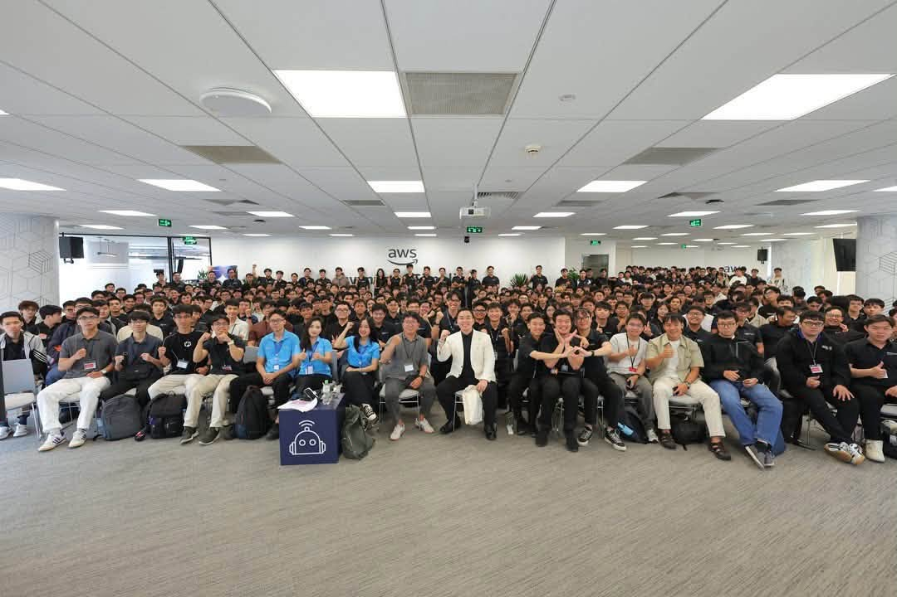
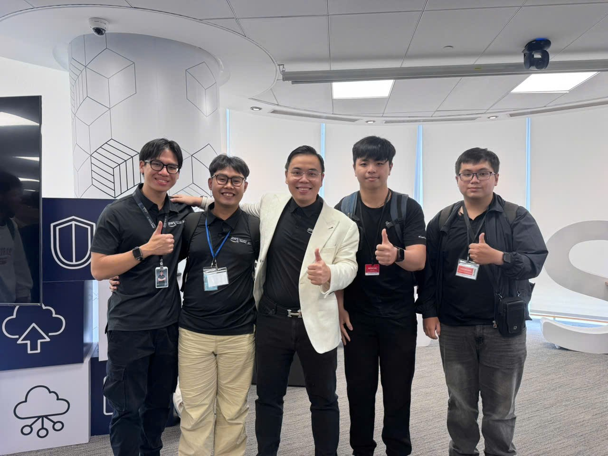

# Buildrathon Kickoff

- **Chủ đề** · Code the Future with CMC Global
- **Ngày tổ chức** · Thứ Bảy, 26/09/2026
- **Địa điểm** · Tầng 26, Bitexco Financial Tower, TP.HCM
- **Đơn vị phối hợp** · AWS First Cloud AI Journey (FCAJ) và CMC Global
- **Vai trò** · Người tham dự

### Mục đích của sự kiện

FCAJ và CMC Global tổ chức buổi kickoff để giới thiệu thử thách Buildrathon, mục tiêu của chương trình và tiêu chí chấm. Chương trình kết hợp phần định hướng nghề nghiệp với một thử thách ngắn về AI agent. Phần mở đầu giới thiệu AWS Cloud, Generative AI và cách các dịch vụ AWS có thể hỗ trợ xây dựng agent. [Chương trình sự kiện](https://luma.com/8fe9vvps)

### Danh sách diễn giả

| Diễn giả | Chức danh trên poster | Đơn vị |
| --- | --- | --- |
| Thien Lu | Program Manager | FCAJ |
| Truong Bui | Tech Lead | CMC Global |
| Phong Pham | Program Manager | FCAJ |

### Nội dung nổi bật

#### Lịch trình buổi sáng

| Thời gian (UTC+7) | Nội dung |
| --- | --- |
| 08:00–09:00 | Đón khách và check-in. |
| 09:00–09:30 | Khai mạc, giới thiệu thử thách, mục tiêu và tiêu chí chấm. |
| 09:30–09:45 | Làm quen và kết nối với những người tham dự. |
| 09:45–10:30 | Talkshow về xây dựng sự nghiệp trong lĩnh vực Cloud và AI. |
| 10:30–10:45 | Hỏi đáp về AWS, chứng chỉ, nghề nghiệp và thử thách Buildrathon. |
| 10:45–11:15 | Thực hành với thử thách AI agent. |
| 11:15–11:20 | Tổng kết, chia sẻ tài nguyên học tập và hoạt động cộng đồng sắp tới. |
| 11:20–12:00 | Phỏng vấn thử theo [lịch sự kiện đăng lại](https://allai.events/event/buildrathon-kickoff-code-the-future-with-cmc-global). |

[Chương trình trên trang đăng ký](https://luma.com/8fe9vvps)

#### Khai mạc và kết nối người tham dự

Phần khai mạc giới thiệu bài toán Buildrathon và cách các đội sẽ được đánh giá. Sau đó là hoạt động làm quen, giúp người tham dự trao đổi về nền tảng, mối quan tâm với AWS và AI, cũng như chuẩn bị phối hợp trong thử thách. [Chương trình sự kiện](https://luma.com/8fe9vvps)

#### Talkshow về nghề nghiệp Cloud và AI

Talkshow đề cập xu hướng Cloud và AI, ví dụ dự án thực tế và hướng phát triển nghề nghiệp. Phần hỏi đáp tiếp nối với các chủ đề AWS, Generative AI, chứng chỉ và thử thách Buildrathon. [Chương trình sự kiện](https://luma.com/8fe9vvps)

#### Thực hành AI Agent Challenge

Thử thách thực hành đặt ra bài toán xây dựng một giải pháp AI quy mô nhỏ trên AWS với sự hỗ trợ của mentor. Nội dung bao gồm cách viết prompt, sử dụng kho tri thức và truy xuất dữ liệu để bổ sung ngữ cảnh cho câu trả lời bằng RAG. AI agent là thành phần kết nối những bước đó trong bài toán thực hành. [Chương trình sự kiện](https://luma.com/8fe9vvps)

#### Phỏng vấn thử

Lịch đăng lại có phần phỏng vấn thử cho các hướng Cloud Engineer, DevOps, Data Engineer và Solution Architect. Nội dung phản hồi tập trung vào kiến thức AWS, kỹ năng kỹ thuật và cách trình bày câu trả lời. [Lịch sự kiện đăng lại](https://allai.events/event/buildrathon-kickoff-code-the-future-with-cmc-global)

### Những gì học được

- **Bắt đầu thử thách bằng bài toán và tiêu chí đánh giá.** Trước khi chọn dịch vụ, em cần diễn đạt được người dùng cần gì và giải pháp phải cho ra kết quả nào.
- **Hiểu vai trò của nguồn dữ liệu trong ứng dụng AI.** Prompt xác định nhiệm vụ, còn kho tri thức cung cấp nội dung liên quan để hệ thống có cơ sở trả lời. Em có thể dùng một câu hỏi có sẵn đáp án để thử cách hệ thống truy xuất và sử dụng thông tin.
- **Tập trình bày quyết định kỹ thuật.** Khi giới thiệu một dự án hoặc trả lời phỏng vấn, em có thể bắt đầu từ yêu cầu, giải thích phần mình thực hiện và đưa ra ví dụ về cách kiểm tra kết quả.

### Ứng dụng vào công việc

Từ phần thử thách AI agent, em có thể áp dụng cách xác định đầu vào, đầu ra và tiêu chí kiểm tra trước khi làm một tính năng AI. Chẳng hạn, với tính năng tạo bản nháp hồ sơ từ PDF trong [proposal Tindy](/vi/2-proposal/), em có thể chọn một tài liệu mẫu, xác định các trường cần trích xuất và kiểm tra trường hợp tài liệu thiếu thông tin. Đây là một cách chuyển nội dung thực hành của sự kiện thành đầu việc có kết quả để trình bày.

### Trải nghiệm tại sự kiện

Em tham dự trực tiếp buổi kickoff tại Bitexco Financial Tower. Phần em liên hệ rõ nhất với kỳ thực tập là thử thách AI agent và talkshow nghề nghiệp. Một phần đặt ra bài toán dùng AI để tạo đầu ra cụ thể, phần còn lại cho em cơ hội suy nghĩ về cách giải thích đầu ra đó khi giới thiệu dự án.

#### Hình ảnh tại Buildrathon Kickoff

*Ảnh tập thể tại hội trường Buildrathon Kickoff.*

*Ảnh lưu niệm tại địa điểm tổ chức.*
