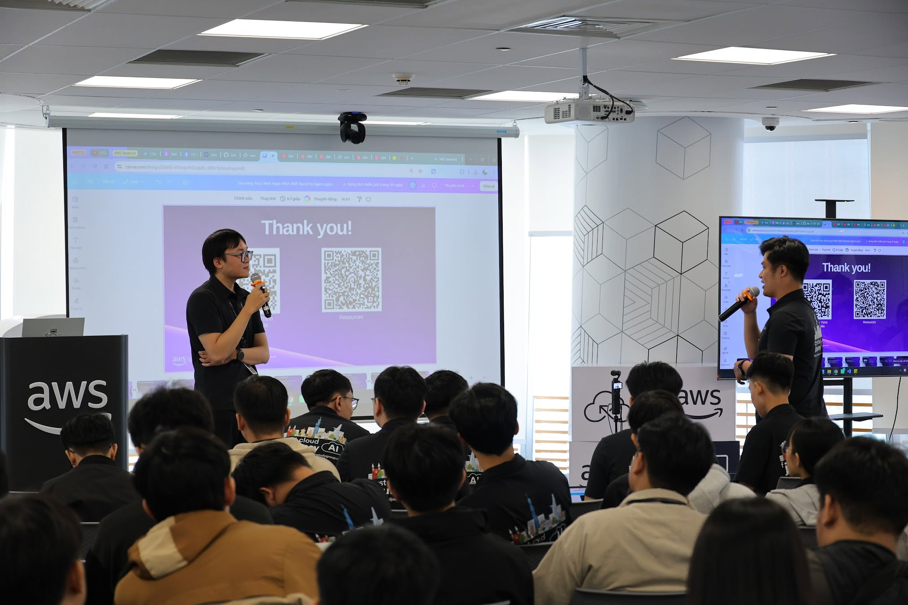
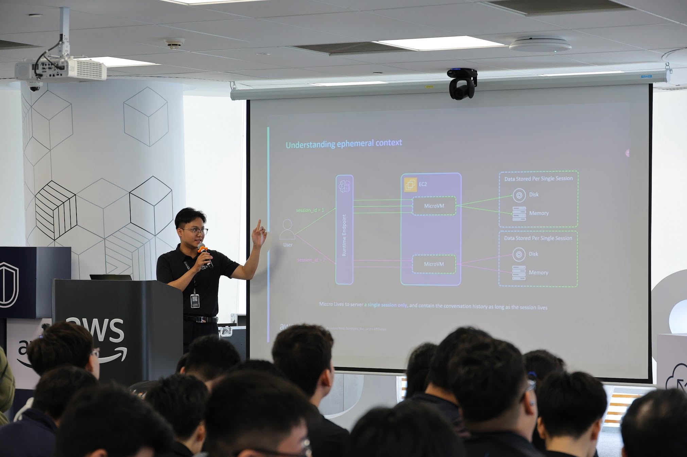
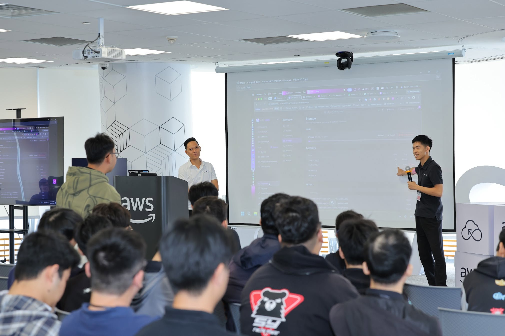
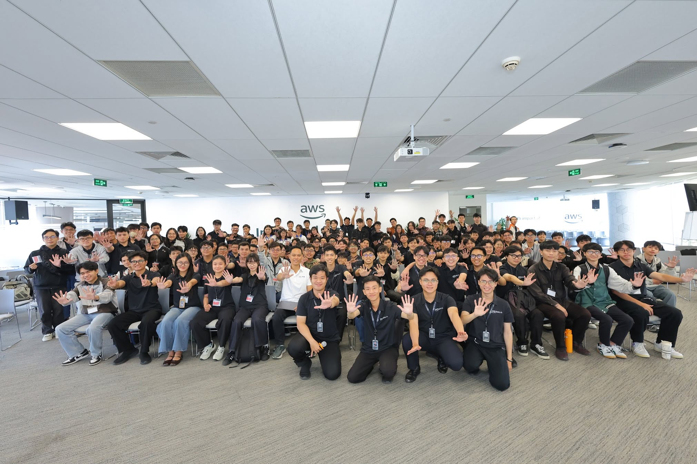

# First Cloud AI Journey Meetup

- **Date** · Saturday, October 24, 2026
- **Time** · 09:00–12:00 (UTC+7)
- **Venue** · 26th floor, Bitexco Financial Tower, Ho Chi Minh City
- **Organizer** · First Cloud AI Journey (FCAJ)
- **Role** · In-person attendee

### Event objectives

The meetup offered five practical perspectives on building and operating applications on AWS. The talks ranged from real-time Vietnamese conversations to cross-account resource sharing, pre-release security reviews, and context management for AI agents. I was especially interested in the decisions behind the demonstrations, such as how to measure what a user experiences and how much access an agent needs for a given task.

### Speakers and program

| Session | Topic | Speakers |
| --- | --- | --- |
| 1 | Hear, Think, Speak – Building a Vietnamese Voice AI Contact Center on AWS | Kiệt Trần · Revve AI |
| 2 | AWS Resource Access Manager | Long Huỳnh · Styl Solution |
| 3 | AWS Pentest with AWS Continuum / Security Agent | Thịnh Nguyễn · Styl Solution |
| 4 | Amazon Bedrock AgentCore | Xuân An · Leader, AWS Student Builder Group HCMUTE |
| 5 | Kiro Crew | Khoa Kiều · Tech Lead, ACB. Nghi Danh · AWS Community Builder |

### Key highlights

#### Session 1 · A Vietnamese voice AI contact center on AWS

**Kiệt Trần** explained a conversational turn through three stages: *Hear, Think, Speak*. The system receives speech, processes its meaning, and responds with speech. In a phone call, the gap between the end of a sentence and the start of the reply directly affects how the exchange feels. The session cited about **1.8 seconds** in the context of the solution discussed at the meetup.

The most memorable example was a live call simulating an initial screening interview for a **Cloud Engineer** role in Vietnamese. Hearing questions and answers over the phone made the effect of response time tangible. A similar test could measure the delay while also checking whether questions are clear, whether follow-ups fit the conversation, and whether the person on the other end can follow the exchange.

#### Session 2 · Sharing resources with AWS Resource Access Manager

**Long Huỳnh** covered how to share supported resources across accounts in AWS Organizations using **AWS Resource Access Manager (AWS RAM)**. A networking account can, for example, share subnets where application accounts deploy their own resources. This lets a team manage the network centrally and avoid recreating components that the accounts can share. [AWS RAM](https://docs.aws.amazon.com/ram/latest/userguide/what-is.html)

I took three questions from the session. Which resource is shared, and with which account? Which actions do IAM policies grant to users or roles in the receiving account? What maximum permissions does the service control policy (SCP) set for the member account? Looking at the three together explains why different teams can have different access to the same shared resource. [AWS RAM and SCPs](https://docs.aws.amazon.com/ram/latest/userguide/security-scp.html)

#### Session 3 · Pre-release security reviews with AWS Security Agent

**Thịnh Nguyễn** discussed how **AWS Security Agent**, part of AWS Continuum, can bring security review earlier into development. Examples included reviewing Terraform infrastructure changes and surfacing findings in GitHub pull requests or GitLab merge requests. Developers can examine a finding alongside the relevant change and review the proposed fix before merging. [AWS Security Agent code review](https://docs.aws.amazon.com/securityagent/latest/userguide/perform-code-review-scan.html)

The session also discussed security assessments on **SIT/UAT** environments within an approved scope before release. The two checkpoints I took away were the review of the proposed change and the confirmation of the fix in a test environment. A team can track a finding from the first report through verification by the person responsible for the change.

*Discussion about application security before deployment.*

#### Session 4 · Amazon Bedrock AgentCore Runtime and Memory

**Xuân An** described two components involved in operating an agent. **AgentCore Runtime** provides its execution environment. In the microVM model shown, each session has its own environment with isolated memory and filesystem resources. The temporary state in that environment supports interactions during the active session. [AgentCore Runtime microVMs](https://docs.aws.amazon.com/bedrock-agentcore/latest/devguide/runtime-how-it-works.html)

**AgentCore Memory** helps an application decide which information to retain. **Short-term memory** stores interactions as events so the agent can continue the current conversation. With a long-term memory strategy, the service can asynchronously extract and consolidate useful information for later sessions. That distinction leads to a concrete design choice about which data needs to be available for the next turn and which can be processed in the background. [AgentCore memory types](https://docs.aws.amazon.com/bedrock-agentcore/latest/devguide/memory-types.html)

*The Runtime presentation illustrated microVM isolation and temporary state for each session.*

#### Session 5 · Kiro Crew

**Khoa Kiều** and **Nghi Danh** presented Kiro Crew for background tasks such as supporting code review and checking system health. This was my favorite session because the Q&A addressed practical issues that come up when an agent becomes part of everyday work.

- **Artifacts.** The demo aggregated job listing data and presented statistics as a chart inside the chat. A visual result made it easier to review the output, especially when the criteria used to summarize the data were clear.
- **Context window.** The discussion covered Auto Compact thresholds around **70–90%** and using **Break down context** to see which components use the most tokens. Compaction condenses earlier history in a long session. Kiro's documentation lists **70%** as the configurable default. [Kiro Crew session context](https://kiro.dev/docs/crew/chat/sessions/)
- **Memory and guardrails.** The speakers discussed reviewing older memory entries, retaining information that still serves a purpose, and controlling agent actions. For a system health task, I can define what the agent may read, require approval for infrastructure changes, and limit access to secrets and credentials. [Kiro Crew tool permissions](https://kiro.dev/docs/crew/security/)

*A speaker and attendees during the technical Q&A.*

### Key takeaways

- **Measure the user's experience.** For a voice assistant, the time until a reply starts is a useful first measure. I also need to check the clarity of the reply and whether it fits the conversation.
- **Review sharing and permissions together.** When several teams use a common network component, I need to identify the owning account, the participating accounts, and the scope of each team's actions.
- **Match data retention to the task.** An agent continuing the current conversation needs different information from one interacting with the same user in a later session. The purpose and retention period should guide what gets stored in memory.
- **Make outputs easy for other people to verify.** A review finding or chart is easier to assess when the reader can trace it to the relevant change or source data.

### Applying the ideas to work

For the PDF-to-profile feature in the [Tindy proposal](/2-proposal/), I can measure the time from submitting a request to seeing the draft and check individual fields against sample documents. The interface can show which step is pending and which fields still need user confirmation. This applies the measurement idea from the voice AI demo to a task with a concrete result in Tindy.

In the team's review workflow, I can use an agent to summarize a change, identify points for review, and link to the relevant documentation. The person responsible for the change can verify those observations before deciding what to fix or merge. The quality of each review comment provides a practical way to evaluate that use of an agent.

### Event experience

The morning at Bitexco gave me a chance to hear tech leads and engineers describe problems they encounter when applying cloud and AI in their work. The Vietnamese screening call and the Kiro Crew Q&A stood out. The call showed me what delay feels like to the listener, while the discussion helped me understand why a background agent needs focused context and clear permissions.

I appreciate the speakers and organizers for giving students a chance to learn from real examples and ask questions. The meetup encouraged me to approach people in the community and bring more specific questions to future events.

#### Group photo

*Group photo on the 26th floor of Bitexco Financial Tower.*
