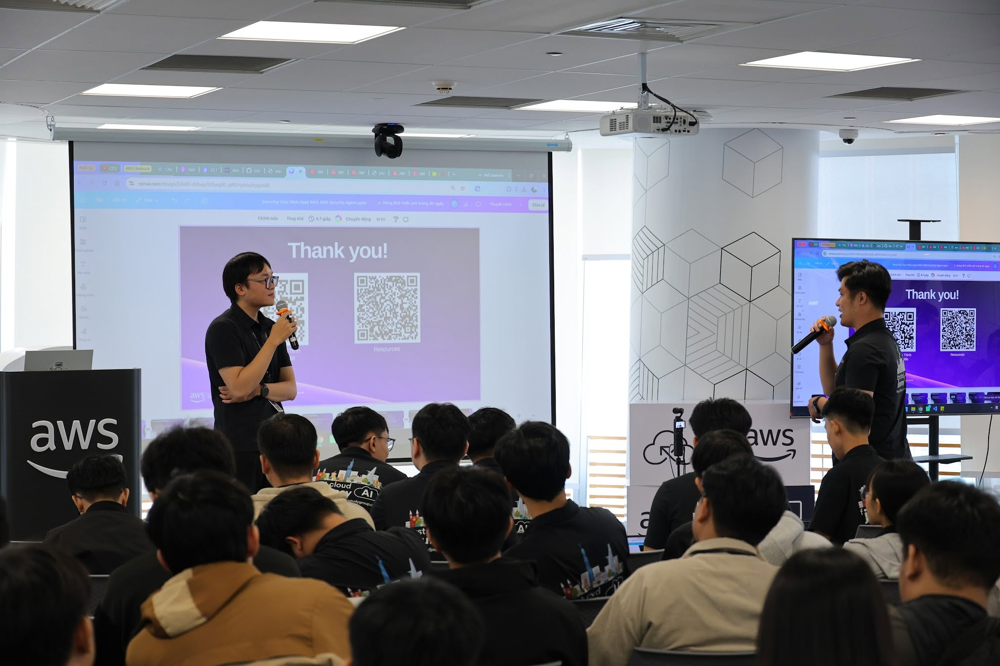
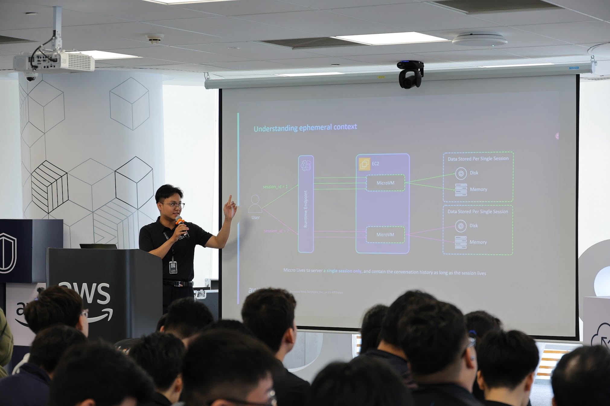
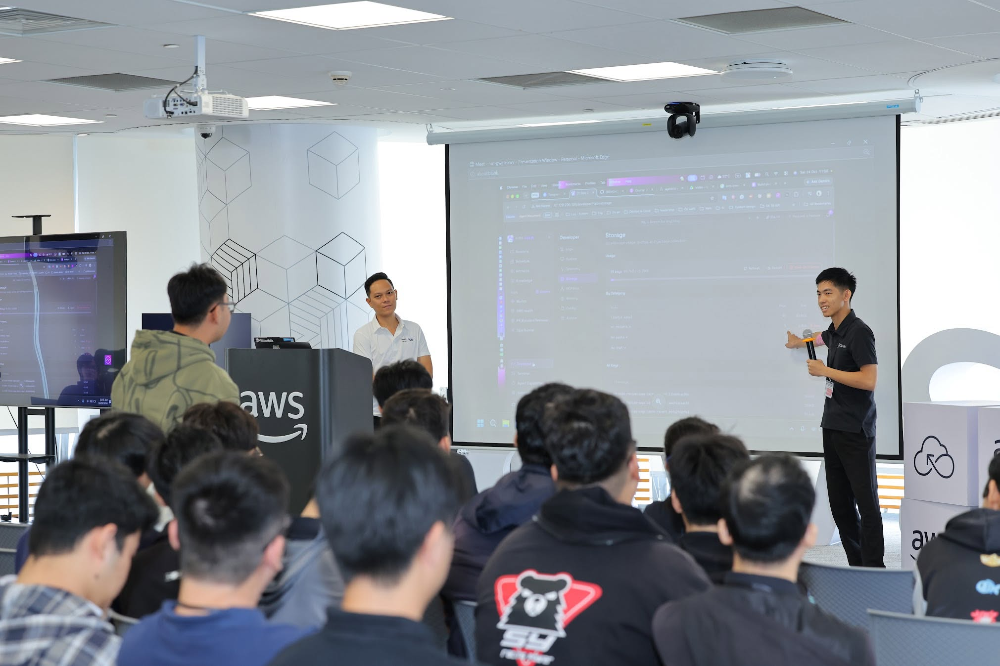
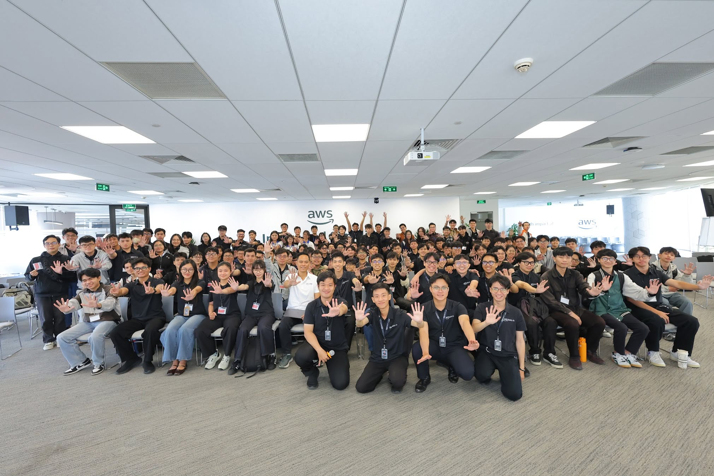

# First Cloud AI Journey Meetup

- **Ngày tổ chức** · Thứ Bảy, 24/10/2026
- **Thời gian** · 09:00–12:00 (UTC+7)
- **Địa điểm** · Tầng 26, Bitexco Financial Tower, TP.HCM
- **Đơn vị tổ chức** · First Cloud AI Journey (FCAJ)
- **Vai trò** · Người tham dự trực tiếp

### Mục đích của sự kiện

Buổi meetup mang đến năm góc nhìn thực tế về xây dựng và vận hành ứng dụng trên AWS. Phần trình bày trải từ xử lý hội thoại tiếng Việt theo thời gian thực đến chia sẻ tài nguyên giữa các tài khoản, rà soát bảo mật trước khi triển khai và quản lý ngữ cảnh cho AI agent. Điều em quan tâm nhất là những quyết định đi kèm mỗi bản demo, chẳng hạn phép đo nào thể hiện trải nghiệm người dùng hoặc giới hạn quyền nào phù hợp với công việc giao cho agent.

### Diễn giả và chương trình

| Phiên | Chủ đề | Diễn giả |
| --- | --- | --- |
| 1 | Hear, Think, Speak – Building a Vietnamese Voice AI Contact Center on AWS | Kiệt Trần · Revve AI |
| 2 | AWS Resource Access Manager | Long Huỳnh · Styl Solution |
| 3 | AWS Pentest with AWS Continuum / Security Agent | Thịnh Nguyễn · Styl Solution |
| 4 | Amazon Bedrock AgentCore | Xuân An · Leader, AWS Student Builder Group HCMUTE |
| 5 | Kiro Crew | Khoa Kiều · Tech Lead, ACB. Nghi Danh · AWS Community Builder |

### Nội dung nổi bật

#### Phiên 1 · Tổng đài Voice AI tiếng Việt trên AWS

Anh **Kiệt Trần** dùng ba bước *Hear, Think, Speak* để mô tả một lượt hội thoại. Hệ thống tiếp nhận lời nói, xử lý nội dung rồi trả lời bằng giọng nói. Với tổng đài qua điện thoại, khoảng chờ giữa lúc người dùng nói xong và lúc nghe phản hồi ảnh hưởng trực tiếp đến nhịp hội thoại. Phiên trình bày nêu mức khoảng **1,8 giây** trong bối cảnh giải pháp được chia sẻ tại meetup.

Phần em nhớ nhất là cuộc gọi demo phỏng vấn sơ tuyển vị trí **Cloud Engineer** bằng tiếng Việt. Khi nghe câu hỏi và lượt phản hồi qua điện thoại, em có thể hình dung người dùng cảm nhận độ trễ như thế nào. Một bài kiểm thử tương tự có thể xem cả thời gian phản hồi lẫn độ rõ của câu hỏi, cách agent nối tiếp nội dung và cách người nghe theo kịp cuộc trao đổi.

#### Phiên 2 · Chia sẻ tài nguyên với AWS Resource Access Manager

Anh **Long Huỳnh** trình bày cách dùng **AWS Resource Access Manager (AWS RAM)** để chia sẻ tài nguyên được hỗ trợ giữa các tài khoản trong AWS Organizations. Ví dụ, một tài khoản quản lý mạng có thể chia sẻ subnet để các tài khoản ứng dụng triển khai tài nguyên của mình trên mạng dùng chung. Mô hình này giúp tập trung việc quản lý mạng và giảm nhu cầu tạo lại các thành phần dùng chung. [AWS RAM](https://docs.aws.amazon.com/ram/latest/userguide/what-is.html)

Khi xem xét quyền truy cập, em ghi lại ba câu hỏi cần trả lời. Tài nguyên nào được chia sẻ và cho tài khoản nào? IAM policy cấp quyền thao tác gì cho người dùng hoặc role ở tài khoản nhận? Service control policy (SCP) đặt giới hạn tối đa nào cho tài khoản thành viên? Nhìn cả ba giúp em hiểu vì sao cùng một tài nguyên được chia sẻ nhưng các nhóm có thể có quyền khác nhau. [Quan hệ giữa AWS RAM và SCP](https://docs.aws.amazon.com/ram/latest/userguide/security-scp.html)

#### Phiên 3 · Đánh giá bảo mật trước khi triển khai với AWS Security Agent

Anh **Thịnh Nguyễn** giới thiệu **AWS Security Agent**, thuộc AWS Continuum, trong quy trình rà soát ứng dụng từ sớm. Ví dụ được đề cập gồm kiểm tra thay đổi hạ tầng Terraform và đưa nhận xét bảo mật vào pull request trên GitHub hoặc merge request trên GitLab. Nhóm phát triển có thể xem vấn đề ngay trong phần thay đổi liên quan và rà lại cách sửa trước khi merge. [Rà soát mã nguồn với AWS Security Agent](https://docs.aws.amazon.com/securityagent/latest/userguide/perform-code-review-scan.html)

Phiên này cũng đề cập việc đánh giá bảo mật trên môi trường **SIT/UAT** trong phạm vi đã được phê duyệt trước khi phát hành. Với em, hai mốc đáng ghi nhớ là lúc review thay đổi và lúc xác nhận bản sửa trên môi trường kiểm thử. Nhóm có thể theo dõi mỗi phát hiện từ khi ghi nhận đến khi người phụ trách kiểm tra lại bản sửa.

*Phần trao đổi về bảo mật ứng dụng trước khi triển khai.*

#### Phiên 4 · Amazon Bedrock AgentCore Runtime và Memory

Anh **Xuân An** trình bày hai thành phần liên quan đến việc đưa agent vào vận hành. **AgentCore Runtime** cung cấp môi trường thực thi. Trong mô hình microVM được minh họa, mỗi phiên có môi trường riêng với tài nguyên bộ nhớ và hệ thống tệp được cô lập. Trạng thái tạm thời trong môi trường này phục vụ các lượt trao đổi của phiên đang chạy. [AgentCore Runtime microVM](https://docs.aws.amazon.com/bedrock-agentcore/latest/devguide/runtime-how-it-works.html)

**AgentCore Memory** giúp ứng dụng quyết định thông tin nào cần giữ. **Short-term memory** lưu các tương tác dưới dạng sự kiện để agent tiếp tục cuộc hội thoại hiện tại. Khi có chiến lược bộ nhớ dài hạn phù hợp, hệ thống có thể trích xuất và tổng hợp thông tin có ích theo cơ chế bất đồng bộ để dùng ở phiên sau. Sự khác biệt này dẫn đến một quyết định thiết kế cụ thể về dữ liệu nào cần xuất hiện ngay trong lượt tiếp theo và dữ liệu nào có thể được xử lý nền. [Các loại bộ nhớ AgentCore](https://docs.aws.amazon.com/bedrock-agentcore/latest/devguide/memory-types.html)

*Minh họa microVM và dữ liệu tạm thời của từng phiên.*

#### Phiên 5 · Kiro Crew

Anh **Khoa Kiều** và anh **Nghi Danh** trình bày cách dùng Kiro Crew cho các công việc chạy nền, như hỗ trợ review mã nguồn và kiểm tra tình trạng hệ thống. Đây là phiên em ấn tượng nhất vì phần hỏi đáp đi vào những vấn đề sẽ gặp khi dùng agent trong công việc hằng ngày.

- **Artifacts.** Demo tổng hợp dữ liệu tuyển dụng và trình bày thống kê dưới dạng biểu đồ ngay trong khung chat. Em thấy đầu ra trực quan giúp người xem kiểm tra kết quả nhanh hơn, nhất là khi biết dữ liệu được tổng hợp theo tiêu chí nào.
- **Context Window.** Phần trao đổi đề cập các ngưỡng Auto Compact khoảng **70–90%** và dùng **Break down context** để xem phần nào chiếm nhiều token. Việc nén ngữ cảnh giúp rút gọn lịch sử cũ trong một phiên dài. Tài liệu Kiro ghi **70%** là ngưỡng mặc định có thể cấu hình. [Quản lý ngữ cảnh phiên trong Kiro Crew](https://kiro.dev/docs/crew/chat/sessions/)
- **Memory và guardrails.** Các diễn giả trao đổi về việc rà soát nội dung cũ được lưu trong memory, giữ lại thông tin còn dùng được và kiểm soát các thao tác của agent. Khi giao tác vụ kiểm tra hệ thống, em có thể xác định dữ liệu nào agent được đọc, yêu cầu phê duyệt cho thao tác thay đổi hạ tầng và hạn chế quyền truy cập secret hoặc credential. [Quyền của công cụ trong Kiro Crew](https://kiro.dev/docs/crew/security/)

*Diễn giả trao đổi với người tham dự trong phần hỏi đáp kỹ thuật.*

### Những gì học được

- **Đo trải nghiệm từ góc nhìn người dùng.** Với trợ lý thoại, thời gian chờ nghe phản hồi là điểm bắt đầu để đánh giá một lượt hội thoại. Em cũng cần xem câu trả lời có rõ và phù hợp với ngữ cảnh hay không.
- **Nhìn tài nguyên chia sẻ cùng quyền thao tác.** Khi nhiều nhóm sử dụng chung thành phần mạng, em cần xác định tài khoản sở hữu, tài khoản được dùng và phạm vi thao tác của từng nhóm.
- **Chọn vòng đời dữ liệu theo tác vụ.** Một agent đang xử lý phiên hiện tại cần thông tin khác với agent quay lại phục vụ người dùng ở phiên sau. Xác định mục đích và thời hạn lưu giúp em quyết định thông tin nào đưa vào memory.
- **Thiết kế đầu ra để người khác kiểm tra được.** Một nhận xét review hoặc biểu đồ có ích hơn khi người đọc có thể lần lại dữ liệu hoặc phần thay đổi làm căn cứ cho kết quả.

### Ứng dụng vào công việc

Với luồng tạo bản nháp hồ sơ từ PDF trong [proposal Tindy](/vi/2-proposal/), em có thể đo thời gian từ lúc gửi yêu cầu đến lúc bản nháp xuất hiện và kiểm tra từng trường bằng tài liệu mẫu. Kết quả nên cho người dùng biết bước nào đang chờ và trường nào cần họ xác nhận. Cách đo này vận dụng ý tưởng từ demo Voice AI vào một tác vụ có đầu ra phù hợp với Tindy.

Trong quy trình review của nhóm, em có thể dùng agent để tóm tắt phần thay đổi, nêu chỗ cần kiểm tra và liên kết đến tài liệu liên quan. Người phụ trách vẫn có căn cứ để kiểm tra nhận xét trước khi quyết định sửa hoặc merge. Đây là một tác vụ nhỏ để thử cách dùng agent mà nhóm có thể đánh giá qua chất lượng từng nhận xét.

### Trải nghiệm tại sự kiện

Buổi sáng ở Bitexco cho em cơ hội nghe các anh Tech Lead và kỹ sư chia sẻ về những vấn đề họ gặp khi đưa Cloud và AI vào công việc. Em nhớ nhất cuộc gọi phỏng vấn bằng tiếng Việt và phần hỏi đáp Kiro Crew. Một ví dụ cho em thấy độ trễ ảnh hưởng đến người nghe ra sao, ví dụ còn lại giúp em hiểu vì sao agent chạy nền cần có ngữ cảnh phù hợp và quyền hạn rõ ràng.

Em cảm ơn các diễn giả và ban tổ chức đã tạo cơ hội để sinh viên tiếp cận các ví dụ thực tế và đặt câu hỏi. Sau buổi meetup, em muốn chủ động trao đổi với người làm cùng lĩnh vực và chuẩn bị câu hỏi cụ thể hơn khi tham gia những sự kiện tiếp theo.

#### Ảnh tập thể

*Ảnh tập thể tại tầng 26, Bitexco Financial Tower.*
