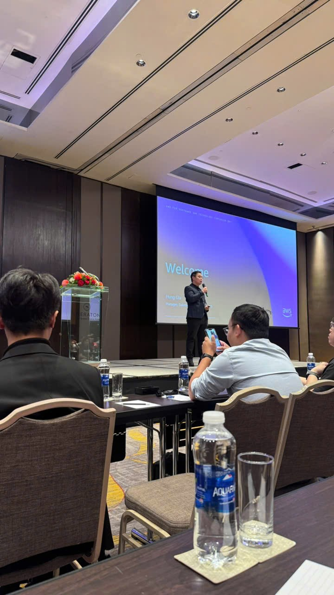
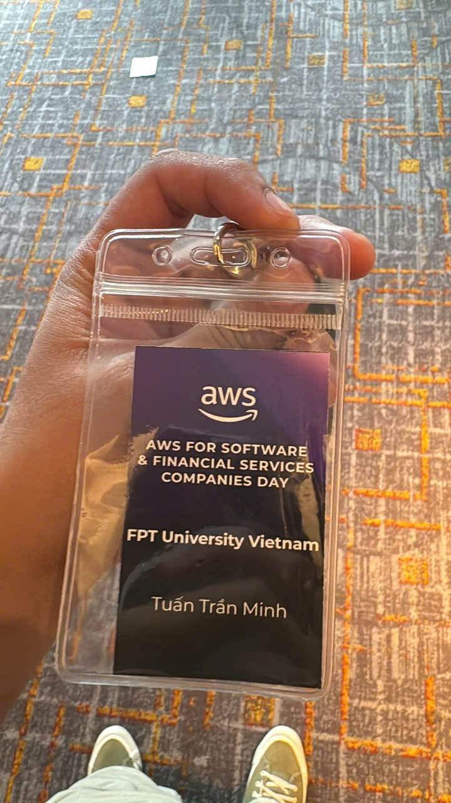
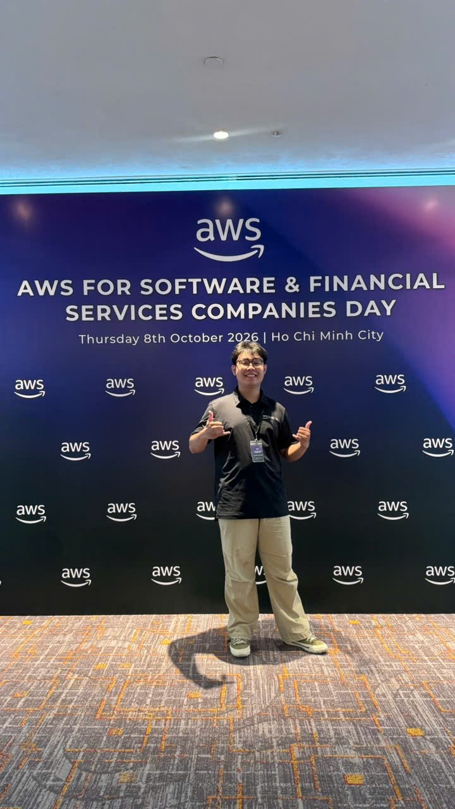
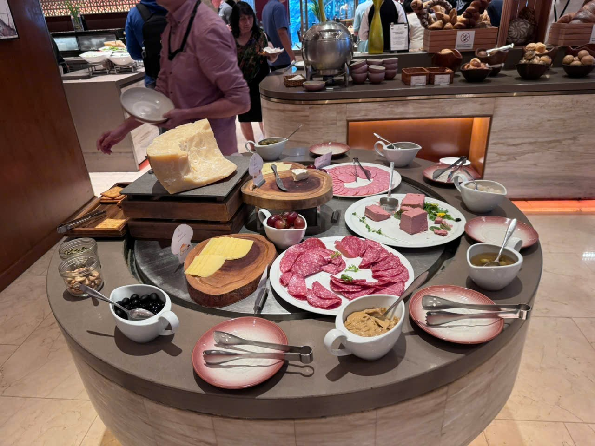
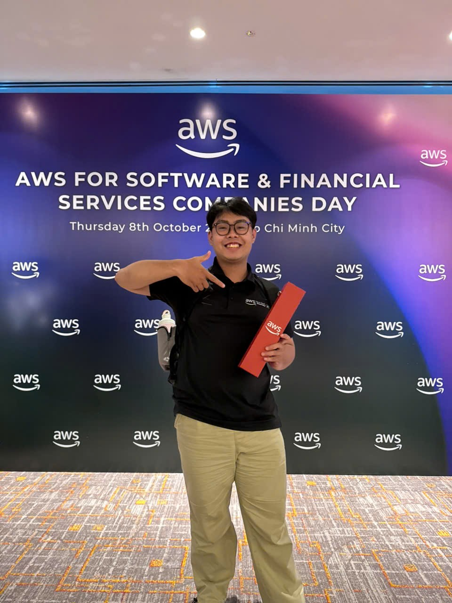

# AWS for Software & Financial Services Companies Day

- **Date** · Thursday, October 8, 2026
- **Program hours** · 09:15–18:00 (UTC+7)
- **Venue** · Sheraton Saigon Grand Opera Hotel, Ho Chi Minh City
- **Organizer** · Amazon Web Services (AWS)
- **Language** · Vietnamese
- **Role** · In-person attendee

### Event objectives

AWS hosted the event for engineering teams in software and financial services. The program followed AI across the engineering lifecycle, from defining requirements and building an application to testing, modernizing code, and operating a system. The morning focused on decisions teams face when putting AI into use. The afternoon offered two parallel workshops with AWS Solutions Architects and a case study from Kyanon Digital.

### Speakers

| Speaker | Role | Program contribution |
| --- | --- | --- |
| Nguyen Gia Hung | Head of Solutions Architect for Vietnam and Cambodia | Welcome, workshop briefing, and Customer Spotlight moderation |
| Dzung Ha | Solutions Architect | Taking agentic AI from demo to deployment |
| Binh Tran | Senior Solutions Architect | Building data products for AI agents |
| Taiki Dang | Solutions Architect | Code modernization with AWS Transform |
| Nhut Le | Solutions Architect | Workshop A on building an application with Kiro |
| Thi Nguyen | Solutions Architect | Workshop B on deploying an AI agent on Amazon Bedrock AgentCore |
| Bui Hoang Viet | DevOps Engineer, Kyanon Digital | Customer Spotlight on limiting the impact of LLM-assisted remediation in Kubernetes |

### Full agenda

| Time (UTC+7) | Activity | Speaker or organization |
| --- | --- | --- |
| 09:15–09:30 | Welcome Address | Nguyen Gia Hung |
| 09:30–10:10 | From Demo to Deployment: Solving Agentic AI's Toughest Challenges | Dzung Ha, with a customer contribution from Katalon |
| 10:10–10:50 | Building High-Quality Data Products for AI Agents | Binh Tran |
| 10:50–11:15 | Networking break | — |
| 11:15–11:55 | Migration at Scale with AWS Transform | Taiki Dang |
| 11:55–12:15 | Workshop briefing and track selection | Nguyen Gia Hung |
| 12:15–13:15 | Buffet lunch at the hotel restaurant | — |
| 13:15–15:15 | Workshop A · Build with Kiro: From Spec to Working Application | Nhut Le |
| 13:15–15:15 | Workshop B · Build & Deploy AI Agents on Amazon Bedrock AgentCore using Vibe Coding with Kiro | Thi Nguyen |
| 15:15–15:35 | Afternoon break | — |
| 15:35–16:15 | Customer Spotlight · Beyond Single-YAML: Taming the Blast Radius of LLM Remediation in Kubernetes | Bui Hoang Viet, Nguyen Gia Hung |
| 16:30–18:00 | Networking drinks at Hai Bar | Sam Williams |

### Key highlights

#### Welcome and taking agentic AI from demo to deployment

**Nguyen Gia Hung** opened the day by introducing the connections between application development, data, modernization, and operations. The examples were aimed at engineering teams that want to understand the steps involved in bringing an AI feature into a product.

*Welcome address in the main event room.*

**Dzung Ha** then covered four issues engineering teams face when moving from an agent demo to a deployed system.

- **Operations.** Teams need ways to observe errors, latency, and the step where a request gets stuck.
- **Data governance.** Agents need defined data sources, clear ownership, and appropriate access.
- **Reliability.** Testing should cover routine requests and cases where a tool or data source fails to return what the agent expects.
- **Trust.** Users and engineering teams need to understand what supports an output and when it needs further review.

The **Katalon True Platform** example applied this thinking to software quality. Katalon described an AWS-based platform that uses test results and quality data to verify changes produced with AI. When an agent changes a feature, test history and execution results give reviewers evidence they can use to check that the feature still behaves as intended. [Katalon True Platform](https://katalon.com/resources-center/blog/katalon-launches-true-platform)

#### Building data products for AI agents

**Binh Tran** focused on three aspects of an agent's inputs: data quality, schema design, and keeping data current through real-time integration. When several systems use the same data product, field names, types, and status definitions need to be clear enough for developers and agents to interpret consistently.

I related this to tracking a document processing request. A data product could define states such as pending, complete, and failed, together with the time of the last update. The agent can use those fields to report the current state, and the application can compare the output with the source system.

#### Modernizing code at scale with AWS Transform

**Taiki Dang** presented **AWS Transform** through examples that included upgrading Java, modernizing .NET, migrating frameworks, and addressing technical debt. The process discussed starts with describing the intended result, defining the scope, applying changes, and validating the result. That approach is useful when the same kind of change needs to be repeated across repositories. [AWS Transform custom](https://docs.aws.amazon.com/transform/latest/userguide/custom.html) · [Modernizing .NET](https://docs.aws.amazon.com/transform/latest/userguide/dotnet.html)

My takeaway was to decide what evidence would support the transformation. Before changing a runtime version or framework, a team can record build and test results as a baseline. After the change, it can compare behavior, identify dependencies that still need attention, and decide which repositories or components to migrate next.

#### Parallel afternoon workshops

Both tracks ran from **13:15 to 15:15**. The event instructions asked attendees to bring a laptop and prepare an **AWS Builder ID** if their track required it. The same identity could be used to continue using Kiro after the session. [AWS Builder ID](https://profile.aws.amazon.com/)

**Workshop A · Build an application with Kiro.** **Nhut Le**'s track guided participants from a description of the application to three deliverables drafted by Kiro: requirements, a design, and implementation tasks. Participants could refine acceptance criteria, guide individual tasks, try the resulting application, and revise any gaps. [Kiro Specs](https://kiro.dev/docs/specs/)

**Workshop B · Build and deploy an AI agent on Amazon Bedrock AgentCore.** **Thi Nguyen**'s track started with an agent built using Kiro and moved it to the cloud with AgentCore. The agenda described adding capabilities after getting the first version running. It raised practical questions about where an agent executes, which tools it may call, and what to watch once it is deployed. [Amazon Bedrock AgentCore overview](https://docs.aws.amazon.com/bedrock-agentcore/latest/devguide/what-is-bedrock-agentcore.html)

#### Customer Spotlight · Limiting the impact of changes in Kubernetes

**Bui Hoang Viet**, a DevOps Engineer at **Kyanon Digital**, spoke about using LLMs to support proposed remediation for Kubernetes incidents. The *Beyond Single-YAML* topic asks how one configuration change could affect the running workload and related components. For example, a team needs to understand which workload is affected, which settings are shared, and how to restore an earlier configuration if the system responds unexpectedly.

I took away the need to trace a proposal through to the deployment decision. A team can review the change, exercise it in a test environment, and use the same health signals to compare behavior before and after a release.

### Key takeaways

- **Use test results as review evidence.** I can connect a change to its acceptance criteria, test cases, and execution results. This gives the team something concrete to review when AI contributes code.
- **Define the input data before evaluating an agent.** A clear schema, field definitions, and data freshness expectations help the team locate whether an unexpected result comes from the source data or the agent's processing.
- **Keep the scope of a change small enough to verify.** When modernizing code or changing infrastructure configuration, a team can check one part at a time and record how to restore a known version.
- **Define operating criteria while prototyping.** An AI feature benefits from an explicit definition of a correct result, a way to measure processing time, and signals to consult when a run fails.

### Applying the ideas to work

For the PDF-to-profile feature in the [Tindy proposal](/2-proposal/), I can specify what PDF input to accept, which fields to extract, and how to display missing information. A set of sample documents gives the team a way to test each extracted field. The pull request can include test evidence so reviewers can check the change against the spec.

The Customer Spotlight also gave me a way to think about the impact of changes in Tindy. Before altering the configuration of a document-processing worker, I can list its queues and dependencies, check the change in a test environment, and review document status and failure rates after release. The rollout plan can include how to restore the previous settings.

### Event experience and photos

I attended in person at Sheraton Saigon Grand Opera Hotel. The progression from data and testing to deployment helped me connect AI with specific engineering tasks in my project. The program included breaks for networking, a buffet lunch, and a final networking session at Hai Bar.

*Event badge collected at check-in.*

*Photo at the event check-in area.*

*Lunch between the morning sessions and the afternoon workshops.*

*Photo with a souvenir from the event.*
