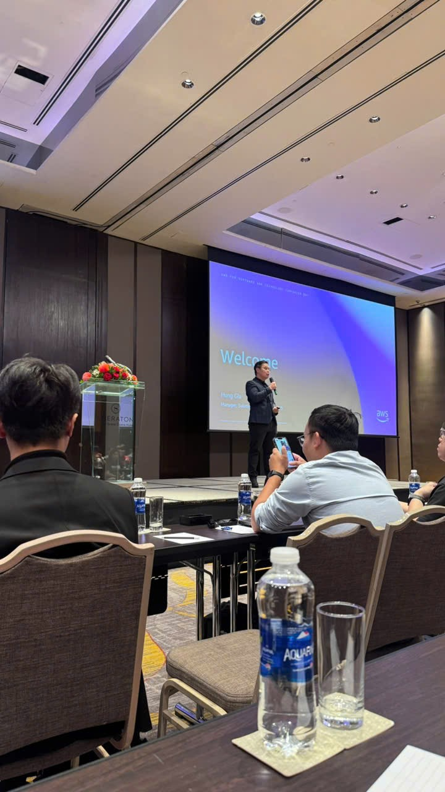
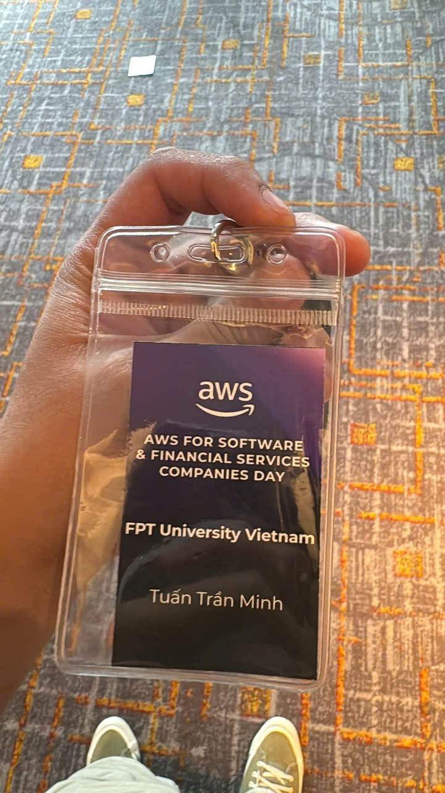
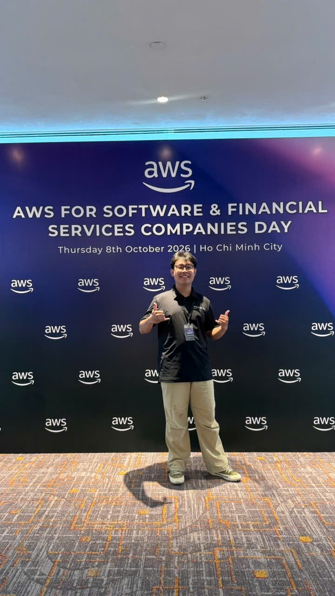
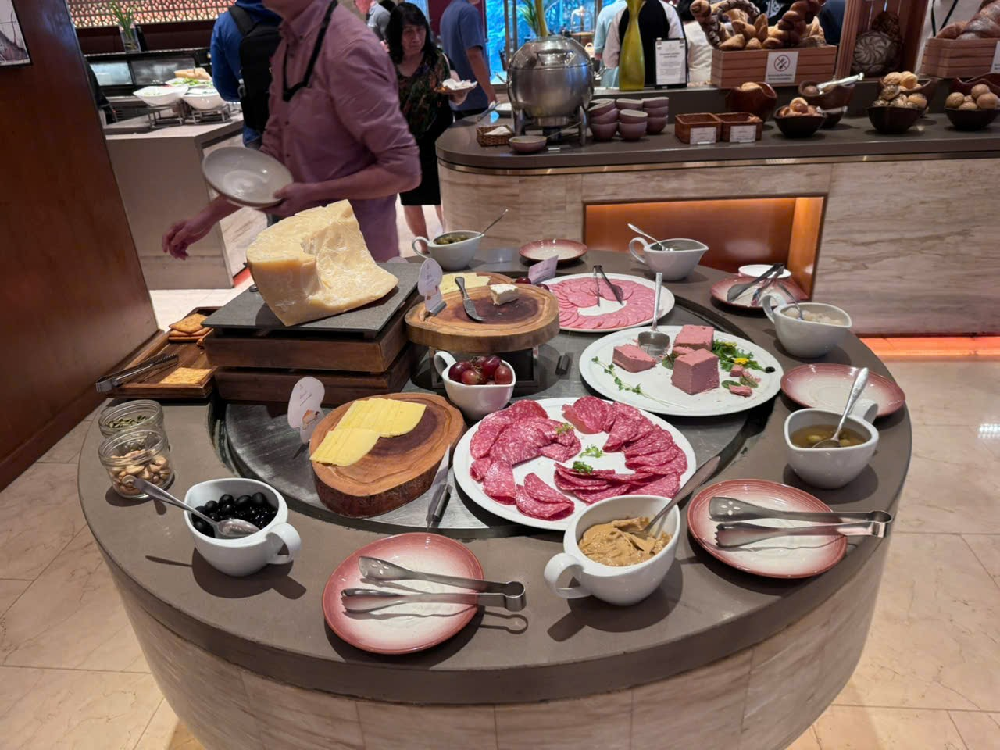
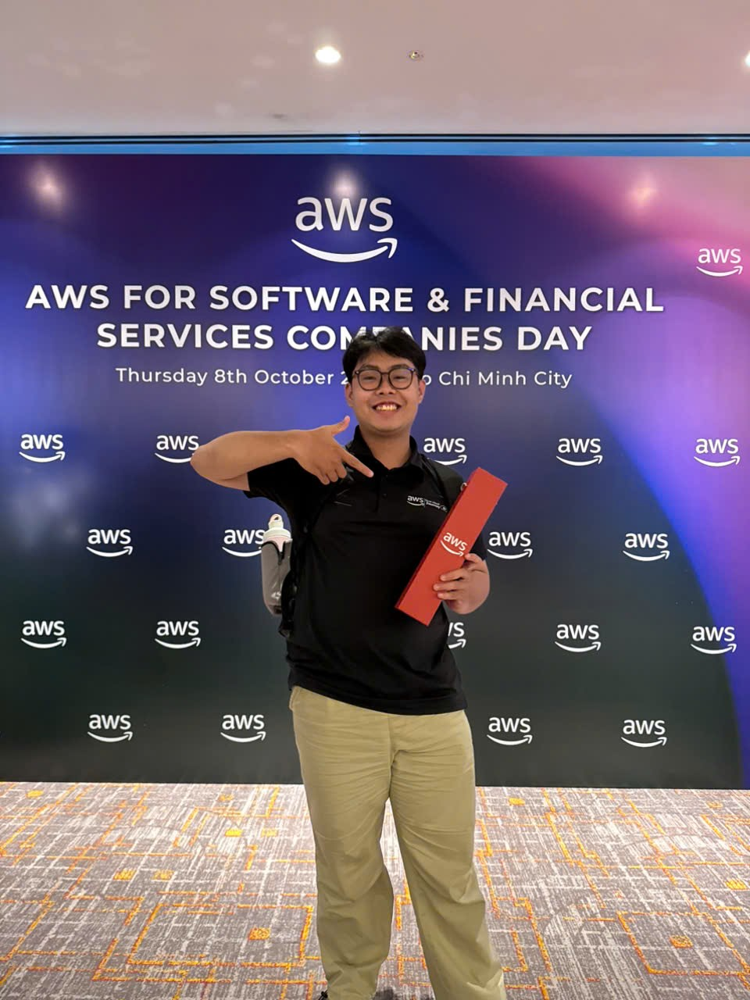

# AWS for Software & Financial Services Companies Day

- **Ngày tổ chức** · Thứ Năm, 08/10/2026
- **Thời gian chương trình** · 09:15–18:00 (UTC+7)
- **Địa điểm** · Sheraton Saigon Grand Opera Hotel, TP.HCM
- **Đơn vị tổ chức** · Amazon Web Services (AWS)
- **Ngôn ngữ** · Tiếng Việt
- **Vai trò** · Người tham dự trực tiếp

### Mục đích của sự kiện

AWS tổ chức sự kiện dành cho các đội kỹ thuật trong ngành phần mềm và dịch vụ tài chính. Chương trình theo chân AI qua nhiều bước của vòng đời kỹ thuật, từ mô tả yêu cầu và xây dựng ứng dụng đến kiểm thử, hiện đại hóa mã nguồn và vận hành hệ thống. Buổi sáng tập trung vào các vấn đề đội kỹ thuật cần giải quyết trước khi đưa AI vào môi trường thực tế. Buổi chiều có hai workshop song song với AWS Solutions Architects và một phiên chia sẻ kinh nghiệm vận hành từ Kyanon Digital.

### Danh sách diễn giả

| Diễn giả | Vai trò | Phiên phụ trách |
| --- | --- | --- |
| Nguyen Gia Hung | Head of Solutions Architect, Việt Nam và Campuchia | Khai mạc, giới thiệu workshop và điều phối Customer Spotlight |
| Dzung Ha | Solutions Architect | Đưa Agentic AI từ demo đến triển khai |
| Binh Tran | Senior Solutions Architect | Xây dựng sản phẩm dữ liệu cho AI agent |
| Taiki Dang | Solutions Architect | Hiện đại hóa mã nguồn với AWS Transform |
| Nhut Le | Solutions Architect | Workshop A về phát triển ứng dụng với Kiro |
| Thi Nguyen | Solutions Architect | Workshop B về triển khai AI agent trên Amazon Bedrock AgentCore |
| Bui Hoang Viet | DevOps Engineer, Kyanon Digital | Customer Spotlight về giới hạn phạm vi ảnh hưởng của remediation do LLM đề xuất trên Kubernetes |

### Lịch trình trong ngày

| Giờ (UTC+7) | Hoạt động | Diễn giả hoặc đơn vị |
| --- | --- | --- |
| 09:15–09:30 | Phát biểu khai mạc | Nguyen Gia Hung |
| 09:30–10:10 | From Demo to Deployment: Solving Agentic AI's Toughest Challenges | Dzung Ha và phần chia sẻ từ Katalon |
| 10:10–10:50 | Building High-Quality Data Products for AI Agents | Binh Tran |
| 10:50–11:15 | Nghỉ giải lao và giao lưu | — |
| 11:15–11:55 | Migration at Scale with AWS Transform | Taiki Dang |
| 11:55–12:15 | Giới thiệu và chọn workshop buổi chiều | Nguyen Gia Hung |
| 12:15–13:15 | Ăn trưa buffet tại nhà hàng khách sạn | — |
| 13:15–15:15 | Workshop A · Build with Kiro: From Spec to Working Application | Nhut Le |
| 13:15–15:15 | Workshop B · Build & Deploy AI Agents on Amazon Bedrock AgentCore using Vibe Coding with Kiro | Thi Nguyen |
| 15:15–15:35 | Nghỉ giải lao | — |
| 15:35–16:15 | Customer Spotlight · Beyond Single-YAML: Taming the Blast Radius of LLM Remediation in Kubernetes | Bui Hoang Viet, Nguyen Gia Hung |
| 16:30–18:00 | Giao lưu cuối ngày tại Hai Bar | Sam Williams |

### Nội dung nổi bật

#### Khai mạc và đưa AI agent từ demo đến triển khai

Phần khai mạc của **Nguyen Gia Hung** giới thiệu cách các phiên trong ngày kết nối giữa phát triển ứng dụng, dữ liệu, hiện đại hóa và vận hành. Các ví dụ hướng đến đội kỹ thuật muốn hiểu toàn bộ quá trình đưa một tính năng AI vào sản phẩm.

*Phần chào mừng tại hội trường.*

Trong phiên tiếp theo, **Dzung Ha** nêu bốn vấn đề khi chuyển Agentic AI từ bản thử nghiệm sang triển khai thực tế.

- **Vận hành.** Nhóm cần xác định cách theo dõi lỗi, độ trễ và bước xử lý đang gặp vấn đề trong một yêu cầu.
- **Quản trị dữ liệu.** Agent cần nguồn dữ liệu xác định, có người chịu trách nhiệm và phạm vi truy cập phù hợp.
- **Độ tin cậy.** Nhóm cần thử cả tình huống thông thường lẫn trường hợp nguồn dữ liệu hoặc công cụ không trả về kết quả như mong đợi.
- **Niềm tin vào kết quả.** Người dùng và nhóm kỹ thuật cần biết căn cứ của đầu ra và khi nào cần kiểm tra thêm.

Câu chuyện **Katalon True Platform** áp dụng tư duy này vào chất lượng phần mềm. Katalon mô tả một nền tảng kiểm thử trên AWS dùng kết quả kiểm thử và dữ liệu chất lượng làm cơ sở để xác minh những thay đổi do AI tạo ra. Khi một agent sửa tính năng, lịch sử kiểm thử và kết quả thực thi cung cấp căn cứ để người review xem thay đổi đã đáp ứng hành vi mong đợi chưa. [Katalon True Platform](https://katalon.com/resources-center/blog/katalon-launches-true-platform)

#### Xây dựng sản phẩm dữ liệu cho AI agent

**Binh Tran** tập trung vào ba phần của dữ liệu đầu vào cho agent là chất lượng dữ liệu, cách thiết kế schema và khả năng tích hợp dữ liệu cập nhật theo thời gian thực. Với một sản phẩm dữ liệu được nhiều hệ thống dùng chung, tên trường, kiểu dữ liệu và ý nghĩa của từng trạng thái cần đủ rõ để người phát triển và agent diễn giải nhất quán.

Một ví dụ em liên hệ từ phiên này là trạng thái yêu cầu xử lý tài liệu. Có thể chuẩn hóa các trạng thái như đang chờ, hoàn thành và lỗi, kèm thời điểm cập nhật. Khi dữ liệu được làm mới, agent có thể dựa vào thông tin đó để trả lời trạng thái hiện tại và ứng dụng có thể kiểm tra xem đầu ra có khớp với hệ thống nguồn hay không.

#### Hiện đại hóa mã nguồn ở quy mô lớn với AWS Transform

**Taiki Dang** giới thiệu **AWS Transform** qua các trường hợp nâng cấp Java, hiện đại hóa .NET, di chuyển framework và xử lý nợ kỹ thuật. Với hướng tiếp cận được trình bày, nhóm mô tả kết quả mong muốn, lập phạm vi thay đổi, thực hiện chuyển đổi và xác minh kết quả. Cách này hữu ích khi một thay đổi tương tự cần lặp lại trên nhiều repository. [AWS Transform custom](https://docs.aws.amazon.com/transform/latest/userguide/custom.html) · [Hiện đại hóa .NET](https://docs.aws.amazon.com/transform/latest/userguide/dotnet.html)

Điểm em ghi lại là cách chuẩn bị bằng chứng để đánh giá việc chuyển đổi. Trước khi thay phiên bản runtime hoặc framework, nhóm có thể lưu kết quả build và bộ kiểm thử làm mốc. Sau chuyển đổi, nhóm đối chiếu các hành vi cần giữ, xem phần thay đổi còn vướng phụ thuộc nào và quyết định phạm vi triển khai tiếp theo.

#### Hai workshop thực hành buổi chiều

Hai track đều diễn ra từ **13:15 đến 15:15**. Phần hướng dẫn trước sự kiện đề nghị mang laptop và chuẩn bị **AWS Builder ID** nếu workshop yêu cầu. Đây cũng là danh tính dùng để tiếp tục sử dụng Kiro sau buổi thực hành. [AWS Builder ID](https://profile.aws.amazon.com/)

**Workshop A · Phát triển ứng dụng với Kiro.** Track của **Nhut Le** hướng dẫn người tham dự mô tả ứng dụng cần xây dựng rồi xem lại ba đầu ra Kiro soạn là yêu cầu, thiết kế và danh sách tác vụ. Người tham dự có thể điều chỉnh tiêu chí chấp nhận trước khi triển khai từng phần, sau đó thử luồng ứng dụng và sửa các điểm còn thiếu. [Kiro Specs](https://kiro.dev/docs/specs/)

**Workshop B · Xây dựng và triển khai AI agent trên Amazon Bedrock AgentCore.** Track của **Thi Nguyen** bắt đầu với một agent dùng Kiro và đưa agent lên môi trường cloud với AgentCore. Agenda mô tả cách mở rộng agent qua từng bước sau bản chạy đầu tiên. Các câu hỏi em có thể dùng để đọc quy trình này là agent chạy ở đâu, công cụ nào được phép gọi và những tín hiệu nào cần theo dõi sau triển khai. [Tổng quan Amazon Bedrock AgentCore](https://docs.aws.amazon.com/bedrock-agentcore/latest/devguide/what-is-bedrock-agentcore.html)

#### Customer Spotlight · Giới hạn phạm vi ảnh hưởng trên Kubernetes

**Bui Hoang Viet**, DevOps Engineer tại **Kyanon Digital**, chia sẻ về bài toán dùng LLM để hỗ trợ đề xuất cách khắc phục sự cố trên Kubernetes. Chủ đề *Beyond Single-YAML* đặt câu hỏi về tác động của một thay đổi cấu hình lên workload đang chạy và các thành phần liên quan. Ví dụ, nhóm cần biết thay đổi áp dụng cho workload nào, cấu hình dùng chung nào bị tác động và cách quay về phiên bản trước nếu hệ thống phản hồi ngoài dự kiến.

Điều em rút ra từ chủ đề này là giữ được dấu vết từ đề xuất đến quyết định triển khai. Một thay đổi có thể đi qua bước review, được thử trên môi trường kiểm thử rồi mới chuyển sang phạm vi vận hành rộng hơn. Người phụ trách có thể dùng chính các tín hiệu đã ghi trước khi thay đổi để so sánh sau triển khai.

### Những gì học được

- **Dùng kết quả kiểm thử làm căn cứ khi review.** Em có thể gắn nhận xét về một thay đổi với tiêu chí chấp nhận, ca kiểm thử và kết quả chạy thực tế. Cách này giúp nhóm kiểm tra nhận xét ngay cả khi code do AI hỗ trợ viết.
- **Làm rõ dữ liệu đầu vào trước khi đánh giá agent.** Schema, định nghĩa trường và độ mới của dữ liệu cho nhóm cơ sở để phân biệt lỗi ở nguồn dữ liệu với lỗi khi agent tạo đầu ra.
- **Giữ phạm vi thay đổi đủ nhỏ để kiểm chứng.** Khi hiện đại hóa mã nguồn hoặc sửa cấu hình hạ tầng, nhóm có thể thử từng phần, đối chiếu hành vi và chuẩn bị cách quay lại phiên bản đã biết.
- **Chuẩn bị tiêu chí vận hành ngay khi làm bản mẫu.** Với một tính năng AI, em có thể xác định trước đâu là kết quả đúng, đo thời gian xử lý ở đâu và xem dữ liệu nào khi cần tìm nguyên nhân lỗi.

### Ứng dụng vào công việc

Với luồng tạo bản nháp hồ sơ từ PDF trong [proposal Tindy](/vi/2-proposal/), em có thể mô tả trước đầu vào PDF, các trường cần trích xuất và cách hiển thị khi tài liệu thiếu thông tin. Một bộ tài liệu mẫu giúp nhóm kiểm thử bản trích xuất và đối chiếu từng trường. Kết quả có thể lưu cùng pull request để người review xem thay đổi có đáp ứng yêu cầu đã ghi trong spec.

Phần Customer Spotlight cũng gợi ý cách đánh giá phạm vi tác động trong kiến trúc Tindy. Nếu sửa cấu hình của worker xử lý tài liệu, em có thể xác định các hàng đợi và thành phần phụ thuộc, kiểm tra trên môi trường thử nghiệm, rồi quan sát trạng thái tài liệu và tỷ lệ xử lý lỗi sau khi phát hành. Nhóm có thể ghi lại cách khôi phục bản cấu hình trước cùng với kế hoạch triển khai.

### Trải nghiệm và hình ảnh tại sự kiện

Em tham dự trực tiếp tại Sheraton Saigon Grand Opera Hotel. Việc các phiên trong ngày nối tiếp từ dữ liệu và kiểm thử đến triển khai giúp em liên hệ nội dung AI với những công việc cụ thể trong dự án. Chương trình có thời gian giao lưu giữa các phiên, bữa trưa buffet và khung networking cuối ngày tại Hai Bar.

*Thẻ check-in tại sự kiện.*

*Ảnh chụp tại khu vực check-in.*

*Bữa trưa giữa chương trình buổi sáng và hai workshop buổi chiều.*

*Ảnh lưu niệm với quà sự kiện.*
