Foundation cung cấp S3 frontend/media, ECR chứa image backend, các secret ứng dụng và GitHub OIDC provider. Template chính là `foundation.yaml`, có thêm các IAM role phục vụ deploy và vận hành.

## 1. Chuẩn bị import tài nguyên giữ lại

Trong lượt này, đã xóa stack Foundation nhưng giữ chín tài nguyên theo chính sách template. Tạo lại quyền quản lý CloudFormation bằng Resource Import, sử dụng `foundation-import.yaml` được chuẩn bị từ template đã triển khai. File import giữ chín tài nguyên hiện có, bỏ bốn IAM role và toàn bộ phần Outputs, đặt mặc định `GitHubOidcProviderMode = Create` để đưa provider vào danh sách import. Mapping identifiers đã lưu trước cleanup.

Sau khi import, dùng lại `foundation.yaml` để bổ sung IAM role qua Change Set khi các đầu vào của CloudFront và Runtime mới đã sẵn sàng. Thao tác import yêu cầu các tài nguyên mục tiêu đã tồn tại.

## 2. Mở luồng import

1. Chọn Region **N. Virginia (`us-east-1`)**, vào **CloudFormation → Stacks**.
2. Bấm mũi tên cạnh **Create stack**, chọn **With existing resources (import resources)**.

**📸 Chụp menu bắt đầu import.**

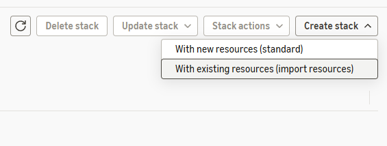

3. Đọc trang giới thiệu, bấm **Next** để đến Specify template.

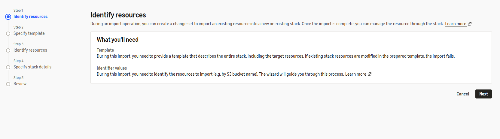

4. Chọn **Upload a template file**, tải `foundation-import.yaml` trong thư mục backup đã chuẩn bị.

**📸 Chụp trang có tên file đã chọn.**

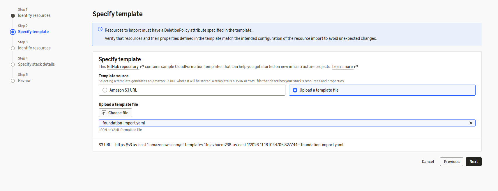

5. Bấm **Next** đến **Identify resources**, đối chiếu **Resources to import (9)**.

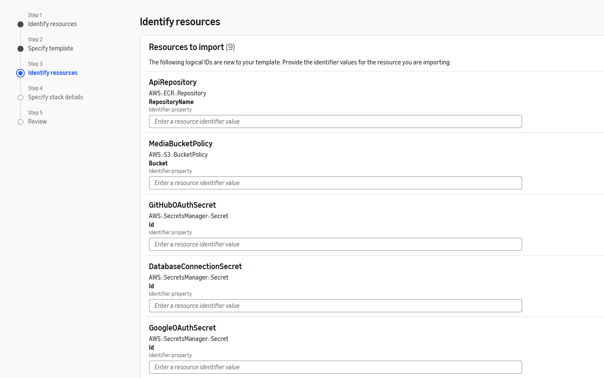

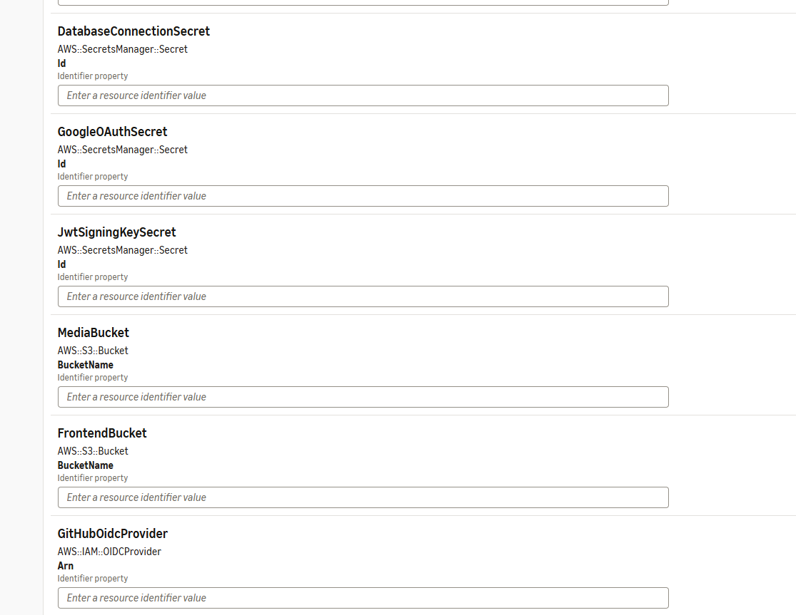

## 3. Điền identifier theo mapping

| Logical ID | Identifier property | Giá trị lấy từ mapping |
| --- | --- | --- |
| `ApiRepository` | `RepositoryName` | Tên ECR repository `tindy-api`. |
| `MediaBucketPolicy` | `Bucket` | Tên media bucket. |
| `GitHubOAuthSecret` | `Id` | ARN đầy đủ của secret OAuth GitHub. |
| `DatabaseConnectionSecret` | `Id` | ARN đầy đủ của secret kết nối DB. |
| `GoogleOAuthSecret` | `Id` | ARN đầy đủ của secret OAuth Google. |
| `JwtSigningKeySecret` | `Id` | ARN đầy đủ của secret khóa JWT. |
| `MediaBucket` | `BucketName` | Tên media bucket, giống trường Bucket của MediaBucketPolicy. |
| `FrontendBucket` | `BucketName` | Tên frontend bucket. |
| `GitHubOidcProvider` | `Arn` | ARN provider `token.actions.githubusercontent.com`. |

Copy giá trị từ `console-import-identifiers.csv` đã xuất trước thao tác. Các trường Id của Secrets Manager nhận ARN tham chiếu tài nguyên. Giá trị bí mật vẫn nằm trong Secrets Manager.

**📸 Sau khi điền, chụp đủ chín identifier, cuộn thành hai phần nếu cần, rồi bấm Next.**

Đã điền đủ chín identifier và đối chiếu với mapping lưu trước cleanup.

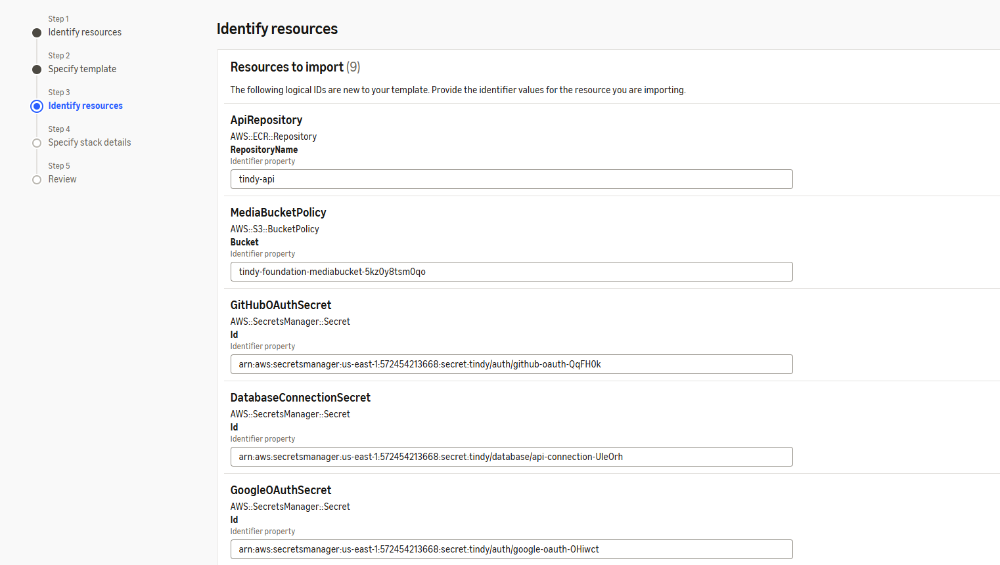

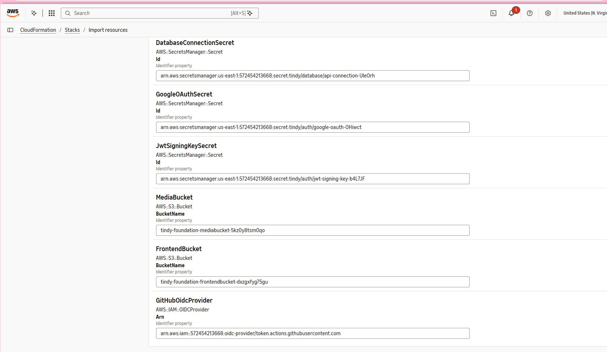

## 4. Tham số dùng cho giai đoạn import

Bấm **Next** đến Specify stack details, nhập tên stack `tindy-foundation`. Dùng `GitHubOidcProviderMode = Create` để resource provider hiện có được đưa vào import. Đặt `BackendDeployEnabled`, `InfraPlannerEnabled` và `LifecycleWorkflowsEnabled` là `false`. Để trống `BackendApiExecutionRoleName`, `BackendApiTaskRoleName`, `FrontendDeployDistributionId` và `FrontendDeployOidcSubject` trong giai đoạn này.

**📸 Chụp tên stack và đủ tham số trước khi chuyển sang Review.**

Đã xác minh tên stack `tindy-foundation`, `GitHubOidcProviderMode = Create`, ba tùy chọn bật role là `false` và bốn trường tham chiếu Runtime/Frontend để trống.

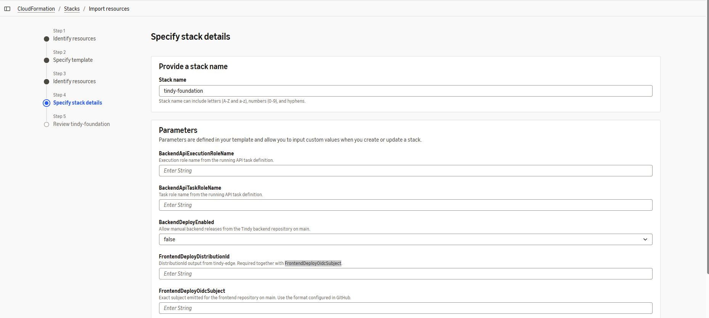

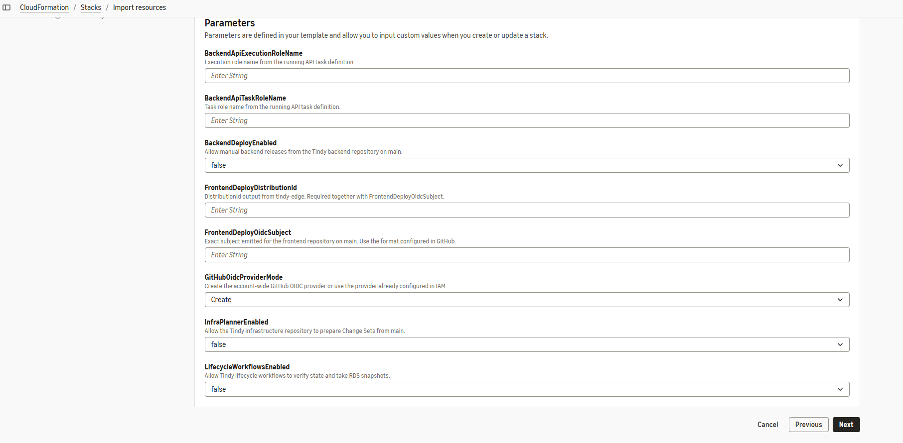

## 5. Kiểm tra trước khi import

Bấm **Next** đến Review. Đối chiếu tên stack, các tham số và chín tài nguyên được import từ mapping đã lưu. Chụp danh sách tài nguyên trước khi bấm nút thực thi. Nếu giao diện hiển thị Resource changes, kết quả mong đợi là chín mục có Action `Import`.

Đã mở trang Review và đối chiếu đủ chín tài nguyên cùng tham số đã chọn.

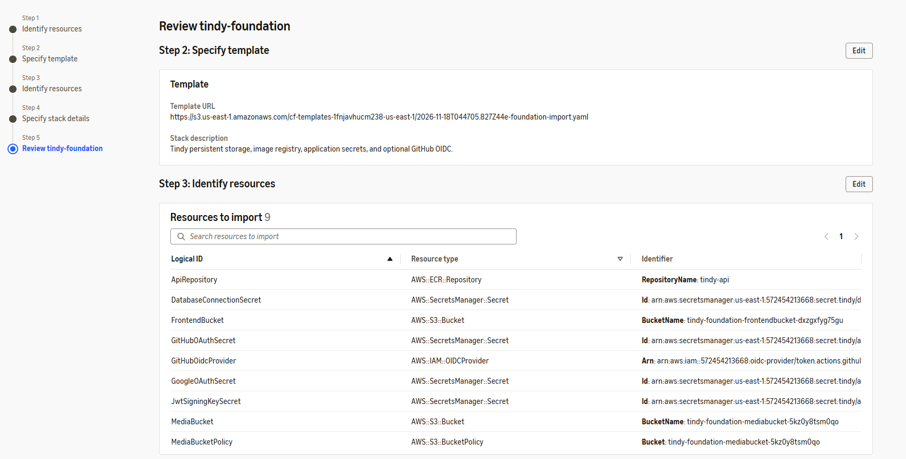

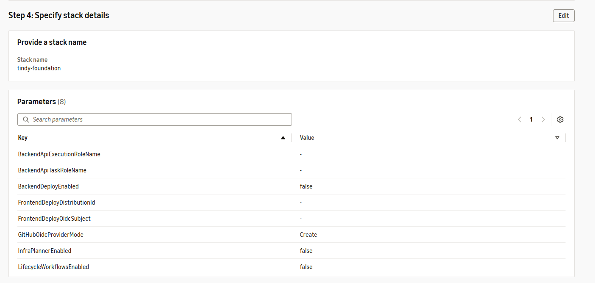

### Xử lý lỗi Outputs khi tạo import Change Set

Lượt đầu file import còn Outputs và CloudFormation báo `As part of the import operation, you cannot modify or add [Outputs]`. Change Set chưa được tạo thành công, chưa có bằng chứng import hoàn tất.

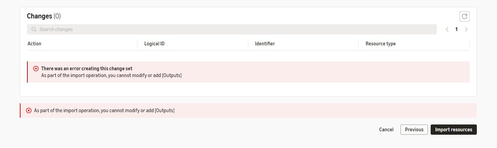

Đã sửa `foundation-import.yaml` bằng cách bỏ toàn bộ Outputs. Quay về **Specify template**, upload lại file đã sửa, đối chiếu lại đủ chín identifier và giữ các tham số import đã hướng dẫn. Sau khi import hoàn tất, thêm lại Outputs qua thao tác cập nhật với template chính `foundation.yaml`.

### Review sau khi sửa template

Upload lại file đã bỏ Outputs và giữ identifier cùng tham số trước đó. Change Set đã tạo thành công với **Changes (9)** và cả chín Action đều là `Import`.

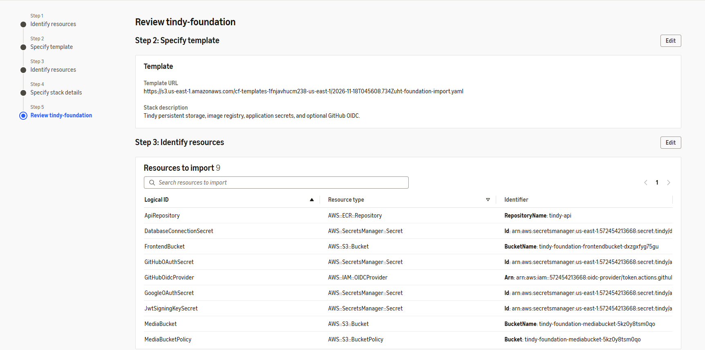

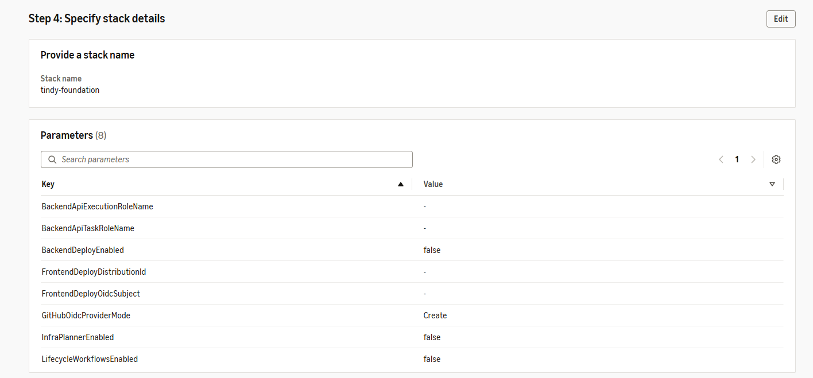

**📸 Chụp bảng chín Action Import trước khi thực thi.**

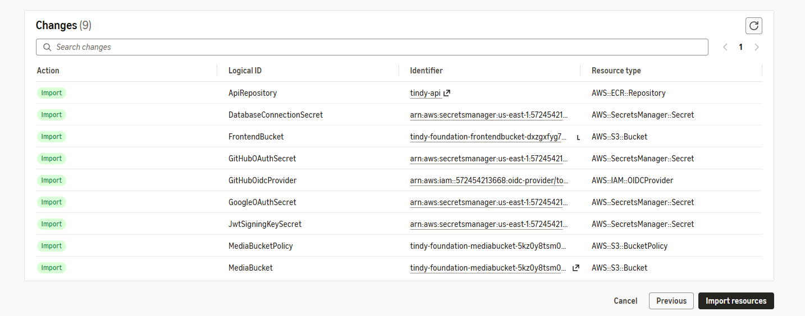

## 6. Thực thi import

Bấm **Import resources**, theo dõi tab **Events** của `tindy-foundation` đến khi stack đạt `IMPORT_COMPLETE`. Nếu có `IMPORT_ROLLBACK_IN_PROGRESS`, `IMPORT_ROLLBACK_COMPLETE` hoặc lỗi khác, kiểm tra Logical ID và Status reason trước khi thao tác tiếp.

**📸 Chụp Events với dòng stack IMPORT_COMPLETE và Resources với chín tài nguyên đã import.**

Đã thực thi import thành công. Ảnh tab **Resources** cho thấy stack `tindy-foundation` đạt `IMPORT_COMPLETE`, danh sách có **Resources (9)** và các tài nguyên đang hiển thị có trạng thái `UPDATE_COMPLETE`.

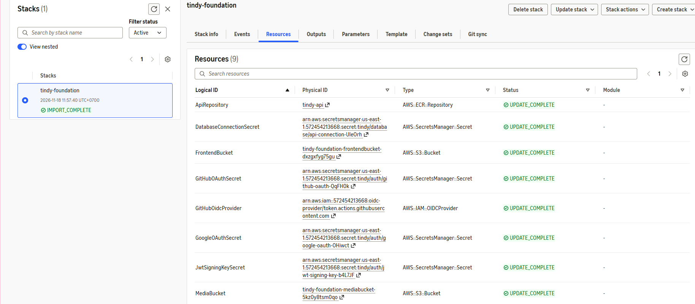

Bước tiếp theo là cập nhật stack bằng template chính `foundation.yaml` để khôi phục Outputs và cấu hình các IAM role theo giai đoạn triển khai.

## 7. Khôi phục template chính và Outputs

Tạo Change Set `tindy-foundation-restore-template` bằng **Replace existing template → Upload a template file**, chọn `foundation.yaml` trong repo hạ tầng. Giữ `GitHubOidcProviderMode = Create`. Bật lại `InfraPlannerEnabled = true` theo cấu hình vận hành trước cleanup để tạo role chuẩn bị Change Set từ GitHub Actions. Role này đã có đủ đầu vào OIDC ở giai đoạn hiện tại.

Giữ `BackendDeployEnabled = false`, `LifecycleWorkflowsEnabled = false`, để trống hai tên role Runtime và hai tham số frontend. Các đầu vào đó sẽ được điền sau khi Runtime và Edge mới đã có Outputs.

Xác nhận IAM capability rồi tạo Change Set. Dự kiến Resource changes chỉ thêm `InfraPlannerRole`; các Outputs được khôi phục theo template. Đối chiếu Change Set thực tế trước khi Execute.

**📸 Chụp tên file template chính, tham số và Resource changes.** Phần này mô tả bước kế tiếp, kết quả cập nhật sẽ được bổ sung theo bằng chứng thực hành.

Đã mở **Stack actions → Create a change set**, chọn **Standard change set → Replace existing template → Upload a template file** và tải đúng `foundation.yaml`.

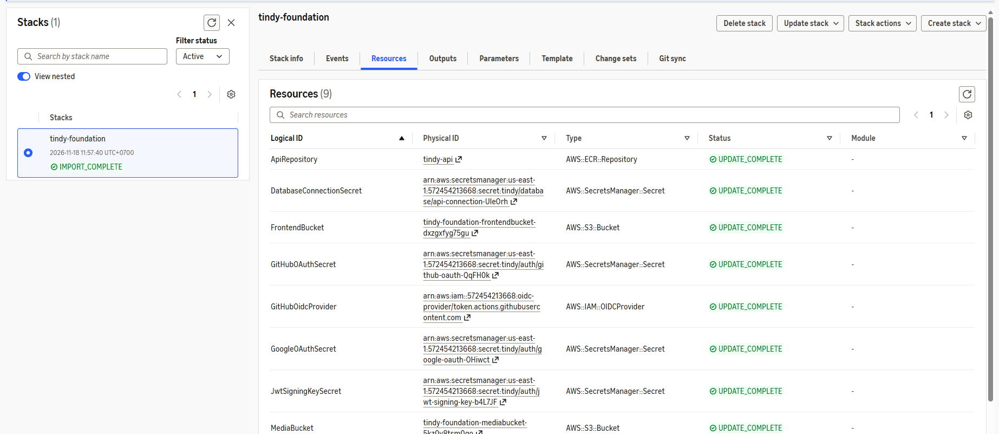

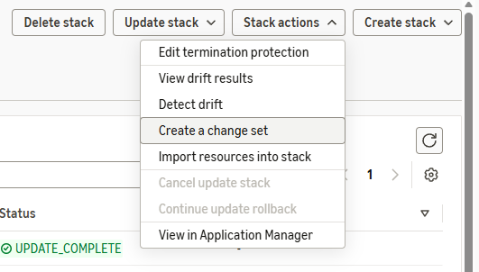

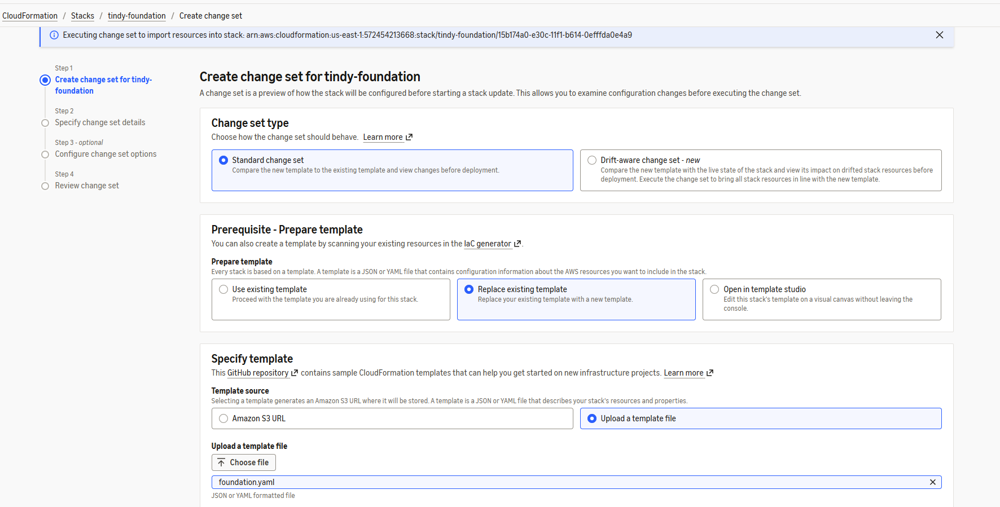

Đã đặt tên Change Set `tindy-foundation-restore-template` và xác minh tham số `GitHubOidcProviderMode = Create`, `InfraPlannerEnabled = true`, `BackendDeployEnabled = false`, `LifecycleWorkflowsEnabled = false`. Bốn trường tham chiếu role Runtime và cấu hình Frontend đang để trống theo giai đoạn triển khai.

**📸 Chụp tên Change Set và đủ tham số.**

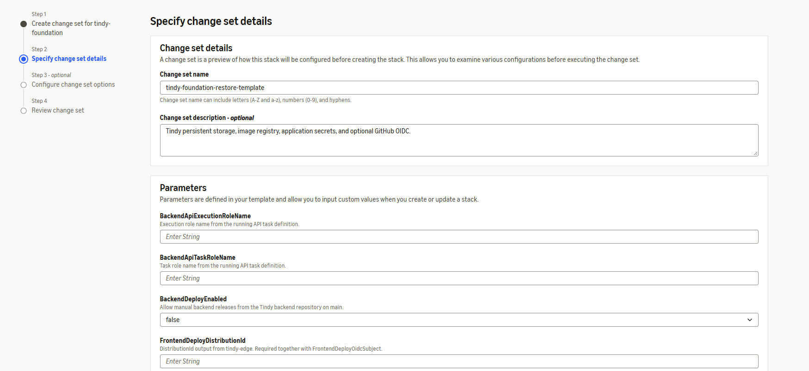

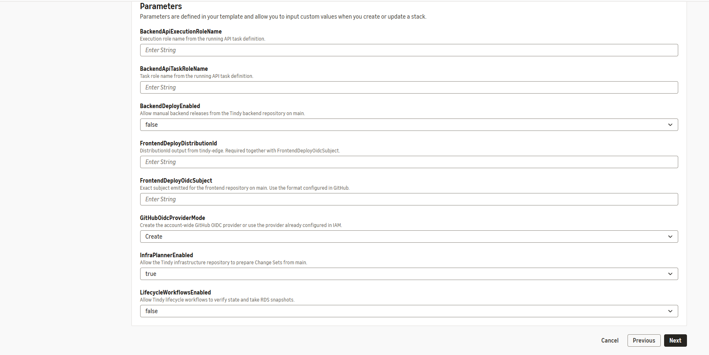

Bấm Next, giữ Express mode tắt, rollback bật và xác nhận IAM capability theo Console. Tạo Change Set rồi kiểm tra Resource changes.

Change Set `tindy-foundation-restore-template` đã đạt `CREATE_COMPLETE`, execution status `AVAILABLE`, chỉ có một mục `InfraPlannerRole → Add` thuộc loại `AWS::IAM::Role`.

**📸 Chụp Resource changes trước khi Execute.**

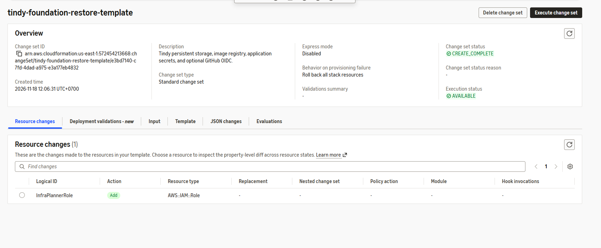

Bấm **Execute change set**, giữ **Use deletion policy** nếu Console hiển thị lựa chọn, rồi theo dõi Events đến `tindy-foundation — UPDATE_COMPLETE`. Sau đó kiểm tra Outputs có các tham chiếu bucket, ECR, secret, OIDC và `InfraPlannerRoleArn` phục vụ những bước tiếp theo.

**📸 Chụp trạng thái stack UPDATE_COMPLETE và toàn bộ Outputs, cuộn thêm nếu cần.**

Đã xác nhận thực thi Change Set với **Use deletion policy**.

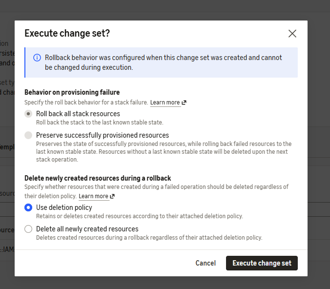

Stack đã đạt **UPDATE_COMPLETE**. Ảnh tại tab Outputs ghi nhận trạng thái stack cùng **Outputs (14)**.

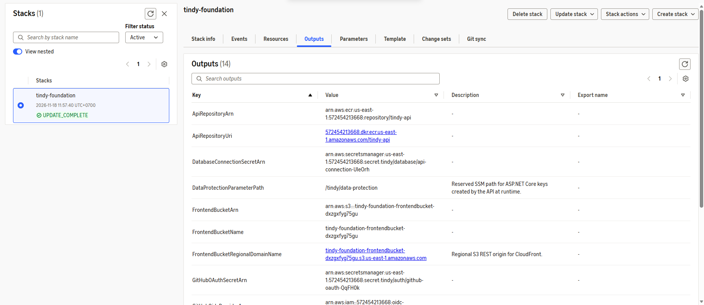

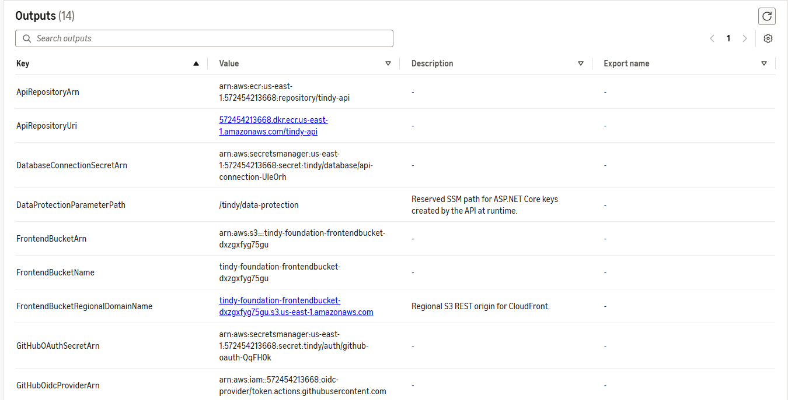

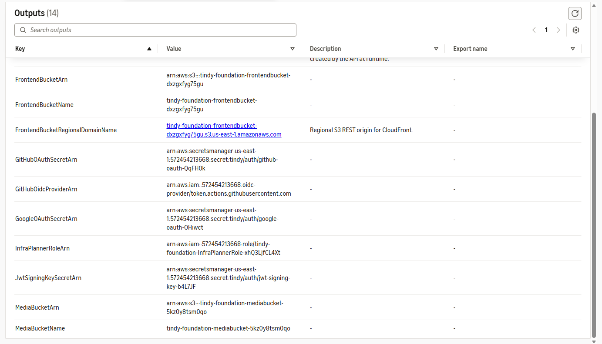

Đã khôi phục các tham chiếu frontend/media bucket, ECR, application secret, OIDC, Data Protection path và `InfraPlannerRoleArn`. Backend deploy, frontend deploy và lifecycle role sẽ được cấu hình theo đầu vào Runtime và Edge mới ở giai đoạn sau. Các ARN role trong GitHub repository variables cần đối chiếu theo Outputs mới trước khi sử dụng workflow tương ứng.

Foundation đã sẵn sàng cho bước triển khai Network.
