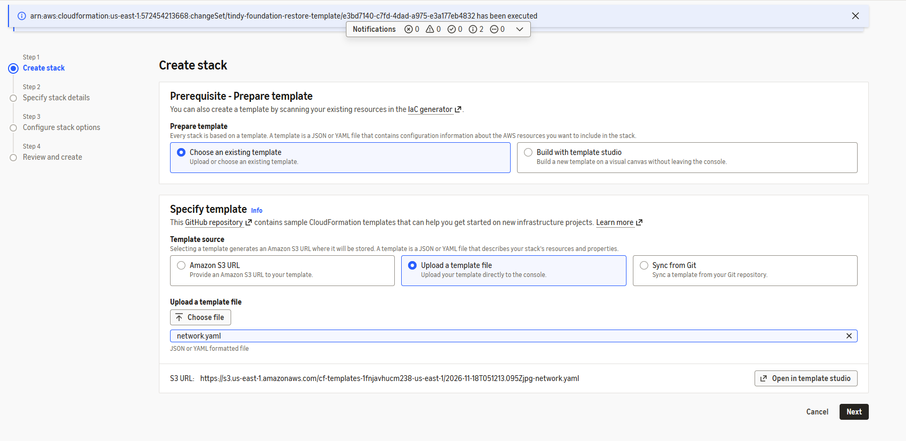
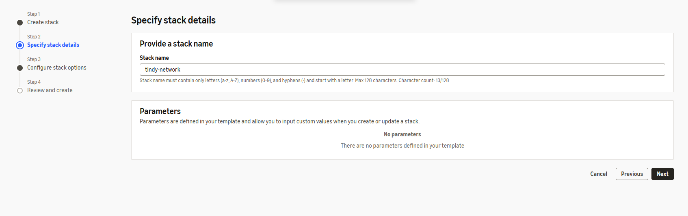
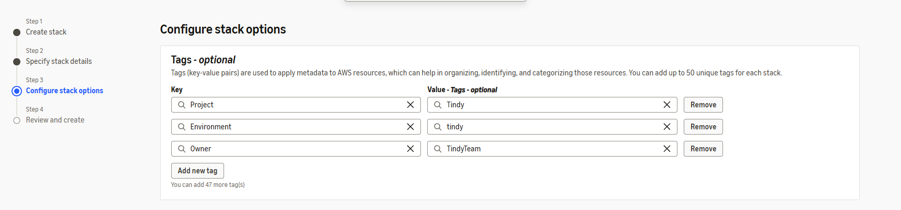
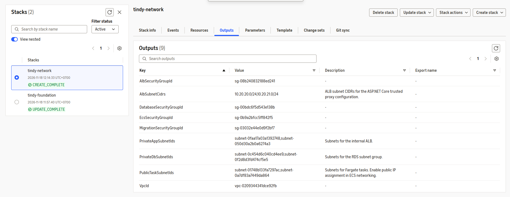

`network.yaml` tạo VPC `10.20.0.0/16`, Internet Gateway, sáu subnet, route table và security group cho ALB, ECS, migration và database. Các Outputs là đầu vào của database và runtime. Template hiện có 26 tài nguyên và chín Outputs, sử dụng ở `us-east-1`.

## 1. Tạo stack từ template

1. Mở **CloudFormation → Create stack → With new resources (standard)** tại **N. Virginia (`us-east-1`)**.
2. Chọn **Choose an existing template → Upload a template file**, tải `network.yaml` trong thư mục `tindy-infrastructure/cloudformation`.

**📸 Chụp trang có tên network.yaml đã chọn.**

3. Bấm Next, nhập Stack name `tindy-network`. Template này có tài nguyên và Outputs, không khai báo Parameters.

**📸 Chụp tên stack trước khi sang Options.**

4. Trong Configure stack options, thêm tag `Project=Tindy`, `Environment=tindy`, `Owner=TindyTeam`. Giữ Express mode tắt và rollback bật.
5. Sang Review, kiểm tra đúng stack và template, rồi thực hiện tạo stack bằng nút Submit/Create stack theo Console.
6. Theo dõi Events đến `tindy-network — CREATE_COMPLETE`. Nếu có lỗi, xem Logical ID và Status reason để xử lý trước khi tiếp tục.

**📸 Chụp kết quả CREATE_COMPLETE và toàn bộ Outputs.**

## 2. Outputs dùng ở bước tiếp theo

| Output | Nơi sử dụng |
| --- | --- |
| `VpcId` | Runtime networking. |
| `PublicTaskSubnetIds` | ECS API và các one-off task. |
| `PrivateAppSubnetIds` | Internal ALB. |
| `PrivateDbSubnetIds` | RDS subnet group. |
| `AlbSubnetCidrs` | Cấu hình trusted proxy của API. |
| `AlbSecurityGroupId` | ALB. |
| `EcsSecurityGroupId` | API service. |
| `MigrationSecurityGroupId` | Bootstrap/migration/seed task. |
| `DatabaseSecurityGroupId` | RDS. |

## 3. Kết quả triển khai đã xác minh

Đã đặt tên `tindy-network` và Console xác nhận template không khai báo tham số.

Đã thêm các tag Project, Environment và Owner theo hướng dẫn.

Stack đạt **CREATE_COMPLETE** và có đủ **Outputs (9)**. Ảnh Outputs ghi nhận cả trạng thái hoàn tất và các tham chiếu mạng mới dùng cho Database và Runtime. Dùng ID từ stack mới trong các lần triển khai tiếp theo.

