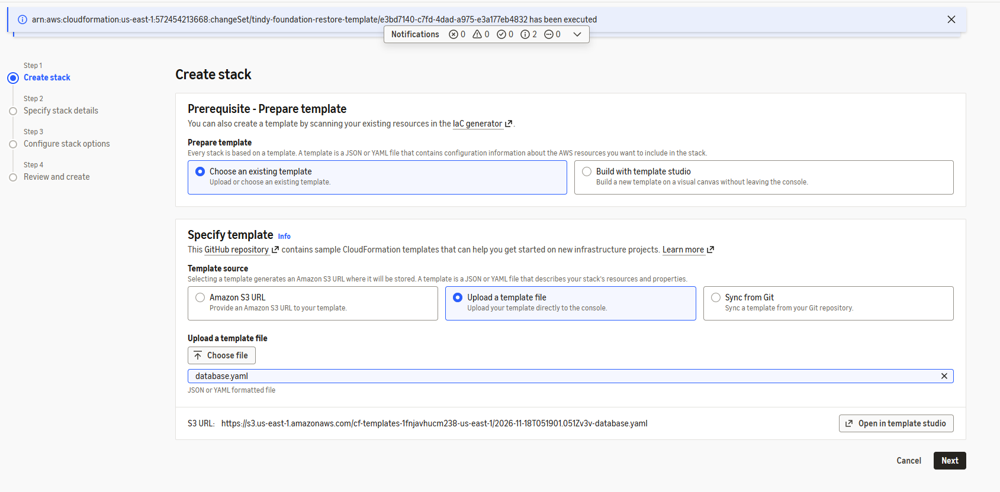
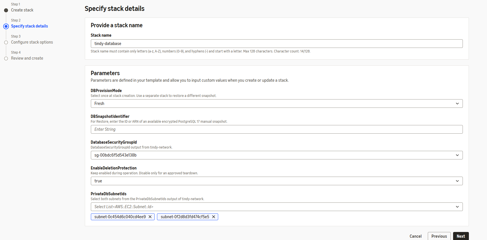
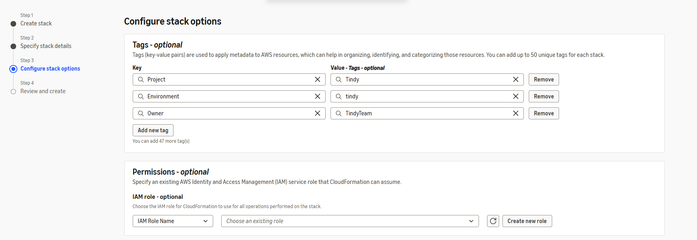
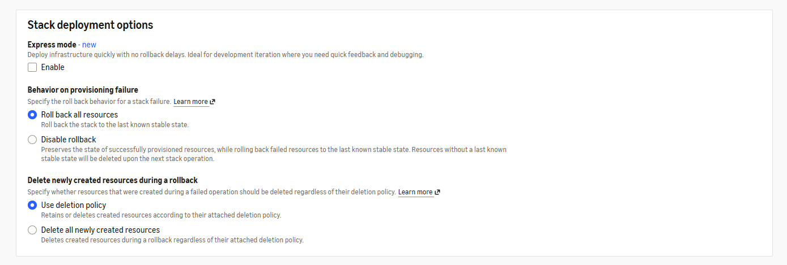
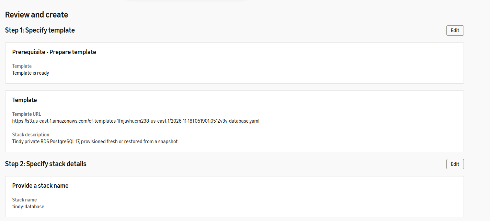
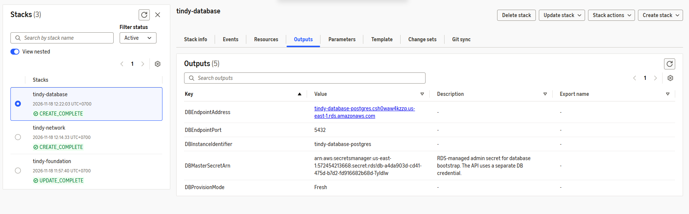

`database.yaml` tạo RDS PostgreSQL trong hai private DB subnet bằng một subnet group, một parameter group yêu cầu TLS và một DB instance. Luồng Fresh tạo database `tindy`, master user `tindy_admin` và để RDS quản lý mật khẩu master trong Secrets Manager. PostgreSQL `17.11` đã được kiểm tra bằng AWS CLI và báo available tại `us-east-1` trước thao tác này.

## Tạo stack

1. Chọn **CloudFormation → Create stack → With new resources (standard)** tại N. Virginia.
2. Upload `database.yaml` từ repo hạ tầng.

**📸 Chụp tên file đã chọn.**

3. Bấm Next, đặt tên stack `tindy-database` và điền tham số theo bảng.

| Parameter | Giá trị |
| --- | --- |
| `DBProvisionMode` | `Fresh` |
| `DBSnapshotIdentifier` | Để trống. |
| `EnableDeletionProtection` | `true` |
| `DatabaseSecurityGroupId` | Output cùng tên từ Network mới. |
| `PrivateDbSubnetIds` | Chọn cả hai subnet từ output cùng tên của Network mới. |

**📸 Chụp tên stack và toàn bộ tham số trước khi chuyển tiếp.**

4. Thêm tag `Project=Tindy`, `Environment=tindy`, `Owner=TindyTeam`. Giữ Express mode tắt và rollback bật, review rồi tạo stack.
5. Chờ stack `CREATE_COMPLETE`, mở Outputs để ghi endpoint, port, provision mode và master secret ARN nếu được xuất ở chế độ Fresh.

**📸 Chụp trạng thái hoàn tất và Outputs.**

Database mới cần bootstrap, migration và seed ở giai đoạn Runtime trước khi bật API. Secret kết nối API được giữ từ môi trường cũ cần đối chiếu và cập nhật sang DB mới. Đã xác minh tên stack `tindy-database`, chế độ Fresh, snapshot để trống và deletion protection bật. Security group `sg-00bdc6f5d543e138b` cùng hai subnet `subnet-0c454d6c040cd4ee9`, `subnet-0f2d8d3fd474cf5e5` khớp Outputs của Network mới. Database đã tạo hoàn tất, có bằng chứng CREATE_COMPLETE và Outputs bên dưới.

## Kết quả triển khai đã xác minh

Đã cấu hình đủ tag, Express mode tắt, rollback bật và **Use deletion policy**, rồi Review tên stack cùng template.

Stack `tindy-database` đạt **CREATE_COMPLETE**, có **Outputs (5)**. `DBProvisionMode` là `Fresh`, cổng `5432`, DB identifier `tindy-database-postgres`. Đã có `DBEndpointAddress` và `DBMasterSecretArn` cho bước bootstrap sau này.

**📸 Ảnh Outputs ghi nhận đồng thời trạng thái stack hoàn tất.**

Master secret do RDS quản lý phục vụ bootstrap. API sử dụng credential DB riêng thông qua application connection secret, được chuẩn bị ở giai đoạn Runtime. Tiếp theo triển khai Integrations.
