`integrations.yaml` thiết lập luồng quét PDF trong media bucket bằng GuardDuty Malware Protection for S3, EventBridge, SQS và DLQ. Template còn có IAM role, queue policy, CloudWatch alarm và SNS email subscription tùy tham số.

## Tạo stack

1. Chọn **CloudFormation → Create stack → With new resources (standard)** tại `us-east-1`, upload `integrations.yaml`.

**📸 Chụp tên file đã chọn.**

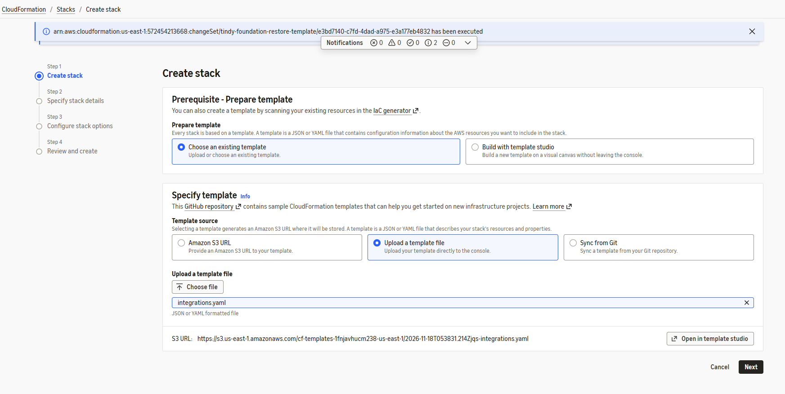

2. Đặt tên stack `tindy-integrations` và điền các tham số sau.

| Parameter | Giá trị |
| --- | --- |
| `MediaBucketName` | Output cùng tên từ Foundation. |
| `ScanAlarmEmail` | Email người nhận cảnh báo. |
| `AlbMetricLoadBalancer` | Để trống ở lượt tạo. |
| `AlbMetricTargetGroup` | Để trống ở lượt tạo. |

Runtime chưa có ALB và target group mới, nên hai metric dimension để trống. Sau khi Runtime tạo xong, cập nhật cả hai giá trị qua Change Set để bật các alarm ALB/API.

**📸 Chụp tên stack và tham số, che email khi xuất bản nếu cần.**

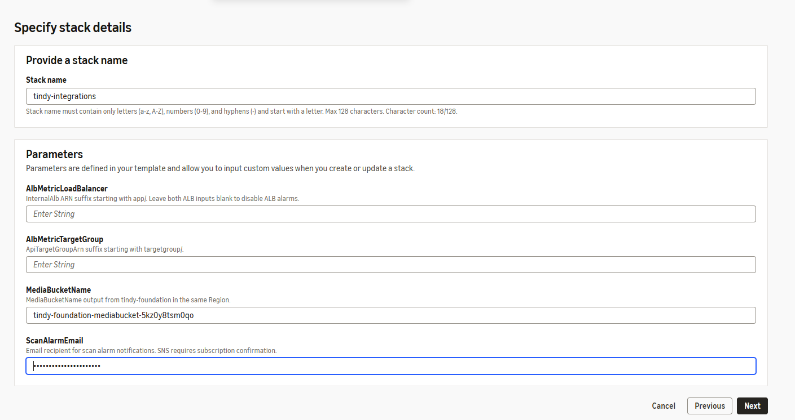

3. Thêm tag `Project=Tindy`, `Environment=tindy`, `Owner=TindyTeam`. Giữ Express mode tắt và rollback bật, xác nhận IAM capability theo Console, review rồi tạo stack.
4. Chờ `CREATE_COMPLETE`, mở Outputs để lấy `GuardDutyProtectionPlanArn` và `GuardDutyQueueUrl` cho Runtime.
5. Mở **GuardDuty → Malware Protection for S3**, chọn protection plan mới, kiểm tra **Active**, tagging bật và các prefix `certificates/pdf/`, `ai-input/pdf/`.
6. Với email được cấu hình, mở thư SNS và chọn **Confirm subscription**, rồi kiểm tra subscription trong SNS đã xác nhận.

**📸 Chụp stack hoàn tất, Outputs, protection plan Active và trạng thái subscription đã xác nhận.**

## Tiến độ đã xác minh

Đã upload đúng `integrations.yaml`, đặt tên `tindy-integrations`, chọn media bucket từ Foundation và để hai ALB metric dimension trống. Trường email đã được nhập và được Console che theo `NoEcho` của template.

Đã thêm đủ tag Project, Environment, Owner, tắt Express mode, bật rollback, giữ Use deletion policy và xác nhận IAM capability.

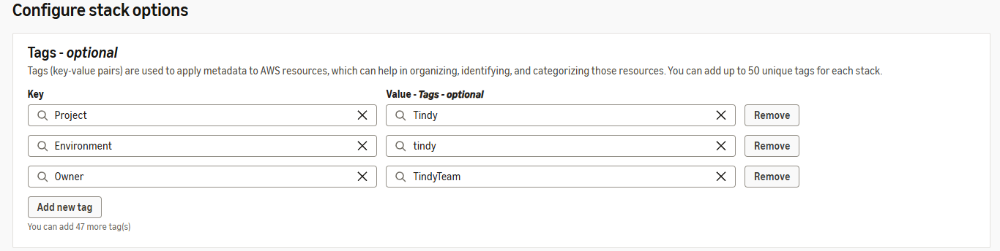

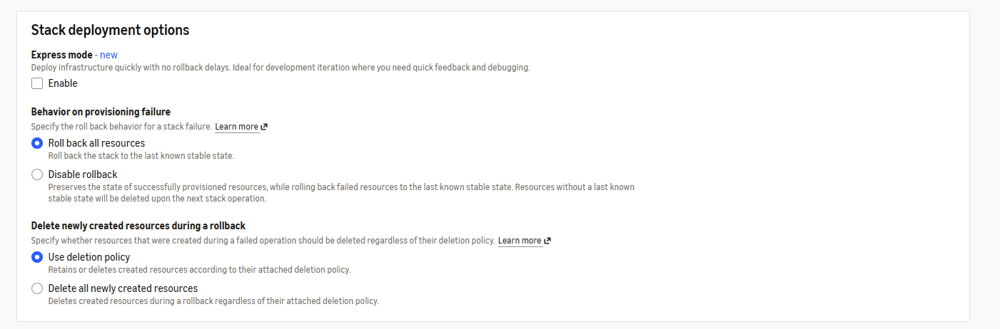

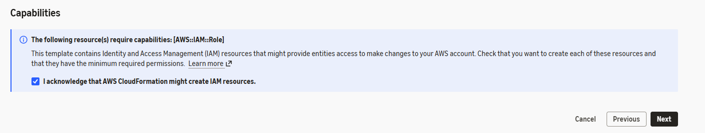

## Kết quả tạo stack và xác nhận SNS

Stack `tindy-integrations` đã đạt **CREATE_COMPLETE**. Ảnh Outputs ghi nhận trạng thái hoàn tất và đủ **Outputs (7)**.

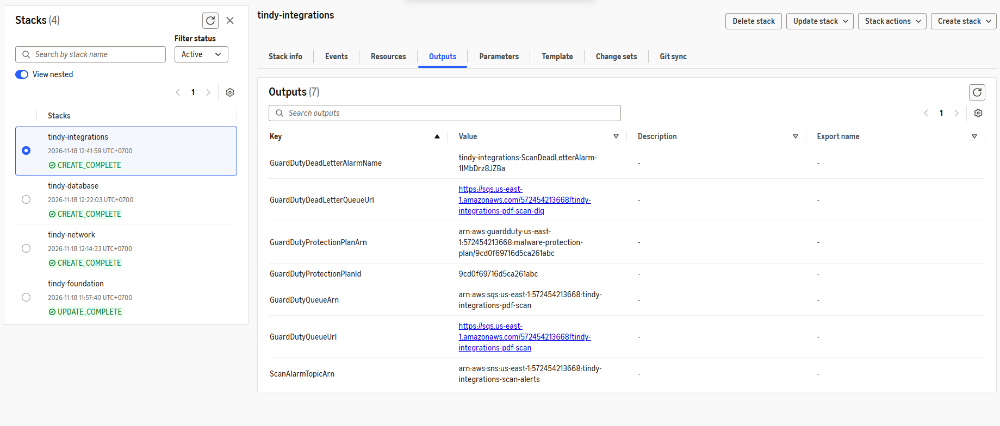

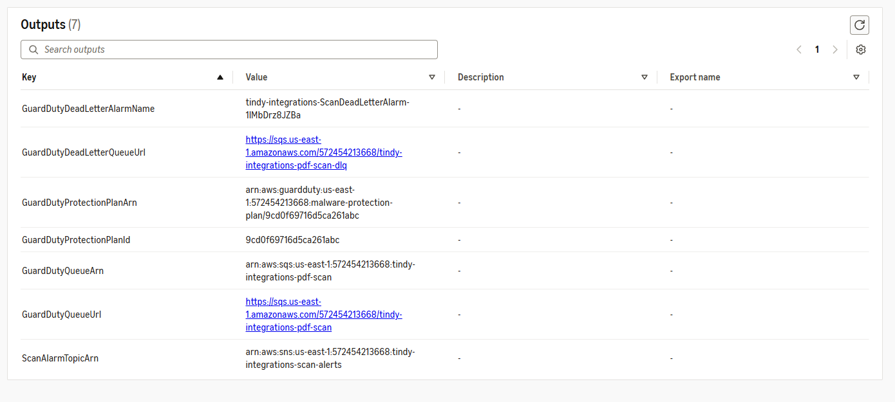

Các tham chiếu Runtime cần sử dụng là `GuardDutyProtectionPlanArn` và `GuardDutyQueueUrl`. Các Outputs còn lại cung cấp protection plan ID, queue ARN, DLQ URL, tên DLQ alarm và SNS topic ARN.

1. Mở thư **AWS Notification - Subscription Confirmation**, đối chiếu topic `tindy-integrations-scan-alerts` và bấm **Confirm subscription**.

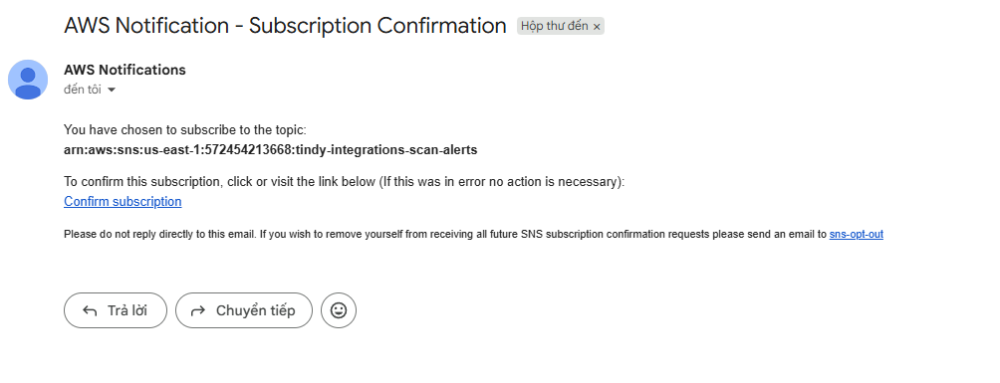

2. Tại trang xác nhận của SNS, bấm **Confirm Subscription**.

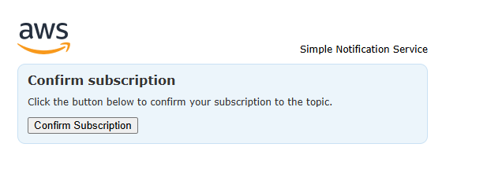

3. Kiểm tra kết quả **Subscription confirmed!** và subscription ARN.

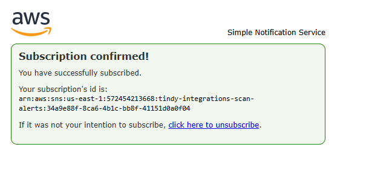

Đã có bằng chứng SNS xác nhận thành công. Tiếp tục kiểm tra protection plan **Active**, tagging và hai prefix PDF để hoàn tất xác minh Integrations.

## Đối chiếu trạng thái bằng AWS CLI

Sau khi nhận ảnh xác nhận, đã đọc protection plan và SNS subscription bằng AWS CLI. Plan mới `9cd0f69716d5ca261abc` báo `ACTIVE`, StatusReasons rỗng, tagging `ENABLED`, bảo vệ media bucket với hai prefix `certificates/pdf/` và `ai-input/pdf/`. SNS trả về subscription ARN của protocol email, khớp trang Subscription confirmed.

Mục 5.4.2 đã xác minh cấu hình hoạt động của các tài nguyên. Ảnh trang chi tiết GuardDuty plan đã được bổ sung bên dưới. Alarm ALB/API sẽ được cấu hình sau khi Runtime có ALB và target group mới.

## Xác minh GuardDuty trên Console

1. Mở **GuardDuty → Malware Protection**, tại ô **S3**, bấm **View feature**. Console ghi nhận bảo vệ một bucket.

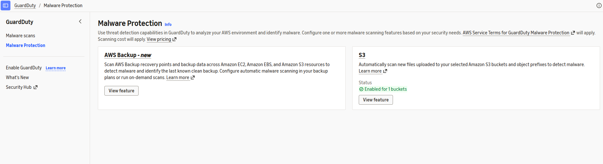

2. Tại **Protected buckets**, xác nhận đúng media bucket của Foundation, protection plan mới và trạng thái **Active**. Bảng hiển thị **2 prefix**.

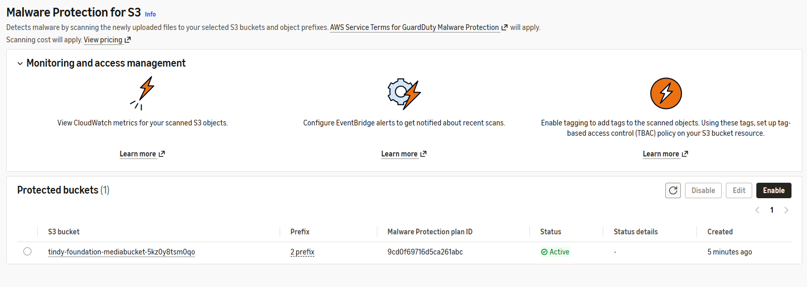

3. Mở bucket trong danh sách. Trang chi tiết xác nhận **Status = Active** và **Tag scanned objects = Yes**. Hai prefix đã được đối chiếu riêng bằng CLI là `certificates/pdf/` và `ai-input/pdf/`.

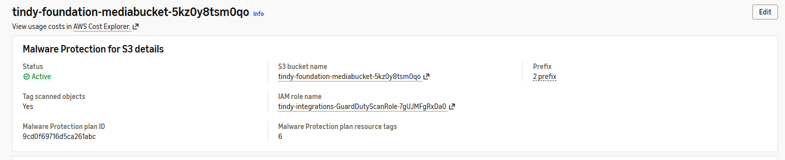

Đã hoàn tất xác minh mục 5.4.2 gồm stack CREATE_COMPLETE, Outputs, SNS subscription confirmed và GuardDuty plan Active. Kiểm thử upload PDF sẽ thực hiện khi API và schema đã sẵn sàng.

## Bổ sung monitoring sau khi Runtime Healthy

Sau khi Runtime và Edge đã live, đối chiếu read-only CloudFormation resources của `tindy-runtime` để lấy ARN hiện tại. Phần này là hướng dẫn cập nhật, chưa có bằng chứng đã Execute.

Tạo Standard change set trên `tindy-integrations`, Use existing template, tên `tindy-integrations-enable-alb-alarms`. Chỉ cập nhật hai tham số:

| Tham số | Giá trị |
| --- | --- |
| `AlbMetricLoadBalancer` | `app/tindy--Inter-KlwCTvMOHRHo/e543836fc18c01a4` |
| `AlbMetricTargetGroup` | `targetgroup/tindy-ApiTa-VBQVMEGFV6ZL/9ba7ccbfe0bd71fa` |

Đây là suffix ARN dùng cho CloudWatch dimensions. Giữ MediaBucketName và ScanAlarmEmail hiện tại. Email SNS đã xác nhận trước đó tiếp tục nhận thông báo.

| Alarm | Điều kiện theo template |
| --- | --- |
| `AlbNoHealthyTargetsAlarm` | Minimum HealthyHostCount dưới 1 qua 3 kỳ 60 giây, missing data tính là breaching. |
| `AlbGenerated5xxAlarm` | Tổng ELB 5xx từ 5 lỗi trong 300 giây. |
| `ApiTarget5xxAlarm` | Tổng target 5xx từ 5 lỗi trong 300 giây. |

Dự kiến Change Set Add ba alarm và Modify `ScanAlarmTopicPolicy` để cho phép thông báo từ các alarm mới. **📸 Chụp Parameters và Resource changes khi CREATE_COMPLETE / AVAILABLE**, kiểm tra trước khi Execute. Sau update kiểm tra các alarm và dimensions trong CloudWatch, ghi nhận trạng thái thực tế.

### Bằng chứng cấu hình monitoring

Ảnh trước khi cập nhật ghi nhận `tindy-integrations` CREATE_COMPLETE với bảy Outputs, gồm queue, DLQ, GuardDuty protection plan và scan alarm. Các tài nguyên tích hợp đang tồn tại trước khi bổ sung alarm ALB.

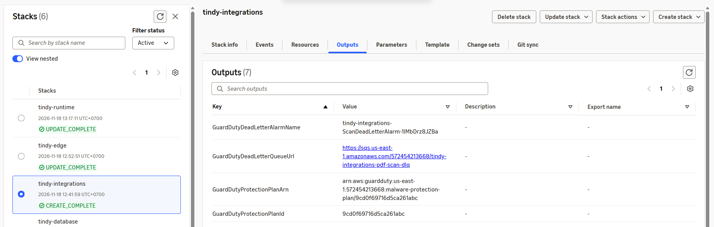

Wizard chọn **Standard change set** và **Use existing template** trên stack `tindy-integrations`. Bước này dùng template hiện tại để bật các alarm có điều kiện bằng tham số.

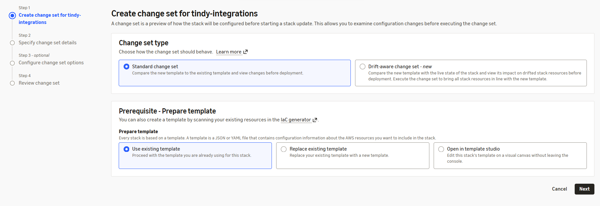

`AlbMetricLoadBalancer` đã điền `app/tindy--Inter-KlwCTvMOHRHo/e543836fc18c01a4`, khớp suffix ARN của InternalAlb hiện tại. CloudWatch dùng dimension này để xác định load balancer cần theo dõi.

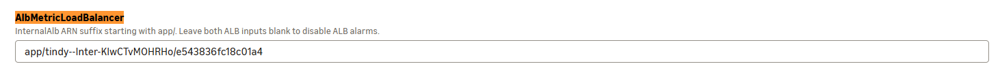

`AlbMetricTargetGroup` đã điền `targetgroup/tindy-ApiTa-VBQVMEGFV6ZL/9ba7ccbfe0bd71fa`, khớp suffix ARN của ApiTargetGroup hiện tại. Dimension này xác định nhóm target của API trong alarm HealthyHostCount và target 5xx.

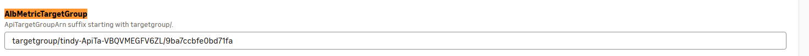

Hai tham số đã khớp dữ liệu read-only từ AWS. Tiếp tục Next, giữ các tham số và options khác, xác nhận IAM capability nếu yêu cầu rồi tạo Change Set. **📸 Chụp Resource changes khi CREATE_COMPLETE / AVAILABLE.** Chưa có bằng chứng Change Set được tạo hoặc monitoring update đã Execute tại mốc này.

### Review Change Set monitoring

Change Set `tindy-integrations-enable-alb-alarms` đạt **CREATE_COMPLETE**, Execution status **AVAILABLE**. Danh sách có đúng bốn thay đổi:

| Logical ID | Action | Resource type | Replacement |
| --- | --- | --- | --- |
| `AlbGenerated5xxAlarm` | Add | `AWS::CloudWatch::Alarm` | — |
| `AlbNoHealthyTargetsAlarm` | Add | `AWS::CloudWatch::Alarm` | — |
| `ApiTarget5xxAlarm` | Add | `AWS::CloudWatch::Alarm` | — |
| `ScanAlarmTopicPolicy` | Modify | `AWS::SNS::TopicPolicy` | False |

Ba alarm được thêm để theo dõi ALB/API, policy SNS được cập nhật tại chỗ để cho phép thông báo từ các alarm mới. Phạm vi thay đổi khớp hướng dẫn. Chưa có bằng chứng Execute tại mốc này.

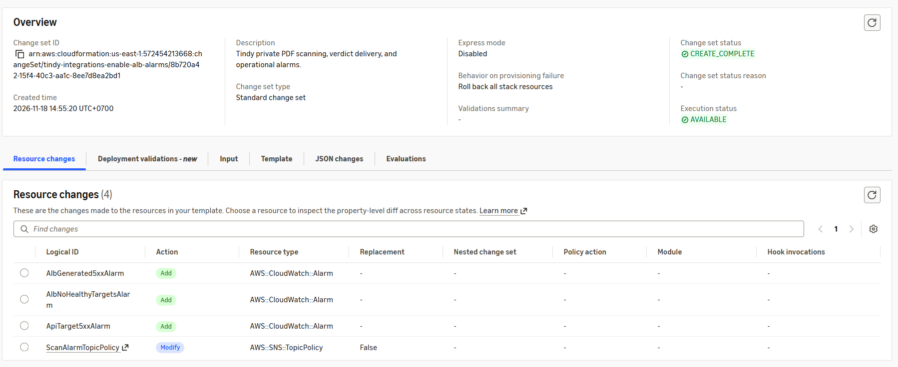

Bấm **Execute change set**, giữ rollback hiện tại và Use deletion policy nếu được hỏi, rồi xác nhận. Chờ stack **UPDATE_COMPLETE**. **📸 Chụp stack sau cập nhật.** Sau đó vào **CloudWatch → Alarms → All alarms**, Region N. Virginia, tìm `tindy-integrations`. **📸 Chụp danh sách bốn alarm** gồm ba alarm mới và ScanDeadLetterAlarm hiện có, cùng trạng thái thực tế. Nếu alarm mới còn INSUFFICIENT_DATA, refresh sau vài phút. Nếu ALARM, mở chi tiết xem State reason và metric trước khi kết luận.

### Kết quả monitoring đã xác minh

Hộp thoại Execute giữ rollback và Use deletion policy. Sau thực thi, `tindy-integrations` đạt **UPDATE_COMPLETE**.

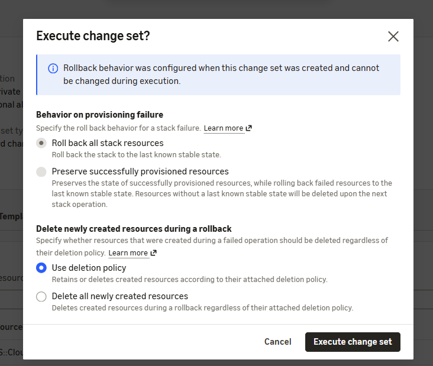

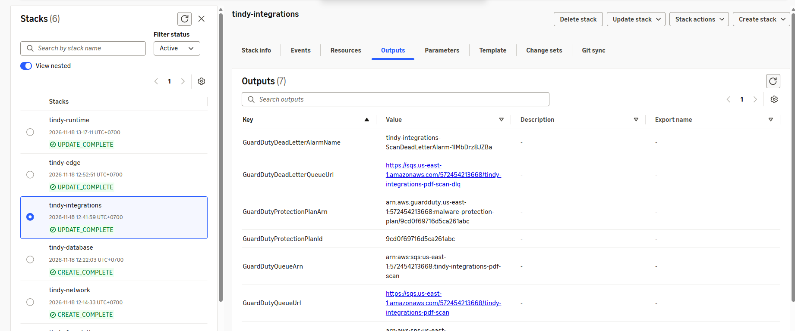

CloudWatch hiển thị đủ bốn alarm **OK**, tất cả **Actions enabled**: ApiTarget5xxAlarm, AlbGenerated5xxAlarm, AlbNoHealthyTargetsAlarm và ScanDeadLetterAlarm. Đây là trạng thái tại thời điểm chụp. Chưa thực hiện thử nghiệm gây lỗi để xác minh phát thông báo alarm.

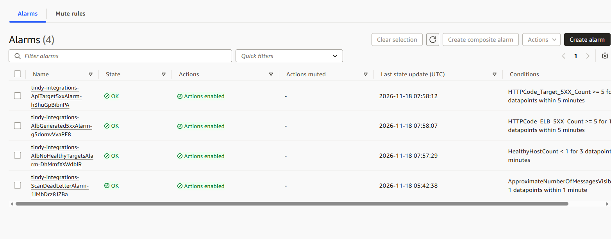
