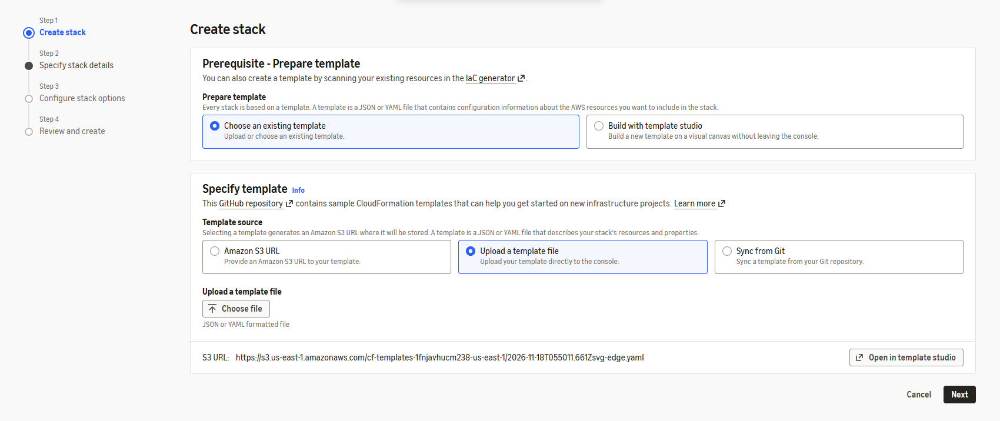
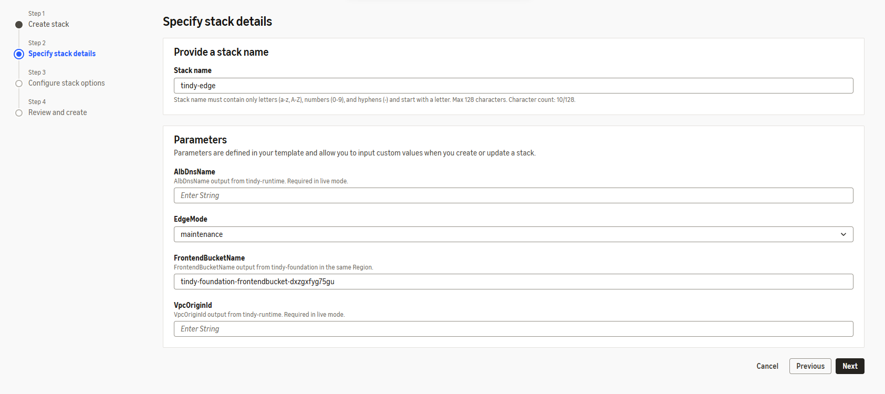
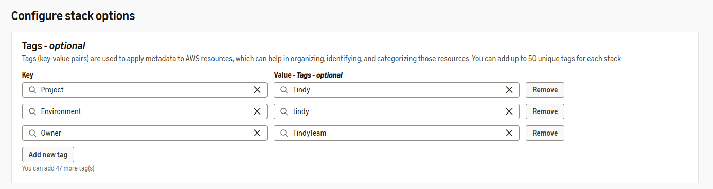
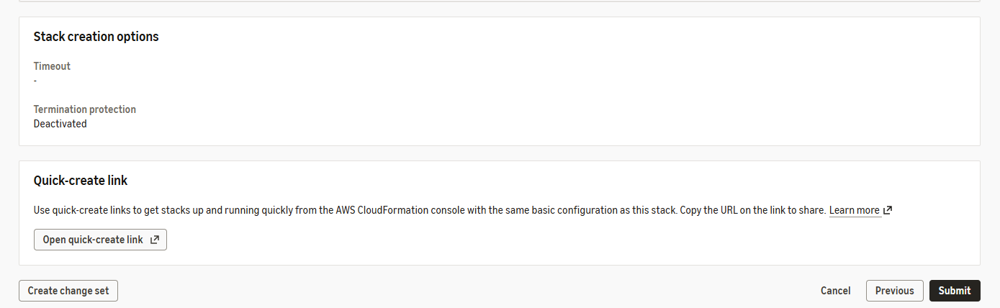
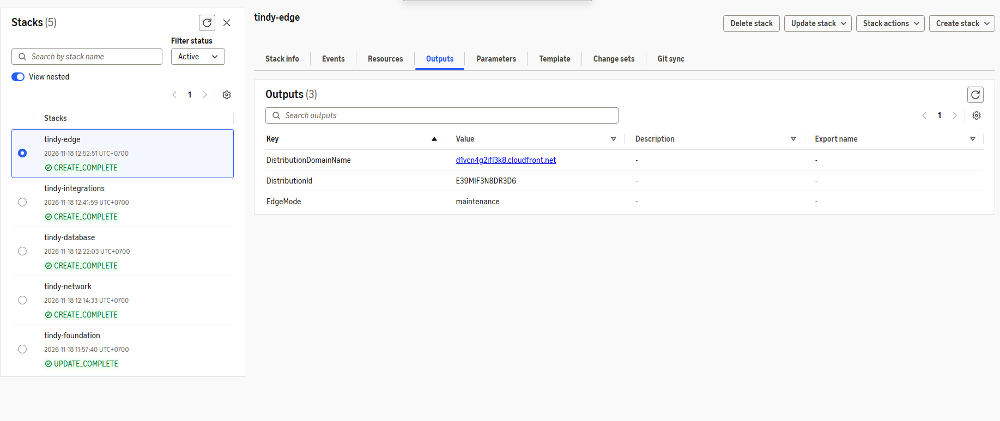
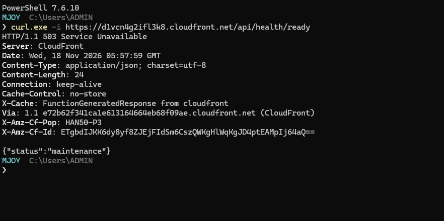

`edge.yaml` tạo CloudFront distribution, Origin Access Control, frontend bucket policy và function định tuyến maintenance. Tạo Edge trước Runtime để lấy hostname mới cho cấu hình public host và OAuth của API.

1. Trong `us-east-1`, chọn **CloudFormation → Create stack → With new resources (standard)**, upload `edge.yaml`.

**📸 Chụp tên file đã chọn.**



2. Đặt tên `tindy-edge`. Điền `FrontendBucketName` theo Foundation Outputs, chọn `EdgeMode = maintenance`, để trống `VpcOriginId` và `AlbDnsName`.

**📸 Chụp tên stack và đủ bốn tham số.**



3. Thêm tag `Project=Tindy`, `Environment=tindy`, `Owner=TindyTeam`. Giữ Express mode tắt và rollback bật. Review rồi tạo stack.
4. Chờ stack `CREATE_COMPLETE`, mở Outputs lấy `DistributionId`, `DistributionDomainName` và `EdgeMode`.

**📸 Chụp trạng thái hoàn tất và Outputs.**

5. Thay `<cloudfront-hostname>` bằng DistributionDomainName mới, chạy trong PowerShell.

```powershell
curl.exe -i "https://<cloudfront-hostname>/api/health/ready"
```

Xác minh HTTP `503` và JSON `{"status":"maintenance"}`. CloudFront giữ maintenance đến khi Runtime và DB schema sẵn sàng.

**📸 Chụp lệnh, mã HTTP và JSON phản hồi.**

## Tiến độ tạo Edge

Đã chọn template edge.yaml, đặt tên stack tindy-edge, chọn frontend bucket từ Foundation, EdgeMode maintenance và để trống AlbDnsName/VpcOriginId. Đã thêm đủ ba tag vận hành.



Trang Review hiển thị nút **Submit**. Termination protection hiện **Deactivated** theo ảnh Review.



Đã Submit và xác minh stack `tindy-edge` đạt **CREATE_COMPLETE**. Ảnh Outputs ghi nhận đủ ba giá trị.

| Output | Giá trị trong lượt triển khai |
| --- | --- |
| `DistributionId` | `E39MIF3N8DR3D6` |
| `DistributionDomainName` | `d1vcn4g2ifl3k8.cloudfront.net` |
| `EdgeMode` | `maintenance` |



Dùng hostname mới để cấu hình `CloudFrontPublicHost` của Runtime. Chạy kiểm tra maintenance bằng HTTPS trước khi tiếp tục.

```powershell
curl.exe -i https://d1vcn4g2ifl3k8.cloudfront.net/api/health/ready
```

**📸 Chụp lệnh cùng mã HTTP 503 và JSON maintenance.** Đã gọi HTTPS bằng curl và xác minh HTTP `503 Service Unavailable`, `Server: CloudFront`, `Cache-Control: no-store` cùng JSON `{"status":"maintenance"}`. Đã ghi nhận ảnh terminal bên dưới.



