`runtime.yaml` tạo ECS cluster, API task definition và service, IAM role, log group, internal ALB, listener, target group, ingress và CloudFront VPC Origin. Các one-off task definition cho bootstrap, migration và seed được bật theo tham số.

## 1. Chuẩn bị đầu vào

Đã đối chiếu Outputs của Foundation, Network, Database, Integrations và Edge bằng AWS CLI. Hostname mới là `d1vcn4g2ifl3k8.cloudfront.net`, Edge maintenance đã được xác minh trả HTTP 503.

Image ECR còn tồn tại và có release tag là `tindy-api@sha256:1505b06199c2965fd800deab9956cbf47601ce76bc42848b8085dfae5b7f69ea`, trùng ApiImage ghi nhận từ Runtime trước cleanup. Image được pin theo digest để dùng nhất quán cho API và các tác vụ DB.

Đặt `DesiredCount = 0` khi tạo Runtime để chuẩn bị secrets, bootstrap DB, migration và seed trước khi bật API. Giữ `AiPdfUploadsEnabled = false` trong giai đoạn chuẩn bị schema.

## 2. Upload template

1. Tại N. Virginia, chọn **CloudFormation → Create stack → With new resources (standard)**.
2. Chọn **Upload a template file**, tải `runtime.yaml` từ repo hạ tầng.

**📸 Chụp trang có tên runtime.yaml đã chọn.**

3. Bấm Next, đặt tên `tindy-runtime`. Điền các tham số từ Outputs mới trong các bước hướng dẫn tiếp theo.

**📸 Chụp bảng tham số theo từng phần trước khi Review.**

Đã ghi nhận upload runtime.yaml và nhập tham số như ảnh bên dưới. Runtime mới đã tạo hoàn tất, xem bằng chứng ở cuối trang.

## 3. Tham số Runtime giai đoạn đầu

Đã đối chiếu Outputs hiện tại, image digest trong ECR và CloudFront prefix list bằng AWS CLI. Cấu hình cũ bật OAuth, media, Bedrock text và AI PDF. Giai đoạn tạo mới giữ OAuth, media và Bedrock text bật, đặt AI PDF false đến khi schema sẵn sàng. Bốn tham số one-off task ở cuối bảng để trống trong lượt tạo cơ bản. Sau khi có service với DesiredCount 0, chuẩn bị secrets rồi cập nhật để tạo task bootstrap/migration/seed.

Bảng đầy đủ cũng được lưu ở `backup/tindy-runtime-fresh/runtime-parameters.csv` và JSON tương ứng trong Worklog.

| Parameter | Giá trị của lượt thực hành |
| --- | --- |
| `ApiImage` | `572454213668.dkr.ecr.us-east-1.amazonaws.com/tindy-api@sha256:1505b06199c2965fd800deab9956cbf47601ce76bc42848b8085dfae5b7f69ea` |
| `DesiredCount` | `0` |
| `VpcId` | `vpc-0209344341dce92fb` |
| `PublicTaskSubnetIds` | `subnet-01748b133fa7297ac,subnet-0a7df83a7449da864` |
| `PrivateAppSubnetIds` | `subnet-0faa17a03a1392748,subnet-050d30a2b0a6274a3` |
| `AlbSubnetCidrs` | `10.20.20.0/24,10.20.21.0/24` |
| `AlbSecurityGroupId` | `sg-08b240832188ed241` |
| `EcsSecurityGroupId` | `sg-0b9a2bfcc5ff842f5` |
| `CloudFrontOriginPrefixListId` | `pl-3b927c52` |
| `CloudFrontServiceSecurityGroupId` | Để trống |
| `CloudFrontPublicHost` | `d1vcn4g2ifl3k8.cloudfront.net` |
| `DatabaseConnectionSecretArn` | `arn:aws:secretsmanager:us-east-1:572454213668:secret:tindy/database/api-connection-UleOrh` |
| `JwtSigningKeySecretArn` | `arn:aws:secretsmanager:us-east-1:572454213668:secret:tindy/auth/jwt-signing-key-b4L7JF` |
| `OAuthEnabled` | `true` |
| `GoogleOAuthSecretArn` | `arn:aws:secretsmanager:us-east-1:572454213668:secret:tindy/auth/google-oauth-OHiwct` |
| `GitHubOAuthSecretArn` | `arn:aws:secretsmanager:us-east-1:572454213668:secret:tindy/auth/github-oauth-QqFH0k` |
| `AiPdfUploadsEnabled` | `false` |
| `BedrockTextEnabled` | `true` |
| `MediaEnabled` | `true` |
| `MediaBucketName` | `tindy-foundation-mediabucket-5kz0y8tsm0qo` |
| `GuardDutyProtectionPlanArn` | `arn:aws:guardduty:us-east-1:572454213668:malware-protection-plan/9cd0f69716d5ca261abc` |
| `GuardDutyQueueUrl` | `https://sqs.us-east-1.amazonaws.com/572454213668/tindy-integrations-pdf-scan` |
| `DataProtectionParameterPath` | `/tindy/data-protection` |
| `DBProvisionMode` | `Fresh` |
| `MigrationConnectionSecretArn` | Để trống |
| `SeedPasswordSecretArn` | Để trống |
| `DBEndpointAddress` | Để trống |
| `DBMasterSecretArn` | Để trống |

Các giá trị trên đã được đối chiếu với ảnh nhập tham số. Đã có bằng chứng tạo Runtime mới ở cuối trang. **📸 Chụp tên stack và từng phần Parameters trước Review.**

## 4. Đối chiếu tham số đã nhập

Đã upload đúng `runtime.yaml`, đặt tên stack `tindy-runtime`.

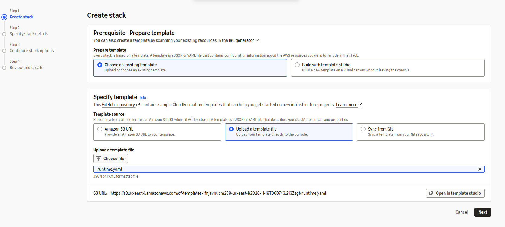

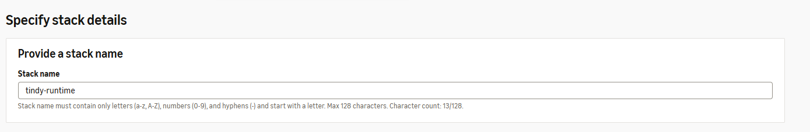

Đã đối chiếu image digest, CloudFront hostname và prefix list, tham chiếu secrets/GuardDuty, các feature flag và ID subnet/security group mới. `DesiredCount = 0`, `DBProvisionMode = Fresh`, `AiPdfUploadsEnabled = false`. Bốn tham số phục vụ one-off task đang trống theo giai đoạn tạo cơ bản.

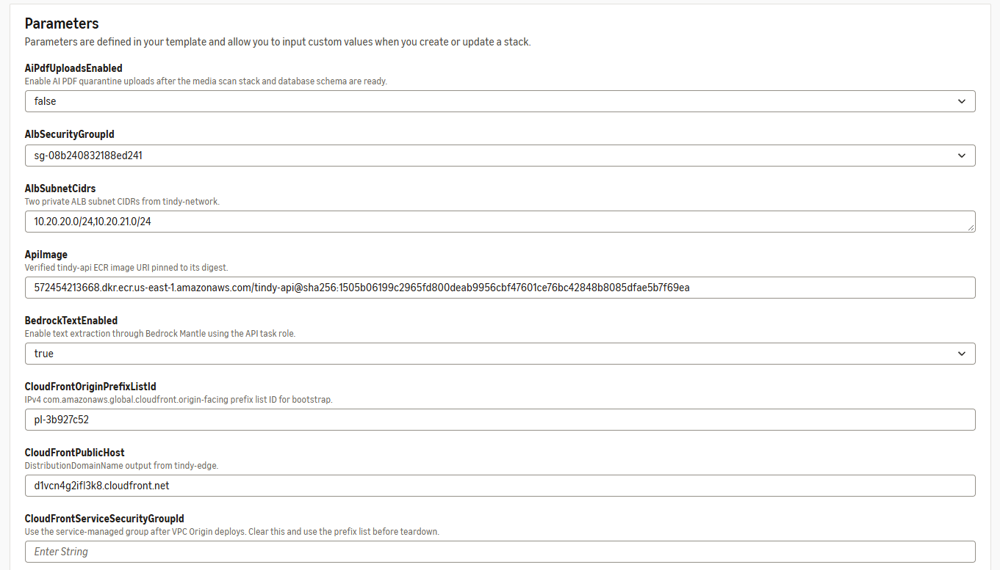

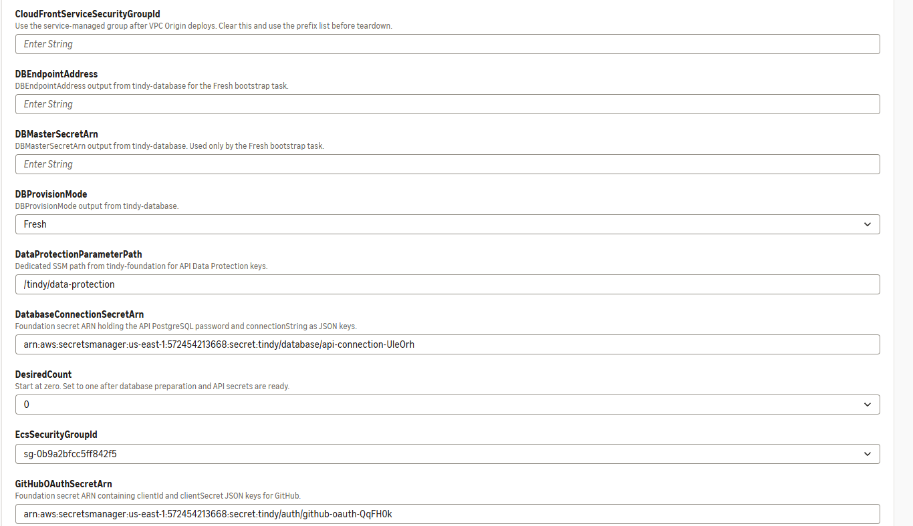

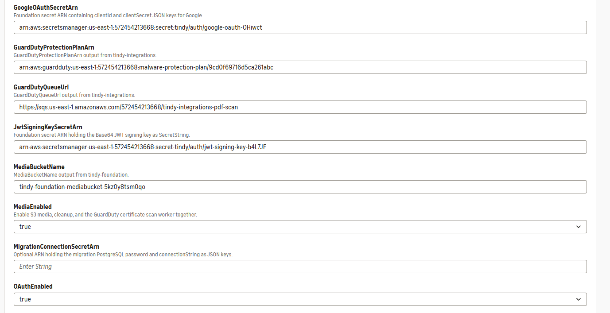

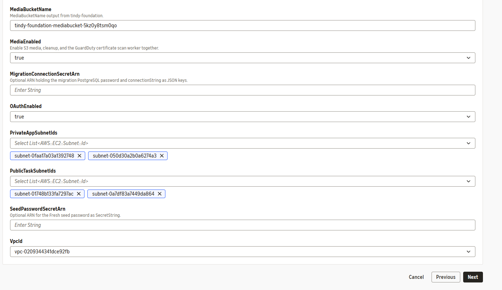

## 5. Tạo stack và lấy Outputs

Bấm Next, thêm tag `Project=Tindy`, `Environment=tindy`, `Owner=TindyTeam`. Giữ Express mode tắt, rollback bật và Use deletion policy. Xác nhận IAM capability khi được yêu cầu, Review rồi Submit.

Chờ `tindy-runtime — CREATE_COMPLETE`, mở Outputs lấy `AlbDnsName`, `VpcOriginId`, `ApiTargetGroupArn` và các tham chiếu ECS. Do DesiredCount bằng 0, service ở giai đoạn này chưa chạy API task.

**📸 Chụp Options/IAM, trạng thái CREATE_COMPLETE và toàn bộ Outputs.**

Đã thêm đủ tag và xác minh Express mode tắt, Roll back all resources, Use deletion policy cùng IAM capability đã được chọn.

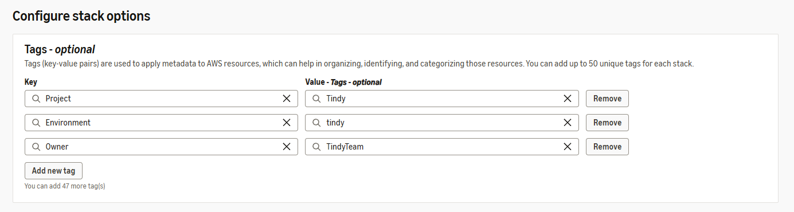

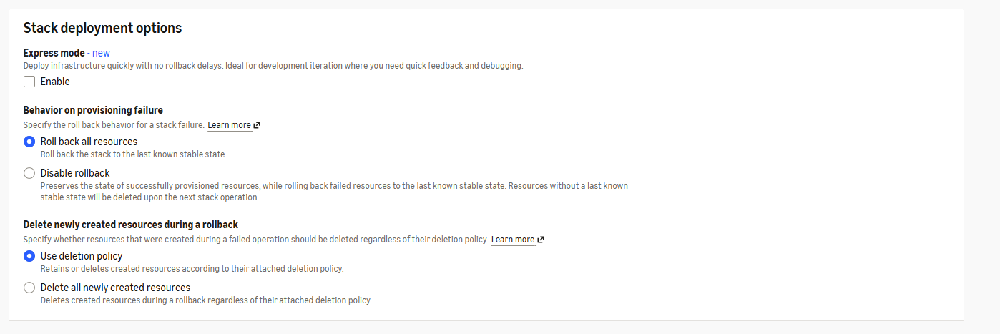

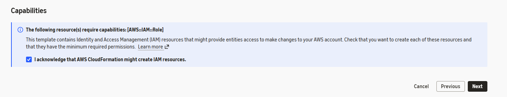

Trang Review hiển thị nút Submit để bắt đầu tạo stack.

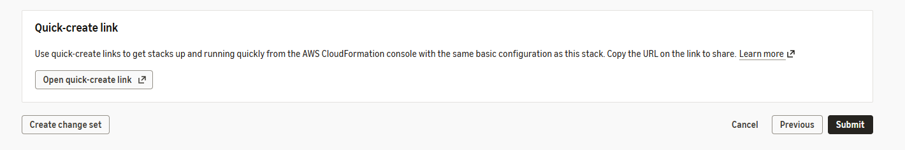

Runtime đã đạt **CREATE_COMPLETE**, có **Outputs (6)**. Ảnh Outputs ghi nhận trạng thái stack cùng các tham chiếu mới.

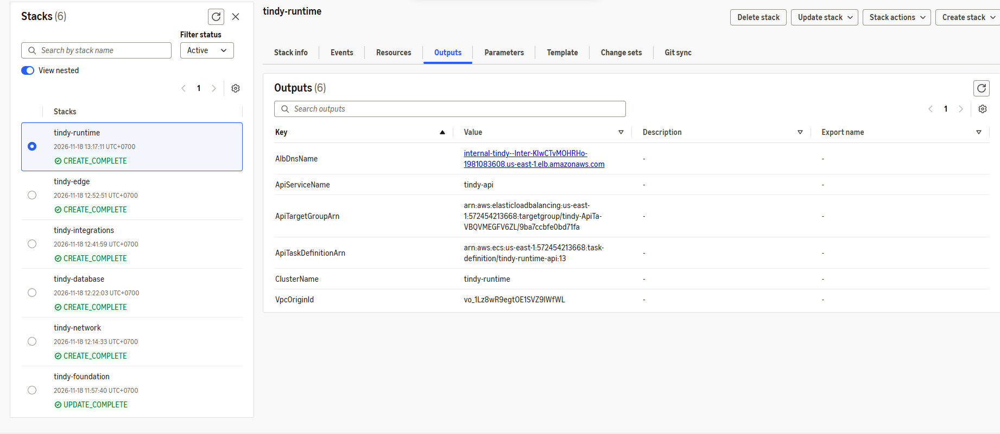

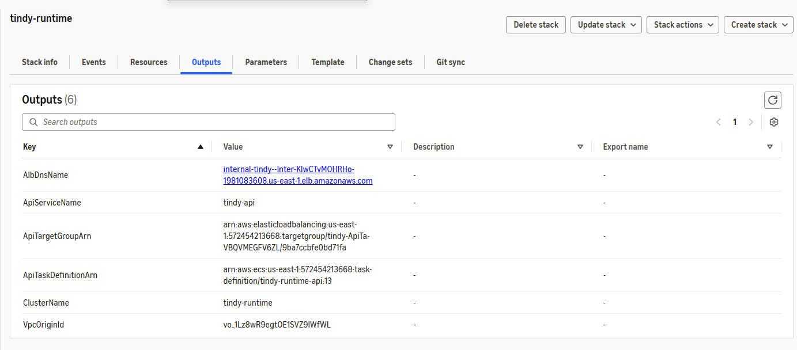

| Output | Vai trò ở giai đoạn sau |
| --- | --- |
| `AlbDnsName` | Điền vào Edge khi chuyển live. |
| `VpcOriginId` | Gắn VPC Origin mới vào Edge. |
| `ApiTargetGroupArn` | Kiểm tra health và cấu hình alarm theo target group mới. |
| `ApiTaskDefinitionArn` | Theo dõi revision cấu hình API. |
| `ApiServiceName`, `ClusterName` | Kiểm tra service và chạy one-off task. |

Bootstrap/migration/seed task definition sẽ xuất hiện sau khi bổ sung các tham số tương ứng. Tiếp theo kiểm tra service có Desired/Running/Pending bằng 0 để chuẩn bị secrets cho Fresh.
