Đã đọc trạng thái ECS bằng CLI, service ACTIVE với Desired/Running/Pending đều bằng 0 và không có failures. VPC Origin lấy trực tiếp từ Outputs báo Deployed.

## 1. Khởi tạo các tham chiếu secrets

Script có sẵn `scripts/prepare-runtime-secrets.ps1` đọc Outputs của Foundation và Database, kiểm tra service ở 0 task rồi chuẩn bị application/migration/seed secrets. Secret đã có AWSCURRENT được giữ theo logic script, nên cần đối chiếu endpoint và cấu hình kết nối trước khi chạy task DB.

Mở PowerShell 7 và chạy từ repo hạ tầng.

```powershell
Set-Location 'D:\FPT\Semester 6\OJT\aws\tindy-platform\tindy-infrastructure'
.\scripts\prepare-runtime-secrets.ps1 -AwsProfile tindy-admin | Format-List *
```

## 2. Kết quả cần ghi

Script xuất bốn trường `DBEndpointAddress`, `DBMasterSecretArn`, `MigrationConnectionSecretArn` và `SeedPasswordSecretArn`. Đây là các tham chiếu để cập nhật Runtime và tạo task bootstrap/migration/seed.

**📸 Chụp lệnh và bốn trường kết quả, mốc deploy-39.** Nếu có lỗi, lưu phần thông báo lỗi để đối chiếu trước khi tiếp tục.

Chạy script chuẩn bị secrets mới thực hiện giai đoạn cấu hình. Bootstrap DB, migration và seed được chạy lần lượt bằng one-off ECS task ở bước sau. Script đã chạy thành công và trả đủ bốn trường như ảnh bên dưới.

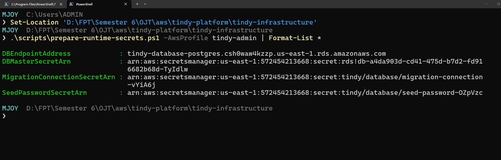

Ảnh ghi nhận DB endpoint hiện tại và ba ARN phục vụ cấu hình task. Bước tiếp theo là đối chiếu connectionString trong secret API/migration với DB Fresh, sau đó cập nhật bốn tham số tương ứng của Runtime qua Change Set, vẫn giữ DesiredCount 0.

## 3. Đối chiếu cấu hình kết nối trước bootstrap

Đã đọc và phân tích secret bằng AWS CLI trong bộ nhớ, chỉ xuất các trường cấu hình và kết quả đối chiếu. API dùng user `tindy_api`, migration dùng `tindy_migrator`. Cả hai cùng trỏ endpoint của DB Fresh, database `tindy`, port `5432`, TLS `VerifyFull` và CA bundle `/app/certs/rds-us-east-1-bundle.crt`. Trường password trong JSON khớp password của connectionString ở cả hai secret.

## 4. Bổ sung tham số task DB vào Runtime

Tạo Change Set `tindy-runtime-enable-db-tasks` từ template Runtime hiện tại. Giữ DesiredCount 0 và các tham số còn lại. Điền bốn giá trị từ kết quả script vào `DBEndpointAddress`, `DBMasterSecretArn`, `MigrationConnectionSecretArn`, `SeedPasswordSecretArn`.

Các điều kiện trong runtime.yaml sẽ bật ba cặp execution role/task definition cho bootstrap, migration và seed. Dự kiến sáu mục Add. Review các thay đổi trước khi Execute.

**📸 Chụp bốn tham số cùng DesiredCount 0, sau đó chụp Resource changes của Change Set.** Đã nhập tham số theo ảnh bên dưới. Kết quả tạo/thực thi Change Set và chạy task sẽ bổ sung sau khi xác minh.

### Ảnh thao tác bổ sung task DB

Đã chọn **Create a change set**, giữ template hiện tại và đặt tên `tindy-runtime-enable-db-tasks`.

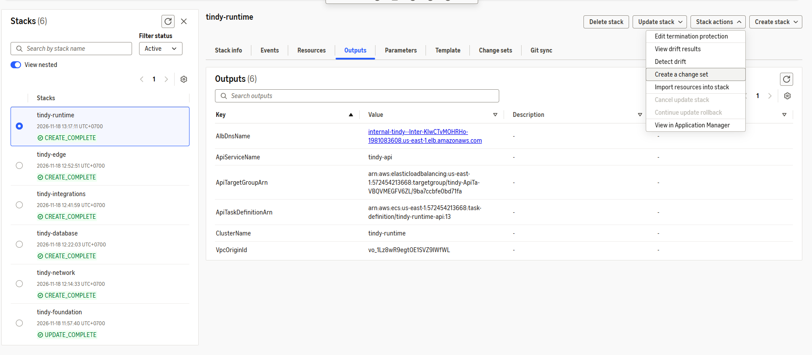

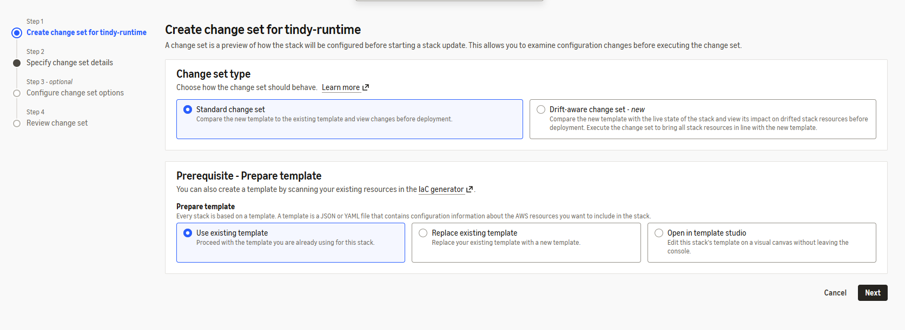

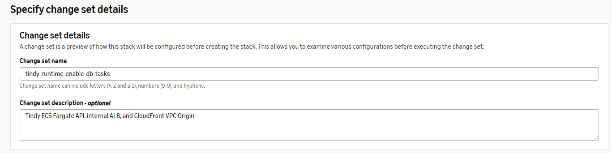

Đã đối chiếu bốn giá trị mới với kết quả script. `DBProvisionMode = Fresh`, `DesiredCount = 0` và `AiPdfUploadsEnabled = false`. Image, Edge, mạng và các tham chiếu Integrations vẫn khớp cấu hình giai đoạn tạo Runtime.

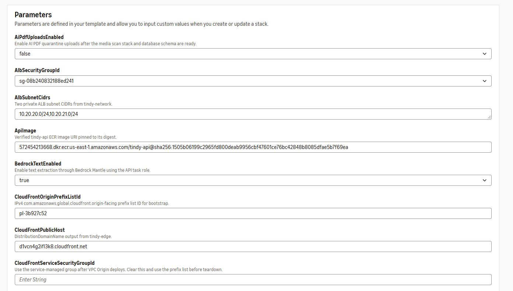

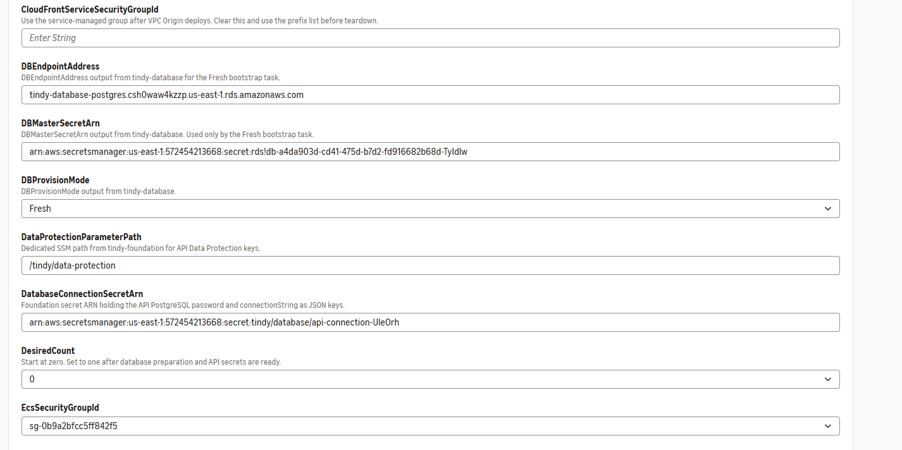

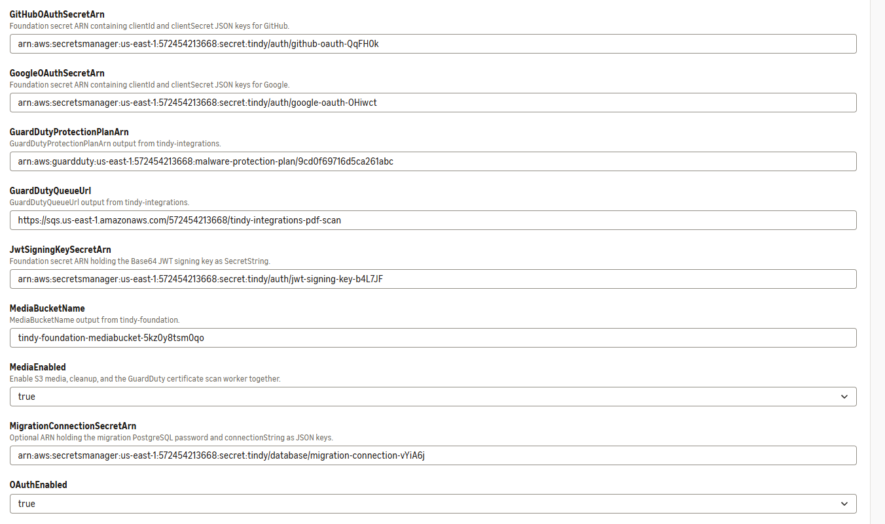

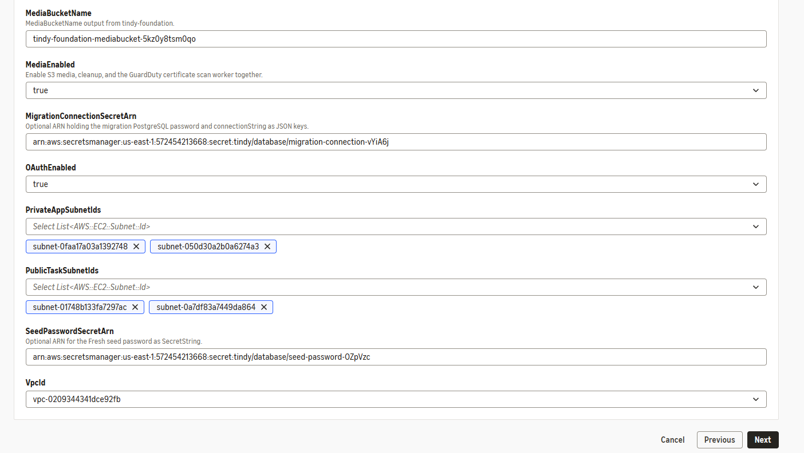

Bấm Next, giữ Options hiện tại và xác nhận IAM capability, sau đó tạo Change Set. **📸 Chụp Resource changes khi CREATE_COMPLETE và AVAILABLE**, dự kiến sáu mục Add. Change Set đã tạo thành công, xem kết quả bên dưới.

### Review Change Set tạo task DB

Đã xác nhận IAM capability. Change Set `tindy-runtime-enable-db-tasks` đạt **CREATE_COMPLETE**, execution status **AVAILABLE**.

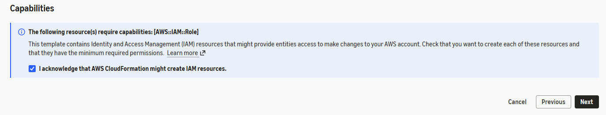

Resource changes gồm đúng sáu mục Add.

| Role | Task definition tương ứng |
| --- | --- |
| `DbBootstrapExecutionRole` | `DbBootstrapTaskDefinition` |
| `MigrationExecutionRole` | `MigrationTaskDefinition` |
| `SeedExecutionRole` | `SeedTaskDefinition` |

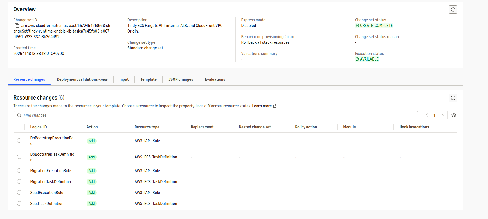

Bấm Execute change set, giữ Use deletion policy nếu Console yêu cầu, chờ Runtime UPDATE_COMPLETE. Sau đó mở Outputs lấy `DbBootstrapTaskDefinitionArn`, `MigrationTaskDefinitionArn` và `SeedTaskDefinitionArn`.

**📸 Chụp kết quả cập nhật và các Outputs task DB.** Các bước này tạo task definition, việc chạy bootstrap, migration và seed được thực hiện lần lượt sau khi stack cập nhật hoàn tất. Đã có bằng chứng Execute hoàn tất bên dưới.

Hộp thoại Execute đã chọn Roll back all stack resources và Use deletion policy. Bấm Execute change set để áp dụng, rồi theo dõi Events đến UPDATE_COMPLETE.

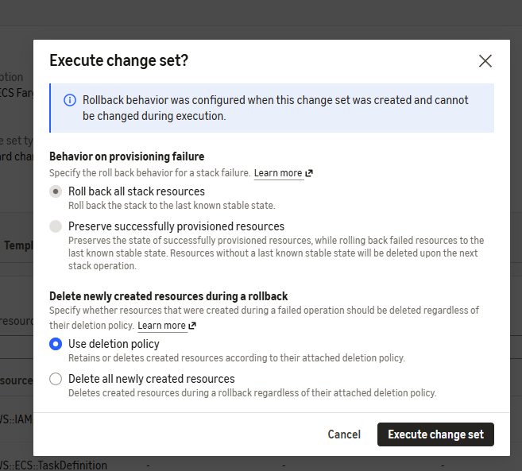

## 5. Kết quả cập nhật Runtime

Stack đạt **UPDATE_COMPLETE** và có **Outputs (9)**. Ba Outputs mới trỏ tới `tindy-runtime-db-bootstrap:2`, `tindy-runtime-migration:5` và `tindy-runtime-seed:5`.

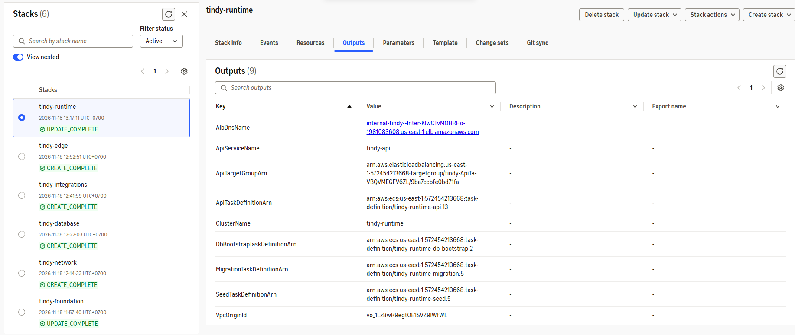

Các task definition đã sẵn sàng. Tiếp tục chạy bootstrap, migration, seed theo thứ tự, xác minh exit code 0 và log trước khi chạy task kế tiếp.
