Runtime đã UPDATE_COMPLETE, có đủ ba task definition. Các bước bên dưới là hướng dẫn thực hiện, chưa có bằng chứng task chạy thành công. Giữ API `DesiredCount = 0` và Edge ở maintenance trong khi chuẩn bị database.

## Thứ tự xử lý Database Fresh

| Task | Chức năng | Điều kiện chuyển bước |
| --- | --- | --- |
| `tindy-runtime-db-bootstrap:2` | Dùng master credential để tạo role API/migration, cấu hình quyền schema và quyền mặc định cho đối tượng mới. | Container exit code 0 và log `Database bootstrap complete.` |
| `tindy-runtime-migration:5` | Chạy `migrate-db` bằng migration credential để tạo/cập nhật schema ứng dụng. | Exit code 0 và kiểm tra log migration. |
| `tindy-runtime-seed:5` | Chạy `seed-demo --fresh` để tạo dữ liệu demo sau migration. | Exit code 0 và kiểm tra log seed. |

Chạy lần lượt từng task và kiểm tra kết quả trước khi tiếp tục.

## 1. Chạy DB bootstrap

Trong **Amazon ECS → Clusters → tindy-runtime → Tasks → Run new task**, chọn các giá trị sau. Tên trường có thể thay đổi theo phiên bản Console.

| Trường | Giá trị | Giải thích |
| --- | --- | --- |
| Compute / Launch type | FARGATE | Chạy container theo task definition. |
| Task definition family | `tindy-runtime-db-bootstrap` | Task chuyên chuẩn bị role và quyền PostgreSQL. |
| Revision | `2` | Revision trong Outputs hiện tại của Runtime. |
| Desired tasks | `1` | Chạy một tác vụ bootstrap. |
| Platform version | LATEST | Dùng nền tảng Fargate hiện hành. |
| VPC | `vpc-0209344341dce92fb` | VPC đã tạo ở bước Network. |
| Subnets | `subnet-01748b133fa7297ac`, `subnet-0a7df83a7449da864` | Public task subnets của Network. |
| Security group | `sg-03032e44e0d9f2bf7` | MigrationSecurityGroupId, được phép truy cập database. |
| Public IP | ENABLED | Cho phép kéo image và tải RDS CA qua Internet. |

Chọn security group có sẵn theo ID trên. Giữ nguyên command và environment của container `db-bootstrap`. Task definition đã tham chiếu credentials trong Secrets Manager và dùng TLS để kết nối RDS.

**📸 Chụp cấu hình task và Networking trước khi bấm Run/Create.**

## 2. Xác minh bootstrap

Mở task vừa chạy, chờ trạng thái **Stopped**, rồi kiểm tra container `db-bootstrap` có **Exit code 0**. Trạng thái Stopped tự nó chưa xác nhận thành công.

Mở tab **Logs**, tìm dòng `Database bootstrap complete.`. Log nằm trong group `/ecs/tindy-runtime`, stream có prefix `db-bootstrap`.

**📸 Chụp trạng thái container/exit code và log hoàn tất.** Nếu exit code khác 0 hoặc không có log hoàn tất, kiểm tra lỗi trước khi chạy migration.

## 3. Migration và seed

Sau khi xác minh bootstrap, dùng cùng cluster và cấu hình Networking để chạy migration revision 5. Kiểm tra exit code và log, rồi mới chạy seed revision 5. Chi tiết và ảnh kết quả sẽ được bổ sung khi thực hiện từng bước.
## Các màn hình cấu hình bootstrap đã ghi nhận

### Chọn cluster và kiểm tra API đang bằng 0

Danh sách ECS có cluster `tindy-runtime`, một service và chưa có task đang chạy. Mở cluster để kiểm tra service `tindy-api` Active, hiển thị `0/0 Tasks running`. Đây là trạng thái phù hợp khi chuẩn bị Database Fresh vì API chưa khởi chạy.

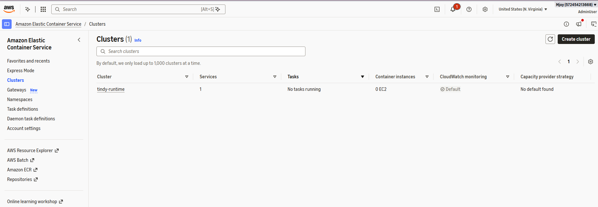

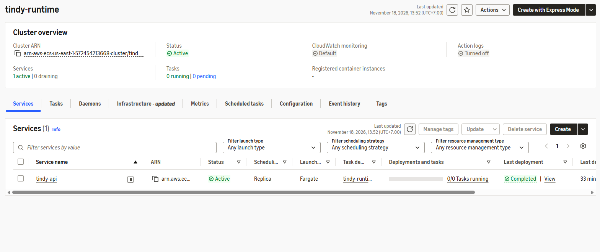

Trong tab **Tasks**, bấm **Run new task**. Ảnh đang lọc desired status **Stopped** và chưa có task trong danh sách này. Sau khi khởi chạy, thay bộ lọc phù hợp để tìm task đang chạy hoặc đã dừng.

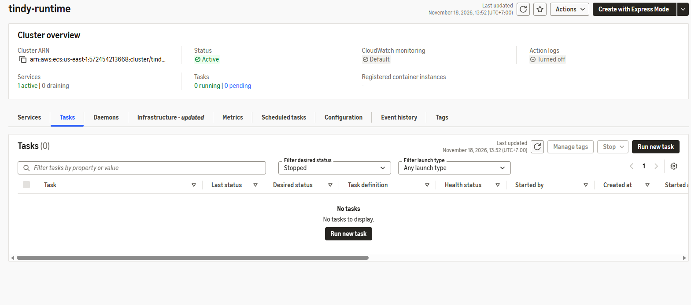

### Task details

Chọn family `tindy-runtime-db-bootstrap`, revision `2` và Desired tasks `1`. Family xác định tác vụ bootstrap, revision chọn đúng cấu hình đã tạo từ CloudFormation, còn Desired tasks là số tác vụ khởi chạy trong lần này. Task group có thể để trống.

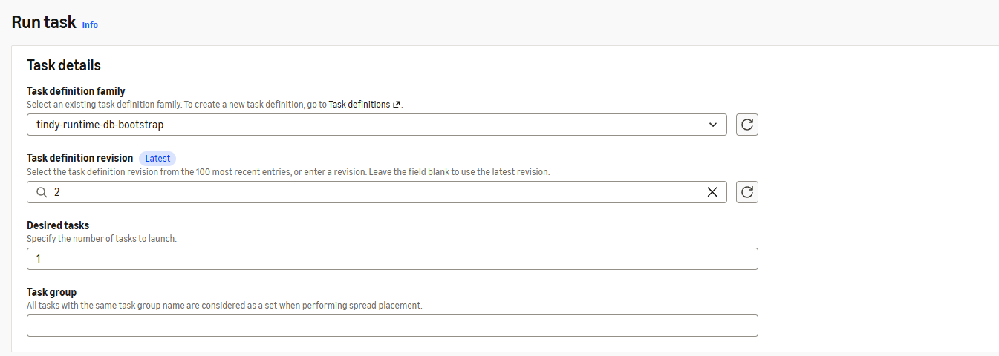

### Environment và compute

Existing cluster là `tindy-runtime`. Trong Compute configuration, chọn **Launch type → Fargate**, Platform version **LATEST**. Các mục Troubleshooting và Monitoring đang thu gọn, giữ cấu hình mặc định cho lần chạy này.

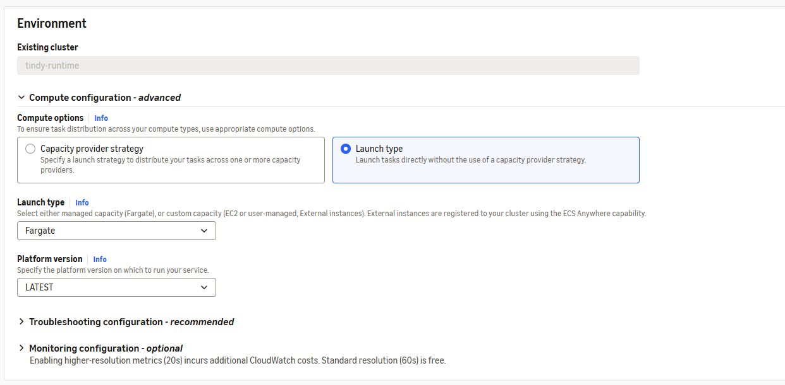

### Networking

Ảnh xác nhận VPC `vpc-0209344341dce92fb`, hai subnet `tindy-ecs-public-a` và `tindy-ecs-public-b`, security group `sg-03032e44e0d9f2bf7` (`tindy-migration-sg`) và Public IP **Turned on**. Public subnet cùng public IP cung cấp kết nối outbound để tải image và chứng chỉ CA. Migration security group là nguồn truy cập được cấu hình cho các tác vụ chuẩn bị database.

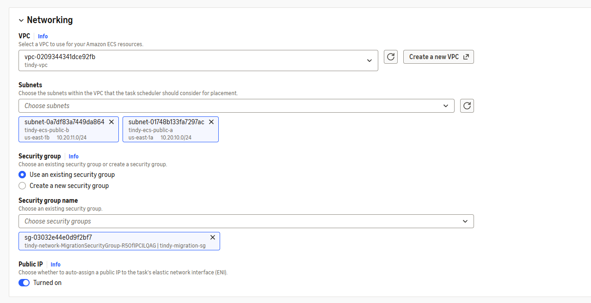

**Tiến độ đã xác minh:** cấu hình trước khi chạy đã khớp hướng dẫn. Chưa có ảnh xác nhận task đã khởi chạy hoặc hoàn tất. Bước tiếp theo là bấm Run/Create, mở task và kiểm tra exit code cùng log theo mục 2 ở trên.

### Bootstrap đã khởi chạy

Task `e5c9c5841c004c6eb10289e9a40be2d9` đã xuất hiện trong danh sách. Ảnh ghi nhận Last status **Deprovisioning**, Desired status **Stopped** và Health status **Unknown**. ECS đang thu hồi tài nguyên của task. Cần mở chi tiết container để kiểm tra exit code và Logs trước khi xác nhận bootstrap thành công hoặc chạy migration.

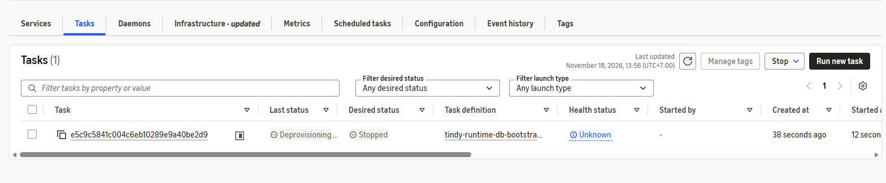

### Bootstrap kết thúc với exit code 0

Task `e5c9c5841c004c6eb10289e9a40be2d9`, task definition `tindy-runtime-db-bootstrap:2`, đã **Stopped**. Chi tiết container `db-bootstrap` xác nhận **Exit code 0**. Thông báo `Essential container in task exited` mô tả việc container chính đã kết thúc. Kết hợp với exit code 0, đây là kết quả tiến trình hoàn tất thành công của tác vụ chạy một lần.

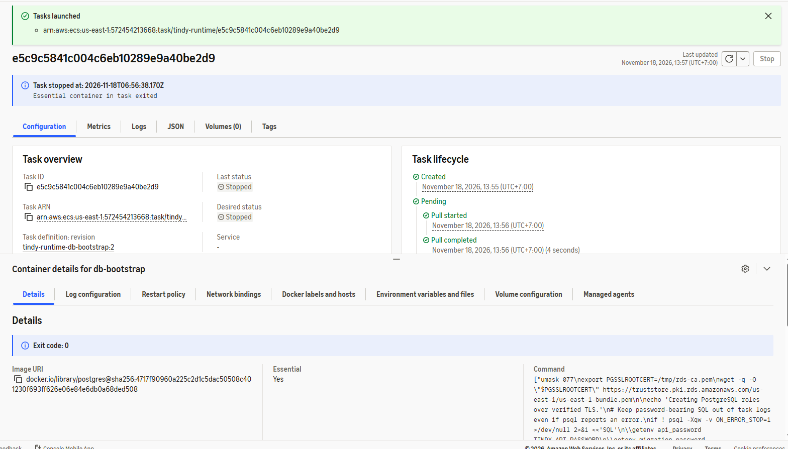

Bằng chứng exit code đã có. Tiếp tục mở tab Logs để ghi nhận `Database bootstrap complete.` trước khi chuyển sang migration. Chưa có ảnh Logs trong mốc này.

### Log xác nhận bootstrap hoàn tất

Log container `db-bootstrap` đã ghi đủ bốn thông báo tạo role qua verified TLS, cấu hình grants cho đối tượng do migration role tạo, kiểm tra API role qua verified TLS và `Database bootstrap complete.`. Kết hợp với exit code 0 ở ảnh trước, bootstrap đã hoàn tất thành công.

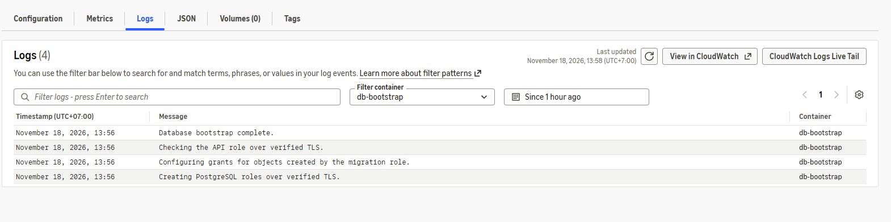

## 4. Chạy migration

Quay lại **ECS → Clusters → tindy-runtime → Tasks → Run new task**. Chọn family `tindy-runtime-migration`, revision `5`, Desired tasks `1`, Launch type **Fargate**, Platform **LATEST**. Giữ nguyên command `migrate-db` và environment trong task definition.

Networking dùng VPC `vpc-0209344341dce92fb`, hai public task subnet `subnet-01748b133fa7297ac` và `subnet-0a7df83a7449da864`, security group `sg-03032e44e0d9f2bf7` và Public IP **Turned on**. Task dùng migration connection secret đã chuẩn bị để cập nhật schema.

**📸 Chụp Task details và Networking trước khi bấm Run/Create.** Sau khi chạy, mở task, chờ Stopped và kiểm tra container `migration` có exit code 0. **📸 Chụp exit code và log migration hoàn tất.** Nếu task lỗi, kiểm tra log trước khi chạy seed. Giữ API DesiredCount 0 và Edge maintenance.

Migration và seed chưa được xác nhận đã chạy tại mốc này.

### Các màn hình cấu hình migration đã ghi nhận

Trước khi tạo task migration, cluster có task bootstrap đã Stopped, tổng số running/pending bằng 0. Banner Tasks launched trong ảnh vẫn trỏ tới task bootstrap `e5c9c5841c004c6eb10289e9a40be2d9`. Ảnh này ghi nhận điểm bắt đầu bước migration, chưa xác nhận migration đã khởi chạy.

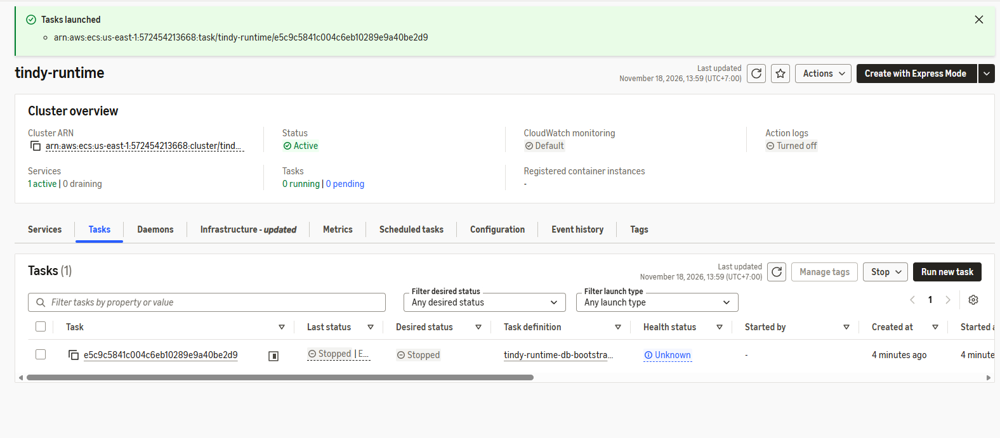

**Task details:** family `tindy-runtime-migration`, revision `5`, Desired tasks `1`, Task group để trống. Task definition này chạy lệnh `migrate-db` để tạo/cập nhật schema bằng migration credential đã chuẩn bị. Desired tasks ở màn hình này chỉ quyết định số task chạy một lần, còn service API vẫn giữ DesiredCount 0.

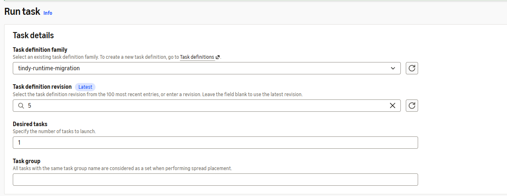

**Environment:** existing cluster `tindy-runtime`, Compute options chọn Launch type, Launch type Fargate, Platform version LATEST. Đây là cấu hình compute cho tác vụ migration.

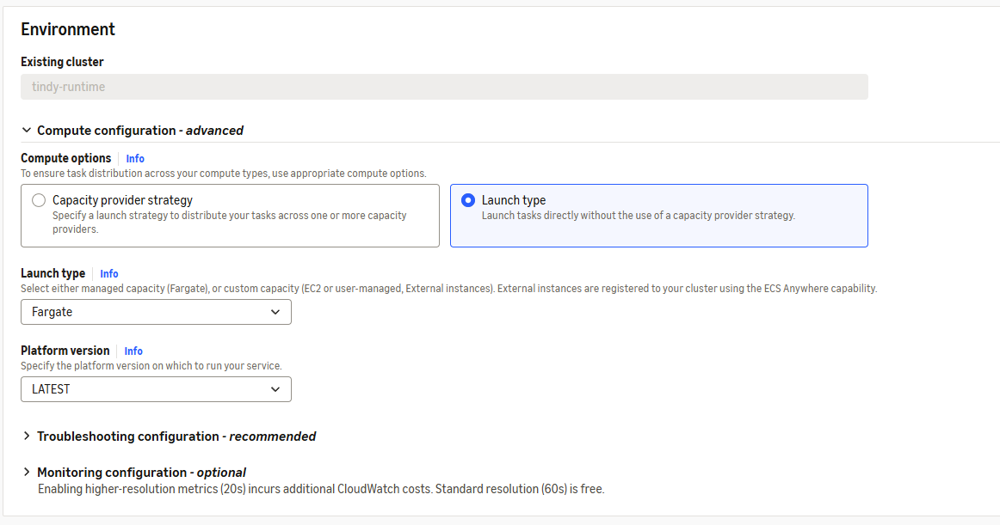

**Networking:** VPC `vpc-0209344341dce92fb`, public subnet `subnet-0a7df83a7449da864` và `subnet-01748b133fa7297ac`, existing security group `sg-03032e44e0d9f2bf7` (`tindy-migration-sg`), Public IP Turned on. Cấu hình dùng lại đường mạng đã chạy bootstrap thành công để kéo image và kết nối RDS theo quyền security group.

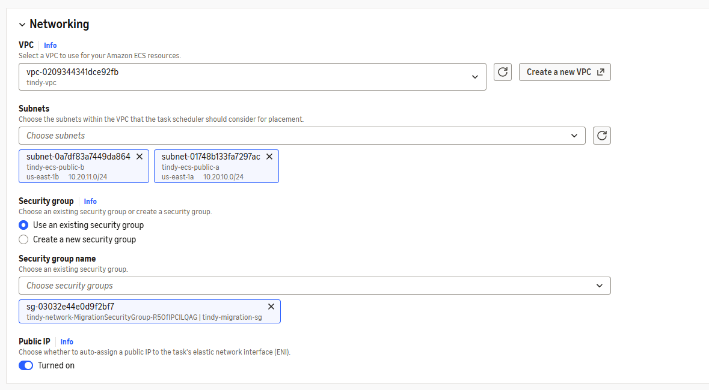

Các ảnh xác nhận cấu hình trước khi chạy đã khớp. Tiếp tục bấm Run/Create, mở task migration mới rồi kiểm tra exit code của container `migration` và Logs. Chưa ghi nhận kết quả migration tại mốc này.

### Migration hoàn tất

Task `d6839873357f48e2a4cc830dbc480677` dùng `tindy-runtime-migration:5`, command `migrate-db`, đã Stopped với container exit code **0**.

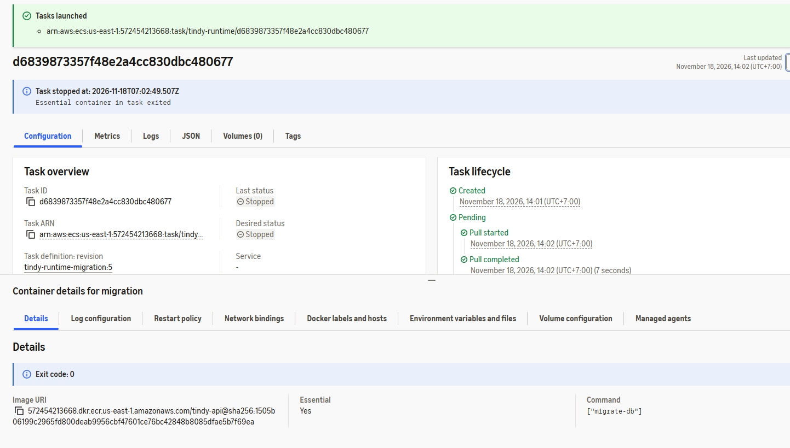

Log xác nhận `Database migration complete. Applied history: 26. Latest migration: 20261112124706_Media_AllowAiPdfQuarantine.`. Mã lệnh migration chỉ ghi dòng hoàn tất sau khi cập nhật schema và đọc migration history thành công.

Log cũng có thông báo không tải được `libgssapi_krb5.so.2`. Trong lần chạy này, thông báo đó không ngăn migration hoàn tất, theo exit code 0 và dòng kết quả sau đó. Nguyên nhân phát sinh thông báo thư viện chưa được xác minh tại mốc này.

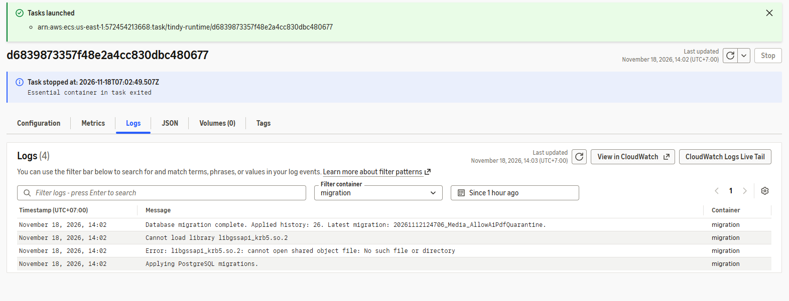

## 5. Chạy seed demo cho Database Fresh

Vào **ECS → Clusters → tindy-runtime → Tasks → Run new task**. Chọn family `tindy-runtime-seed`, revision `5`, Desired tasks `1`, Launch type **Fargate**, Platform **LATEST**.

Dùng lại VPC `vpc-0209344341dce92fb`, hai public subnet `subnet-01748b133fa7297ac` và `subnet-0a7df83a7449da864`, security group `sg-03032e44e0d9f2bf7`, Public IP **Turned on**. Giữ nguyên command `seed-demo --fresh` và environment. Task definition lấy connection string từ migration secret và mật khẩu demo từ seed password secret.

**📸 Chụp Task details và Networking trước khi Run/Create.** Sau khi chạy, kiểm tra container `seed` Stopped với exit code **0**, mở Logs xác minh kết quả seed. Kết quả chạy mới dự kiến có `Demo seed completed.`. **📸 Chụp exit code và Logs.** Seed chưa được xác nhận đã chạy. API tiếp tục DesiredCount 0, Edge maintenance.

### Các màn hình cấu hình seed đã ghi nhận

Cluster hiển thị hai task bootstrap và migration đã Stopped, với tổng running/pending bằng 0. Exit code và log thành công của hai task đã được ghi nhận ở trên. Đây là trạng thái trước khi khởi chạy seed.

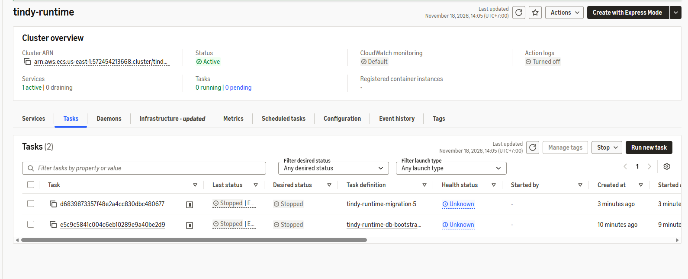

**Task details:** chọn family `tindy-runtime-seed`, revision `5`, Desired tasks `1`, Task group để trống. Task definition thực thi `seed-demo --fresh` để tạo dữ liệu demo trên database Fresh đã có schema. Số task ở đây chỉ áp dụng cho lần chạy seed, service API tiếp tục giữ DesiredCount 0.

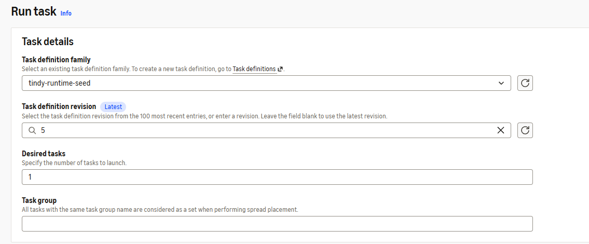

**Environment:** cluster `tindy-runtime`, Compute options chọn Launch type, Launch type Fargate, Platform version LATEST. Giữ nguyên command, environment và các tham chiếu secret trong task definition.

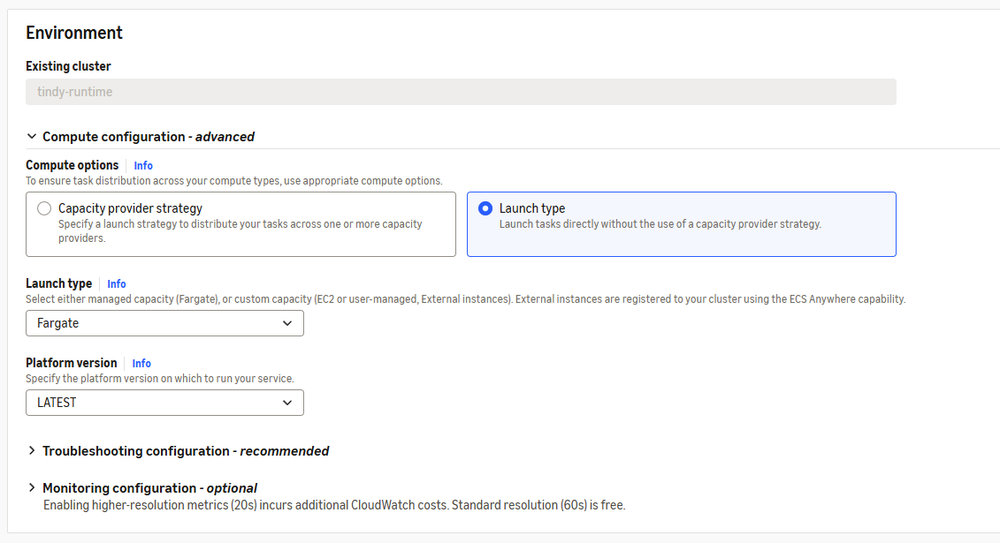

**Networking:** VPC `vpc-0209344341dce92fb`, public subnet `subnet-0a7df83a7449da864` và `subnet-01748b133fa7297ac`, existing security group `sg-03032e44e0d9f2bf7` (`tindy-migration-sg`), Public IP Turned on. Cấu hình dùng lại đường mạng đã chạy bootstrap và migration thành công.

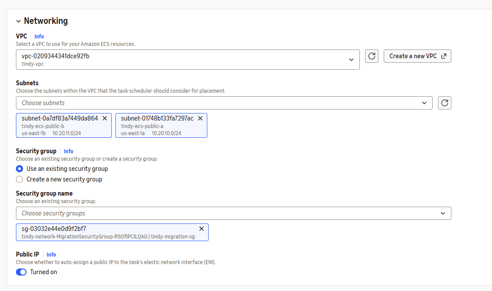

Ảnh xác nhận cấu hình trước khi chạy đã khớp. Bấm Run/Create, mở task seed mới và kiểm tra container `seed` có exit code 0 cùng log hoàn tất. Chưa có bằng chứng seed đã khởi chạy hoặc hoàn tất tại mốc này.

### Seed hoàn tất

Task `1e49f952ecc14f6eaed0dfe72a6144b5` dùng `tindy-runtime-seed:5`, command `seed-demo --fresh`, đã Stopped với container `seed` có **Exit code 0**.

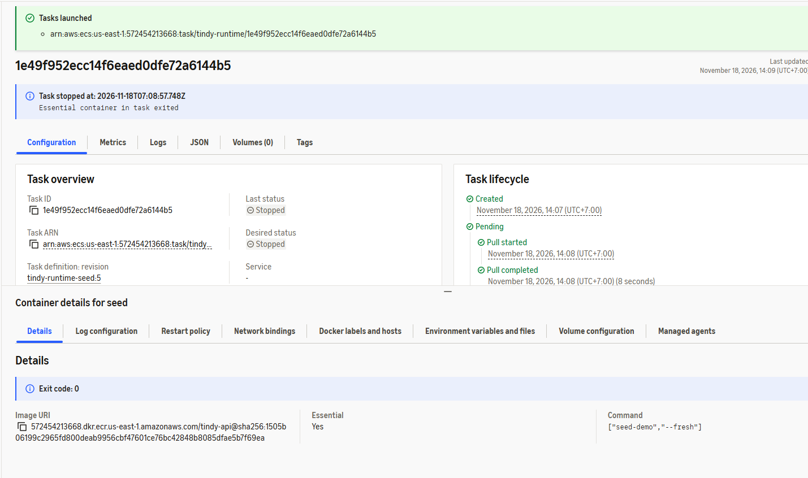

Tab Logs xác nhận `Demo seed completed.`. Các dòng SQL INSERT trong ảnh là log thao tác tạo dữ liệu. Exit code 0 cùng dòng hoàn tất xác nhận tiến trình seed thành công. Chưa có kiểm tra độc lập số lượng bản ghi hoặc luồng web tại mốc này.

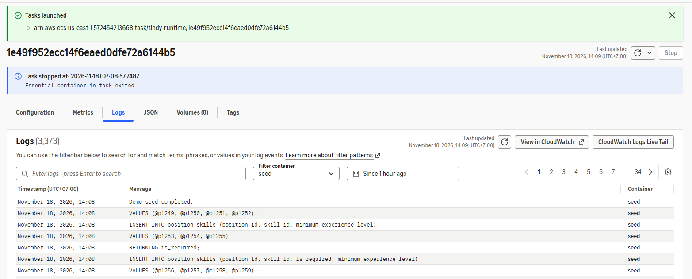

| Tác vụ | Bằng chứng hoàn tất |
| --- | --- |
| Bootstrap revision 2 | Exit code 0 và `Database bootstrap complete.` |
| Migration revision 5 | Exit code 0, 26 migrations và `Database migration complete.` |
| Seed revision 5 | Exit code 0 và `Demo seed completed.` |

Bước tiếp theo là lấy security group do CloudFront VPC Origin quản lý trong đúng VPC, rồi cập nhật Runtime qua Change Set với `CloudFrontServiceSecurityGroupId` hiện tại và `DesiredCount = 1`. API chưa được xác nhận đã chạy hoặc Healthy. Edge vẫn maintenance.
