Bootstrap, migration và seed đã hoàn tất với exit code 0 cùng log xác nhận. Bước này cấu hình nguồn truy cập ALB theo CloudFront service security group và bật một task API. Edge vẫn maintenance cho đến khi Runtime được kiểm tra Healthy.

## 1. Lấy CloudFront service security group

Trong EC2 → Security Groups, ảnh xác nhận group `CloudFront-VPCOrigins-Service-SG` có ID **`sg-0ae54c77731609b33`**, thuộc VPC **`vpc-0209344341dce92fb`**. Đây là ID hiện tại của môi trường đã dựng lại.

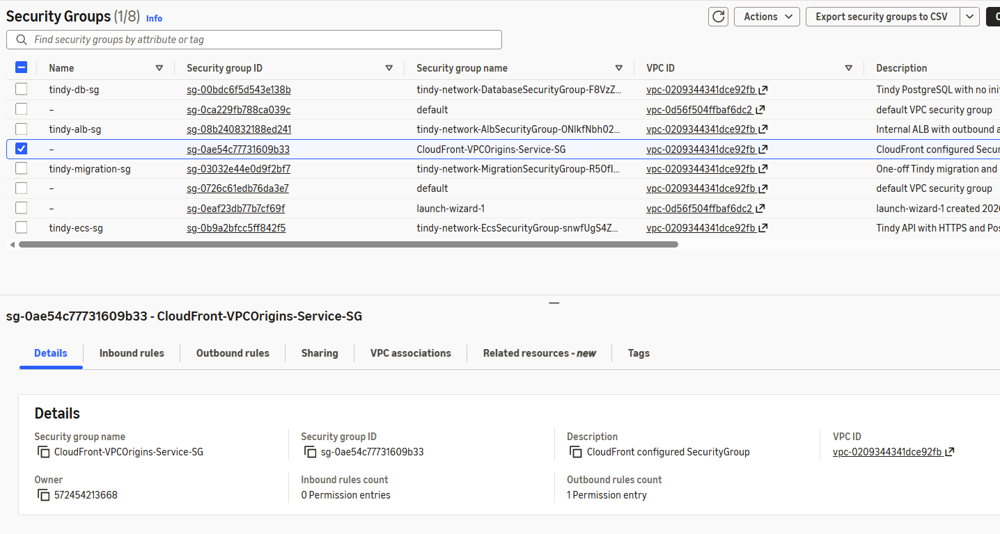

Group có 0 inbound permission entries và 1 outbound permission entry trong ảnh. Tham số Runtime sẽ dùng group này làm nguồn cho rule ingress của ALB. Không cần sửa trực tiếp group do CloudFront quản lý trong bước này.

## 2. Tạo Change Set bật API

Vào **CloudFormation → tindy-runtime → Stack actions → Create a change set**. Chọn **Standard change set**, **Use existing template**, rồi Next. Đặt tên `tindy-runtime-start-api`.

| Tham số | Giá trị | Mục đích |
| --- | --- | --- |
| `CloudFrontServiceSecurityGroupId` | `sg-0ae54c77731609b33` | Giới hạn nguồn truy cập ALB theo service SG của CloudFront VPC Origin. |
| `DesiredCount` | `1` | Khởi chạy một task API sau khi DB đã sẵn sàng. |

Giữ nguyên các tham số khác, bao gồm `AiPdfUploadsEnabled = false` và CloudFront origin prefix list hiện tại. Giữ options hiện tại, xác nhận IAM capability nếu được yêu cầu, rồi tạo Change Set.

**📸 Chụp hai tham số đã đổi và Resource changes sau khi Change Set CREATE_COMPLETE / AVAILABLE.** Khi chỉ đổi hai tham số trên, dự kiến `AlbIngressFromCloudFront` bị thay thế và `ApiService` được sửa tại chỗ. Kiểm tra danh sách thực tế trước khi Execute. Chưa có bằng chứng Change Set được tạo hoặc API đã chạy tại mốc này.

## 3. Bằng chứng tạo và review Change Set

Stack Runtime đang UPDATE_COMPLETE trước lần cập nhật bật API. Trạng thái này thuộc lần cập nhật trước, chưa xác nhận API đã khởi chạy.

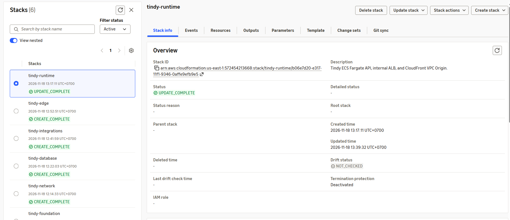

Đã chọn Standard change set và Use existing template để giữ template hiện tại và cập nhật tham số.

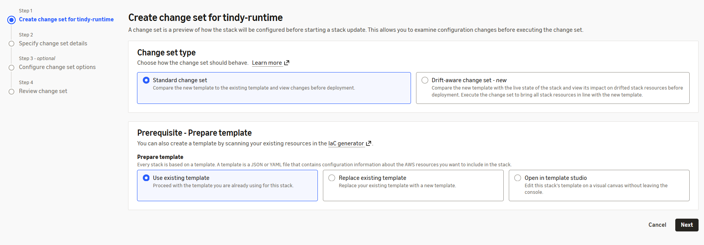

Hai trường đã đổi đúng theo hướng dẫn: `CloudFrontServiceSecurityGroupId = sg-0ae54c77731609b33` và `DesiredCount = 1`. Security group này là nguồn cho rule ingress vào ALB, còn DesiredCount yêu cầu ECS duy trì một task API.

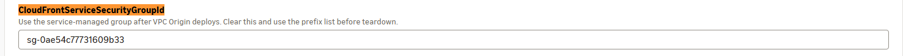

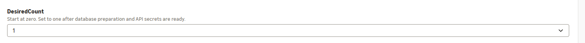

Đã xác nhận IAM capability trong wizard. Review thực tế bên dưới cho thấy hai tài nguyên thay đổi.

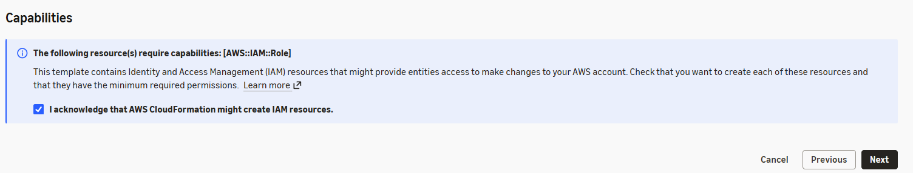

Change Set `tindy-runtime-start-api` đã **CREATE_COMPLETE**, Execution status **AVAILABLE**, Express mode Disabled, rollback được cấu hình Roll back all stack resources.

| Logical ID | Action | Replacement | Ý nghĩa |
| --- | --- | --- | --- |
| `AlbIngressFromCloudFront` | Modify | True | Thay tài nguyên rule ingress để dùng CloudFront service SG. Policy action ReplaceAndDelete áp dụng cho rule cũ. |
| `ApiService` | Modify | False | Cập nhật ECS service tại chỗ với số task mới. |

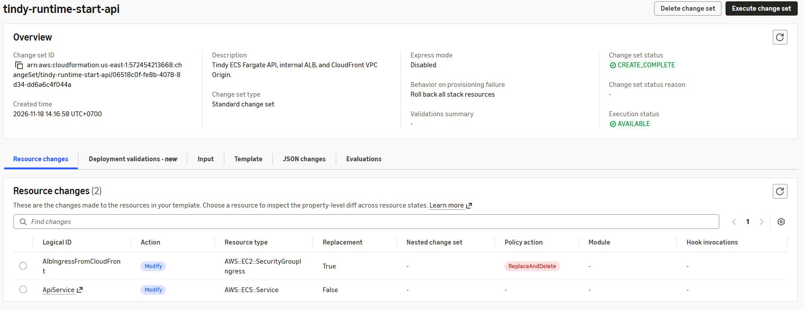

Danh sách khớp phạm vi hai tham số đã đổi. Chưa có bằng chứng Execute hoặc API Healthy tại mốc này.

## 4. Execute và kiểm tra kết quả

Bấm **Execute change set**, giữ rollback đã cấu hình và chọn **Use deletion policy** nếu hộp thoại yêu cầu, sau đó xác nhận Execute. Theo dõi Events đến khi stack **UPDATE_COMPLETE**. Nếu update lỗi, kiểm tra Events và ECS service events trước khi tiếp tục.

**📸 Chụp Runtime UPDATE_COMPLETE sau lần cập nhật này.** Mở **ECS → Clusters → tindy-runtime → Services → tindy-api**, kiểm tra Desired 1, Running 1, Pending 0 và deployment hoàn tất. **📸 Chụp trạng thái service**. Sau đó kiểm tra target group Healthy và log API. Edge tiếp tục maintenance trong quá trình kiểm tra.

## 5. Kết quả bật API đã xác minh

Hộp thoại Execute giữ Roll back all stack resources và Use deletion policy. Change Set đã được thực thi.

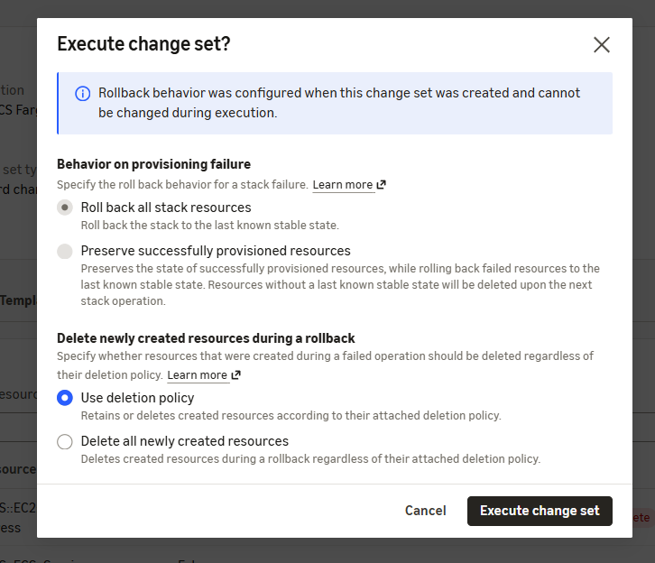

Events xác nhận Runtime **UPDATE_COMPLETE** lúc 14:19:50 UTC+07 ngày 18/11/2026. Event DELETE_COMPLETE của `AlbIngressFromCloudFront` trong quá trình thay rule khớp với Replacement True đã review.

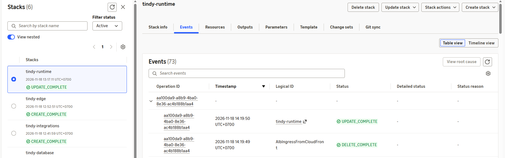

Cluster hiển thị **1 running / 0 pending**. Service `tindy-api` Active, **1/1 Tasks running**, Last deployment Completed.

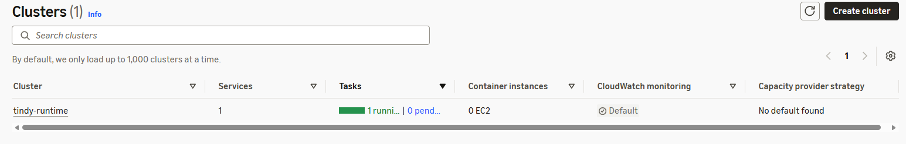

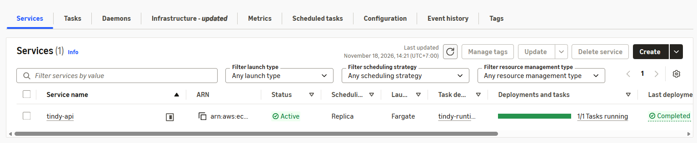

Service overview xác nhận Desired **1**, Running **1**, Pending **0**, task definition `tindy-runtime-api:13`, Deployment status **Success**. Load balancer target health của container `api:8080` có **1 Healthy / 0 Unhealthy**. Các bằng chứng này xác nhận Runtime và health check ALB đã đạt. Chưa xác minh request API qua CloudFront ở chế độ live.

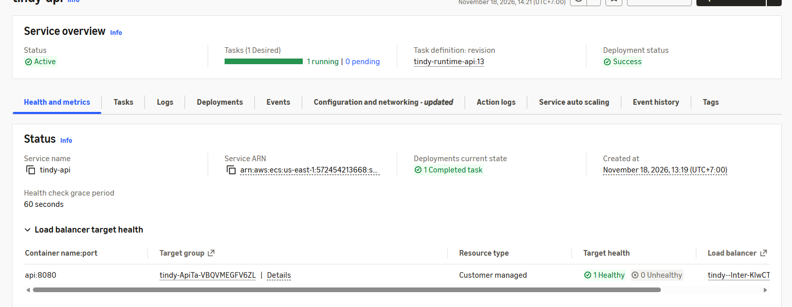

## Bước tiếp theo

Lấy `AlbDnsName` và `VpcOriginId` trực tiếp từ **CloudFormation → tindy-runtime → Outputs** để chuẩn bị Change Set của `tindy-edge`. Việc chuyển `EdgeMode` sang `live` được thực hiện ở bước tiếp theo. Edge hiện vẫn maintenance. Alarm dimensions của Integrations và việc bật AI PDF vẫn còn chờ cập nhật riêng.

### Edge trước khi chuyển live

Ảnh Outputs của `tindy-edge` xác nhận stack CREATE_COMPLETE, distribution `E39MIF3N8DR3D6`, hostname `d1vcn4g2ifl3k8.cloudfront.net` và `EdgeMode = maintenance`. API Healthy trong Runtime chưa đồng nghĩa Edge đã chuyển live. Để chuẩn bị đầu vào live, chọn stack `tindy-runtime` rồi mở Outputs lấy `AlbDnsName` và `VpcOriginId`.

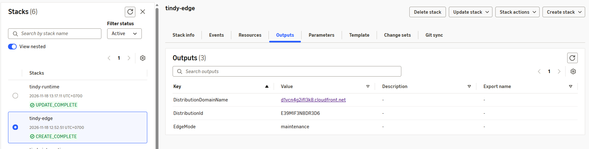

## Bật AI PDF sau khi schema và monitoring sẵn sàng

Migration đã ghi nhận `20261112124706_Media_AllowAiPdfQuarantine`, GuardDuty protection plan đã Active, queue đã cấu hình và bốn alarm monitoring đã OK. Bước tiếp theo tạo Standard change set trên `tindy-runtime`, Use existing template, tên `tindy-runtime-enable-ai-pdf`. Chỉ đổi `AiPdfUploadsEnabled` từ false sang true. Giữ DesiredCount 1 và các tham số khác.

Tham số này ánh xạ vào biến môi trường `GuardDuty__AiPdfUploadsEnabled` trong API task definition. Theo template, dự kiến task definition được thay revision và ECS service được cập nhật để triển khai revision mới. **📸 Chụp tham số và Resource changes khi CREATE_COMPLETE / AVAILABLE**, kiểm tra trước khi Execute. Chưa có bằng chứng bật AI PDF hoặc upload/scan thành công tại mốc này.

### Review Change Set bật AI PDF

Wizard đã chọn Standard change set và Use existing template trên `tindy-runtime`. Tham số `AiPdfUploadsEnabled` được đặt **true**.

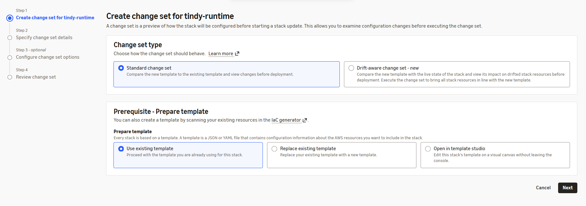

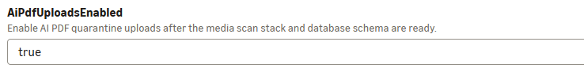

Change Set `tindy-runtime-enable-ai-pdf` đã **CREATE_COMPLETE / AVAILABLE**. Resource changes gồm:

| Logical ID | Action | Replacement | Ý nghĩa |
| --- | --- | --- | --- |
| `ApiService` | Modify | False | Cập nhật service tại chỗ để triển khai task definition mới. |
| `ApiTaskDefinition` | Modify | True | Đăng ký revision task definition mới với biến môi trường bật AI PDF. Policy action ReplaceAndDelete áp dụng tài nguyên task definition cũ. |

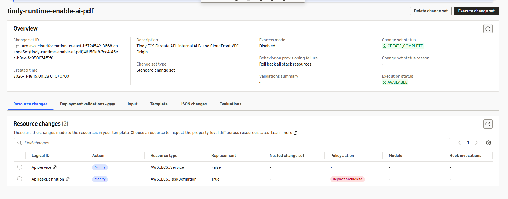

Phạm vi khớp thay đổi tham số. Chưa có bằng chứng Execute hoặc upload/scan thành công tại mốc này.

Bấm Execute change set, giữ rollback và Use deletion policy nếu được hỏi rồi xác nhận. Chờ Runtime **UPDATE_COMPLETE**, kiểm tra ECS `tindy-api` Desired 1 / Running 1 / Pending 0, deployment Success và ALB target Healthy. Trong lúc rolling update có thể tạm có nhiều hơn một task. **📸 Chụp trạng thái stack và service sau khi ổn định**, ghi nhận revision mới thực tế. Chạy lại readiness qua CloudFront, kỳ vọng HTTP 200 Healthy, rồi mới kiểm tra upload PDF.

### Kết quả triển khai revision bật AI PDF

Runtime đã **UPDATE_COMPLETE** sau Change Set bật AI PDF. ECS service `tindy-api` Active, Desired 1 / Running 1 / Pending 0, Deployment status **Success**, task definition **`tindy-runtime-api:14`**.

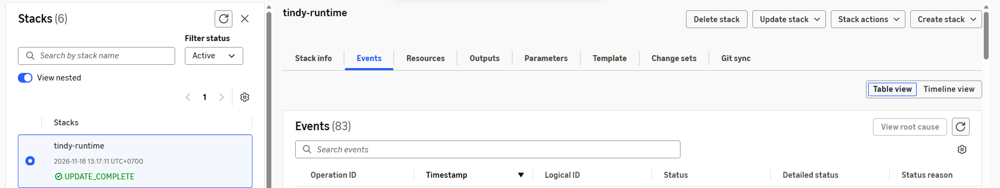

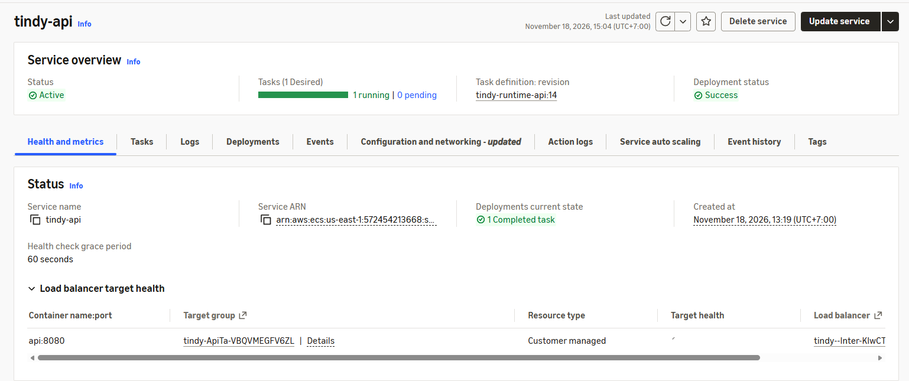

Cột Target health đang tải trong ảnh service nên chưa có bằng chứng trực tiếp trạng thái Healthy của revision mới tại mốc này. Kiểm tra lại readiness qua CloudFront trước khi thử PDF.

### Kiểm tra luồng upload → scan → extract

Sau readiness HTTP 200 Healthy, mở **AI Studio** trên frontend. Trong mục **CV (optional)**, chọn một PDF demo có văn bản, không rỗng, tối đa **2 MiB và 10 trang**. Giao diện upload khi chọn file và hiển thị tiến độ scan. **📸 Chụp trạng thái Scanning và kết quả scan**. Khi file được xác nhận clean, bấm **Extract suggestions**, rồi **📸 chụp kết quả Review suggestions** hoặc thông báo lỗi thực tế. Chưa có bằng chứng upload, scan hoặc extract thành công tại mốc này.

### Readiness và PDF scan/extract đã đạt

Sau khi triển khai revision 14, request HTTPS qua CloudFront tới `/api/health/ready` tiếp tục trả **HTTP 200 OK** và `{"status":"Healthy","service":"Tindy API"}`.

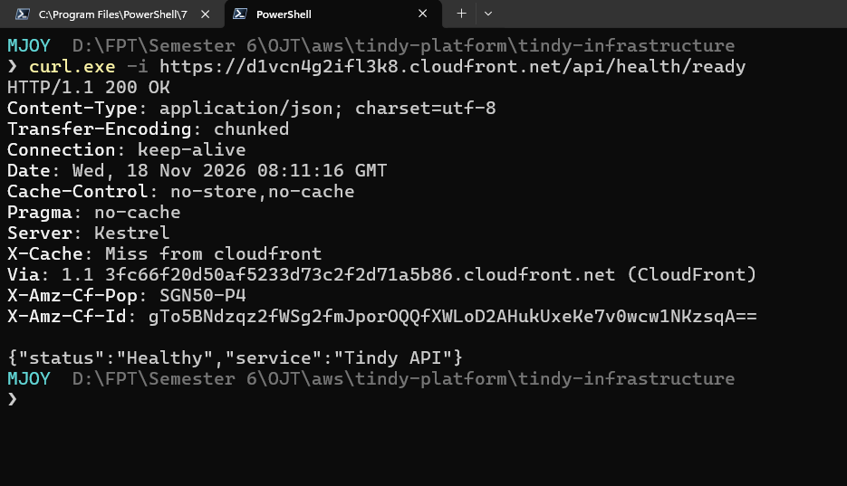

AI Studio hiển thị file `CV_Backend.pdf` với trạng thái **Scan complete. Ready to extract.**. Khung Profile text trống (0/20,000 characters), còn Review suggestions đã hiển thị các kỹ năng như ASP.NET Core, C#, Docker, Entity Framework Core, PostgreSQL và REST API. Các mục Experience and certificates và Extraction notes (3) đang thu gọn.

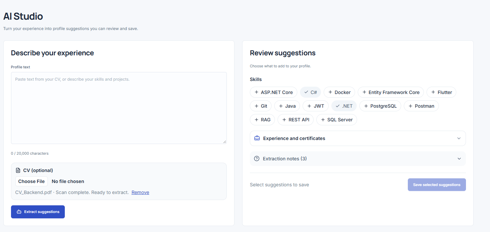

Bằng chứng giao diện xác nhận luồng PDF upload → scan hoàn tất → trích xuất gợi ý đã đạt. Chưa kiểm tra từng trường trong các mục đang thu gọn hoặc lưu gợi ý vào hồ sơ. Chưa có bằng chứng riêng cho upload ảnh hoặc PDF chứng chỉ.

Bước nghiệm thu tiếp theo: chọn một gợi ý kỹ năng chưa có trong hồ sơ, bấm **Save selected suggestions**, kiểm tra thông báo thành công rồi mở hồ sơ và tải lại để xác nhận kỹ năng đã lưu. **📸 Chụp thông báo lưu và kỹ năng trong hồ sơ sau reload.** Đây là thao tác thay đổi dữ liệu demo, chỉ thực hiện với tài khoản demo trong phạm vi nghiệm thu.

### Gợi ý đã được lưu vào hồ sơ

Sau hướng dẫn chọn kỹ năng, lưu và tải lại hồ sơ, người thực hiện xác nhận đã hoàn tất. Ảnh hồ sơ hiển thị **Docker** trong Technical skills cùng các kỹ năng khác. Đây là ảnh kết quả hồ sơ, không có toast lưu thành công trong khung chụp. Việc hoàn tất bước lưu và reload được người thực hiện xác nhận.

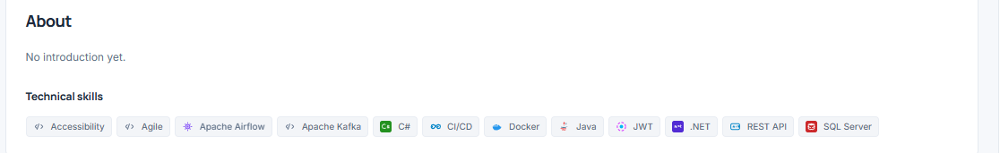

Luồng nghiệm thu PDF đã ghi nhận upload → scan hoàn tất → extract suggestions → lưu kỹ năng → xem kỹ năng trong hồ sơ. Upload ảnh và PDF chứng chỉ là các luồng media riêng, chưa được xác nhận bằng các ảnh này.
