Runtime đã UPDATE_COMPLETE, API Desired 1 / Running 1 / Pending 0 và ALB 1 Healthy / 0 Unhealthy. Edge vẫn maintenance. Bước này dùng Outputs của Runtime để cấu hình origin API cho CloudFront.

## 1. Lấy Outputs từ Runtime

Trong CloudFormation → tindy-runtime → Outputs, lấy `AlbDnsName` và `VpcOriginId`. `AlbDnsName` là DNS internal ALB. `VpcOriginId` định danh kết nối CloudFront VPC Origin đã tạo trong Runtime. Dùng nút copy trên Console, giữ nguyên chữ hoa/thường và tránh khoảng trắng khi dán. AlbDnsName chỉ chứa hostname, không thêm giao thức hay đường dẫn.

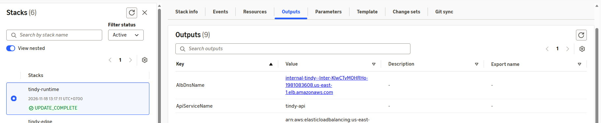

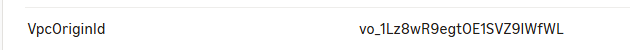

## 2. Tạo Change Set Edge live

Chọn **tindy-edge → Stack actions → Create a change set**. Chọn **Standard change set → Use existing template → Next**, đặt tên `tindy-edge-go-live`.

| Tham số | Giá trị | Chức năng |
| --- | --- | --- |
| `EdgeMode` | `live` | Bật cấu hình routing API live trong template. |
| `AlbDnsName` | Copy từ Output cùng tên của tindy-runtime. | Hostname internal ALB làm origin API. |
| `VpcOriginId` | Copy từ Output cùng tên của tindy-runtime. | Gắn origin với VPC Origin hiện tại. |
| `FrontendBucketName` | Giữ giá trị hiện tại. | Tiếp tục dùng frontend bucket đã có. |

Giữ các options hiện tại và tạo Change Set. **📸 Chụp Parameters đã điền và Resource changes khi CREATE_COMPLETE / AVAILABLE.** Kiểm tra thay đổi trước khi Execute. Tại mốc này mới xác nhận đã thu thập Outputs, chưa xác nhận Edge live.

Sau khi thực thi thành công ở bước tiếp theo, sẽ kiểm tra readiness qua HTTPS trên hostname CloudFront. Các cập nhật alarm dimensions, AI PDF, OAuth và phát hành frontend còn được xử lý theo từng bước riêng.

## 3. Các màn hình chuẩn bị Change Set đã ghi nhận

Đã chọn **Standard change set** và **Use existing template** trên stack `tindy-edge`. Banner về `tindy-runtime-start-api` là thông báo thực thi Runtime ở bước trước.

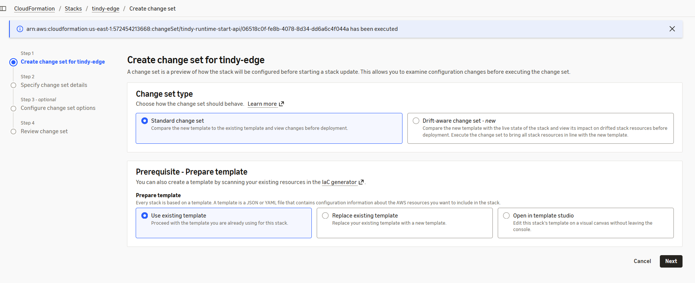

Tên Change Set là `tindy-edge-go-live`. Description giữ mô tả template Edge hiện tại.

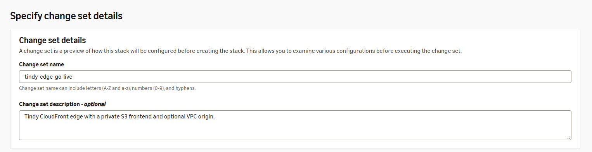

Ảnh Parameters ghi nhận `EdgeMode = live`, hai trường `AlbDnsName` và `VpcOriginId` đã được điền, `FrontendBucketName` giữ `tindy-foundation-frontendbucket-dxzgxfyg75gu`. DNS ALB không có tiền tố giao thức. Hai giá trị origin phải được copy nguyên văn từ Runtime Outputs để tránh nhầm ký tự.

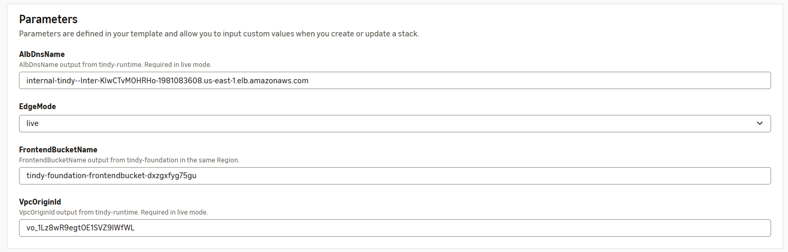

Tiếp tục Next, giữ options hiện tại, review rồi tạo Change Set. **📸 Chụp Resource changes khi CREATE_COMPLETE và execution status AVAILABLE.** Chưa có bằng chứng Change Set hoàn tất hoặc Edge đã chuyển live tại mốc này.

## 4. Review Change Set chuyển live

Change Set `tindy-edge-go-live` đã **CREATE_COMPLETE**, Execution status **AVAILABLE**. Standard change set, Express mode Disabled, rollback Roll back all stack resources.

| Logical ID | Action | Resource type | Replacement |
| --- | --- | --- | --- |
| `EdgeDistribution` | Modify | `AWS::CloudFront::Distribution` | False |

Danh sách có đúng một tài nguyên sửa tại chỗ, phù hợp cập nhật cấu hình origin và routing sang live. Chưa có bằng chứng Execute hoặc readiness qua CloudFront tại mốc này.

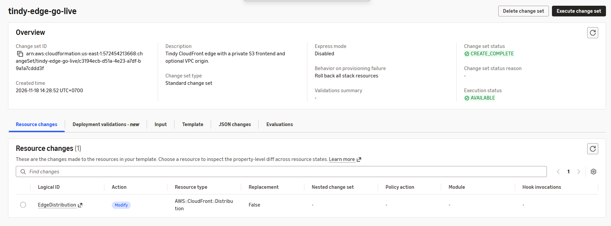

## 5. Execute và kiểm tra readiness

Bấm **Execute change set**, giữ rollback đã cấu hình và **Use deletion policy** nếu được hỏi, rồi xác nhận Execute. Theo dõi Events đến **UPDATE_COMPLETE**. Trong Outputs kiểm tra `EdgeMode = live`.

**📸 Chụp stack UPDATE_COMPLETE và Outputs EdgeMode live.** Sau khi update hoàn tất, chạy PowerShell:

```powershell
curl.exe -i https://d1vcn4g2ifl3k8.cloudfront.net/api/health/ready
```

Kết quả mong đợi là HTTP 200. **📸 Chụp đầy đủ HTTP status và response body.** Nếu nhận mã lỗi, lưu response rồi kiểm tra cấu hình origin và log trước khi kết luận live thành công. Frontend và OAuth sẽ được kiểm tra riêng sau bước readiness.

## 6. Edge live và readiness đã đạt

Stack `tindy-edge` đã **UPDATE_COMPLETE**. Outputs xác nhận `EdgeMode = live`, distribution ID `E39MIF3N8DR3D6` và hostname `d1vcn4g2ifl3k8.cloudfront.net`.

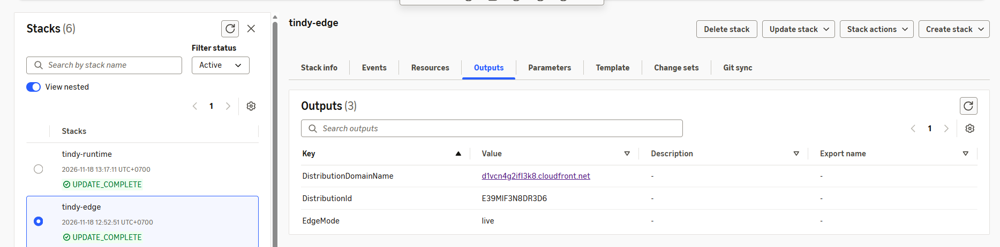

Request HTTPS tới `/api/health/ready` đã trả **HTTP/1.1 200 OK** và body:

```json
{"status":"Healthy","service":"Tindy API"}
```

Response ghi nhận Server Kestrel, Via CloudFront, X-Cache Miss from cloudfront và Cache-Control no-store, no-cache. Đây là bằng chứng readiness API đã đi qua hostname CloudFront sau khi chuyển live. Các luồng đăng nhập, media, AI PDF và frontend chưa được xác nhận bằng kiểm tra này.

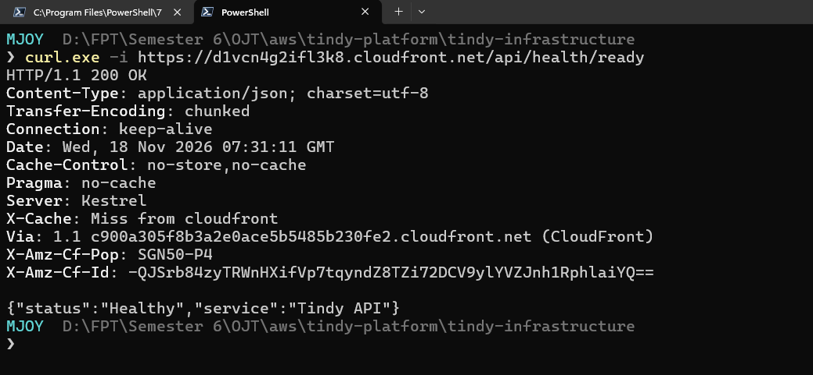

Tiếp theo kiểm tra frontend trên cùng hostname, đối chiếu OAuth callbacks và cấu hình phát hành frontend theo URL mới. Alarm dimensions của Integrations và AI PDF vẫn cần hoàn thiện theo các bước riêng.

## 7. Frontend hiển thị trang đăng nhập

Ảnh trình duyệt ghi nhận trang đăng nhập Tindy đã render với logo, nội dung giới thiệu, các ô Email or Username/Password, nút Sign in và Google/GitHub. Đây là bằng chứng giao diện trang đăng nhập hiển thị. Chưa xác nhận đăng nhập mật khẩu hoặc OAuth thành công.

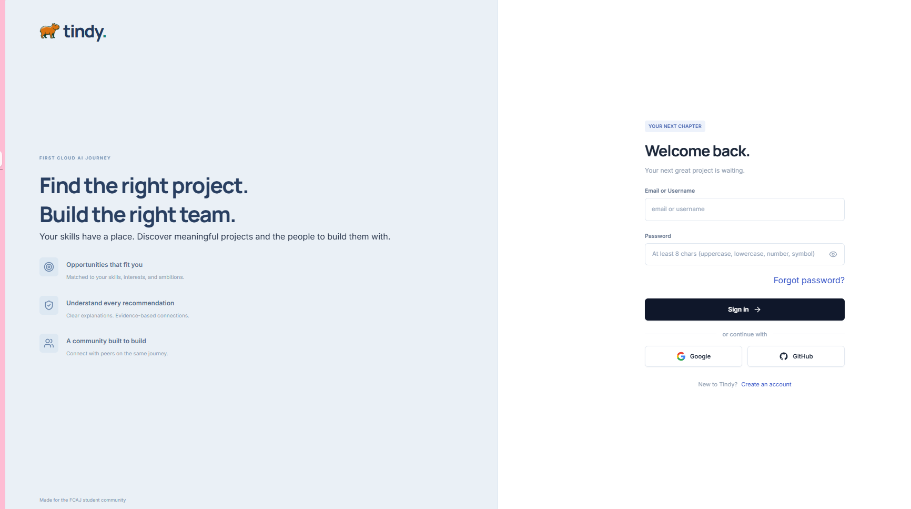

### Kiểm tra đăng nhập tài khoản demo

Theo cấu hình dataset trong mã nguồn backend, dùng tài khoản `demo20` hoặc `demo20@tindy.test` cùng mật khẩu đã cấp cho seed qua secret `tindy/database/seed-password`. Có thể xem giá trị bằng Secrets Manager → chọn secret → Retrieve secret value để nhập trực tiếp vào giao diện. Giữ mật khẩu ngoài ảnh workshop và các file tài liệu.

Bấm Sign in, kiểm tra trang sau đăng nhập và dữ liệu dự án có tải được. **📸 Chụp trang sau đăng nhập**, hoặc thông báo lỗi nếu có. Số lượng dự án thực tế và các thao tác ứng dụng sẽ được đối chiếu khi thực hiện, chưa được xác nhận trong ảnh trang đăng nhập này. OAuth Google/GitHub cần kiểm tra riêng với callback của hostname mới.

## 8. Đăng nhập và Discover Projects đã đạt

Sau bước đăng nhập bằng tài khoản demo, frontend hiển thị trang Discover Projects và hồ sơ `Nguyễn Minh An (Demo)`. Ảnh ghi nhận thẻ `Student Marketplace [Demo]`, vị trí Backend Developer, hai slot mở, kỹ năng ASP.NET Core/C#, cùng Rule-based match **93%** và bảng giải thích các yếu tố điểm.

Your overview hiển thị **Loaded 20**. Đây là số mục đã tải trong giao diện tại thời điểm chụp, chưa phải bằng chứng tổng số dự án trong database. Ảnh xác nhận phiên đăng nhập và dữ liệu Discovery hiển thị. Chưa xác nhận các thao tác Apply/Save, tải trang để kiểm tra duy trì phiên, Find Teammates hoặc OAuth.

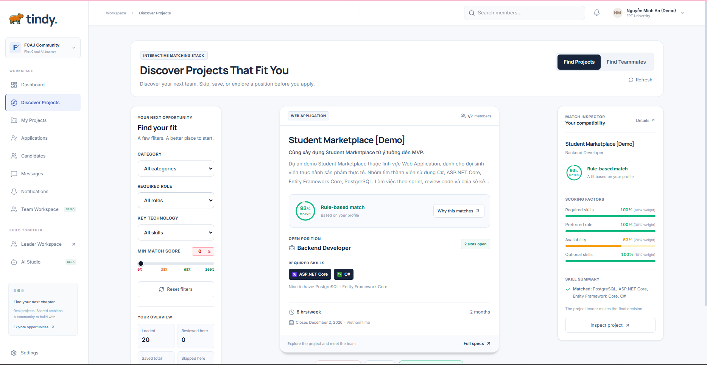

Bước kiểm tra tiếp theo: tải lại trang để kiểm tra phiên còn hoạt động, mở **Full specs** trên thẻ dự án để kiểm tra chi tiết, rồi chuyển sang **Find Teammates** để xem danh sách thành viên. **📸 Chụp trang chi tiết dự án và Find Teammates sau khi tải dữ liệu.**

## 9. Chi tiết dự án và Find Teammates hiển thị dữ liệu

Trang Project Details tải `Student Marketplace [Demo]`, trạng thái recruiting, leader `Trần Thu Hà (Demo)`, 1/7 members, mô tả, mục tiêu và technology stack. Giao diện cũng hiển thị các nút Apply to Position, Save và Message leader. Ảnh xác nhận dữ liệu chi tiết hiển thị, chưa xác nhận đã thực hiện các thao tác ghi dữ liệu này.

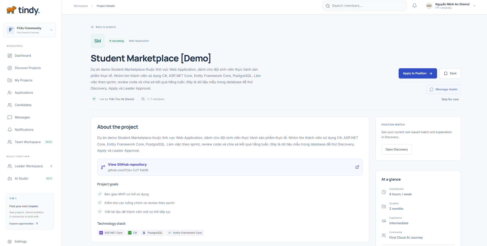

Find Teammates hiển thị dự án `Campus Room Booking [Demo]`, vị trí Backend Developer có hai slot mở, thẻ ứng viên `Phan Nhật Minh (Demo)` và **55% Position Match**. Match inspector hiển thị required skills 0%, preferred role 100%, availability 100% và optional skills 50%. Your overview ghi nhận Loaded 19 tại thời điểm chụp.

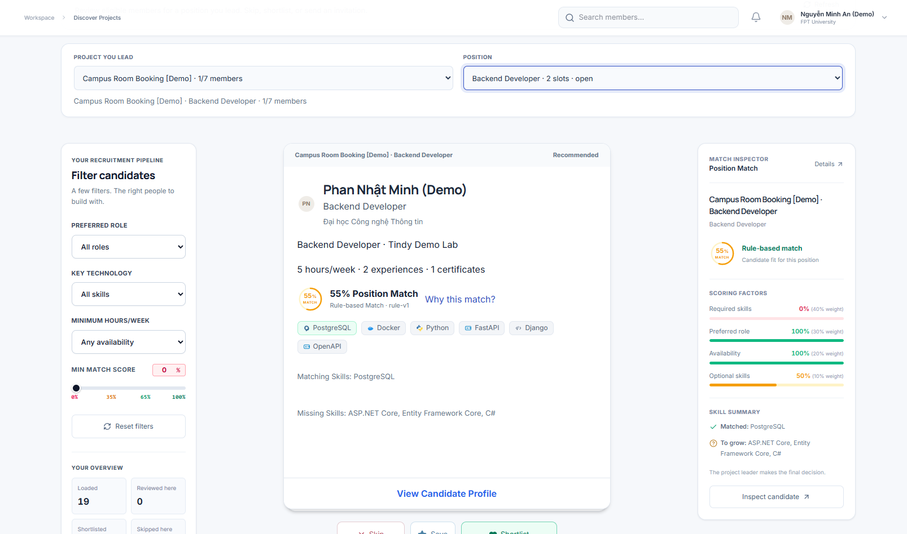

Hai trang đã tải được dữ liệu qua giao diện đăng nhập. Ảnh không chứng minh riêng thao tác F5 đã được thực hiện hoặc toàn bộ 50 dự án đã được truy vấn. Apply, Save, Shortlist, Invite, OAuth và media/AI vẫn cần kiểm tra riêng theo phạm vi demo.
