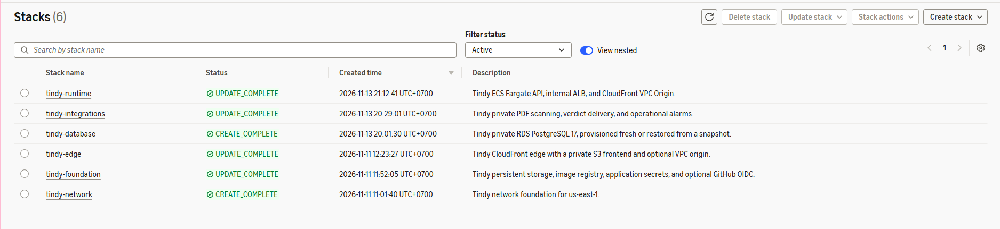
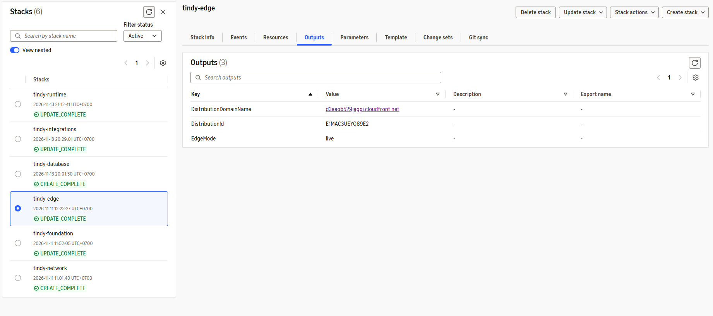

## Record the existing stacks

1. Open **CloudFormation → Stacks** in `us-east-1`, select **Active**, and filter for `tindy`.
2. Confirm all six stacks exist. Foundation, Integrations, Runtime and Edge initially report `UPDATE_COMPLETE`. Network and Database report `CREATE_COMPLETE`. Finish active updates before proceeding.

**📸 Capture the six stack names and status.**

3. Open **tindy-edge → Outputs**, record `DistributionId`, `DistributionDomainName` and `EdgeMode`, initially `live`.

