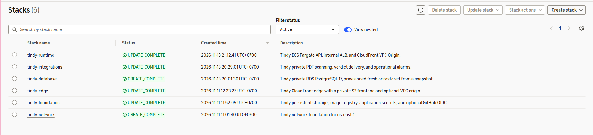
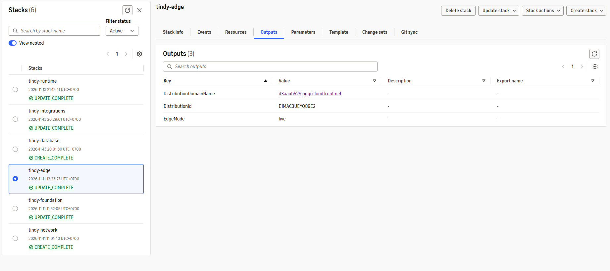

## Kiểm tra các stack trước cleanup

1. Mở AWS Console, chọn **N. Virginia (`us-east-1`)**.
2. Vào **CloudFormation → Stacks**, chọn bộ lọc **Active**, tìm `tindy`.
3. Kiểm tra đủ sáu stack và chờ các thao tác đang chạy hoàn tất trước khi thay đổi hạ tầng.

| Stack | Template | Trạng thái ban đầu |
| --- | --- | --- |
| `tindy-foundation` | `foundation.yaml` | `UPDATE_COMPLETE` |
| `tindy-network` | `network.yaml` | `CREATE_COMPLETE` |
| `tindy-database` | `database.yaml` | `CREATE_COMPLETE` |
| `tindy-integrations` | `integrations.yaml` | `UPDATE_COMPLETE` |
| `tindy-runtime` | `runtime.yaml` | `UPDATE_COMPLETE` |
| `tindy-edge` | `edge.yaml` | `UPDATE_COMPLETE` |

**📸 Chụp danh sách sáu stack cùng cột Status trước cleanup.**

4. Mở **tindy-edge → Outputs**, ghi lại `DistributionId`, `DistributionDomainName` và `EdgeMode`. Edge ban đầu ở chế độ `live`. Giữ hostname để gọi kiểm tra maintenance.

