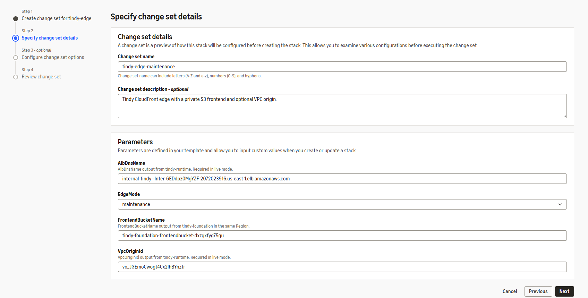
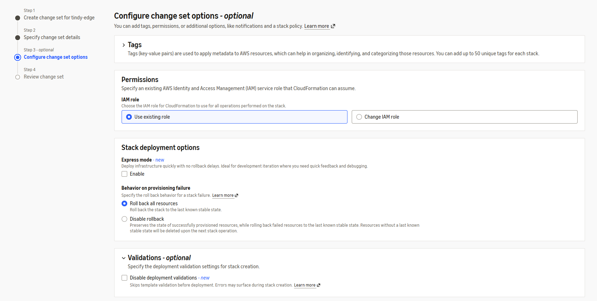
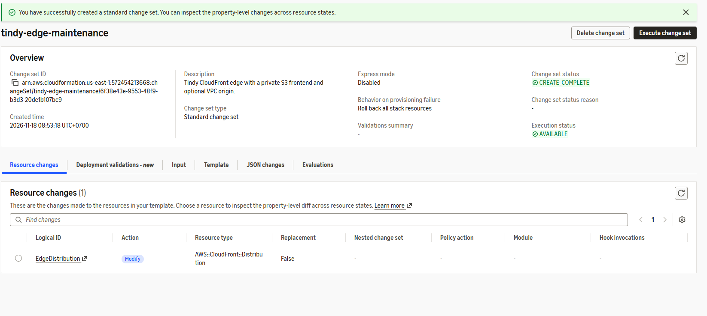
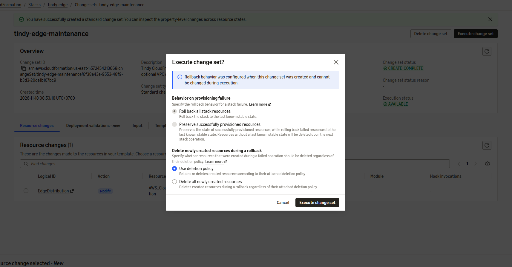
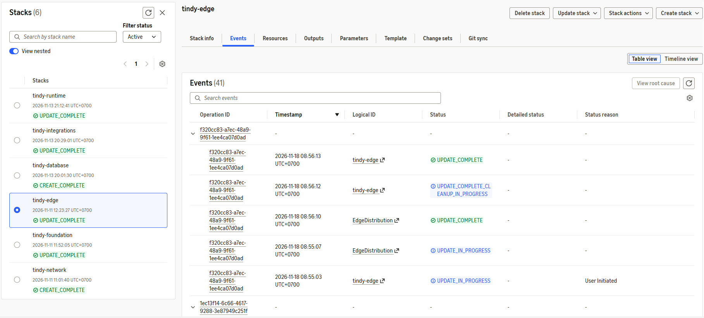
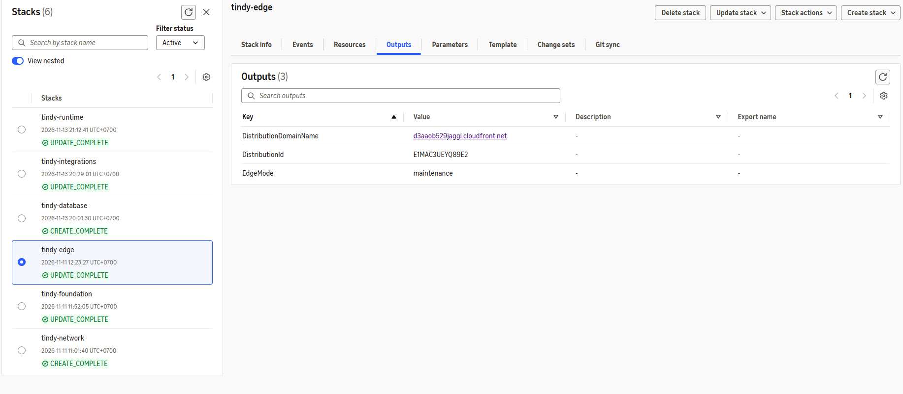
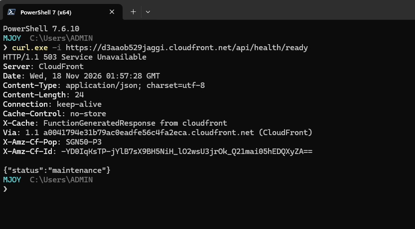

## Chuyển CloudFront sang maintenance

`edge.yaml` sử dụng `EdgeMode` để điều khiển backend origin và hành vi API. Chuyển sang maintenance sẽ gỡ backend origin khỏi distribution và cho CloudFront trả phản hồi bảo trì trước khi tháo VPC Origin của Runtime.

1. Trong **tindy-edge**, chọn **Stack actions → Create change set for current stack**.
2. Chọn **Standard change set**, **Use existing template**, rồi **Next**.
3. Đặt tên `tindy-edge-maintenance`.
4. Đổi `EdgeMode = maintenance`. Giữ các giá trị hiện tại của `FrontendBucketName`, `AlbDnsName` và `VpcOriginId`. Điều kiện trong template quyết định việc gỡ backend origin.

**📸 Chụp tham số trước khi tạo Change Set.**



5. Giữ **Use existing role**, Express mode bỏ chọn, **Roll back all resources** và deployment validations bật. Tạo Change Set.



6. Chờ `CREATE_COMPLETE` và execution status `AVAILABLE`.
7. Trong Resource changes, xác nhận duy nhất `EdgeDistribution → Modify → Replacement = False`.

**📸 Chụp Resource changes trước khi Execute.**



8. Bấm **Execute change set**, giữ **Use deletion policy** và xác nhận.



9. Mở **Events**, Refresh đến khi `tindy-edge — UPDATE_COMPLETE`.



10. Mở **Outputs**, xác nhận `EdgeMode = maintenance`.



11. Trong PowerShell, thay `<cloudfront-hostname>` bằng `DistributionDomainName` đã lưu và chạy lệnh sau.

```powershell
curl.exe -i "https://<cloudfront-hostname>/api/health/ready"
```

Kết quả đã xác minh gồm HTTP `503 Service Unavailable`, `Server: CloudFront`, `Cache-Control: no-store` và JSON `{"status":"maintenance"}`.

**📸 Chụp lệnh, mã HTTP và JSON phản hồi trong cùng khung hình.**


