## Chuẩn bị Runtime trước khi xóa

`runtime.yaml` quản lý ECS Fargate API, internal ALB và CloudFront VPC Origin. Rule `AlbIngressFromCloudFront` ban đầu tham chiếu security group do CloudFront quản lý. Chuyển nguồn rule sang CloudFront origin-facing prefix list để gỡ dependency trước khi xóa Runtime.

1. Mở **tindy-runtime → Outputs**, ghi lại cluster, service, task definition, ALB, target group và VPC Origin.

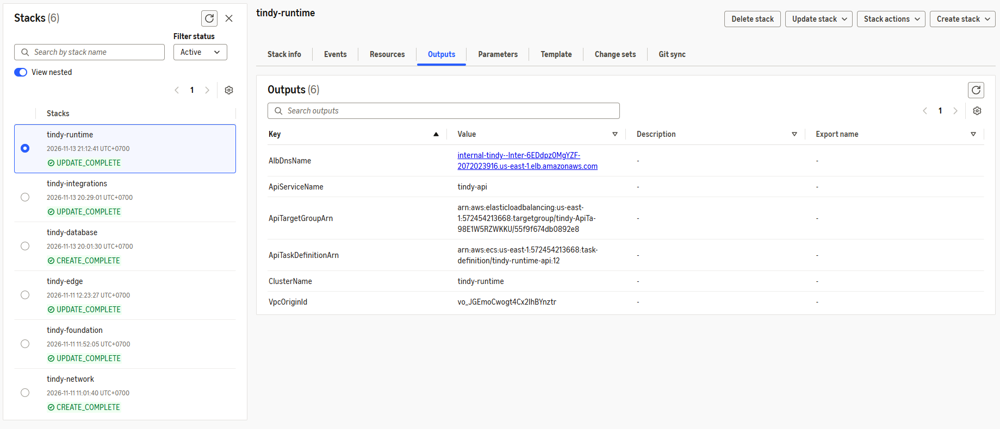

2. Chọn **Stack actions → Create change set for current stack**, dùng **Standard change set** và **Use existing template**.

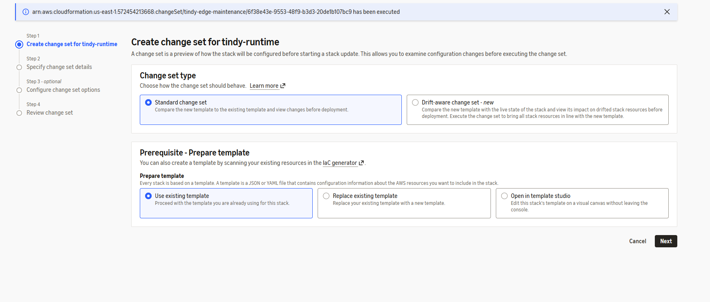

3. Đặt tên `tindy-runtime-prepare-delete`.
4. Xóa giá trị `CloudFrontServiceSecurityGroupId` để ô này rỗng. Giữ các tham số còn lại theo stack hiện tại.

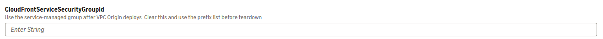

5. Điền `CloudFrontOriginPrefixListId`. Lượt thực hành đã đối chiếu giá trị `pl-3b927c52`. Ở môi trường khác, tra IPv4 managed prefix list `com.amazonaws.global.cloudfront.origin-facing` tại Region triển khai.

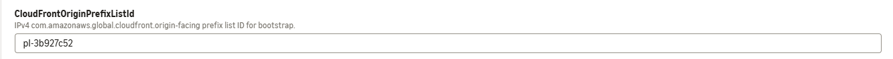

6. Xác nhận IAM capabilities theo yêu cầu, giữ Express mode tắt và rollback bật, rồi tạo Change Set.

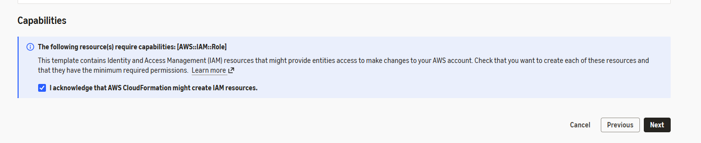

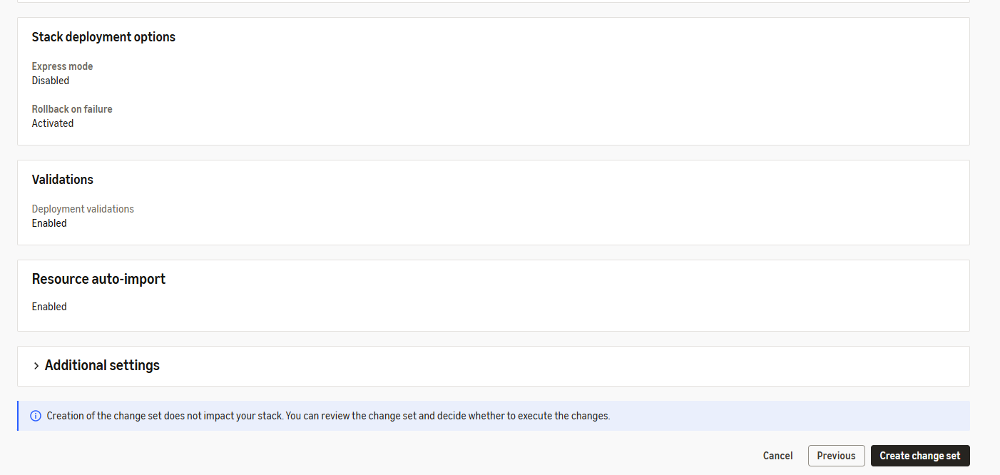

7. Chờ `CREATE_COMPLETE` và `AVAILABLE`. Kiểm tra duy nhất `AlbIngressFromCloudFront → Modify → Replacement = True`. Policy action `ReplaceAndDelete` trong ảnh áp dụng cho rule ingress này.

**📸 Chụp thay đổi rule trước khi Execute.**

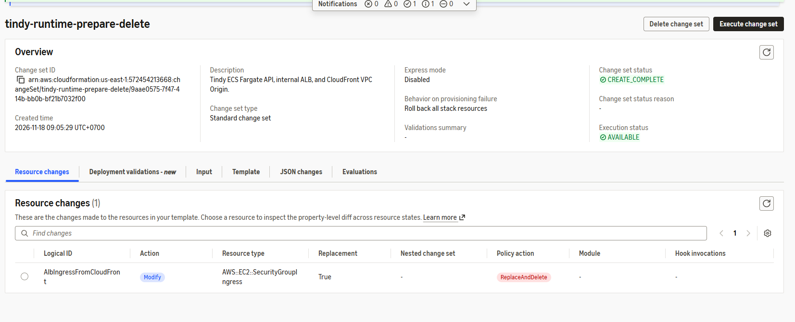

8. Execute, giữ **Use deletion policy** và theo dõi Events. Ảnh dưới ghi nhận thời điểm bắt đầu cập nhật.

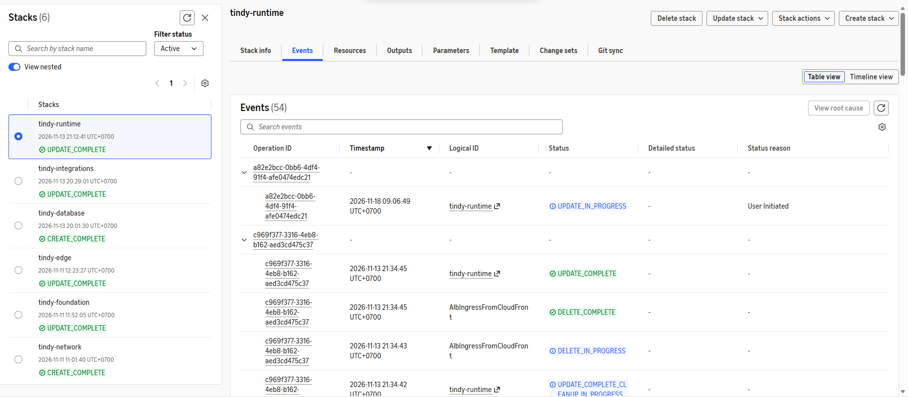

9. Refresh đến khi stack `UPDATE_COMPLETE`. Trong **Resources**, kiểm tra `AlbIngressFromCloudFront` cập nhật thành công.

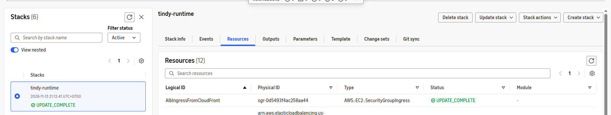

10. Vào **tindy-network → Resources → AlbSecurityGroup**, mở Physical ID để sang EC2 Security Groups.
11. Trong **Inbound rules**, xác nhận HTTP, TCP 80 có Source là `pl-3b927c52`.

**📸 Chụp security group ALB cùng protocol, port và source của rule.**

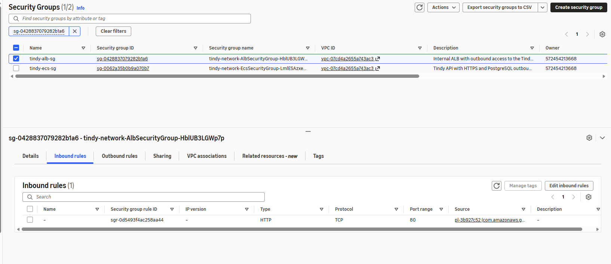

Nếu Console báo không có thay đổi trong khi rule vẫn trỏ tới service security group, cần truyền giá trị rỗng tường minh bằng CLI. Lượt thực hành này đã cập nhật thành công qua Console.

## Xóa Runtime

1. Quay lại **CloudFormation → tindy-runtime → Delete stack**.
2. Nhập `tindy-runtime` vào ô xác nhận, để **Express mode** bỏ chọn.

**📸 Chụp hộp thoại trước khi xác nhận xóa.**

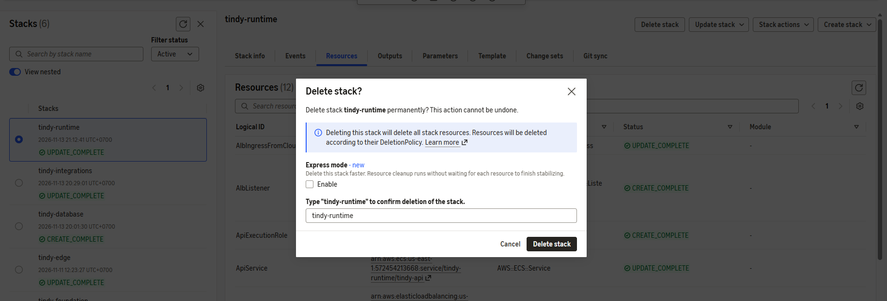

3. Bấm **Delete stack**, theo dõi **Events**.
4. Nếu stack biến mất khỏi danh sách Active, đổi **Filter status → Deleted** và chọn đúng stack theo thời gian của lượt vừa xóa.
5. Xác nhận dòng stack `tindy-runtime — DELETE_COMPLETE`.

**📸 Chụp dòng stack xóa hoàn tất.** Ảnh còn ghi nhận internal ALB và runtime log group đã xóa.

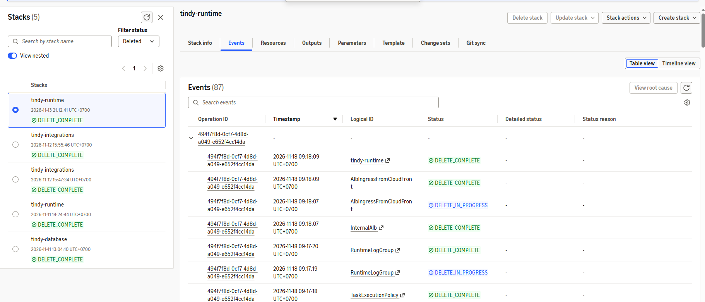

Nếu có `DELETE_FAILED`, đọc Logical ID và Status reason để xác định tài nguyên hoặc dependency cần xử lý trước khi thử lại.
