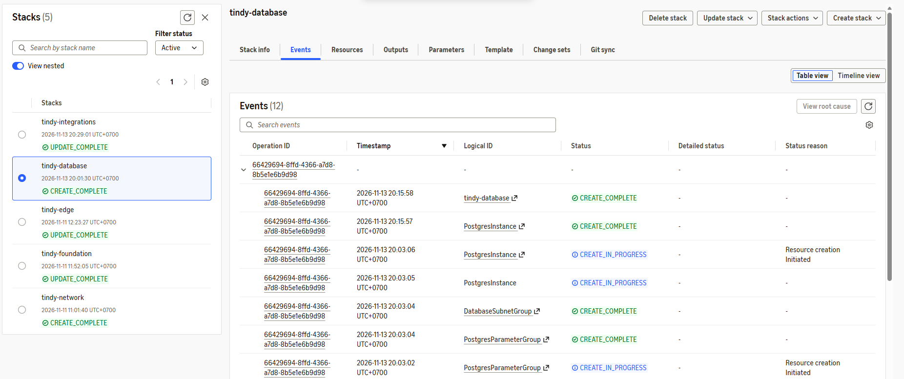
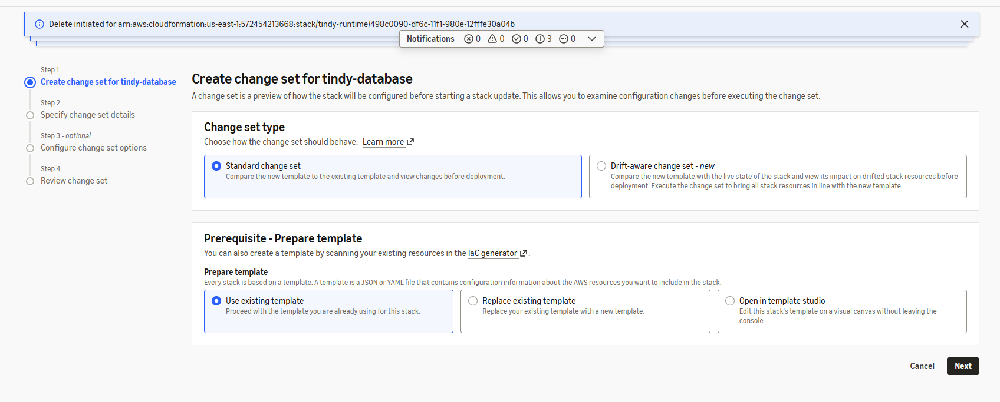
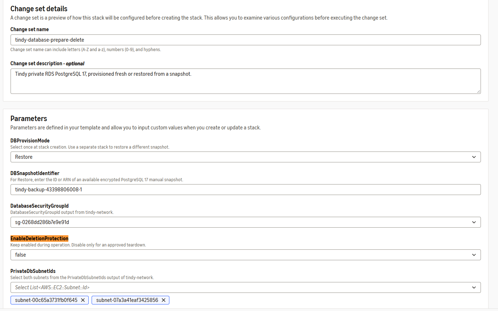
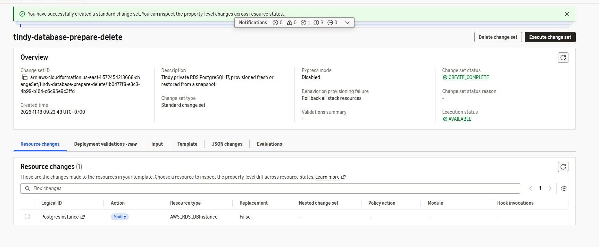
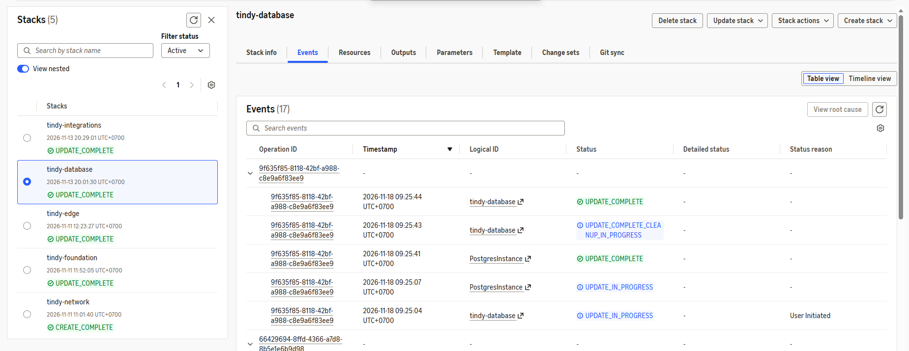
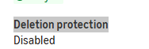
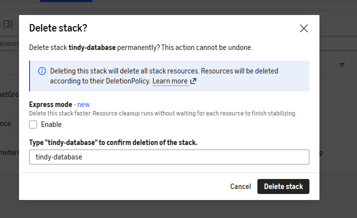
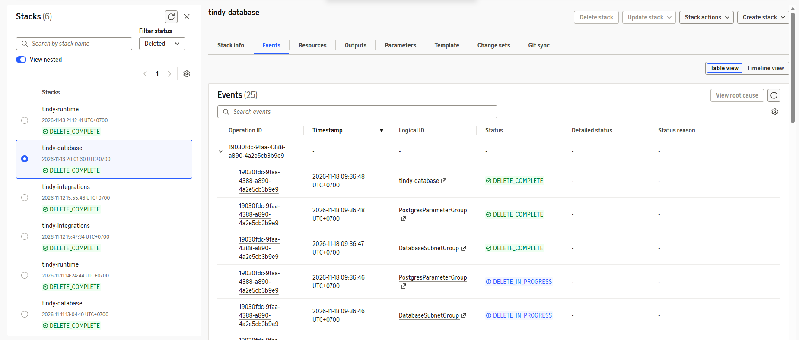

## Tắt deletion protection và chuẩn bị xóa Database

`database.yaml` cung cấp tham số `EnableDeletionProtection`. DB instance hiện có `DeletionPolicy: Snapshot` và `UpdateReplacePolicy: Snapshot`.

1. Chuyển bộ lọc về **Active** và chọn **tindy-database**.

2. Tạo **Standard change set** với **Use existing template**.

3. Đặt tên `tindy-database-prepare-delete`.
4. Đổi `EnableDeletionProtection = false`, giữ các tham số khác. DB hiện tại dùng `DBProvisionMode = Restore` và có `DBSnapshotIdentifier`. Giữ hai giá trị đó trong cập nhật chuẩn bị xóa. Chọn `Fresh` khi tạo stack mới.

**📸 Chụp bảng tham số sau khi tắt deletion protection.**

5. Giữ các Options, tạo Change Set và chờ hoàn tất.
6. Kiểm tra duy nhất `PostgresInstance → Modify → Replacement = False`.

7. Execute, giữ **Use deletion policy**, chờ `tindy-database — UPDATE_COMPLETE`.

8. Trong **Resources**, mở Physical ID của `PostgresInstance` để sang RDS.
9. Mở **Configuration**, xác nhận **Deletion protection = Disabled**. Ảnh hiện có là phần chụp cận trường này.

10. Quay lại **CloudFormation → tindy-database → Delete stack**, nhập tên stack và để Express mode bỏ chọn.

**📸 Chụp hộp thoại xác nhận trước khi xóa.**

11. Bấm **Delete stack** và theo dõi **Events**. Template yêu cầu tạo snapshot trước khi xóa DB instance.
12. Khi stack biến mất khỏi danh sách Active, đổi **Filter status → Deleted**, chọn đúng stack theo thời gian của lượt vừa xóa.
13. Xác nhận dòng stack `tindy-database — DELETE_COMPLETE`. Ảnh ghi nhận cả `DatabaseSubnetGroup` và `PostgresParameterGroup` đã xóa hoàn tất.

**📸 Chụp dòng stack xóa hoàn tất.**

Database đã xóa thành công. Trạng thái snapshot phát sinh khi xóa cần kiểm tra riêng trong RDS Snapshots nếu dùng cho việc lưu trữ hoặc dọn dẹp sau này.
