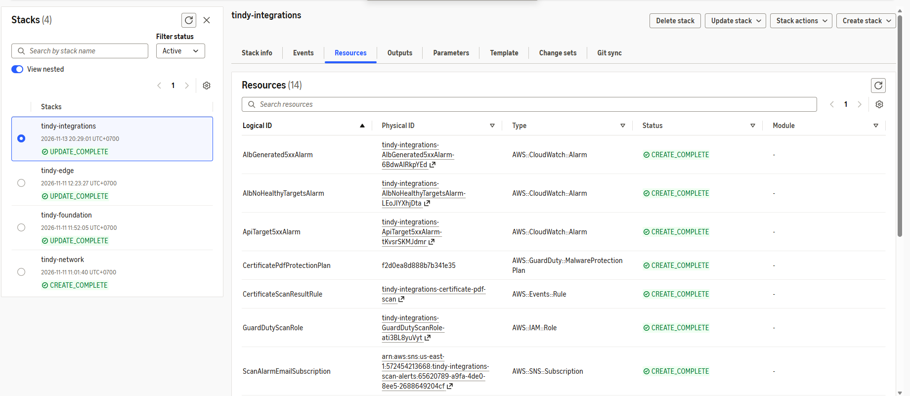
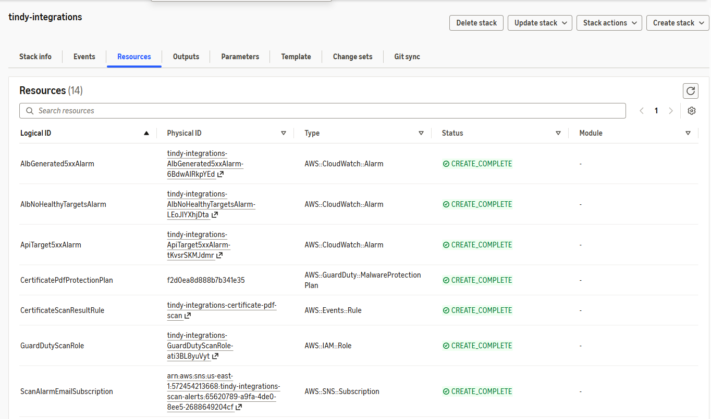
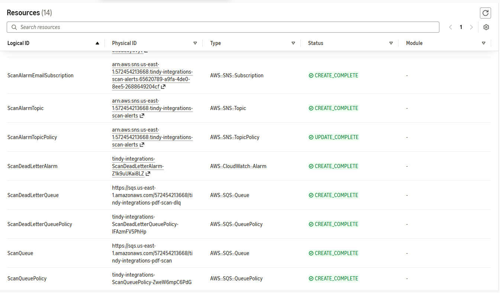
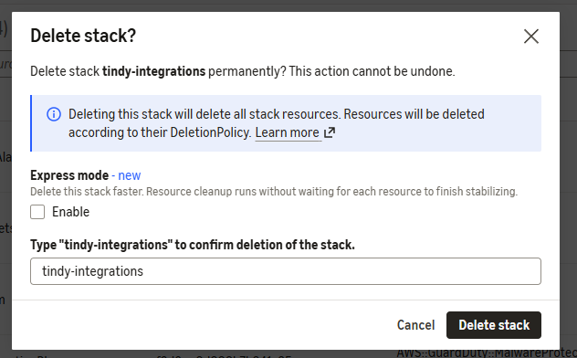
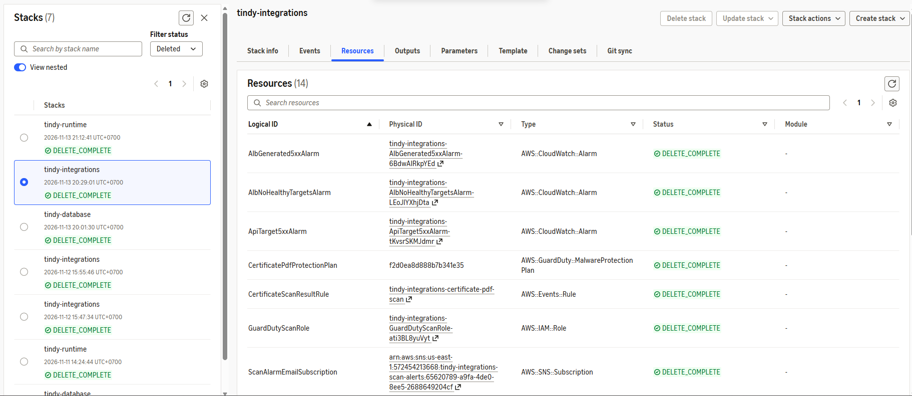

## Kiểm tra và xóa Integrations

Sau khi Runtime và Database đã xóa, chuyển bộ lọc **CloudFormation → Stacks → Active** và chọn **tindy-integrations → Resources**. Stack đang có 14 tài nguyên và trạng thái `UPDATE_COMPLETE`.

`integrations.yaml` quản lý GuardDuty Malware Protection plan, IAM role quét PDF, EventBridge rule gửi kết quả, SQS queue chính và DLQ cùng queue policy, SNS topic/policy/subscription và các CloudWatch alarm. Các alarm ALB vẫn là tài nguyên của Integrations dù Runtime đã được tháo.

1. Đối chiếu tên stack và danh sách Resources trước khi xóa.
2. Cuộn danh sách để ghi đủ các tài nguyên quét PDF, cảnh báo và hàng đợi.

**📸 Chụp tên stack và trạng thái, sau đó chụp phần trên và phần dưới danh sách Resources.**

3. Trước thời điểm ghi các ảnh này, đã kiểm tra bằng AWS CLI cả `tindy-integrations-pdf-scan` và `tindy-integrations-pdf-scan-dlq`. Các chỉ số visible, in flight và delayed đều bằng `0` ở lần đọc đó. Đây là số liệu xấp xỉ tại thời điểm kiểm tra.

4. Bấm **Delete stack**, kiểm tra đúng tên `tindy-integrations`, nhập tên xác nhận và để **Express mode** bỏ chọn.

**📸 Chụp hộp thoại trước khi xác nhận xóa.**

5. Xác nhận xóa và theo dõi trạng thái. Khi stack biến mất khỏi Active, chuyển bộ lọc sang **Deleted** và chọn đúng lượt có thời gian tạo **13/11/2026 20:29:01 UTC+07**.
6. Xác nhận stack `tindy-integrations — DELETE_COMPLETE`. Ảnh tại tab **Resources** ghi nhận các alarm, protection plan, EventBridge rule, IAM role và SNS subscription hiển thị đều đã xóa.

**📸 Chụp trạng thái stack và các tài nguyên sau xóa.**

Integrations đã xóa thành công. Tiếp theo là Edge, Network và Foundation.
