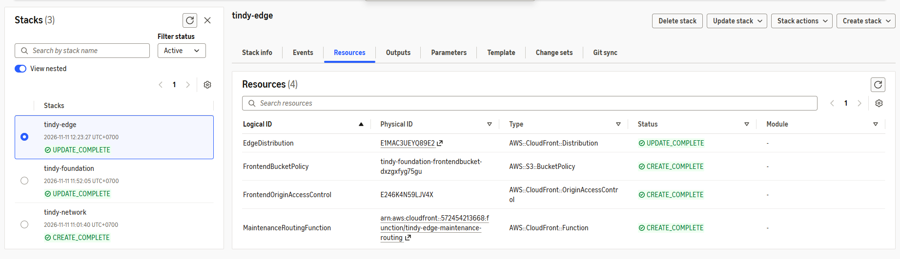
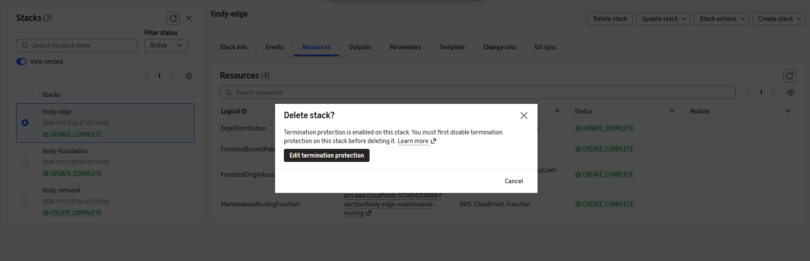
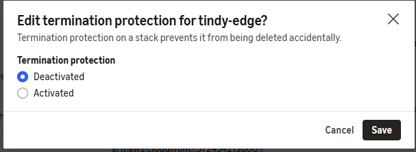
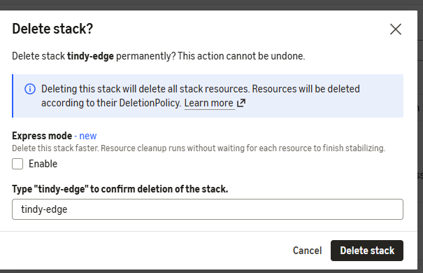
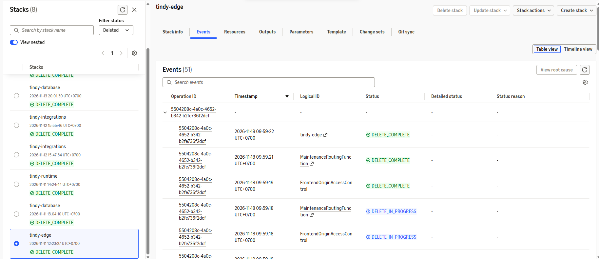

## Chuẩn bị xóa Edge và xử lý termination protection

Sau khi Integrations đã xóa, chọn **CloudFormation → Stacks → Active → tindy-edge → Resources**. Stack có bốn tài nguyên gồm `EdgeDistribution`, `FrontendBucketPolicy`, `FrontendOriginAccessControl` và `MaintenanceRoutingFunction`.

**📸 Chụp danh sách tài nguyên trước khi xóa.**

Khi chọn **Delete stack**, Console báo stack đang bật **termination protection** và yêu cầu tắt trước khi xóa.

1. Bấm **Edit termination protection** trong thông báo.
2. Kiểm tra tiêu đề hiển thị đúng `tindy-edge`, chọn **Deactivated**.

**📸 Chụp lựa chọn Deactivated trước khi bấm Save.**

3. Bấm **Save** để áp dụng, sau đó mở lại **Delete stack**.

4. Sau khi lưu, chọn **Delete stack**, nhập `tindy-edge` và để Express mode bỏ chọn.

**📸 Chụp hộp thoại trước khi xác nhận xóa.**

5. Bấm **Delete stack**, theo dõi Events. Khi stack biến mất khỏi Active, đổi bộ lọc sang **Deleted** và chọn đúng lượt có thời gian tạo **11/11/2026 12:23:27 UTC+07**.
6. Xác nhận `tindy-edge — DELETE_COMPLETE`. Ảnh Events cũng ghi nhận `MaintenanceRoutingFunction` và `FrontendOriginAccessControl` xóa hoàn tất.

**📸 Chụp dòng stack xóa hoàn tất.**

Edge đã xóa thành công. Lượt triển khai tiếp theo sẽ tạo CloudFront distribution mới và cập nhật cấu hình ứng dụng theo hostname mới.
