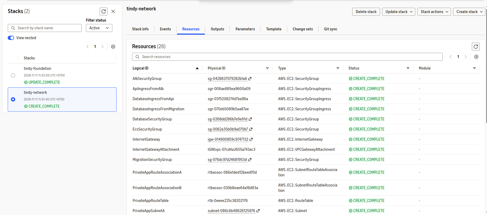
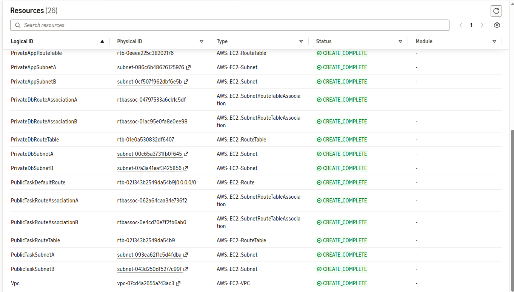
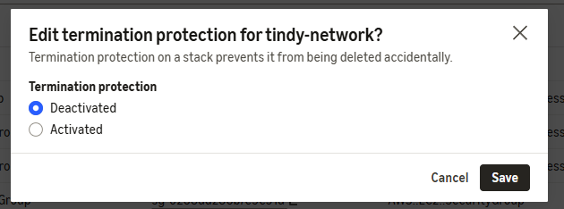
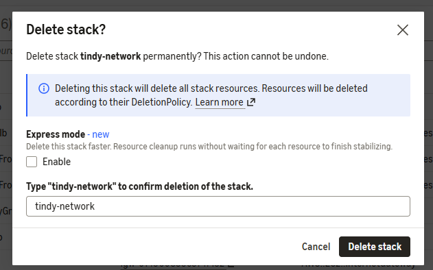
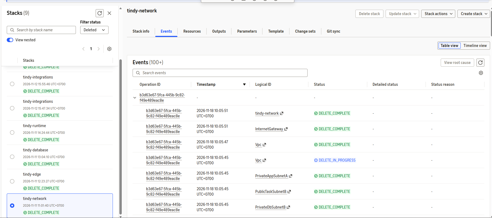

## Chuẩn bị xóa Network

Sau khi Runtime, Database, Integrations và Edge đã xóa, kiểm tra phụ thuộc của VPC trước khi tháo Network. Lần đọc AWS CLI trước thao tác này trả về danh sách network interface rỗng cho VPC Tindy. Network đang bật termination protection.

1. Chọn **CloudFormation → Stacks → Active → tindy-network → Resources**.
2. Kiểm tra danh sách 26 tài nguyên của `network.yaml`, gồm VPC, Internet Gateway và attachment, các subnet, route table, route, subnet association, security group và ingress rule.

**📸 Chụp phần trên và dưới danh sách tài nguyên.**

3. Chọn **Stack actions → Edit termination protection**, kiểm tra đúng `tindy-network` và chọn **Deactivated**.

**📸 Chụp lựa chọn trước khi lưu.**

4. Bấm **Save**, mở lại **Delete stack**, nhập `tindy-network` và để Express mode bỏ chọn.

**📸 Chụp hộp thoại xác nhận xóa.**

5. Bấm **Delete stack** và theo dõi **Events**. Khi stack biến mất khỏi Active, chuyển bộ lọc sang **Deleted** và chọn đúng `tindy-network`.
6. Xác nhận dòng stack `tindy-network — DELETE_COMPLETE`. Ảnh cũng ghi nhận VPC và Internet Gateway đã xóa hoàn tất.

**📸 Chụp dòng stack xóa hoàn tất.**

Network đã xóa thành công. Nếu gặp `DELETE_FAILED` ở một lượt thực hành khác, đọc Logical ID và Status reason để xử lý dependency trước khi thử lại.
