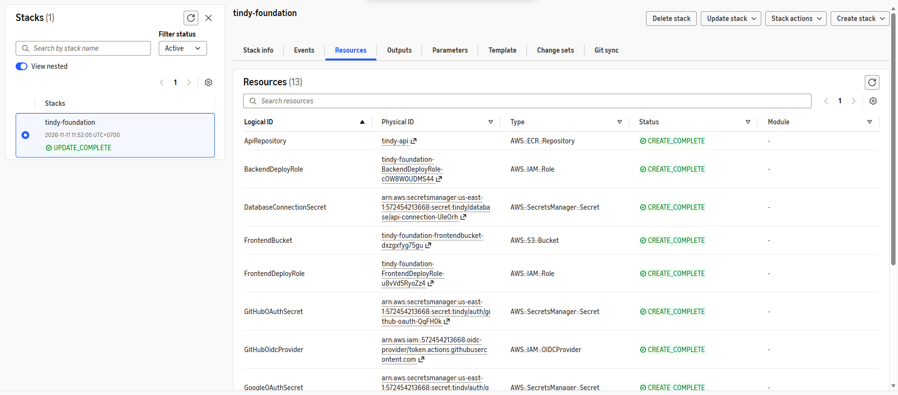
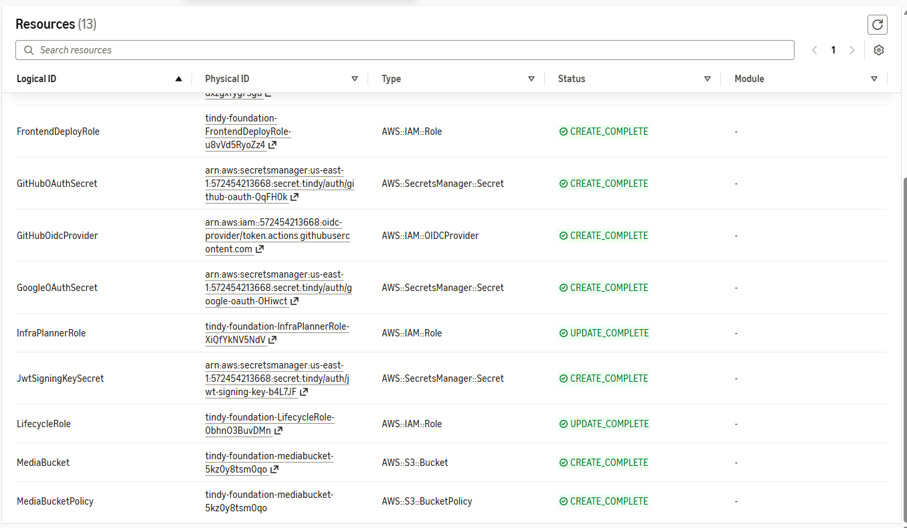
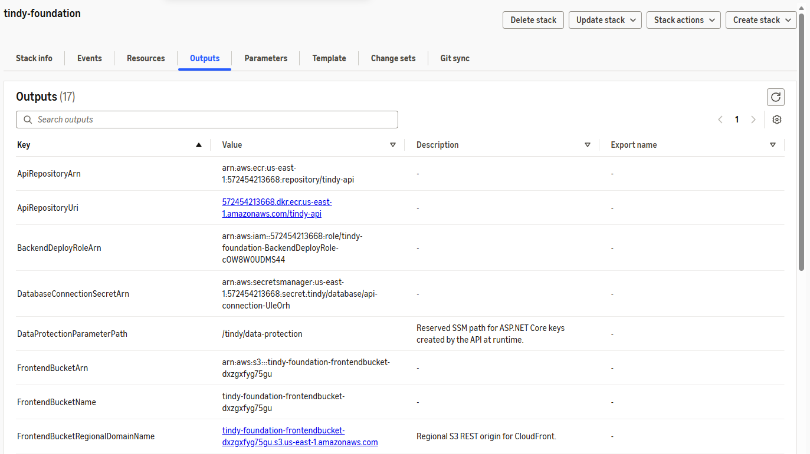
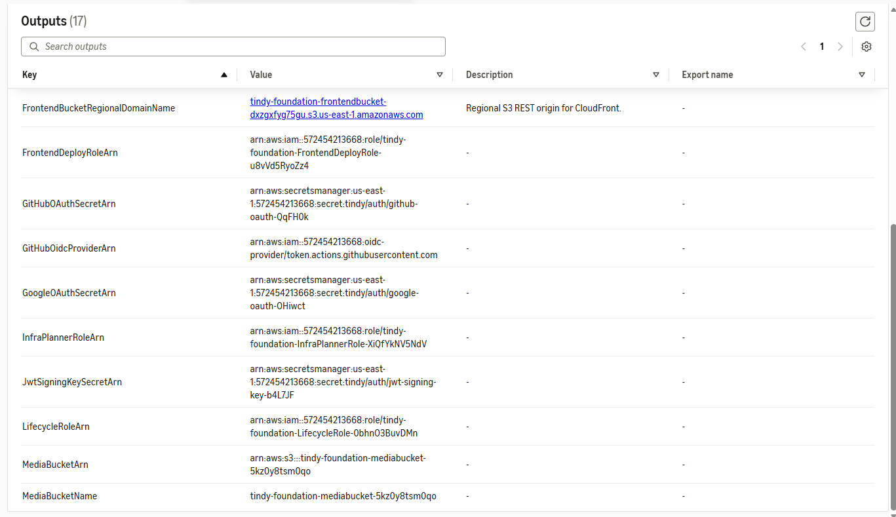
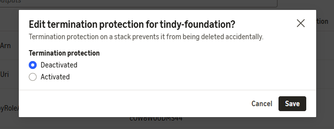
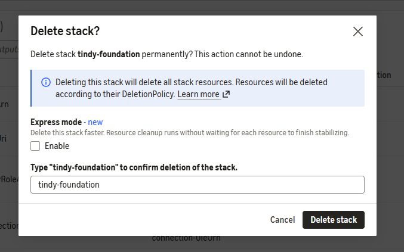
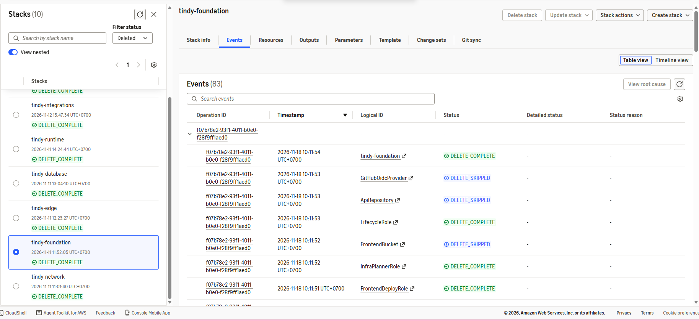

## Lưu cấu hình Foundation trước khi xóa

Sau khi Network xóa hoàn tất, đã xuất bằng AWS CLI cấu hình stack Foundation vào thư mục vận hành `backup/tindy-foundation-before-cleanup` trong Worklog. Các file gồm `resources.json`, `stack-metadata.json`, `deployed-template.json` và `retained-resource-mapping.csv`. Đây là bản ghi phục vụ import, nằm ngoài thư mục static của website.

Stack Foundation hiện có 13 tài nguyên và termination protection đang bật. Đã đối chiếu template đang triển khai có chín tài nguyên dùng `RetainExceptOnCreate`, gồm hai bucket S3, media bucket policy, ECR repository, bốn application secret và GitHub OIDC provider. Bốn IAM role triển khai/vận hành còn lại sẽ bị xóa theo template khi tháo stack. Mapping đã lưu logical ID, resource type và physical ID của chín tài nguyên cần import lại.

1. Mở **CloudFormation → Stacks → Active → tindy-foundation → Resources**. Đối chiếu 13 tài nguyên với mapping đã xuất.

**📸 Chụp phần trên và dưới của Resources.**

2. Mở **Outputs**, ghi nhận 17 Outputs gồm các tham chiếu ECR, S3, secrets, OIDC, IAM role và path Data Protection. `DataProtectionParameterPath` là đường dẫn SSM dự kiến dùng bởi API. Các key do API tạo ở runtime cần được quản lý riêng với danh sách tài nguyên của stack.

**📸 Chụp cả hai phần của Outputs.**

3. Chọn **Stack actions → Edit termination protection**, kiểm tra đúng `tindy-foundation`, chọn **Deactivated** rồi lưu.

**📸 Chụp lựa chọn Deactivated trước khi Save.**

4. Chọn **Delete stack**, nhập `tindy-foundation` và để Express mode bỏ chọn.

**📸 Chụp hộp thoại trước khi xác nhận xóa.**

5. Bấm **Delete stack** và theo dõi Events. Khi stack biến mất khỏi Active, chuyển sang **Deleted** và chọn đúng stack Foundation.
6. Xác nhận `tindy-foundation — DELETE_COMPLETE`. Các dòng `DELETE_SKIPPED` cho biết CloudFormation giữ tài nguyên theo chính sách template. Trong ảnh có GitHub OIDC provider, ECR repository và frontend bucket được giữ, còn các role hiển thị đã xóa.

**📸 Chụp dòng stack hoàn tất và các trạng thái DELETE_SKIPPED.**

Cả sáu stack của lượt thực hành đã xóa thành công. Khi dựng lại, dùng mapping đã lưu để đưa tài nguyên Foundation được giữ vào stack mới. Kiểm tra tài nguyên còn tồn tại và đối chiếu cấu hình trước khi import.
