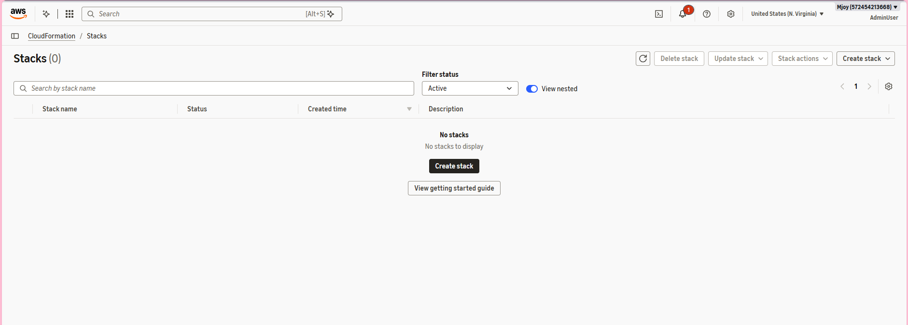

## Kết quả cleanup và chuẩn bị triển khai lại

Đã xác minh `DELETE_COMPLETE` của Runtime, Database, Integrations, Edge, Network và Foundation. Việc dựng lại sẽ bắt đầu từ Foundation, dùng resource import cho các tài nguyên được giữ. Database mới chọn Fresh rồi chạy bootstrap, migration và seed dữ liệu demo.

Snapshot RDS, S3, ECR, secrets, OIDC provider và các dữ liệu runtime ngoài stack cần được kiểm kê riêng. Các tài nguyên giữ lại có thể tiếp tục phát sinh phí. Thư mục backup lưu mapping và cấu hình trước xóa phục vụ quá trình dựng lại.

Trước khi xuất bản, rà account ID và thông tin hiển thị trong ARN trên ảnh. Phần triển khai tiếp theo sẽ được ghi vào các mục tương ứng của workshop cùng ảnh thực hành.

Sau khi xóa cả sáu stack, chọn bộ lọc **Active**. Danh sách trống xác nhận môi trường hiện không còn stack hoạt động tại Region này.

